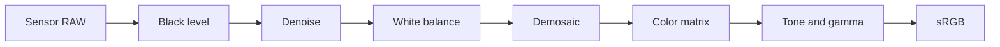

<!-- Generated by scripts/build.py from data/*.yaml. Edit the YAML files, not this file. -->

# Awesome Neural ISP 

**Neural (learned) camera ISPs with released code and pretrained weights, plus a primer on the classical pipeline they build on.**

     

**[English](README.md) · [简体中文](README.zh-CN.md) · [Interactive page](https://ruilin.li/Awesome-Neural-ISP/) · [Weights index](WEIGHTS.md) · [ISP 101](guide/isp-101.md) · [Contributing](CONTRIBUTING.md)**

A curated list of research on neural (learned) camera image signal processors (ISPs). It covers learned replacements for each stage of the classical pipeline (denoising, demosaicing, white balance, color and tone), end-to-end RAW-to-sRGB networks, controllable neural ISPs, inverse ISPs, ISPs for machine vision, and ISP tuning. For every paper the list records whether code and pretrained weights are public, and links the weights exactly as the official repository does.

It currently holds **417 unique publications**, of which **206 have public code** and **133 release pretrained weights**, plus 29 datasets. The [interactive page](https://ruilin.li/Awesome-Neural-ISP/) has the same data with filters for task, model family, training, signal, control interface and release status. Each publication has one primary task; controllable and mobile/efficient ISPs are overlapping collections. Two challenge implementations are nested under their reports and are not counted as separate publications.

Code and weight totals include explicitly labeled third-party implementations; the weights index includes 1 such publication(s).

**Literature update: 2026-10-28.** The full code/weight audit date remains 2026-10-11; see [sources and update notes](guide/literature-update-2026-10-28.md) for newly checked entries.

**Summary revision: 2026-11-05; classification audit: 2026-11-05.** See the [classification rules and full audit](guide/classification-2026-11-05.md) and [summary revision notes](guide/summary-revision-2026-11-05.md).

**Reading the tables.** In each section, papers with downloadable weights come first. The *Weights* column copies the links from each repository README; "in repo" means the checkpoint files are committed to the repository. In the *Code* column, "unofficial" marks a third-party implementation, "coming soon" a placeholder repository, and "—" means no public code was found.

## Contents

- [ISP 101](#isp-101)
- [Research Threads](#research-threads)
- [Cross-task Collections](#cross-task-collections)
- [Papers](#papers)
  - [End-to-End RAW-to-sRGB](#end-to-end-raw-to-srgb) (35 papers, 13 with weights)
  - [RAW Denoising & Noise Modeling](#raw-denoising--noise-modeling) (28 papers, 13 with weights)
  - [Low-Light Rendering & Exposure Correction](#low-light-rendering--exposure-correction) (35 papers, 11 with weights)
  - [Demosaicing & Remosaicing](#demosaicing--remosaicing) (32 papers, 8 with weights)
  - [RAW Deblurring & Other Restoration](#raw-deblurring--other-restoration) (14 papers, 3 with weights)
  - [RAW Super-Resolution & Resampling](#raw-super-resolution--resampling) (11 papers, 2 with weights)
  - [Burst & HDR Imaging](#burst--hdr-imaging) (42 papers, 13 with weights)
  - [RAW Video](#raw-video) (20 papers, 9 with weights)
  - [White Balance & Color Constancy](#white-balance--color-constancy) (52 papers, 19 with weights)
  - [Color Correction, Tone & Retouching](#color-correction-tone--retouching) (17 papers, 13 with weights)
  - [Inverse ISP & RAW Synthesis](#inverse-isp--raw-synthesis) (32 papers, 9 with weights)
  - [RAW Compression & Joint Coding](#raw-compression--joint-coding) (8 papers, 3 with weights)
  - [ISP for Machine Vision](#isp-for-machine-vision) (45 papers, 13 with weights)
  - [ISP Parameter & Pipeline Optimization](#isp-parameter--pipeline-optimization) (16 papers, 1 with weights)
  - [Challenges, Surveys & Evaluation](#challenges-surveys--evaluation) (30 papers, 3 with weights)
- [Datasets](#datasets)
- [Tools & Open-source ISPs](#tools--open-source-isps)
- [Learning Resources](#learning-resources)
- [Related Lists](#related-lists)
- [Contributing](#contributing)
- [About This List](#about-this-list)
- [License](#license)

## ISP 101

A camera sensor records a noisy, linear mosaic with one color per pixel. The ISP turns it into a display-ready image.
The classical stages below are where learned methods plug in; the [full primer](guide/isp-101.md) explains each stage
and comes with a [50-line NumPy pipeline](guide/minimal_isp.py) you can run on your own RAW files.

| Classical stage | What it does | Learned methods in this list |
|:--|:--|:--|
| Black level, defect pixels, lens shading | remove sensor offsets and optical falloff | usually kept classical |
| Denoising | remove Poisson-Gaussian sensor noise | [Denoising & noise](#raw-denoising--noise-modeling) · [Low-light & exposure](#low-light-rendering--exposure-correction) · [Burst / HDR](#burst--hdr-imaging) · [RAW video](#raw-video) |
| Demosaicing | interpolate the two missing colors per pixel | [Demosaic / remosaic](#demosaicing--remosaicing) |
| White balance | estimate and cancel the illuminant color | [Color / tone / editing](#color-correction-tone--retouching) |
| Color correction, tone, gamma | map camera RGB to sRGB and compress dynamic range | [Color / tone / editing](#color-correction-tone--retouching) |
| The whole pipeline | RAW in, sRGB out | [End-to-end ISP](#end-to-end-raw-to-srgb) · [Mobile / efficient](#mobile--efficient-isp) |
| Explicit rendering controls | user editing, camera conditioning and modular stages | [Controllable ISP](#controllable-neural-isp) |
| The pipeline in reverse | sRGB back to RAW | [Inverse ISP / RAW synthesis](#inverse-isp--raw-synthesis) |
| Output for machines, not people | detection or segmentation on RAW | [Machine vision](#isp-for-machine-vision) |
| Parameters of a hardware ISP | automatic tuning | [ISP optimization](#isp-parameter--pipeline-optimization) |

## Research Threads

- **CNNs, attention and generative ISPs.** The library includes pyramidal CNN pipelines, Transformer and state-space restoration, and diffusion, flow-matching or autoregressive rendering/reconstruction. These families coexist and address different quality, training and deployment constraints. Examples: PyNET · LiteISPNet · LDM-ISP · RAW-Flow · Retinex-RAWMamba · VAR-ISP
- **Learning with imperfect or missing pairs.** Cross-camera RAW and RGB captures can differ in geometry and color. Alignment-aware losses, synthetic training data and sensor-domain translation address different parts of this problem. MAI 2025 and NTIRE 2026 include explicit unpaired smartphone-ISP settings. Examples: LiteISPNet · Unprocessing · Day-to-Night · Rawformer · NTIRE 2026 Unpaired ISP
- **Capture-aware conditioning.** EXIF settings, device embeddings, calibrated color matrices and capture time provide different conditioning signals. Their presence does not automatically imply exposed user editing controls. Examples: ParamISP · MetaISP · Uni-ISP · CRISPnet · CCMNet · Time-Aware AWB
- **Deployment depends on hardware.** Mobile ISP challenges evaluate target-device execution, while compact and binarized designs also appear in denoising, demosaicing and video. Parameter counts, quantization and measured latency answer different efficiency questions. Examples: MicroISP · PyNET-V2 Mobile · PMRID · BRVE · BinRVR · BMTNet
- **Imaging for perception and action.** Task-driven rendering, direct RAW inference, learned pipeline selection and input adapters optimize information for downstream models. Benchmarks span detection, segmentation, matching and robotic manipulation. Examples: Dirty Pixels · AdaptiveISP · RAW-Adapter · TA-ISP · POS-ISP · RawVLA
- **Different meanings of controllability.** User parameters, reference-style adjustment, replaceable learned stages and camera conditioning are labeled separately in the controllable collection. Color-only editing, inverse reconstruction and automatic tuning remain connected through independent tags. Examples: CtrlISP · Modular Neural ISP · DRIFT · Deep-FlexISP · Neural Photo-Finishing · ParamISP

## Cross-task Collections

Collections overlap primary tasks; their counts are not added to the publication total.

### Controllable Neural ISP

Learned rendering with explicit user parameters, style/reference controls, replaceable learned stages or camera-conditioned outputs. Control badges distinguish interactive editing from camera conditioning. Color-only modules and conventional parameter-tuning baselines remain in their own categories.

- [CtrlISP: Rescuing Low-Light RAW Images via Controllable Neural ISP](https://openaccess.thecvf.com/content/CVPR2026F/html/Zhang_CtrlISP_Rescuing_Low-Light_RAW_Images_via_Controllable_Neural_ISP_CVPRF_2026_paper.html) — 2026 · Low-light & exposure · User parameters
- [DRIFT: Deep Restoration, ISP Fusion, and Tone-mapping](https://openaccess.thecvf.com/content/CVPR2026W/NTIRE/html/Majee_DRIFT_Deep_Restoration_ISP_Fusion_and_Tone-mapping_CVPRW_2026_paper.html) — 2026 · Burst / HDR · User parameters, Reference / style
- [Modular Neural Image Signal Processing](https://arxiv.org/abs/2512.08564) — 2026 · End-to-end ISP · Replaceable learned stages, Reference / style, User parameters
- [Uni-ISP: Toward Unifying the Learning of ISPs from Multiple Mobile Cameras](https://arxiv.org/abs/2406.01003) — 2025 · End-to-end ISP · Camera / capture conditioning
- [ParamISP: Learned Forward and Inverse ISPs using Camera Parameters](https://arxiv.org/abs/2312.13313) — 2024 · End-to-end ISP · Camera / capture conditioning
- [MetaISP – Exploiting Global Scene Structure for Accurate Multi-Device Color Rendition](https://arxiv.org/abs/2401.03220) — 2023 · End-to-end ISP · Camera / capture conditioning
- [CRISPnet: Color Rendition ISP Net](https://arxiv.org/abs/2203.10562) — 2022 · End-to-end ISP · Camera / capture conditioning
- [Deep-FlexISP: A Three-Stage Framework for Night Photography Rendering](https://openaccess.thecvf.com/content/CVPR2022W/NTIRE/html/Liu_Deep-FlexISP_A_Three-Stage_Framework_for_Night_Photography_Rendering_CVPRW_2022_paper.html) — 2022 · Low-light & exposure · Reference / style
- [Neural Photo-Finishing](https://doi.org/10.1145/3550454.3555526) — 2022 · ISP optimization · Replaceable learned stages, User parameters, Reference / style

### Mobile & Efficient ISP

Methods explicitly designed or evaluated for mobile, edge or sensor compute constraints, spanning full ISPs, denoising, demosaicing and video. This is a deployment collection, not a separate imaging task; no field-wide shift in training paradigm is assumed.

- [An Extensible and Lightweight Unified Architecture for Demosaicing Pixel-bin Image Sensors](https://arxiv.org/abs/2606.13136) — 2026 · Demosaic / remosaic
- [Binarized High-Efficiency RAW Video Restoration and Beyond](https://arxiv.org/abs/2608.16756) — 2026 · RAW video
- [DRIFT: Deep Restoration, ISP Fusion, and Tone-mapping](https://openaccess.thecvf.com/content/CVPR2026W/NTIRE/html/Majee_DRIFT_Deep_Restoration_ISP_Fusion_and_Tone-mapping_CVPRW_2026_paper.html) — 2026 · Burst / HDR · User parameters, Reference / style
- [Efficient Real-Time Raw-to-Raw Denoising for Extreme Low-Light Ultra HD Video on Mobile Devices](https://openaccess.thecvf.com/content/CVPR2026/html/Pochimireddy_Efficient_Real-Time_Raw-to-Raw_Denoising_for_Extreme_Low-Light_Ultra_HD_Video_CVPR_2026_paper.html) — 2026 · RAW video
- [Freeze the Structure, Free the Color: Fourier-Domain Training for Unpaired Smartphone ISP](https://openaccess.thecvf.com/content/CVPR2026W/NTIRE/html/Kim_Freeze_the_Structure_Free_the_Color_Fourier-Domain_Training_for_Unpaired_CVPRW_2026_paper.html) — 2026 · End-to-end ISP
- [Lightweight Unpaired Smartphone ISP Transfer with Semantic Pseudo-Pairing](https://arxiv.org/abs/2605.07495) — 2026 · End-to-end ISP
- [Binarized Mamba-Transformer for Lightweight Quad Bayer HybridEVS Demosaicing](https://arxiv.org/abs/2503.16134) — 2025 · Demosaic / remosaic
- [Learned Lightweight Smartphone ISP with Unpaired Data](https://arxiv.org/abs/2505.10420) — 2025 · End-to-end ISP
- [Lightweight Quad Bayer HybridEVS Demosaicing via State Space Augmented Cross-Attention](https://arxiv.org/abs/2508.06058) — 2025 · Demosaic / remosaic
- [γ-Quant: Towards Learnable Quantization for Low-bit Pattern Recognition](https://arxiv.org/abs/2509.22448) — 2025 · Machine vision
- [Binarized Low-light Raw Video Enhancement](https://arxiv.org/abs/2403.19944) — 2024 · RAW video
- [CoDISP: Exploring Compressed Domain Camera ISP with RGB-guided Encoder](https://openaccess.thecvf.com/content/CVPR2024W/MAI/html/Zhang_CoDISP_Exploring_Compressed_Domain_Camera_ISP_with_RGB-guided_Encoder_CVPRW_2024_paper.html) — 2024 · Burst / HDR
- [Enabling ISP-less Low-Power Computer Vision](https://arxiv.org/abs/2210.05451) — 2023 · Machine vision
- [Fully Quantized Always-on Face Detector Considering Mobile Image Sensors](https://arxiv.org/abs/2311.01001) — 2023 · Machine vision
- [PyNET-QxQ: An Efficient PyNET Variant for QxQ Bayer Pattern Demosaicing in CMOS Image Sensors](https://arxiv.org/abs/2203.04314) — 2023 · Demosaic / remosaic
- [Raw Instinct: Trust Your Classifiers and Skip the Conversion](https://arxiv.org/abs/2403.14439) — 2023 · Machine vision
- [SYENet: A Simple Yet Effective Network for Multiple Low-Level Vision Tasks with Real-time Performance on Mobile Device](https://openaccess.thecvf.com/content/ICCV2023/html/Gou_SYENet_A_Simple_Yet_Effective_Network_for_Multiple_Low-Level_Vision_ICCV_2023_paper.html) — 2023 · End-to-end ISP
- [Improving the Energy Efficiency and Robustness of tinyML Computer Vision using Log-Gradient Input Images](https://arxiv.org/abs/2203.02571) — 2022 · Machine vision
- [LAN: Lightweight Attention-Based Network for RAW-to-RGB Smartphone Image Processing](https://openaccess.thecvf.com/content/CVPR2022W/NTIRE/html/Raimundo_LAN_Lightweight_Attention-Based_Network_for_RAW-to-RGB_Smartphone_Image_Processing_CVPRW_2022_paper.html) — 2022 · End-to-end ISP
- [LW-ISP: A Lightweight Model with ISP and Deep Learning](https://arxiv.org/abs/2210.03904) — 2022 · End-to-end ISP
- [MicroISP: Processing 32MP Photos on Mobile Devices with Deep Learning](https://arxiv.org/abs/2211.06770) — 2022 · End-to-end ISP
- [PyNet-V2 Mobile: Efficient On-Device Photo Processing With Neural Networks](https://arxiv.org/abs/2211.06263) — 2022 · End-to-end ISP
- [CSAnet: High Speed Channel Spatial Attention Network for Mobile ISP](https://openaccess.thecvf.com/content/CVPR2021W/MAI/html/Hsyu_CSAnet_High_Speed_Channel_Spatial_Attention_Network_for_Mobile_ISP_CVPRW_2021_paper.html) — 2021 · End-to-end ISP
- [Del-Net: A Single-Stage Network for Mobile Camera ISP](https://arxiv.org/abs/2108.01623) — 2021 · End-to-end ISP
- [Efficient Multi-Stage Video Denoising with Recurrent Spatio-Temporal Fusion](https://arxiv.org/abs/2103.05407) — 2021 · RAW video
- [Restoring Extremely Dark Images in Real Time](https://openaccess.thecvf.com/content/CVPR2021/html/Lamba_Restoring_Extremely_Dark_Images_in_Real_Time_CVPR_2021_paper.html) — 2021 · Low-light & exposure
- [Practical Deep Raw Image Denoising on Mobile Devices](https://arxiv.org/abs/2010.06935) — 2020 · Denoising & noise
- [PyNET-CA: Enhanced PyNET with Channel Attention for End-to-End Mobile Image Signal Processing](https://arxiv.org/abs/2104.02895) — 2020 · End-to-end ISP
- [Replacing Mobile Camera ISP with a Single Deep Learning Model](https://arxiv.org/abs/2002.05509) — 2020 · End-to-end ISP
- [Towards Fast and Light-Weight Restoration of Dark Images](https://arxiv.org/abs/2011.14133) — 2020 · Low-light & exposure
- [Deep Demosaicing for Edge Implementation](https://arxiv.org/abs/1904.00775) — 2019 · Demosaic / remosaic
- [ISP4ML: Understanding the Role of Image Signal Processing in Efficient Deep Learning Vision Systems](https://arxiv.org/abs/1911.07954) — 2019 · Machine vision

## Papers

### End-to-End RAW-to-sRGB

Learned full-pipeline RAW-to-display rendering. Specialized low-light, multi-frame, video and task-driven objectives have their own primary categories. Mobile deployment and controllability are cross-cutting collections.

**With pretrained weights (13)**

| Paper | Venue | Code | Weights |
|:--|:--|:--|:--|
| **[Lightweight Unpaired Smartphone ISP Transfer with Semantic Pseudo-Pairing](https://arxiv.org/abs/2605.07495)** To construct supervision from unpaired RAW/RGB collections, matches DINOv2 semantic embeddings using fused Gromov–Wasserstein transport at image and patch levels; trains a 7K-parameter color CNN on these pseudo pairs. | CVPRW (NTIRE) 2026 | [GitHub](https://github.com/nuniniyujin/Unpaired-ISP) PyTorch | [checkpoint (Google Drive, see checkpoints/weight_url.txt)](https://drive.google.com/drive/folders/1kwby-1qOq67RGABkmkLD3OXLC5eYK3OM?usp=sharing) |
| **[Modular Neural Image Signal Processing](https://arxiv.org/abs/2512.08564)** To expose controls hidden by monolithic neural ISPs, separates denoising, color processing, photofinishing and upsampling into replaceable learned stages; supports style-specific modules and repeated RAW re-rendering through an interactive editor. <i>Note: Official repository announces acceptance at SIGGRAPH Asia 2026 (checked 2026-10-28); a standalone editing GUI is available.</i> | SIGGRAPH Asia 2026 | [GitHub](https://github.com/mahmoudnafifi/modular_neural_isp) PyTorch | [denoising/models/\*.pth (lite/base/large)](https://github.com/mahmoudnafifi/modular_neural_isp/tree/main/denoising/models) [photofinishing/models/\*.pth (multiple styles)](https://github.com/mahmoudnafifi/modular_neural_isp/tree/main/photofinishing/models) |
| **[ISPDiffuser: Learning RAW-to-sRGB Mappings with Texture-Aware Diffusion Models and Histogram-Guided Color Consistency](https://arxiv.org/abs/2503.19283)** To separate texture recovery from color transfer, reconstructs grayscale detail with a texture-aware diffusion model, then maps grayscale to sRGB using histogram guidance and a color-consistency loss, reducing texture loss and color distortion. | AAAI 2025 | [GitHub](https://github.com/RenYangSCU/ISPDiffuser) PyTorch | [ZRR / MAI weights (Google Drive)](https://drive.google.com/drive/folders/1smqKEttfKNEZfS8OT-g9yoMOCoRs90Gy?usp=sharing) [Mirror (Baidu, code f1gv)](https://pan.baidu.com/s/1eAAZf0TbHakxrqwyl2AZVA?pwd=f1gv) |
| **[Learned Lightweight Smartphone ISP with Unpaired Data](https://arxiv.org/abs/2505.10420)** To remove pixel-aligned training requirements, trains mobile ISP backbones using multiple discriminators on pretrained feature maps and complementary losses; preserves scene content while transferring the target RGB collection's color and texture statistics. | CVPRW (MAI) 2025 | [GitHub](https://github.com/AndreiiArhire/Learned-Lightweight-Smartphone-ISP-with-Unpaired-Data) PyTorch | [pretrained/models/{ZRR,Fujifilm} (in repo)](https://github.com/AndreiiArhire/Learned-Lightweight-Smartphone-ISP-with-Unpaired-Data/tree/main/pretrained) |
| **[ParamISP: Learned Forward and Inverse ISPs using Camera Parameters](https://arxiv.org/abs/2312.13313)** To model ISP variations with capture settings, ParamNet embeds EXIF parameters such as ISO and exposure into control features for forward/inverse ISP networks; enables parameter-aware reconstruction, RAW editing and camera-to-camera transfer. | CVPR 2024 | [GitHub](https://github.com/woo525/ParamISP) PyTorch | [Official weights (Google Drive, inverse and forward)](https://drive.google.com/drive/folders/1L7ZSikYt5eaCOEINpjjwmPX0CoZLbBG6) |
| **[MetaISP – Exploiting Global Scene Structure for Accurate Multi-Device Color Rendition](https://arxiv.org/abs/2401.03220)** To reproduce device-specific color rather than only DSLR-like detail, uses cross-covariance-inspired attention for global semantics and conditions rendering on device metadata, with illuminant estimation when metadata is missing. | VMV 2023 | [GitHub](https://github.com/vccimaging/MetaISP) PyTorch | [MetaISPNet weights (Google Drive)](https://drive.google.com/drive/folders/1tLWlx0LDUjQ9niZje0cfLKt98dx1VEIR?usp=sharing) |
| **[LAN: Lightweight Attention-Based Network for RAW-to-RGB Smartphone Image Processing](https://openaccess.thecvf.com/content/CVPR2022W/NTIRE/html/Raimundo_LAN_Lightweight_Attention-Based_Network_for_RAW-to-RGB_Smartphone_Image_Processing_CVPRW_2022_paper.html)** To improve mobile RAW rendering without costly inference, learns the input mosaic with a convolutional layer and applies lightweight attention plus unsupervised pretraining; targets both perceptual quality and reconstruction fidelity. | CVPRW (NTIRE) 2022 | [GitHub](https://github.com/draimundo/LAN) TensorFlow | [models/LAN_iteration_200000.ckpt (in repo)](https://github.com/draimundo/LAN/tree/master/models) |
| **[MicroISP: Processing 32MP Photos on Mobile Devices with Deep Learning](https://arxiv.org/abs/2211.06770)** To process high-resolution photographs on constrained phones, uses a scalable compact architecture compatible with mobile accelerators; releases paired mobile/medium-format Fujifilm UltraISP data and demonstrates subsecond processing of up to 32MP images on tested devices. <i>Note: Academic use only</i> | ECCVW 2022 | [GitHub](https://github.com/aiff22/MicroISP) TensorFlow | [pretrained_weights/MicroISP.ckpt (in repo)](https://github.com/aiff22/MicroISP/tree/master/pretrained_weights) |
| **[Learning RAW-to-sRGB Mappings with Inaccurately Aligned Supervision](https://openaccess.thecvf.com/content/ICCV2021/html/Zhang_Learning_RAW-to-sRGB_Mappings_With_Inaccurately_Aligned_Supervision_ICCV_2021_paper.html)** To align cross-camera supervision despite color mismatch, jointly learns RAW-to-sRGB mapping and alignment; a target-guided global color module changes colors without moving pixels, enabling effective training of a lightweight ISP backbone. <i>Note: The README also provides ZRR via Baidu (code 8sq1) and a preprocessed SR-RAW.</i> | ICCV 2021 | [GitHub](https://github.com/cszhilu1998/RAW-to-sRGB) PyTorch | [ZRR / SR-RAW pretrained models (Google Drive)](https://drive.google.com/drive/folders/12eMNZh-A9E4bVup-Kcy_F0_c0IToUyw7?usp=sharing) |
| **[AWNet: Attentive Wavelet Network for Image ISP](https://arxiv.org/abs/2008.09228)** To preserve RAW detail with efficient long-range context, combines wavelet transforms and attention with a global-context block; multiscale decomposition reconstructs texture while nonlocal features learn color mapping. | ECCVW (AIM) 2020 | [GitHub](https://github.com/Charlie0215/AWNet-Attentive-Wavelet-Network-for-Image-ISP) PyTorch | [demosaiced_model (Google Drive)](https://drive.google.com/file/d/1uhohG6cYkM_-W4dGLl8yGlo85UMF6KEK/view?usp=sharing) [Raw_model (Google Drive)](https://drive.google.com/file/d/1jBwEm7_zbU55qOlGAVuOAQ8BIwx2g7Fw/view?usp=sharing) |
| **[PyNET-CA: Enhanced PyNET with Channel Attention for End-to-End Mobile Image Signal Processing](https://arxiv.org/abs/2104.02895)** To improve PyNET's feature selection and output reconstruction, adds channel attention and subpixel reconstruction modules to its pyramidal CNN; evaluates the resulting end-to-end mobile RAW-to-RGB model in the AIM learned-ISP challenge. <i>Note: Authors warn that results may not be reproducible with PyTorch &gt; 1.4</i> | ECCVW (AIM) 2020 | [GitHub](https://github.com/egyptdj/skyb-aim2020-public) PyTorch | [pretrained_model.zip (Dropbox)](https://www.dropbox.com/s/psoz0auaynu3e5x/pretrained_model.zip?dl=0) |
| **[Replacing Mobile Camera ISP with a Single Deep Learning Model](https://arxiv.org/abs/2002.05509)** To replace hand-tuned mobile ISP stages, uses a pyramidal CNN trained progressively on smartphone RAW–DSLR pairs to learn restoration and rendering jointly; releases the 10,000-pair Zurich RAW-to-RGB dataset. <i>Note: PyTorch version at aiff22/PyNET-PyTorch; training also requires VGG-19</i> | CVPRW 2020 | [GitHub](https://github.com/aiff22/PyNET) TensorFlow / PyTorch | [PyNET_pretrained.zip (TF)](https://download.ai-benchmark.com/s/C4a3C5WxB8p2my8/download/PyNET_pretrained.zip) [pynet_level_0.pth (PyTorch version)](https://download.ai-benchmark.com/s/A5wkJNztkpex8T4/download/pynet_level_0.pth) |
| **[W-Net: Two-stage U-Net with misaligned data for raw-to-RGB mapping](https://arxiv.org/abs/1911.08656)** To learn from misaligned cross-camera pairs without metadata, cascades two U-Nets and uses a loss less sensitive to alignment but sensitive to color; ensembles models trained with different losses for RAW-to-RGB reconstruction. | ICCVW (AIM) 2019 | [GitHub](https://github.com/khuhm/W-Net) | [pretrained models (Google Drive)](https://drive.google.com/drive/folders/1eH_prE7EWEUqxJes5IfHTdsFyqP64o7w?usp=sharing) |

**Code only or not released (22)**

| Paper | Venue | Code |
|:--|:--|:--|
| **[RGB-Event ISP: The Dataset and Benchmark](https://arxiv.org/abs/2501.19129)** To establish event-guided ISP evaluation, releases 3,373 pixel-aligned RAW/event captures across 24 scenes, a ColorChecker-referenced conventional pipeline, learned-ISP baselines and a simple event-guided model for studying event contributions. <i>Note: Dataset on HF yunfanlu/RGB-Event-ISP-Dataset and Baidu; non-commercial research use only</i> | ICLR 2025 | [GitHub](https://github.com/yunfanLu/RGB-Event-ISP) |
| **[Enhancing RAW-to-sRGB with Decoupled Style Structure in Fourier Domain](https://arxiv.org/abs/2401.02161)** To avoid coupling cross-camera color and spatial reconstruction, separates Fourier phase enhancement, amplitude refinement and color adaptation into three subnetworks; this lets structure and appearance be optimized independently before fusion. <i>Note: README explicitly states checkpoints will not be released; you need to train it yourself</i> | AAAI 2024 | [GitHub](https://github.com/alexhe101/FourierISP) PyTorch |
| **[SYENet: A Simple Yet Effective Network for Multiple Low-Level Vision Tasks with Real-time Performance on Mobile Device](https://openaccess.thecvf.com/content/ICCV2023/html/Gou_SYENet_A_Simple_Yet_Effective_Network_for_Multiple_Low-Level_Vision_ICCV_2023_paper.html)** To run several low-level vision tasks on mobile hardware, uses two asymmetric branches joined by a quadratic connection unit and a regression focal loss; a roughly 6K-parameter architecture handles ISP, enhancement and super-resolution. <i>Note: README describes the arguments for loading pretrained models, but no weight download link was found; includes an ONNX export script</i> | ICCV 2023 | [GitHub](https://github.com/sanechips-multimedia/syenet) PyTorch |
| **[PyNet-V2 Mobile: Efficient On-Device Photo Processing With Neural Networks](https://arxiv.org/abs/2211.06263)** To enable on-device full-resolution neural ISP, redesigns the CNN for mobile operator and accelerator constraints; evaluates 12MP RAW rendering on Fujifilm UltraISP, including smartphone CPU/GPU and NPU/APU latency measurements. <i>Note: The pretrained model (Google Drive) linked in the README returns 404 (checked 2026-10-11).</i> | ICPR 2022 | [GitHub](https://github.com/gmalivenko/PyNET-v2) TensorFlow / Keras |
| **[CameraNet: A Two-Stage Framework for Effective Camera ISP Learning](https://arxiv.org/abs/1908.01481)** To separate conflicting restoration and aesthetic objectives, uses two CNN modules with distinct supervision and progressive training: one restores sensor measurements, while the other learns color and appearance enhancement. <i>Note: Official TF1.15 code; README only provides HDR+/SID processed data, no weight link found</i> | IEEE TIP 2019 | [GitHub](https://github.com/zhetongliang/CameraNet_official) TensorFlow |
| **[HighEr-Resolution Network for Image Demosaicing and Enhancing](https://arxiv.org/abs/1911.08098)** To exploit large patches without excessive GPU memory, combines parallel high- and low-resolution feature paths for local detail and global context; progressive training stabilizes joint demosaicing and enhancement. <i>Note: Both OneDrive links for the challenge weights (114.pth / 115.pth) in the README return 404 (checked 2026-10-11).</i> | ICCVW (AIM) 2019 | [GitHub](https://github.com/MKFMIKU/RAW2RGBNet) PyTorch |
| **[Freeze the Structure, Free the Color: Fourier-Domain Training for Unpaired Smartphone ISP](https://openaccess.thecvf.com/content/CVPR2026W/NTIRE/html/Kim_Freeze_the_Structure_Free_the_Color_Fourier-Domain_Training_for_Unpaired_CVPRW_2026_paper.html)** To prevent unpaired color learning from damaging geometry, stabilizes and freezes FourierISP's structural branch, then trains color with a blurred-image ViT discriminator, inverse-cycle consistency and VGG perceptual losses under a staged curriculum. | CVPRW (NTIRE) 2026 | — |
| **[RPBA-Net: An Interpretable Residual Pyramid Bilateral Affine Network for RAW-Domain ISP Enhancement](https://arxiv.org/abs/2605.03626)** To make RAW enhancement interpretable and compact, predicts identity-guided residual affine corrections and pyramid bilateral grids; guide-driven adaptive slicing and cross-scale fusion jointly reconstruct color, global tone and local texture. | arXiv 2026 | — |
| **[Visual Autoregressive Priors for RAW-to-sRGB Image Signal Processing](https://arxiv.org/abs/2609.18302)** To exploit generative priors despite imperfect alignment and missing metadata, adapts a frozen visual-autoregressive next-scale predictor to RAW conditioning; wavelet-separated color losses supervise low-frequency tone and chromatic edges with limited trainable parameters. | ECCVW (LoViF) 2026 | — |
| **[EvRAW: Event-guided Structural and Color Modeling for RAW-to-sRGB Image Reconstruction](https://doi.org/10.1145/3746027.3754983)** To reduce motion blur and color distortion in dynamic RAW-to-sRGB imaging, extracts event-motion cues with a structural-enhancement module and uses regional gamma/channel-wise color decoding; contributes pixel-aligned RAW/event data. | ACM MM 2025 | — |
| **[Experts-Guided Unbalanced Optimal Transport for ISP Learning from Unpaired and/or Paired Data](https://arxiv.org/abs/2512.05635)** To reduce dependence on paired RAW–sRGB captures, trains existing ISP architectures with unbalanced optimal transport and a committee of color, structure and frequency discriminators; supports paired or unpaired learning while discounting target-domain outliers. <i>Note: Repo currently contains only a README</i> | arXiv 2025 | [GitHub (coming soon)](https://github.com/gosha20777/EGUOT-ISP) |
| **[SemiISP/SemiIE: Semi-Supervised Image Signal Processor and Image Enhancement Leveraging One-to-Many Mapping sRGB-to-RAW](https://arxiv.org/abs/2504.02345)** To train personalized ISPs with few paired captures, learns a one-to-many sRGB-to-RAW reconstruction model and uses its synthetic pairs alongside real pairs in semi-supervised training, extending the approach to image enhancement. | arXiv 2025 | — |
| **[Uni-ISP: Toward Unifying the Learning of ISPs from Multiple Mobile Cameras](https://arxiv.org/abs/2406.01003)** To avoid a separate neural ISP for every camera, conditions jointly learned forward/inverse mappings on device embeddings; releases synchronized FiveCam RAW–sRGB pairs and evaluates adaptation to new devices and cross-camera rendering. | IEEE TIP 2025 | — |
| **[RMFA-Net: A Neural ISP for Real RAW to RGB Image Reconstruction](https://arxiv.org/abs/2406.11469)** To respect RAW sensor structure and uneven exposure, combines implicit black-level correction, a three-channel split preserving CFA detail and Retinex-based explicit tone mapping; also provides a smaller deployment variant. | arXiv 2024 | — |
| **[Simple Image Signal Processing using Global Context Guidance](https://arxiv.org/abs/2404.11569)** To recover global illumination cues lost during patch training, adds a full-RAW global-context module to a compact neural ISP; the module can also augment other backbones to improve full-image color and tone consistency. | ICIP 2024 | — |
| **[CRISPnet: Color Rendition ISP Net](https://arxiv.org/abs/2203.10562)** To match a smartphone ISP's scene-dependent color rendition, combines image metadata with classification-derived global semantics; contributes real and HDR-monitor captures spanning lighting, exposure and gain settings for color-focused ISP evaluation. | arXiv 2022 | — |
| **[LW-ISP: A Lightweight Model with ISP and Deep Learning](https://arxiv.org/abs/2210.03904)** To reduce neural-ISP deployment cost, augments a U-Net with fine-grained attention and an upsampling block; heterogeneous distillation transfers clean-image features and reconstruction knowledge from a larger teacher into the compact student. | BMVC 2022 | — |
| **[Transform your Smartphone into a DSLR Camera: Learning the ISP in the Wild](https://arxiv.org/abs/2203.10636)** To learn from weakly paired phone/DSLR images, combines a color-conditional ISP, parametric color alignment and a global-context Transformer predictor; a masked alignment loss excludes unreliable motion regions, alongside the new ISPW dataset. <i>Note: Repo currently only offers the ISPW dataset download; README says "Code will be released soon"</i> | ECCV 2022 | [GitHub (coming soon)](https://github.com/4rdhendu/TransformPhone2DSLR) |
| **[CSAnet: High Speed Channel Spatial Attention Network for Mobile ISP](https://openaccess.thecvf.com/content/CVPR2021W/MAI/html/Hsyu_CSAnet_High_Speed_Channel_Spatial_Attention_Network_for_Mobile_ISP_CVPRW_2021_paper.html)** To balance RAW-to-RGB fidelity and mobile speed, combines channel attention with spatial attention implemented by dilated depthwise convolution; the simplified attention module reduces inference cost for end-to-end ISP. | CVPRW (MAI) 2021 | — |
| **[Del-Net: A Single-Stage Network for Mobile Camera ISP](https://arxiv.org/abs/2108.01623)** To avoid sequential ISP error accumulation within a mobile budget, uses a multiscale CNN with spatial/channel attention for global color and lightweight residual attention blocks for denoising, jointly learning the RAW-to-RGB pipeline. | arXiv 2021 | — |
| **[Deep Camera: A Fully Convolutional Neural Network for Image Signal Processing](https://arxiv.org/abs/1908.09191)** To reduce error accumulation in sequential ISP stages, trains a fully convolutional network end to end for defect-pixel correction, denoising, white balance, exposure, demosaicing, color transformation and gamma encoding. | ICCVW 2019 | — |
| **[DeepISP: Towards Learning an End-to-End Image Processing Pipeline](https://arxiv.org/abs/1801.06724)** To learn low-light restoration and rendering together, maps mosaiced RAW through local denoising/demosaicing and global color-adjustment stages; introduces paired low-/normal-light Samsung S7 data for evaluating the complete learned pipeline. | IEEE TIP 2018 | — |

<a href="#contents">back to contents</a>

### RAW Denoising & Noise Modeling

Single-image RAW noise removal, sensor-noise calibration and synthesis, including self-supervised denoising. Brightness/rendering recovery belongs to low-light; temporal fusion belongs to burst or video.

**With pretrained weights (13)**

| Paper | Venue | Code | Weights |
|:--|:--|:--|:--|
| **[2-Shots in the Dark: Low-Light Denoising with Minimal Data Acquisition](https://arxiv.org/abs/2512.03245)** To synthesize camera-specific training noise with minimal capture effort, uses one noisy image and one dark frame per ISO: Poisson sampling models shot noise, while Fourier spectral sampling preserves signal-independent noise's spatial and statistical structure. | CVPR 2026 | [GitHub](https://github.com/IVRL/2-Shots-in-the-Dark) PyTorch | [SID/ELD and LRID models + dark-frame resources (Google Drive)](https://drive.google.com/drive/folders/1Hz4rzV8578lHCTzQkwCHE2nrphQy1QYG?usp=sharing) |
| **[Learned Nonlocal Feature Matching and Filtering for RAW Image Denoising](https://arxiv.org/abs/2604.17453)** To retain interpretable self-similarity while learning RAW denoising, builds a nonlocal block performing neighbor matching, collaborative filtering and aggregation over multiscale learned features; integrates the classical patch pipeline into a trainable network. | arXiv 2026 | [GitHub](https://github.com/MIA-UIB/nonlocal-matchfilter) PyTorch | [GitHub Releases (with weights)](https://github.com/MIA-UIB/nonlocal-matchfilter/releases) |
| **[Learning Physics-Informed Noise Models from Dark Frames for Low-Light Raw Image Denoising](https://arxiv.org/abs/2310.09126)** To learn sensor noise without clean/noisy pairs, trains a physics-informed neural proxy from dark frames using physics-guided noise decoupling, a physics-aware proxy model and differentiable distribution loss; also releases LRID. <i>Note: Provides PNNP weights for Sony A7S2 and IMX686; the training code for PNNP itself is not open-sourced</i> | IEEE TPAMI 2026 | [GitHub](https://github.com/fenghansen/PNNP) PyTorch | [Checkpoints & Resources (Baidu, code vmcl)](https://pan.baidu.com/s/1WMv2x7yqg0kMTBCddqkCLQ?pwd=vmcl) [LRID dataset (Hugging Face)](https://huggingface.co/datasets/hansen97/LRID) |
| **[Learning Joint Denoising, Demosaicing, and Compression from the Raw Natural Image Noise Dataset](https://arxiv.org/abs/2501.08924)** To support sensor- and rendering-flexible denoising, releases paired natural RAW images and compares Bayer versus linear-RGB restoration; jointly learning RAW denoising/compression improves rate–distortion efficiency while preserving later editing freedom. <i>Note: Weights are dual-licensed under GPL3 and CC-BY-4.0.</i> | arXiv 2025 | [GitHub](https://github.com/trougnouf/rawnind_jddc) PyTorch | [pre-trained models (Google Drive)](https://drive.google.com/drive/folders/12Uc5sT4OWx02sviUS_boDk1zDSDRVorw?usp=sharing) |
| **[Noise Modeling in One Hour: Minimizing Preparation Efforts for Self-supervised Low-Light RAW Image Denoising](https://arxiv.org/abs/2505.00045)** To reduce camera-specific noise-synthesis preparation, analyzes sensor-noise properties and removes explicit system-gain calibration and signal-independent-noise profiling; constructs synthetic training noise with preparation reduced from days to hours. | CVPR 2025 | [GitHub](https://github.com/SonyResearch/raw_image_denoising) PyTorch | [pretrained checkpoints (Google Drive)](https://drive.google.com/drive/folders/1KyR9f6SIciXWv29owm0xYPCOnaMd9YWh?usp=sharing) |
| **[YOND: Practical Blind Raw Image Denoising Free from Camera-Specific Data Dependency](https://arxiv.org/abs/2506.03645)** To denoise unknown cameras without camera-specific training, combines coarse-to-fine noise estimation, expectation-matched variance stabilization and an SNR-guided denoiser; supports both automatic strength adaptation and manual adjustment. | IEEE TPAMI 2025 | [GitHub](https://github.com/fenghansen/YOND_public) PyTorch | [SNR-Net weights + training data (Baidu, code nn4v)](https://pan.baidu.com/s/1tAJW_57v2jWJ605MWKMKVg?pwd=nn4v) [Online demo (HF Spaces)](https://huggingface.co/spaces/hansen97/YOND) |
| **[DualDn: Dual-domain Denoising via Differentiable ISP](https://arxiv.org/abs/2409.18783)** To avoid choosing between RAW detail preservation and sRGB perceptual quality, links RAW- and sRGB-domain denoisers through a differentiable ISP; jointly trains both stages and contributes the Real-Captured Camera-Independent Denoising dataset. <i>Note: Both models are trained on MIT-Adobe FiveK with a Restormer backbone; the README table also links test sets and visual results.</i> | ECCV 2024 | [GitHub](https://github.com/OpenImagingLab/DualDn) PyTorch | [pretrained_model.zip, synthetic test (OneDrive)](https://mycuhk-my.sharepoint.com/:u:/g/personal/1155231343_link_cuhk_edu_hk/Eb2uUHfx8pRBimlrVRbR0dUB5arCuP6Vx5g3LKxImOUv3w?e=XLXLKC) [DualDn_Big.pth, real captures / DND (OneDrive)](https://mycuhk-my.sharepoint.com/:u:/g/personal/1155231343_link_cuhk_edu_hk/EeSssinwPSRLvC2zOTdmAd8BLLtF3MaKfFw2kYv25WthkQ?e=bbO0Ql) |
| **[Make Explicit Calibration Implicit: Calibrate Denoiser Instead of the Noise Model](https://arxiv.org/abs/2308.03448)** To adapt RAW denoisers without explicit sensor-noise calibration, pretrains with virtual cameras and implicitly calibrates the denoiser through few-pair fine-tuning; structural adjustments reduce synthetic-to-real noise mismatch without extra inference cost. <i>Note: Since 2025-12 also includes UltraLED code and data</i> | ICCV 2023 | [GitHub](https://github.com/Srameo/LED) PyTorch | [Models Zoo (Google Drive)](https://drive.google.com/drive/folders/11MYkjzbPIZ7mJbu9vrgaVC-OwGcOFKsM?usp=sharing) [related files (Baidu, code iay5)](https://pan.baidu.com/s/17rA_8GvfNPZJY5Zl9dyILw?pwd=iay5) [weight table by camera/method](https://github.com/Srameo/LED/blob/main/docs/pretrained-models.md) |
| **[Towards General Low-Light Raw Noise Synthesis and Modeling](https://arxiv.org/abs/2307.16508)** To capture signal-independent noise beyond simple distributions, combines physical shot-noise synthesis with a learned generative noise model and a multiscale Fourier Transformer discriminator; releases LRD for cross-sensor evaluation. <i>Note: Noise synthesis model not released due to commercial licensing</i> | ICCV 2023 | [GitHub](https://github.com/fengzhang427/LRD) PyTorch | [RAW denoising models (Google Drive)](https://drive.google.com/file/d/1VkgHyEU6hNsXLL1vRfFWWLZCmGYGyi_h/view?usp=sharing) [Mirror (Baidu, code ujzm)](https://pan.baidu.com/s/1iMNrQh5P4g2prhhk2Tcu_g) |
| **[Pseudo-ISP: Learning Pseudo In-camera Signal Processing Pipeline from A Color Image Denoiser](https://arxiv.org/abs/2103.10234)** To adapt sRGB denoisers to unfamiliar sensor/ISP noise, learns a pseudo ISP and RAW noise model from noisy inputs and pseudo-clean outputs, then alternates synthetic-pair generation with denoiser adaptation using unpaired clean images. | arXiv 2021 | [GitHub](https://github.com/happycaoyue/Pseudo-ISP) PyTorch | [pretrained denoising models (Baidu, code 6aj4)](https://pan.baidu.com/s/1W8_Uemrm8coX3wFZ_Jlw1g) |
| **[Rethinking Noise Synthesis and Modeling in Raw Denoising](https://openaccess.thecvf.com/content/ICCV2021/html/Zhang_Rethinking_Noise_Synthesis_and_Modeling_in_Raw_Denoising_ICCV_2021_paper.html)** To avoid inaccurate per-sensor parametric models, samples real sensor noise directly; pattern-aligned patch sampling preserves spatial correlations and high-bit reconstruction recovers quantization-hidden variation for realistic RAW-noise synthesis. | ICCV 2021 | [GitHub](https://github.com/zhangyi-3/noise-synthesis) PyTorch | [pretrained (Baidu, code v4dh)](https://pan.baidu.com/s/1RMYgubpdKZFO8JUkdTC7vg?pwd=v4dh) |
| **[A Physics-based Noise Formation Model for Extreme Low-light Raw Denoising](https://arxiv.org/abs/2003.12751)** To improve extreme-low-light synthetic training, models CMOS shot, long-tailed read, row and quantization noise with a reproducible calibration procedure; releases a multi-camera dataset to test how realistic synthesis transfers to real captures. <i>Note: TPAMI 2021 extended version (arXiv 2108.02158); also accessible under the repo name Vandermode/NoiseModel</i> | CVPR 2020 | [GitHub](https://github.com/Vandermode/ELD) PyTorch | [ELD data + pretrained models (Google Drive)](https://drive.google.com/drive/folders/1QoEhB1P-hNzAc4cRb7RdzyEKktexPVgy?usp=sharing) [Mirror (Baidu, code 0lby)](https://pan.baidu.com/s/11ksugpPH5uyDL-Z6S71Q5g) |
| **[Practical Deep Raw Image Denoising on Mobile Devices](https://arxiv.org/abs/2010.06935)** To make RAW denoising mobile-friendly across ISO values, calibrates sensor-specific synthetic noise and applies a k-Sigma transform that normalizes noise variation; a compact network then handles a wide gain range with measured smartphone latency. | ECCV 2020 | [GitHub](https://github.com/MegEngine/PMRID) PyTorch / MegEngine | [models/torch_pretrained.ckp + mge_pretrained.ckp (in repo)](https://github.com/MegEngine/PMRID/tree/main/models) [benchmark data (Kaggle mirror; the README also lists OneDrive)](https://www.kaggle.com/datasets/1bdc5cd707cfbb3ee842eb3cbfe93495dbba88017d29f295f8edbcb8f8790556) |

**Code only or not released (15)**

| Paper | Venue | Code |
|:--|:--|:--|
| **[GALOSH: Blind, Training-Free Denoising of Raw Bayer and sRGB Images by Parallel-Friendly Local Shrinkage](https://arxiv.org/abs/2607.03768)** To avoid training data and expensive patch search, estimates Poisson–Gaussian noise per image, applies generalized Anscombe stabilization and local Walsh–Hadamard luminance shrinkage, then regresses chrominance from luminance; supports parallel, fixed-point RAW/sRGB denoising. <i>Note: Training-free method with no network weights; Releases provide a Windows executable.</i> | arXiv 2026 | [GitHub](https://github.com/luxgrain/GALOSH) C++ / Python |
| **[SeNM-VAE: Semi-Supervised Noise Modeling with Hierarchical Variational Autoencoder](https://openaccess.thecvf.com/content/CVPR2024/html/Zheng_SeNM-VAE_Semi-Supervised_Noise_Modeling_with_Hierarchical_Variational_Autoencoder_CVPR_2024_paper.html)** To learn noise with limited paired data, uses a variational graphical model of clean/degraded conditional distributions and an objective combining paired/unpaired samples; synthesizes training pairs for denoising and super-resolution. | CVPR 2024 | [GitHub](https://github.com/zhengdihan/SeNM-VAE) PyTorch |
| **[Physics-Guided ISO-Dependent Sensor Noise Modeling for Extreme Low-Light Photography](https://openaccess.thecvf.com/content/CVPR2023/html/Cao_Physics-Guided_ISO-Dependent_Sensor_Noise_Modeling_for_Extreme_Low-Light_Photography_CVPR_2023_paper.html)** To model complex noise across ISO settings, builds a normalizing flow with components guided by physical noise sources and ISO dependence; releases paired images, flat fields and bias frames for training and evaluation. <i>Note: Repo is mainly for the dataset</i> | CVPR 2023 | [GitHub](https://github.com/happycaoyue/LLD) |
| **[Learnability Enhancement for Low-light Raw Denoising: Where Paired Real Data Meets Noise Modeling](https://arxiv.org/abs/2207.06103)** To improve learnability of limited real pairs, decouples sensor noise, augments the shot-noise component and corrects dark shading; increases training variation while simplifying the mapping the denoiser must learn. <i>Note: README provides ISO noise parameters and data; pretrained weights are in the later PNNP / LRID release</i> | ACM MM 2022 | [GitHub](https://github.com/megvii-research/PMN) PyTorch |
| **[Noise2NoiseFlow: Realistic Camera Noise Modeling without Clean Images](https://openaccess.thecvf.com/content/CVPR2022/html/Maleky_Noise2NoiseFlow_Realistic_Camera_Noise_Modeling_Without_Clean_Images_CVPR_2022_paper.html)** To learn realistic noise without clean references, jointly trains a Noise Flow normalizing-flow model and a denoiser using only noisy/noisy pairs; enables both noise synthesis and denoising under weak supervision. | CVPR 2022 | [GitHub](https://github.com/SamsungLabs/Noise2NoiseFlow) PyTorch |
| **[Learning Camera-Aware Noise Models](https://arxiv.org/abs/2008.09370)** To model noise more flexibly than fixed sensor distributions, trains a camera-aware generative adversarial noise model from real measurements; one model synthesizes distinct noise characteristics for multiple cameras and gain settings. <i>Note: The checkpoint folder (Google Drive) linked in the README returns 404 (checked 2026-10-11).</i> | ECCV 2020 | [GitHub](https://github.com/arcchang1236/CA-NoiseGAN) PyTorch |
| **[Learning Raw Image Denoising with Bayer Pattern Unification and Bayer Preserving Augmentation](https://arxiv.org/abs/1904.12945)** To train one denoiser across Bayer patterns without invalid RGB-style augmentations, combines BayerUnify pattern normalization and Bayer-preserving augmentation with a modified U-Net, allowing heterogeneous RAW datasets to be pooled safely. <i>Note: Repo contains only the BayerUnify/Aug utility functions</i> | CVPRW (NTIRE) 2019 | [GitHub](https://github.com/Jiaming-Liu/BayerUnifyAug) |
| **[Noise Flow: Noise Modeling with Conditional Normalizing Flows](https://arxiv.org/abs/1908.08453)** To express real noise beyond Gaussian approximations, combines conditional normalizing flows with physical signal-dependent noise components; a compact model learns camera/gain-conditioned noise distributions for density estimation and synthesis. <i>Note: Automatically downloads SIDD_Medium_Raw; no separate weight link found</i> | ICCV 2019 | [GitHub](https://github.com/BorealisAI/noise_flow) TensorFlow |
| **[A High-Quality Denoising Dataset for Smartphone Cameras](https://openaccess.thecvf.com/content_cvpr_2018/html/Abdelhamed_A_High-Quality_Denoising_CVPR_2018_paper.html)** To benchmark real smartphone denoising with reliable references, develops a systematic clean-ground-truth estimation procedure and collects about 30,000 noisy images from five phones and ten scenes; supplies RAW/sRGB evaluation data. <i>Note: The repo contains the ground-truth estimation code; the dataset is on the SIDD website</i> | CVPR 2018 | [GitHub](https://github.com/AbdoKamel/sidd-ground-truth-image-estimation) |
| **[RPG-VST: Robust Poisson-Gaussian Variance Stabilization for Blind RAW Denoising](https://arxiv.org/abs/2607.24291)** To stabilize blind noise calibration under outliers, fits per-CFA Poisson–Gaussian parameters with a constrained Student-t log-variance objective; a stabilized-noise reliability test selects robust or least-squares fitting before a frozen Gaussian denoiser. | IEEE SPL 2026 | — |
| **[Why Low-Light Cameras Go Color Blind: Removing Color Bias in Raw Denoising](https://arxiv.org/abs/2607.11090)** To address cross-camera color shifts in blind low-light denoising, identifies black-level estimation error as a key bias source and predicts it with a global bias-estimator network, reducing dependence on camera-specific calibration. | ICCP 2026 | — |
| **[Non-parametric Sensor Noise Modeling and Synthesis](https://www.ecva.net/papers/eccv_2024/papers_ECCV/html/3438_ECCV_2024_paper.php)** To avoid restrictive sensor-noise distributions, estimates intensity-dependent probability mass functions directly from captures and interpolates across ISO; also synthesizes additional noise when only already-noisy images are available. | ECCV 2024 | — |
| **[Contrastive Learning for Low-light Raw Denoising](https://arxiv.org/abs/2305.03352)** To preserve weak high-frequency details under extreme noise, introduces denoising contrastive regularization that pulls restored features toward clean images and away from noisy inputs; a Wnet embedding extracts high-frequency cues. | AAAI 2023 | — |
| **[ELMformer: Efficient Raw Image Restoration with a Locally Multiplicative Transformer](https://arxiv.org/abs/2208.14704)** To restore single-channel RAW efficiently, combines bidirectional fusion projection for spatial/color structure with locally multiplicative self-attention; the Transformer reduces attention cost while supporting both RAW denoising and deblurring. <i>Note: Repo contains only a README</i> | ACM MM 2022 | [GitHub (coming soon)](https://github.com/leonmakise/ELMformer) |
| **[NODE: Extreme Low Light Raw Image Denoising using a Noise Decomposition Network](https://arxiv.org/abs/1909.05249)** To handle noise sources amplified in extreme low light, uses a multitask RAW-domain neural network that explicitly estimates defective-pixel noise alongside Gaussian read noise and Poisson shot noise before reconstructing the clean signal. | arXiv 2019 | — |

<a href="#contents">back to contents</a>

### Low-Light Rendering & Exposure Correction

Low-light RAW rendering and exposure correction, including interpretable conventional baselines. RAW-only noise estimation stays under denoising; multi-frame fusion and temporally evaluated methods stay under burst or video.

**With pretrained weights (11)**

| Paper | Venue | Code | Weights |
|:--|:--|:--|:--|
| **[Hierarchical Mixing Architecture for Low-light RAW Image Enhancement](https://arxiv.org/abs/2510.15497)** To balance low-light quality and efficiency, mixes channel attention and Mamba in hierarchical large/small-scale blocks; local distribution adjustment learns regional luminance/contrast statistics, while multiprior fusion maintains domain-consistent features. | arXiv 2025 | [GitHub](https://github.com/Cynicarlos/HiMA) PyTorch | [pretrained (Google Drive)](https://drive.google.com/drive/folders/196hPm0aLqpgsxLryKqKpE0UKgvXE_0ap?usp=drive_link) [pretrained (Baidu, code 8fem)](https://pan.baidu.com/s/146zs6nfFdNcTmA3ytsd7vQ?pwd=8fem) |
| **[LDM-ISP: Enhancing Neural ISP for Low Light with Latent Diffusion Models](https://arxiv.org/abs/2312.01027)** To reuse pretrained diffusion priors for extremely dark RAW, trains lightweight modules that modulate U-Net features with RAW cues; separates low-frequency latent generation from high-frequency preservation during decoding. <i>Note: Authors state the released model is a retrained version that scores slightly higher than the paper</i> | ICRA 2025 | [GitHub](https://github.com/csqiangwen/LDM-ISP) PyTorch | [pretrained_models (OneDrive/SharePoint)](https://hkustconnect-my.sharepoint.com/:f:/g/personal/qwenab_connect_ust_hk/EglycxTmf0RNqWc5C3uvRRcBGISUNq2rsOiOqx_fT23Scg?e=kb1BNY) |
| **[Learning to See in the Extremely Dark](https://arxiv.org/abs/2506.21132)** To study illumination down to 0.0001 lux, synthesizes calibrated paired RAW/sRGB data at three light ranges; a diffusion enhancer with adaptive illumination correction and color-consistency loss addresses extreme-noise exposure and color recovery. | ICCV 2025 | [GitHub](https://github.com/JianghaiSCU/SIED) PyTorch | [pre-trained model (OneDrive)](https://1drv.ms/f/c/e379fe7c770e3033/Ekg7dQ-J7PxCuJ3_-FQ_uNsB0ZWvwL2HUK3dSFcogki0jA?e=XWToVn) [Mirror (Baidu, code m9zp)](https://pan.baidu.com/s/1m3pP50qopY8TRoGwt6wrjA) |
| **[Retinex-RAWMamba: Bridging Demosaicing and Denoising for Low-Light RAW Image Enhancement](https://arxiv.org/abs/2409.07040)** To jointly handle RAW noise, demosaicing and nonlinear exposure, introduces a CFA-aware Mamba architecture and a Retinex decomposition module; decouples illumination and reflectance to reduce reliance on manually chosen linear amplification. <i>Note: Each checkpoint also has a Baidu mirror</i> | IEEE TCSVT 2024 | [GitHub](https://github.com/Cynicarlos/RetinexRawMamba) PyTorch | [Sony (Google Drive)](https://drive.google.com/file/d/1eAgm5HHDH0CBUsl-czZ7Kdues3tAPy7W/view?usp=drive_link) [Fuji (Google Drive)](https://drive.google.com/file/d/1C9x-VcHdkFt-7MQONSkZAWtttu3Gtp12/view?usp=drive_link) [MCR (Google Drive)](https://drive.google.com/file/d/1OOuyC7PcODPrcNm1uXx2CZwIS8mchtj7/view?usp=drive_link) |
| **[DNF: Decouple and Feedback Network for Seeing in the Dark](https://openaccess.thecvf.com/content/CVPR2023/html/Jin_DNF_Decouple_and_Feedback_Network_for_Seeing_in_the_Dark_CVPR_2023_paper.html)** To resolve ambiguity between noise removal and color mapping, decouples RAW-domain denoising from sRGB reconstruction and feeds features back across stages; avoids information loss caused by passing only intermediate images. | CVPR 2023 | [GitHub](https://github.com/Srameo/DNF) PyTorch | [SID Sony (Google Drive)](https://drive.google.com/file/d/1FHreF_UHFutkiQ0LMdWjX2fahznka0Cb/view?usp=share_link) [SID Fuji (Google Drive)](https://drive.google.com/file/d/1WfwZLBbj0EUf_QTYS8Qq5Rzk2iV8QKQ7/view?usp=share_link) [MCR (Google Drive)](https://drive.google.com/file/d/1kFYnqJTYfYkRWcojGxgV9DpVup4uFFBR/view?usp=share_link) [SID Sony (Baidu, code eoiz)](https://pan.baidu.com/s/1-r29zUvCS-Wa2wEYovX89g?pwd=eoiz) |
| **[ExposureDiffusion: Learning to Expose for Low-light Image Enhancement](https://arxiv.org/abs/2307.07710)** To avoid starting enhancement from pure noise, embeds a physical exposure process into diffusion and iteratively restores the noisy input; an adaptive residual layer suppresses overcorrection once regions become well exposed. <i>Note: Same author as R2LCM</i> | ICCV 2023 | [GitHub](https://github.com/wyf0912/ExposureDiffusion) PyTorch | [SID_Pg / SID_PGru / SID_real etc. (Google Drive)](https://drive.google.com/drive/folders/1qdxZBg-GsYxHaDj3Zd_NikYiweqDOFzo?usp=drive_link) |
| **[Abandoning the Bayer-Filter to See in the Dark](https://openaccess.thecvf.com/content/CVPR2022/html/Dong_Abandoning_the_Bayer-Filter_To_See_in_the_Dark_CVPR_2022_paper.html)** To exploit monochrome sensitivity without a second sensor at inference, learns a De-Bayer-Filter simulator and fuses synthesized monochrome with color RAW using channel attention; contributes real monochrome/color paired MCR data. <i>Note: MCR dataset also available via Baidu (code 22cv)</i> | CVPR 2022 | [GitHub](https://github.com/TCL-AILab/Abandon_Bayer-Filter_See_in_the_Dark) PyTorch | [MCR_pretrained_model (Google Drive)](https://drive.google.com/file/d/1GDQxKobmIxw1hn9EToghcBNmKcnT_eJo/view?usp=sharing) [SID_pretrained_model (Google Drive)](https://drive.google.com/file/d/1m4Os_EpOQpBbaFXcHbEQA048prMrE8Rl/view?usp=sharing) |
| **[Rendering Nighttime Image Via Cascaded Color and Brightness Compensation](https://arxiv.org/abs/2204.08970)** To model night illumination explicitly, cascades color- and brightness-compensation networks instead of learning both together; contributes NR2R, a high-resolution night RAW–RGB dataset with expert white-balance and tone annotations. <i>Note: Stage-2 and other weights are listed in the README</i> | CVPRW (NTIRE) 2022 | [GitHub](https://github.com/njuvision/CBUnet) PyTorch | [stage-1 cube++.pth (Google Drive)](https://drive.google.com/file/d/1K8CgwXp0Pk7yPNUWXOF6zbK9iHgpiVDS/view?usp=sharing) |
| **[Restoring Extremely Dark Images in Real Time](https://openaccess.thecvf.com/content/CVPR2021/html/Lamba_Restoring_Extremely_Dark_Images_in_Real_Time_CVPR_2021_paper.html)** To restore dark images with low latency, concentrates computation in coarse scale spaces and processes scales concurrently; an input-only amplifier estimates exposure gain, reducing reliance on externally supplied amplification factors. <i>Note: The repo also includes comparison training scripts for SID / SGN / DID</i> | CVPR 2021 | [GitHub](https://github.com/MohitLamba94/Restoring-Extremely-Dark-Images-In-Real-Time) PyTorch | [demo_imgs/weights (in repo, loaded directly by demo.py)](https://github.com/MohitLamba94/Restoring-Extremely-Dark-Images-In-Real-Time/tree/main/demo_imgs) |
| **[EEMEFN: Low-Light Image Enhancement via Edge-Enhanced Multi-Exposure Fusion Network](https://doi.org/10.1609/aaai.v34i07.7013)** To recover detail from a single extremely dark RAW, synthesizes multiple exposure representations, fuses their complementary features and uses edge-enhanced refinement; combines exposure handling and boundary reconstruction in one enhancement framework. <i>Note: Published at AAAI 2020 (no arXiv version)</i> | AAAI 2020 | [GitHub](https://github.com/MinfengZhu/EEMEFN) PyTorch | [Sony / Fuji models (MEGA)](https://mega.nz/file/uBUhDCaS#sl_3X-ceBsConxcytAH-FUmBfbaO2Zh6e4X3GIVf24w) |
| **[Learning to See in the Dark](https://arxiv.org/abs/1805.01934)** To replace failing conventional processing at extreme low SNR, trains a fully convolutional U-Net directly from short-exposure RAW to long-exposure sRGB references; releases paired Sony/Fuji captures establishing a reproducible low-light benchmark. <i>Note: In 2025-09 the authors removed the dataset download script due to storage costs, so data must be downloaded manually; models are still fetched via script</i> | CVPR 2018 | [GitHub](https://github.com/cchen156/Learning-to-See-in-the-Dark) TensorFlow | [python download_models.py (script download)](https://github.com/cchen156/Learning-to-See-in-the-Dark#testing) |

**Code only or not released (24)**

| Paper | Venue | Code |
|:--|:--|:--|
| **[NEC-Diff: Noise-Robust Event-RAW Complementary Diffusion for Seeing Motion in Extreme Darkness](https://arxiv.org/abs/2603.20005)** To reconstruct motion under severe photon noise, uses a diffusion framework that combines complementary event and RAW measurements; contributes REAL with 47,800 pixel-aligned low-light RAW/event/reference samples spanning 0.001–0.8 lux. <i>Note: Dataset is being uploaded in batches; no weights yet</i> | CVPR 2026 | [GitHub](https://github.com/jinghan-xu/NEC-Diff) |
| **[ERIENet: An Efficient RAW Image Enhancement Network under Low-Light Environment](https://arxiv.org/abs/2512.15186)** To accelerate low-light RAW rendering, processes scales in parallel with channel-aware residual dense convolution blocks; a green-channel guidance branch exploits Bayer sampling redundancy to aid reconstruction with lower computational cost. <i>Note: The repo has training/testing code; no weights found.</i> | ICVISP 2025 | [GitHub](https://github.com/whiteknight-WJN/An-Efficient-RAW-Image-Enhancement-Network-under-Low-Light-Environment) PyTorch |
| **[TS-Diff: Two-Stage Diffusion Model for Low-Light RAW Image Enhancement](https://arxiv.org/abs/2505.04281)** To adapt diffusion enhancement across cameras, pretrains camera-feature-integration modules on virtual sensors, averages and fine-tunes them on limited target RAW data; a color corrector dynamically aligns global color distributions during diffusion. <i>Note: The pretrained_models/ directory contains only placeholder files</i> | IJCNN 2025 | [GitHub](https://github.com/CircccleK/TS-Diff) PyTorch |
| **[Day-to-Night Image Synthesis for Training Nighttime Neural ISPs](https://openaccess.thecvf.com/content/CVPR2022/html/Punnappurath_Day-to-Night_Image_Synthesis_for_Training_Nighttime_Neural_ISPs_CVPR_2022_paper.html)** To reduce expensive nighttime training captures, converts daytime RAW into aligned clean/noisy nighttime pairs with controllable noise; mixing synthetic data with a small real subset trains nighttime neural ISPs. <i>Note: README references pretrained_\* directories, but no weight files were found in the repo and the dataset link is empty</i> | CVPR 2022 | [GitHub](https://github.com/SamsungLabs/day-to-night) PyTorch |
| **[Deep-FlexISP: A Three-Stage Framework for Night Photography Rendering](https://openaccess.thecvf.com/content/CVPR2022W/NTIRE/html/Liu_Deep-FlexISP_A_Three-Stage_Framework_for_Night_Photography_Rendering_CVPRW_2022_paper.html)** To decouple night-rendering noise, color and brightness, cascades RAW denoising, white balance and Bayer-to-sRGB subnetworks; weakly coupled stages simplify training and allow style adjustments through the intermediate pipeline. <i>Note: The Docker image with the 2022 models (Google Drive) returns 404 (checked 2026-10-11); the repo's Night_Photography_2023 folder ships checkpoints for the team's 2023 challenge entry instead.</i> | CVPRW (NTIRE) 2022 | [GitHub](https://github.com/q935970314/Deep-FlexISP) |
| **[Towards Fast and Light-Weight Restoration of Dark Images](https://arxiv.org/abs/2011.14133)** To accelerate dark-image restoration, packs features into low-resolution representations for most computation and unpacks the output; estimates amplification from the input, reducing both inference cost and manual exposure configuration. | BMVC 2020 | [GitHub](https://github.com/MohitLamba94/LLPackNet) PyTorch |
| **[Beyond Pixel Fidelity: Minimizing Perceptual Distortion and Color Bias in Night Photography Rendering](https://arxiv.org/abs/2604.28136)** To reduce night-rendering color bias and perceptual artifacts, pHVI-ISPNet combines HVI-space processing, RAW features and wavelet propagation with exposure-dependent loss weights and a feature-distribution color-constancy loss. | ICIP 2026 | — |
| **[CtrlISP: Rescuing Low-Light RAW Images via Controllable Neural ISP](https://openaccess.thecvf.com/content/CVPR2026F/html/Zhang_CtrlISP_Rescuing_Low-Light_RAW_Images_via_Controllable_Neural_ISP_CVPRF_2026_paper.html)** To make extreme-low-light enhancement user-controllable, cascades differentiable ISP modules: DenoiseNet uses spatial interaction and guidance against dark-shading noise, while ColorNet predicts rendering parameters for adaptive color, brightness and style adjustment. | CVPR Findings 2026 | — |
| **[Unified RAW Image Exposure Correction and Restoration via Linear Illumination and Frequency-Adaptive Enhancement](https://arxiv.org/abs/2610.28191)** To restore both under- and overexposed RAW, predicts channel-aware linear gains with LICN and applies a dual-branch frequency network with dynamic convolution; contributes 1,784 real pairs spanning 223 scenes. <i>Note: Posted 2026-10-20. The author repository labels the work ACAIT 2026 but contains only a README; implementation and weights were not available on 2026-10-28.</i> | arXiv 2026 | [GitHub (coming soon)](https://github.com/yingkai-zhang/RIECR) |
| **[When Extreme Darkness Meets Motion Blur: MeanFlow for Unified RAW Restoration](https://arxiv.org/abs/2608.01720)** To restore jointly dark and motion-blurred RAW, calibrates a shared RAW tokenizer across exposure domains and applies single-evaluation MeanFlow enhancement; physics-guided refinement and the SIDED benchmark address coupled motion/noise degradation. | arXiv 2026 | — |
| **[DarkDiff: Advancing Low-Light Raw Enhancement by Retasking Diffusion Models for Camera ISP](https://arxiv.org/abs/2505.23743)** To reduce oversmoothing from pixel-regression ISPs, retasks a pretrained generative diffusion model for low-light RAW processing; transfers learned image priors into the camera pipeline to recover perceptually sharper detail and color. | arXiv 2025 | — |
| **[Physics-Guided Rectified Flow for Low-light RAW Image Enhancement](https://arxiv.org/abs/2509.08330)** To capture spatial sensor-noise variation, combines additive/multiplicative physical noise with per-pixel calibration and synthesis, then trains a physics-guided rectified-flow enhancer; contributes the Sony A7S II indoor LLID benchmark. | arXiv 2025 | — |
| **[Rethinking Reconstruction and Denoising in the Dark: New Perspective, General Architecture and Beyond](https://openaccess.thecvf.com/content/CVPR2025/html/Ma_Rethinking_Reconstruction_and_Denoising_in_the_Dark_New_Perspective_General_CVPR_2025_paper.html)** To avoid weak coupling between restoration tasks, shares a chromaticity/noise-aware backbone with compact reconstruction and denoising heads; task-specific supervision and dual-head interaction exchange information beyond image-level cascades. | CVPR 2025 | — |
| **[Towards Realistic Low-Light Image Enhancement via ISP Driven Data Modeling](https://arxiv.org/abs/2504.12204)** To synthesize realistic paired low-light data, unprocesses normal-light images to RAW, adds RAW-domain degradations and varies white balance, tone and gamma during re-rendering; validates data effectiveness with a convolutional U-Net baseline. | arXiv 2025 | — |
| **[Back to the Future: A Night Photography Rendering ISP Without Deep Learning](https://openaccess.thecvf.com/content/CVPR2023W/NTIRE/html/Zini_Back_to_the_Future_A_Night_Photography_Rendering_ISP_Without_CVPRW_2023_paper.html)** To avoid night-ISP training-data and compute demands, constructs a shallow, explainable conventional pipeline with few parameters and no learned network; evaluates perceptual rendering through the NTIRE night-photography challenge. | CVPRW (NTIRE) 2023 | — |
| **[DiffuseRAW: End-to-End Generative RAW Image Processing for Low-Light Images](https://arxiv.org/abs/2402.18575)** To use generative priors before lossy ISP processing, fine-tunes a pretrained latent diffusion model directly on low-light RAW to generate long-exposure-like processed images; learns the RAW-to-output pipeline end to end. | arXiv 2023 | — |
| **[Learning to See Low-Light Images via Feature Domain Adaptation](https://arxiv.org/abs/2312.06723)** To decouple noise removal and color mapping at single-stage cost, supervises the encoder with clean RAW and adapts features through a line-buffer-friendly Lineformer; removes the RAW supervision branch at inference. | arXiv 2023 | — |
| **[Progressive Joint Low-light Enhancement and Noise Removal for Raw Images](https://arxiv.org/abs/2106.14844)** To adapt joint brightness, color and denoising across cameras with less recollection, combines a coefficient-estimation branch and a joint enhancement/denoising branch; targets camera-specific processing of high-resolution RAW images. | IEEE TIP 2022 | — |
| **[Shallow Camera Pipeline for Night Photography Rendering](https://arxiv.org/abs/2204.08972)** To render low-light photographs with few interpretable parameters, uses local light enhancement, global histogram adjustment and stronger denoising in dark regions; the handcrafted pipeline avoids requiring explicit training targets. <i>Note: The paper states code will be released upon acceptance; no repo found.</i> | arXiv 2022 | — |
| **[Towards Low Light Enhancement with RAW Images](https://arxiv.org/abs/2112.14022)** To identify which RAW properties benefit enhancement, introduces a factorized enhancement model for controlled evaluation; REENet learns to exploit RAW during training while supporting sRGB-only input at test time. | IEEE TIP 2022 | — |
| **[Few-Shot Domain Adaptation for Low Light RAW Image Enhancement](https://arxiv.org/abs/2303.15528)** To transfer low-light enhancement to a new camera, combines labeled source-camera data with ten or fewer labeled target examples through few-shot domain adaptation; contributes paired short/long-exposure Nikon data for cross-camera testing. | BMVC 2021 | — |
| **[Learning an Adaptive Model for Extreme Low-light Raw Image Processing](https://arxiv.org/abs/2004.10447)** To avoid manually setting RAW amplification, predicts a scene-dependent target exposure with a brightness-prediction module and renders it through exposure shifting; introduces an image-enhancement vector and Campus Image Dataset for supervision. | IET Image Processing 2020 | — |
| **[Sky Optimization: Semantically Aware Image Processing of Skies in Low-Light Photography](https://openaccess.thecvf.com/content_CVPRW_2020/html/w31/Liba_Sky_Optimization_Semantically_Aware_Image_Processing_of_Skies_in_Low-Light_CVPRW_2020_paper.html)** To treat noisy night skies separately, trains a low-resolution sky-segmentation network from partially annotated masks, refines and upsamples masks with a weighted guided filter, then applies sky-specific white balance, tone and noise processing. | CVPRW 2020 | — |
| **[Learning Digital Camera Pipeline for Extreme Low-Light Imaging](https://arxiv.org/abs/1904.05939)** To learn well-exposed rendering from short-exposure RAW, trains a neural camera pipeline with a loss combining pixelwise and perceptual properties; evaluates both numerical fidelity and human visual preference under extreme low light. | arXiv 2019 | — |

<a href="#contents">back to contents</a>

### Demosaicing & Remosaicing

CFA reconstruction and conversion, including joint demosaicing/denoising and Bayer, Quad, Nona or HybridEVS patterns. Dedicated super-resolution and other RAW degradations have separate categories. Burst-based training alone does not imply multi-frame inference.

**With pretrained weights (8)**

| Paper | Venue | Code | Weights |
|:--|:--|:--|:--|
| **[Binarized Mamba-Transformer for Lightweight Quad Bayer HybridEVS Demosaicing](https://arxiv.org/abs/2503.16134)** To demosaic Quad Bayer HybridEVS efficiently, combines binarized Mamba projections with Swin Transformer blocks while keeping selective scanning full precision; captures global/local dependencies with lower edge-device compute. | CVPR 2025 | [GitHub](https://github.com/Clausy9/BMTNet) PyTorch | [pretrained models (Google Drive)](https://drive.google.com/file/d/1bn7Pxt05H2bJd3MFVB600_UXbkECq9pg/view?usp=sharing) |
| **[Examining Joint Demosaicing and Denoising for Single-, Quad-, and Nona-Bayer Patterns](https://arxiv.org/abs/2504.07145)** To compare CFA-dependent joint restoration, benchmarks Single/Quad/Nona Bayer under a common denoising/demosaicing setup; introduces maskout training for dead pixels and a 638-image challenging RAW demosaicing dataset. | ICCP 2025 | [GitHub](https://github.com/SamsungLabs/unified-demosaicing) PyTorch | [PyTorch/models/iso{400..3200}.pth (in repo)](https://github.com/SamsungLabs/unified-demosaicing/tree/main/PyTorch/models) |
| **[Modeling Dual-Exposure Quad-Bayer Patterns for Joint Denoising and Deblurring](https://arxiv.org/abs/2412.07256)** To combine short-exposure sharpness and long-exposure low noise within a sensor, models dual-exposure Quad Bayer acquisition and trains a hierarchical CNN; B2QB synthesis converts Bayer data into training observations. <i>Note: D2-Dataset is about 43.5GB, Baidu code 0fbf.</i> | IEEE TIP 2025 | [GitHub](https://github.com/zhaoyuzhi/QRNet) PyTorch | [QRNet pretrained models (Baidu, code l5nw)](https://pan.baidu.com/s/1H6aJr4uRnsrjm96T0XrSXQ?pwd=l5nw) |
| **[DemosaicFormer: Coarse-to-Fine Demosaicing Network for HybridEVS Camera](https://arxiv.org/abs/2406.07951)** To restore HybridEVS color and defective pixels, cascades coarse demosaicing and pixel correction; a multiscale gating module exchanges features across resolutions for coarse-to-fine reconstruction. | CVPRW (MIPI) 2024 | [GitHub](https://github.com/QUEAHREN/DemosaicFormer) PyTorch | [model (Google Drive)](https://drive.google.com/file/d/1Fc9LA5KRoprYMlQ8gZmsddKHdDQW0Z8z/view?usp=drive_link) |
| **[Joint Demosaicking and Denoising Benefits from a Two-stage Training Strategy](https://arxiv.org/abs/2009.06205)** To preserve observed CFA values and stabilize learning, first trains a traditional-plus-residual-CNN demosaicer on clean data, then trains a second CNN on demosaiced noise; compares this staged strategy with joint end-to-end training. | J. Comput. Appl. Math. 2023 | [GitHub](https://github.com/Yuguo-math/JDMDN-TwoStage) PyTorch | [Demosaic/{lightweight,normal}.pkl + Denoise/ (in repo)](https://github.com/Yuguo-math/JDMDN-TwoStage) |
| **[CDLNet: Noise-Adaptive Convolutional Dictionary Learning Network for Blind Denoising and Demosaicing](https://arxiv.org/abs/2112.00913)** To retain interpretability and noise adaptation, unfolds convolutional dictionary learning into a trainable network for denoising and joint demosaicing; evaluates small/large models and unsupervised training. | IEEE OJSP 2022 | [GitHub](https://github.com/nikopj/CDLNet-OJSP) PyTorch | [trained_nets/{CDLNet-s2030, JDD_CDLNet-s0120} (in repo)](https://github.com/nikopj/CDLNet-OJSP/tree/HEAD/trained_nets) |
| **[Residual Swin Transformer Channel Attention Network for Image Demosaicing](https://arxiv.org/abs/2204.07098)** To combine spatial attention with color-channel interactions, stacks residual Swin Transformer blocks and inserts channel attention between consecutive blocks; targets compact demosaicing with fewer trainable parameters. | EUVIP 2022 | [GitHub](https://github.com/xingwz/RSTCANet) PyTorch | [dm_model_zoo/RSTCANet_{B,S,L}.pth (in repo)](https://github.com/xingwz/RSTCANet/tree/master/dm_model_zoo) |
| **[Beyond Joint Demosaicking and Denoising: An Image Processing Pipeline for a Pixel-bin Image Sensor](https://arxiv.org/abs/2104.09398)** To reconstruct noisy pixel-bin sensor images, combines depth/spatial attention with perceptual losses for joint denoising and demosaicing; extends the network into a smartphone reconstruction and enhancement pipeline. | CVPRW (NTIRE) 2021 | [GitHub](https://github.com/sharif-apu/BJDD_CVPR21) PyTorch | [Quad-Bayer weights (Google Drive)](https://drive.google.com/drive/folders/1_ziIMjK9vGg-P_7Wxit96bnfHiO4_wQw?usp=sharinge) [Bayer weights (Google Drive)](https://drive.google.com/drive/folders/125hFTHR5qpJy4AKhtjxFhZJ5aPxQI4TE?usp=sharing) |

**Code only or not released (24)**

| Paper | Venue | Code |
|:--|:--|:--|
| **[Efficient Deep Demosaicing with Spatially Downsampled Isotropic Networks](https://arxiv.org/abs/2601.00703)** To reduce demosaicing cost, spatially downsamples before an isotropic fully convolutional network designed with mathematical architecture search; evaluates the efficiency/quality trade-off on demosaicing and joint denoising tasks. | WACVW 2026 | [GitHub](https://github.com/cory-fan/jd3net) PyTorch |
| **[PyNET-QxQ: An Efficient PyNET Variant for QxQ Bayer Pattern Demosaicing in CMOS Image Sensors](https://arxiv.org/abs/2203.04314)** To support nonstandard QxQ Bayer sensors within mobile budgets, reduces the pyramidal PyNET architecture and trains it with progressive knowledge distillation; preserves edge/texture reconstruction with under 2.5% of the original parameter count. <i>Note: README says to place best_acc_model.pth but gives no download link</i> | IEEE Access 2023 | [GitHub](https://github.com/Minhyeok01/PyNET-QxQ) |
| **[SAGAN: Adversarial Spatial-asymmetric Attention for Noisy Nona-Bayer Reconstruction](https://arxiv.org/abs/2110.08619)** To suppress Nona-Bayer reconstruction artifacts, combines spatial-asymmetric attention for bidirectional transformation and large-kernel global context with adversarial learning; jointly denoises and reconstructs full-color output. | BMVC 2021 | [GitHub](https://github.com/sharif-apu/SAGAN_BMVC21) PyTorch |
| **[Deep Joint Demosaicking and Denoising](https://groups.csail.mit.edu/graphics/demosaicnet/)** To train robust joint denoising/demosaicing, mines difficult reconstruction examples at scale and learns a convolutional model from noisy mosaics; supports both Bayer and X-Trans sensor layouts. <i>Note: The PyTorch version does not implement the noise-aware model; see the older Caffe repo mgharbi/demosaicnet_caffe.</i> | SIGGRAPH Asia (TOG) 2016 | [GitHub](https://github.com/mgharbi/demosaicnet) PyTorch |
| **[An Extensible and Lightweight Unified Architecture for Demosaicing Pixel-bin Image Sensors](https://arxiv.org/abs/2606.13136)** To avoid separate networks for each pixel-bin CFA, uses a modular lightweight shared demosaicing architecture and a training-free CFA identifier; supports extensible handling of Quad, Nona and related sensor layouts. | arXiv 2026 | — |
| **[SegDem: Segmentation helps Demosaicing](https://arxiv.org/abs/2608.07916)** To transfer scene structure into demosaicing, pretrains region/boundary representations with instance segmentation and transfers the decoder to RAW reconstruction; evaluates this strategy with CNN, Transformer and state-space backbones across Single/Quad Bayer. | arXiv 2026 | — |
| **[Structural Guidance for Unified Joint Demosaicing and Denoising](https://arxiv.org/abs/2608.09995)** To guide noisy sparse-CFA restoration with pretrained structure, encodes mosaic, CFA masks and noise level as a unified observation; a trainable adapter bridges domains before residual fusion of structural and restoration features. | arXiv 2026 | — |
| **[Lightweight Quad Bayer HybridEVS Demosaicing via State Space Augmented Cross-Attention](https://arxiv.org/abs/2508.06058)** To separate event-pixel holes from demosaicing, TSANet first inpaints then reconstructs color; a Cross-Swin State Block combines positional priors, cross-attention and linear-complexity state-space modeling for lightweight HybridEVS processing. | arXiv 2025 | — |
| **[How to Best Combine Demosaicing and Denoising?](https://arxiv.org/abs/2408.06684)** To determine low-complexity restoration order, analyzes demosaiced-noise statistics and compares staged pipelines; recommends adapted post-demosaic denoising at moderate noise and partial pre-denoising plus a second denoiser at high noise. | Inverse Probl. Imaging 2024 | — |
| **[Efficient Unified Demosaicing for Bayer and Non-Bayer Patterned Image Sensors](https://openaccess.thecvf.com/content/ICCV2023/html/Lee_Efficient_Unified_Demosaicing_for_Bayer_and_Non-Bayer_Patterned_Image_Sensors_ICCV_2023_paper.html)** To share demosaicing across Bayer and non-Bayer sensors, KLAP adapts only a small set of CFA-specific filters; its inference-time meta-learning variant addresses unknown artifacts in real sensor data. | ICCV 2023 | — |
| **[Inheriting Bayer's Legacy: Joint Remosaicing and Denoising for Quad Bayer Image Sensor](https://arxiv.org/abs/2303.13571)** To reuse Bayer ISPs with Quad Bayer sensors, jointly remosaics and denoises without resolution loss using a dual-head network, Swin-based denoising and wavelet processing; hard-patch post-training targets moiré/zipper failures. | arXiv 2023 | — |
| **[Joint Demosaicing and Denoising with Double Deep Image Priors](https://arxiv.org/abs/2309.09426)** To jointly denoise and demosaic without external training data, optimizes two deep-image-prior networks on a single RAW observation; evaluates reconstruction across multiple noise types and intensities. | arXiv 2023 | — |
| **[SDAT: Sub-Dataset Alternation Training for Improved Image Demosaicing](https://arxiv.org/abs/2303.15792)** To reduce demosaicing dataset bias without changing architecture, partitions training data into differently biased subsets and alternates them during optimization; evaluates the protocol across several reconstruction backbones. | IEEE OJSP 2023 | — |
| **[Toward Moiré-Free and Detail-Preserving Demosaicking](https://arxiv.org/abs/2305.08585)** To reduce moiré without oversmoothing detail, separates spectral and spatial feature aggregation; strengthens global cross-color communication while retaining local spatial contrast for demosaicing and joint denoising. | arXiv 2023 | — |
| **[StereoISP: Rethinking Image Signal Processing for Dual Camera Systems](https://arxiv.org/abs/2211.07390)** To exploit a dual-camera system's additional measurements, uses inter-view disparity to combine stereo RAW inputs for joint denoising and demosaicing; evaluates the preliminary pipeline on synthesized stereo RAW pairs. | arXiv 2022 | — |
| **[Deep Joint Demosaicing and High Dynamic Range Imaging within a Single Shot](https://arxiv.org/abs/2111.07281)** To recover full-color HDR from sparse spatially varying exposures, uses spatially varying convolution for Bayer structure and exposure guidance against clipped/dark pixels; jointly optimizes demosaicing and single-shot HDR reconstruction. | arXiv 2021 | — |
| **[Joint Demosaicking and Denoising in the Wild: The Case of Training Under Ground Truth Uncertainty](https://arxiv.org/abs/2101.04442)** To train despite imperfect clean targets, models ground-truth uncertainty with a two-stage probabilistic degradation and conjugate prior, optimizing an ELBO; a weak-prior fine-tuning scheme improves out-of-distribution joint restoration. | AAAI 2021 | — |
| **[Learning to Jointly Deblur, Demosaick and Denoise Raw Images](https://arxiv.org/abs/2104.06459)** To avoid separate-stage artifacts with known blur, introduces an interpretable joint demosaicing/deblurring module and trains on realistically unprocessed RAW; also corrects color-dependent optical point-spread blur in real captures. | arXiv 2021 | — |
| **[A Review of an Old Dilemma: Demosaicking First, or Denoising First?](https://openaccess.thecvf.com/content_CVPRW_2020/html/w31/Jin_A_Review_of_an_Old_Dilemma_Demosaicking_First_or_Denoising_CVPRW_2020_paper.html)** To resolve restoration-order choices, reviews and benchmarks noisy-mosaic pipelines and analyzes demosaiced noise; specifies how classic denoisers must be adapted when demosaicing precedes denoising. | CVPRW (NTIRE) 2020 | — |
| **[Joint Demosaicing and Denoising with Self Guidance](https://openaccess.thecvf.com/content_CVPR_2020/html/Liu_Joint_Demosaicing_and_Denoising_With_Self_Guidance_CVPR_2020_paper.html)** To exploit Bayer's denser green sampling, first estimates green and uses it to guide missing-color recovery; density-map guidance handles varying spatial frequencies and extends joint restoration to super-resolution. <i>Note: The repo README contains only a TODO; code not released</i> | CVPR 2020 | [GitHub (coming soon)](https://github.com/laulampaul/sgnet) |
| **[Deep Demosaicing for Edge Implementation](https://arxiv.org/abs/1904.00775)** To reduce edge-device demosaicing cost while controlling zipper/false-color artifacts, develops a compact deep reconstruction model and analyzes artifact formation; evaluates reconstruction accuracy against computational requirements. | ICIAR 2019 | — |
| **[Joint Demosaicking and Denoising by Fine-Tuning of Bursts of Raw Images](https://arxiv.org/abs/1905.05092)** To bridge synthetic-training and real-sensor noise, learns joint demosaicing/denoising directly from mosaicked bursts without RGB truth; burst-specific self-supervised fine-tuning adapts the CNN to each capture. | ICCV 2019 | — |
| **[Deep Image Demosaicking using a Cascade of Convolutional Residual Denoising Networks](https://arxiv.org/abs/1803.05215)** To make joint restoration interpretable and data-efficient, unrolls a regularized optimization process into cascaded convolutional residual denoisers; learns the prior while retaining an explicit iterative demosaicing structure. | ECCV 2018 | — |
| **[Learning Deep Convolutional Networks for Demosaicing](https://arxiv.org/abs/1802.03769)** To learn reconstruction for flexible CFA layouts, trains deep CNN demosaicers and jointly optimizes CFA design with reconstruction; extends evaluation to spatially varying exposure/color for single-shot HDR. | arXiv 2018 | — |

<a href="#contents">back to contents</a>

### RAW Deblurring & Other Restoration

RAW deblurring, deraining, reflection/moiré removal, under-display restoration and general mixed-degradation restoration. Excludes methods whose main objective is demosaicing, denoising or super-resolution.

**With pretrained weights (3)**

| Paper | Venue | Code | Weights |
|:--|:--|:--|:--|
| **[DSDNet: Raw Domain Demoiréing via Dual Color-Space Synergy](https://arxiv.org/abs/2504.15756)** To remove moiré while preserving color, fuses RAW and YCbCr streams with dynamically modulated synergic attention; a luminance–chrominance adaptive Transformer separates brightness and color representations for more targeted correction. | ACM MM 2025 | [GitHub](https://github.com/xxxxxxxxDSDNet/DSDNet-official) PyTorch | [pre-train models (Google Drive)](https://drive.google.com/drive/folders/1hjJLFLX4pvBUxhPIvk6XCvCBLZNQIZ7N?usp=drive_link) [Mirror (Baidu, code ewnv)](https://pan.baidu.com/s/14_hywe6NE320qwFjwMJ31A) |
| **[Image Demoireing in RAW and sRGB Domains](https://arxiv.org/abs/2312.09063)** To exploit complementary moiré cues, jointly processes RAW and sRGB using gated-feedback and frequency-selection skip modules; an RGB-guided learned ISP restores camera-dependent color after feature-level demoiréing. | ECCV 2024 | [GitHub](https://github.com/rebeccaeexu/RRID) PyTorch | [pre-trained model (Dropbox)](https://www.dropbox.com/scl/fo/wxhxlj6y064fbx4lrotcd/APoEwRwRT82LnW8wzDqvW24?rlkey=ghf505sfpkr8y9z5psourzpk6&st=enbcm5va&dl=0) |
| **[Panel-Specific Degradation Representation for Raw Under-Display Camera Image Restoration](https://www.ecva.net/papers/eccv_2024/papers_ECCV/html/6479_ECCV_2024_paper.php)** To account for panel-dependent under-display degradation, learns implicit OLED-panel representations with unsupervised triplet loss and conditions an efficient restoration Transformer on them; contributes aligned sensor-level real UDC captures. | ECCV 2024 | [GitHub](https://github.com/OBAKSA/DREUDC) PyTorch | [Dataset + pretrained models (Google Drive)](https://drive.google.com/drive/folders/1k4RQQJhNNKa3J_XC0lI2XGojL8xWCUA9?usp=sharing) |

**Code only or not released (11)**

| Paper | Venue | Code |
|:--|:--|:--|
| **[Efficient RAW Image Deblurring with Adaptive Frequency Modulation](https://arxiv.org/abs/2505.24407)** To deblur RAW efficiently, processes frequency-domain features and adaptively modulates components by spectral position; targets RAW-to-RAW restoration while allowing the same design to extend to sRGB deblurring. <i>Note: The README asks for pretrained models to be placed in checkpoints but gives no download link</i> | arXiv 2025 | [GitHub](https://github.com/WenlongJiao/FrENet) PyTorch |
| **[Toward Efficient Deep Blind Raw Image Restoration](https://arxiv.org/abs/2409.18204)** To generalize blind restoration across cameras, simulates realistic sensor noise, motion blur and camera shake in RAW and trains on multiple sensors; restores detail before nonlinear ISP processing complicates the degradations. | ICIP 2024 | [GitHub](https://github.com/mv-lab/AISP) |
| **[R3: Reconstruction, Raw, and Rain: Deraining Directly in the Bayer Domain](https://arxiv.org/abs/2509.24022)** To avoid irreversible ISP mixing during deraining, reconstructs directly from Bayer mosaics before rendering; introduces matched-bit-depth RAW/sRGB rainy captures and a color-invariant Information Conservation Score for evaluation. | WACV 2026 | — |
| **[RDDM: Practicing RAW Domain Diffusion Model for Real-world Image Restoration](https://arxiv.org/abs/2508.19154)** To transfer diffusion restoration across RAW distributions, introduces a RAW VAE mapping into enhanced linear images and configurable multi-Bayer LoRA; a scalable sRGB-to-RAW synthesis pipeline supplies low/high-quality training pairs. <i>Note: The repo currently contains only a README and images</i> | arXiv 2025 | [GitHub (coming soon)](https://github.com/YanCHEN-fr/RDDM) |
| **[Removing Reflections from RAW Photos](https://openaccess.thecvf.com/content/CVPR2025/html/Kee_Removing_Reflections_from_RAW_Photos_CVPR_2025_paper.html)** To separate real reflections using linear image formation, trains on photometrically/geometrically simulated RAW mixtures with optional opposite-view context; a low-resolution separation model and learned upsampler reconstruct full-resolution layers. | CVPR 2025 | — |
| **[Training Neural Networks on RAW and HDR Images for Restoration Tasks](https://arxiv.org/abs/2312.03640)** To choose effective training representations for high-dynamic-range signals, compares linear-space losses with PQ, PU21 and μ-law display encodings across denoising, deblurring and SR; identifies the benefit of perceptually uniform encodings. | CVPRW (NTIRE) 2025 | — |
| **[Learning Degradation-Independent Representations for Camera ISP Pipelines](https://openaccess.thecvf.com/content/CVPR2024/html/Guo_Learning_Degradation-Independent_Representations_for_Camera_ISP_Pipelines_CVPR_2024_paper.html)** To generalize across compounded sensor and ISP degradations, refines a self-supervised baseline into degradation-independent representations; the learned features transfer to blind restoration, detection and instance segmentation under unfamiliar imaging conditions. | CVPR 2024 | — |
| **[Deep Contrastive Patch-Based Subspace Learning for Camera Image Signal Processing](https://arxiv.org/abs/2104.00253)** To handle spatially heterogeneous artifacts, PSL-AE contrastively embeds noisy/clean patches into local subspaces and trains cluster-specific decoders; replaces a uniform full-image filter with patch-dependent reconstruction. | IEEE AIC 2023 | — |
| **[End-to-end Rain Streak Removal with RAW Images](https://arxiv.org/abs/2312.13304)** To avoid ISP information loss before deraining, jointly learns rain removal and RAW processing; synthesizes rain streaks in RAW space and tests transfer across cameras and rendering pipelines. | arXiv 2023 | — |
| **[ISP-Agnostic Image Reconstruction for Under-Display Cameras](https://arxiv.org/abs/2111.01511)** To restore under-display images without fixing their appearance, operates before the legacy ISP and preserves its rendering freedom; uses an HDR-monitor capture/augmentation protocol to obtain diverse high-contrast real training data. | arXiv 2021 | — |
| **[Raw Image Deblurring](https://arxiv.org/abs/2012.04264)** To study deblurring before nonlinear rendering, introduces paired RAW/processed Deblur-RAW data and a RAW-oriented restoration network; evaluates sensor transfer and the benefit of RAW training for existing models. | IEEE TMM 2020 | — |

<a href="#contents">back to contents</a>

### RAW Super-Resolution & Resampling

Single-image RAW super-resolution, realistic degradation models and learned RAW downscaling. Joint demosaicing/SR belongs here when resolution scaling is central; multi-frame SR belongs to burst or video.

**With pretrained weights (2)**

| Paper | Venue | Code | Weights |
|:--|:--|:--|:--|
| **[End-to-End Learning for Joint Image Demosaicing, Denoising and Super-Resolution](https://openaccess.thecvf.com/content/CVPR2021/html/Xing_End-to-End_Learning_for_Joint_Image_Demosaicing_Denoising_and_Super-Resolution_CVPR_2021_paper.html)** To avoid accumulated errors across three restoration stages, trains a single CNN jointly for denoising, demosaicing and super-resolution; compares task combinations and losses, including mean absolute error supervision. | CVPR 2021 | [GitHub](https://github.com/xingwz/End-to-End-JDNDMSR) Keras | [models/jdndmsr+_model.h5 etc. (in repo)](https://github.com/xingwz/End-to-End-JDNDMSR/tree/main/models) |
| **[Deep Residual Network for Joint Demosaicing and Super-Resolution](https://arxiv.org/abs/1802.06573)** To avoid amplifying demosaicing artifacts during upscaling, trains a residual CNN directly from low-resolution Bayer mosaics to high-resolution RGB; jointly solves missing colors and spatial detail in one step. <i>Note: Third-party PyTorch reimplementation.</i> | CIC 2018 | [GitHub (unofficial)](https://github.com/Linwei-Chen/Deep-Residual-Network-for-JointDemosaicing-and-Super-Resolution) PyTorch | [Third-party reimplementation weights (Baidu)](https://pan.baidu.com/s/1QtwMmSbTNTfosQ3eEDW2Pg) |

**Code only or not released (9)**

| Paper | Venue | Code |
|:--|:--|:--|
| **[BSRAW: Improving Blind RAW Image Super-Resolution](https://arxiv.org/abs/2312.15487)** To improve blind RAW super-resolution in real scenes, synthesizes sensor noise, defocus and exposure degradations before ISP nonlinearities; trains sensor-domain models and contributes a DSLM dataset for real-capture benchmarking. <i>Note: Code and degradation tools are in mv-lab/AISP (imresutils).</i> | WACV 2024 | [GitHub](https://github.com/mv-lab/AISP) |
| **[Rethinking Learning-based Demosaicing, Denoising, and Super-Resolution Pipeline](https://arxiv.org/abs/1905.02538)** To determine how restoration order affects quality, compares denoising/demosaicing/SR pipelines and embeds intermediate supervision through detachable heads; recommends DN→SR→DM and contributes PixelShift200 for evaluation. <i>Note: The README links to the PixelShift200 and DIV2K data.</i> | ICCP 2022 | [GitHub](https://github.com/guochengqian/TENet) PyTorch |
| **[Towards Real Scene Super-Resolution with Raw Images](https://arxiv.org/abs/1905.12156)** To reduce realistic-degradation mismatch and lost radiance, simulates camera formation for training and uses a dual CNN on RAW; spatially varying color transformation restores local color after super-resolution. <i>Note: The repo contains code for the TPAMI 2021 extended version. The ×2 / ×4 model folders (Google Drive) linked in the README return 404 (checked 2026-10-11).</i> | CVPR 2019 | [GitHub](https://github.com/xuxy09/RawSR) TensorFlow |
| **[Zoom to Learn, Learn to Zoom](https://arxiv.org/abs/1905.05169)** To train real computational zoom despite imperfect alignment, captures optical-zoom RAW reference pairs in SR-RAW and introduces contextual bilateral loss; trains a deep model robust to small input/target displacements. <i>Note: The README provides the SR-RAW dataset (Google Drive / Baidu, code wi02) and quick inference instructions.</i> | CVPR 2019 | [GitHub](https://github.com/ceciliavision/zoom-learn-zoom) TensorFlow |
| **[RAW-Domain Degradation Models for Realistic Smartphone Super-Resolution](https://openaccess.thecvf.com/content/CVPR2026/html/Mosleh_RAW-Domain_Degradation_Models_for_Realistic_Smartphone_Super-Resolution_CVPR_2026_paper.html)** To reduce synthetic-to-real SR mismatch, calibrates device-specific blur/noise and unprocesses rendered images into smartphone RAW; trains mosaicked-RAW super-resolution and evaluates real captures from a held-out device. | CVPR 2026 | — |
| **[Camera-Specific Imaging Simulation for Raw Domain Image Super Resolution](https://doi.org/10.1145/3746027.3754785)** To supply camera-matched RAW SR pairs, accelerates physical simulation through subgraph decomposition; LatentKAN combines stage-supervised iterative feature fusion and learnable Kolmogorov–Arnold activations to reduce spectral bias. | ACM MM 2025 | — |
| **[Learning Arbitrary-Scale RAW Image Downscaling with Wavelet-based Recurrent Reconstruction](https://arxiv.org/abs/2507.23219)** To downscale RAW at arbitrary factors without losing structure, recurrently reconstructs wavelet low/high-frequency bands with separate scaling and prediction modules; adds an energy loss and a real noninteger-scale benchmark. <i>Note: "Code is coming soon".</i> | ACM MM 2025 | [GitHub (coming soon)](https://github.com/RenYangSCU/ASRD) |
| **[RBSFormer: Enhanced Transformer Network for Raw Image Super-Resolution](https://openaccess.thecvf.com/content/CVPR2024W/NTIRE/html/Jiang_RBSFormer_Enhanced_Transformer_Network_for_Raw_Image_Super-Resolution_CVPRW_2024_paper.html)** To super-resolve RAW before complex ISP artifacts arise, enhances a Transformer with cross-covariance attention and gated feed-forward blocks; RAW augmentation and hybrid ensembling improve reconstruction under a compact parameter budget. | CVPRW (NTIRE) 2024 | — |
| **[Joint Demosaicing and Super-Resolution (JDSR): Network Design and Perceptual Optimization](https://arxiv.org/abs/1911.03558)** To combine CFA reconstruction and upscaling perceptually, uses a predemosaicer plus residual-dense squeeze-and-excitation blocks; a relativistic discriminator and pre-excitation perceptual loss improve textured-region reconstruction. | IEEE TCI 2020 | — |

<a href="#contents">back to contents</a>

### Burst & HDR Imaging

Multi-frame still-image fusion for restoration, super-resolution and HDR, plus single-shot sensor-domain HDR reconstruction. Includes low-light fusion; continuous sequences with temporal output belong to video.

**With pretrained weights (13)**

| Paper | Venue | Code | Weights |
|:--|:--|:--|:--|
| **[Dynamic Exposure Burst Image Restoration](https://arxiv.org/abs/2603.21784)** To adapt burst acquisition to motion and lighting, BAENet predicts per-frame exposure from a preview, motion and gain; a differentiable burst simulator and staged training jointly optimize capture and restoration. | CVPR 2026 | [GitHub](https://github.com/woo525/DEBIR) PyTorch | [Official weights (Google Drive)](https://drive.google.com/drive/folders/13MfH52gQVCwDvasXscaVnv6zUwokCBJe) |
| **[BurstM: Deep Burst Multi-scale SR using Fourier Space with Optical Flow](https://arxiv.org/abs/2409.15384)** To support flexible-scale burst SR, estimates optical flow for frame alignment and continuous Fourier coefficients for high-frequency textures; one model reconstructs several output scale factors. | ECCV 2024 | [GitHub](https://github.com/Egkang-Luis/BurstM) PyTorch | [SyntheticBurst models (Google Drive)](https://drive.google.com/file/d/1XzBOV_F2un0nBWBdCCQCmDzvXlmee-cO/view?usp=sharing) [BurstSR models (Google Drive)](https://drive.google.com/file/d/1id83q_IOF7qawO5_4WJ4ZGOFvxkcwbFw/view?usp=sharing) |
| **[Burstormer: Burst Image Restoration and Enhancement Transformer](https://arxiv.org/abs/2304.01194)** To exchange information under complex burst motion, uses a Transformer with deformable alignment, reference-feature enrichment and cyclic burst sampling; progressively fuses local/nonlocal context before upsampling. <i>Note: Weights for the other tasks are listed in the subdirectory READMEs.</i> | CVPR 2023 | [GitHub](https://github.com/akshaydudhane16/Burstormer) PyTorch | [synthetic burst SR checkpoint (OneDrive)](https://mbzuaiac-my.sharepoint.com/:u:/g/personal/akshay_dudhane_mbzuai_ac_ae/ER8mPnjoSIZAnaKA8YyCeE8BA_uQr_73b5qRZx9sh9Rzvw?e=Sc4HFJ) |
| **[Joint Demosaicing and Deghosting of Time-Varying Exposures for Single-Shot HDR Imaging](https://openaccess.thecvf.com/content/ICCV2023/html/Kim_Joint_Demosaicing_and_Deghosting_of_Time-Varying_Exposures_for_Single-Shot_HDR_ICCV_2023_paper.html)** To combine time-varying Quad-Bayer exposures without ghosting, extracts mosaicked exposure features and registers spatial/color displacements with a multiscale Transformer; contributes matching sensor-pattern data for joint HDR demosaicing. | ICCV 2023 | [GitHub](https://github.com/KAIST-VCLAB/singshot-hdr-demosaicing) PyTorch | [pretrained best_psnr_mu.pt (Google Drive)](https://drive.google.com/file/d/19W4kWG1YngX10CCT-f9rn7TdqIIpunjc/view?usp=sharing) |
| **[RawHDR: High Dynamic Range Image Reconstruction from a Single Raw Image](https://arxiv.org/abs/2309.02020)** To recover HDR from a single RAW, learns hard/easy exposure masks and combines informative-channel intensity guidance with global spatial guidance; contributes paired RAW/HDR data for highlights and shadow reconstruction. | ICCV 2023 | [GitHub](https://github.com/yunhao-zou/RawHDR) PyTorch | [pretrained model (OneDrive)](https://1drv.ms/u/c/451f7e5b32aa37e0/EaqD9NpDCCFDlHQ68yWLYFQBsNFXk1fBvWkDWcy6Dq95Gw?e=gqyglJ) |
| **[Towards Real-World Burst Image Super-Resolution: Benchmark and Method](https://arxiv.org/abs/2309.04803)** To aggregate real bursts without dense pixelwise alignment, combines homography registration with federated affinity fusion; contributes RealBSR-RAW/RGB data for studying real degradation and complementary interframe detail. <i>Note: The Google Drive copy of the checkpoint returns 404 (checked 2026-10-11).</i> | ICCV 2023 | [GitHub](https://github.com/yjsunnn/FBANet) PyTorch | [RealBSR checkpoint model_best.pth (Baidu, code f9ew)](https://pan.baidu.com/s/1y0OSXD9ExMj4mQ8Sj0VpoA?pwd=f9ew) |
| **[A Differentiable Two-stage Alignment Scheme for Burst Image Reconstruction with Large Shift](https://openaccess.thecvf.com/content/CVPR2022/html/Guo_A_Differentiable_Two-Stage_Alignment_Scheme_for_Burst_Image_Reconstruction_With_CVPR_2022_paper.html)** To handle large burst shifts efficiently, first performs differentiable progressive block matching at patch level, then refines alignment implicitly in full-resolution features; supports joint burst denoising and demosaicing. | CVPR 2022 | [GitHub](https://github.com/GuoShi28/2StageAlign) PyTorch | [experiments/.../models (in repo)](https://github.com/GuoShi28/2StageAlign/tree/main/experiments/J0007_JDDB_PBMNet_wgr_ncc_gt_s2h/models) |
| **[BSRT: Improving Burst Super-Resolution with Swin Transformer and Flow-Guided Deformable Alignment](https://arxiv.org/abs/2204.08332)** To recover burst detail under motion, combines a Swin Transformer backbone with pyramid flow-guided deformable alignment; models long-range structure while merging complementary textures from accurately aligned RAW frames. | CVPRW (NTIRE) 2022 | [GitHub](https://github.com/Algolzw/BSRT) PyTorch | [all pretrained weights (Google Drive)](https://drive.google.com/file/d/1Bv1ZwoE3s8trhG--wjB0Yt6WJIQPpvsn/view?usp=sharing) |
| **[Burst Image Restoration and Enhancement](https://openaccess.thecvf.com/content/CVPR2022/html/Dudhane_Burst_Image_Restoration_and_Enhancement_CVPR_2022_paper.html)** To fuse complementary burst details while rejecting degradation, aligns features with an edge-boosting module and constructs pseudo-burst representations; adaptive aggregation progressively merges these features and increases resolution. <i>Note: Weights for each subtask are listed in the subdirectory READMEs (Burst_Super_Resolution / Burst De-noising).</i> | CVPR 2022 | [GitHub](https://github.com/akshaydudhane16/BIPNet) PyTorch | [synthetic burst SR model BIPNet.ckpt (OneDrive)](https://mbzuaiac-my.sharepoint.com/:u:/g/personal/akshay_dudhane_mbzuai_ac_ae/EYlxq0X49fRGiFD3kMxnM6IB7VNtwhd3atNr4oc1b1psbA?e=pLN14I) |
| **[Deep Burst Super-Resolution](https://openaccess.thecvf.com/content/CVPR2021/html/Bhat_Deep_Burst_Super-Resolution_CVPR_2021_paper.html)** To learn multiframe RAW zoom, aligns noisy frames with optical flow and fuses them with attention before denoised RGB upsampling; contributes BurstSR smartphone bursts paired with DSLR high-resolution references. <i>Note: Challenge toolkit: goutamgmb/NTIRE21_BURSTSR.</i> | CVPR 2021 | [GitHub](https://github.com/goutamgmb/deep-burst-sr) PyTorch | [Model Zoo (auto-downloaded by install script)](https://github.com/goutamgmb/deep-burst-sr#model-zoo) |
| **[Deep Reparametrization of Multi-Frame Super-Resolution and Denoising](https://arxiv.org/abs/2108.08286)** To combine physical fusion and learned priors, reparameterizes a multi-frame MAP objective using learned error metrics and latent image features; applies the same latent-space optimization to burst denoising and super-resolution. | ICCV 2021 | [GitHub](https://github.com/goutamgmb/deep-rep) PyTorch | [Model Zoo (auto-downloaded by install script)](https://github.com/goutamgmb/deep-rep#model-zoo) |
| **[EBSR: Feature Enhanced Burst Super-Resolution with Deformable Alignment](https://openaccess.thecvf.com/content/CVPR2021W/NTIRE/html/Luo_EBSR_Feature_Enhanced_Burst_Super-Resolution_With_Deformable_Alignment_CVPRW_2021_paper.html)** To align and reconstruct burst textures, combines feature-enhanced pyramid deformable alignment, cross-nonlocal fusion and long-range concatenation reconstruction; cascading residual paths improve information flow across stages. | CVPRW (NTIRE) 2021 | [GitHub](https://github.com/Algolzw/EBSR) PyTorch | [Synthetic track model (Google Drive)](https://drive.google.com/file/d/1_WA2chhITIsCj6qImcEM2lD6c-iJsRpy/view?usp=sharing) [Real track model (Google Drive)](https://drive.google.com/file/d/1Zz21YwNtiKZCjerrZsdvcWyubqTJBwaD/view?usp=sharing) |
| **[Joint Denoising and Demosaicking with Green Channel Prior for Real-world Burst Images](https://arxiv.org/abs/2101.09870)** To preserve structure in noisy real bursts, uses Bayer's denser and cleaner green channel as a prior for joint denoising/demosaicing; guides missing-color recovery with this more reliable sampled information. | IEEE TIP 2021 | [GitHub](https://github.com/GuoShi28/GCP-Net) PyTorch | [experiments/gcpnet_model/600000_G.pth (in repo)](https://github.com/GuoShi28/GCP-Net/blob/main/experiments/gcpnet_model/600000_G.pth) |

**Code only or not released (29)**

| Paper | Venue | Code |
|:--|:--|:--|
| **[Kernel-Aware Burst Blind Super-Resolution](https://arxiv.org/abs/2112.07315)** To handle unknown burst blur, estimates kernel-related priors and conditions pyramid deformable alignment on them; integrates degradation awareness into RAW-frame fusion for blind super-resolution. | WACV 2023 | [GitHub](https://github.com/shermanlian/KBNet) PyTorch |
| **[Basis Prediction Networks for Effective Burst Denoising with Large Kernels](https://openaccess.thecvf.com/content_CVPR_2020/html/Xia_Basis_Prediction_Networks_for_Effective_Burst_Denoising_With_Large_Kernels_CVPR_2020_paper.html)** To use large burst-denoising kernels efficiently, predicts a shared set of global basis kernels and pixel-specific mixing coefficients; low-dimensional kernel factorization exploits spatiotemporal self-similarity without dense per-pixel kernel tensors. <i>Note: The model file (Google Drive) linked in the README and in scripts/download_models.sh returns 404 (checked 2026-10-11).</i> | CVPR 2020 | [GitHub](https://github.com/likesum/bpn) TensorFlow |
| **[Burst Denoising with Kernel Prediction Networks](https://arxiv.org/abs/1712.02327)** To align and denoise handheld bursts jointly, predicts spatially varying spatiotemporal kernels from noisy frames and noise levels; realistic noise simulation and annealed training losses help avoid poor local minima. <i>Note: Training code and synthetic data pipeline only</i> | CVPR 2018 | [GitHub](https://github.com/google/burst-denoising) TensorFlow |
| **[Bricker to BRACE: A Bracket Exposure RAW Dataset and Restoration Model for Flicker-Banding](https://arxiv.org/abs/2606.29845)** To remove exposure-dependent flicker bands, fuses bracketed RAW with a frequency-aware prior and multiscale spatial cross-attention; contributes synthetic/real Bricker captures and a stripe-frequency consistency metric. <i>Note: Model and data downloads in the README are still TODO.</i> | arXiv 2026 | [GitHub (coming soon)](https://github.com/ZZH-qwq/BRACE) |
| **[BurstGP: Enhancing Raw Burst Image Super Resolution with Generative Priors](https://arxiv.org/abs/2604.23508)** To add realistic texture to burst SR, augments a conventional reconstructor with multiframe diffusion priors, degradation-aware conditioning and an sRGB-to-linear inverter; controls generative detail while retaining linear-domain fidelity. | arXiv 2026 | — |
| **[DRIFT: Deep Restoration, ISP Fusion, and Tone-mapping](https://openaccess.thecvf.com/content/CVPR2026W/NTIRE/html/Majee_DRIFT_Deep_Restoration_ISP_Fusion_and_Tone-mapping_CVPRW_2026_paper.html)** To combine mobile multi-frame restoration with controllable tone rendering, a perceptually trained MFP network aligns, denoises, demosaics and super-resolves RAW bursts; a separate tone-mapping network provides reference-consistent, tunable high-resolution output. | CVPRW (NTIRE) 2026 | — |
| **[GenMFSR: Generative Multi-Frame Image Restoration and Super-Resolution](https://arxiv.org/abs/2603.19187)** To use foundation-model priors for multiframe RAW reconstruction, aligns burst measurements and constrains generation to high-frequency RAW regions; jointly performs denoising, demosaicing and super-resolution while limiting low-frequency artifacts. | arXiv 2026 | — |
| **[Keyframe-Centric State-Space Modeling for Burst Image Super-Resolution](https://arxiv.org/abs/2503.19634)** To scale burst SR efficiently, concentrates reconstruction compute on the keyframe and extracts subpixel priors through Gather–Aggregate–Scatter transfer; wavelet-conditioned state-space routing emphasizes high-frequency information while preserving native-view features. | SIGGRAPH Asia 2026 | — |
| **[LatentBurst: A Fast and Efficient Multi Frame Super-Resolution for Hexadeca-Bayer Pattern CIS images](https://arxiv.org/abs/2604.23268)** To reconstruct Hexadeca-Bayer bursts on mobile hardware, uses latent pyramid alignment/fusion and an efficient U-Net; optical-flow fine-tuning and two-step distillation address motion and synthetic-to-real domain gaps. | arXiv 2026 | — |
| **[Neural Block-wise Auto-exposure for Single-Shot High Dynamic Range Imaging](https://arxiv.org/abs/2610.18733)** To adapt single-shot HDR capture to local brightness, predicts exposure for every nonoverlapping 16×16 sensor block from a preview image and its exposure time; compares RAW- and sRGB-preview conditioning. <i>Note: Posted 2026-10-09 and revised 2026-10-16. No implementation or pretrained checkpoint link was found in the paper or repository search on 2026-10-28.</i> | arXiv 2026 | — |
| **[RawMetaDiff: Unlocking Extreme Darkness from Dual-Exposure RAW with Meta-Guided Diffusion](https://openaccess.thecvf.com/content/CVPR2026/html/Liu_RawMetaDiff_Unlocking_Extreme_Darkness_from_Dual-Exposure_RAW_with_Meta-Guided_Diffusion_CVPR_2026_paper.html)** To fuse misaligned dual exposures in extreme darkness, conditions diffusion on RAW metadata: channel-wise color transfer aligns global statistics and metadata-normalized cross-attention restores shadow detail; contributes the 1K DERaw dataset. | CVPR 2026 | — |
| **[QMambaBSR: Burst Image Super-Resolution with Query State Space Model](https://arxiv.org/abs/2408.08665)** To distinguish consistent subpixel detail from random burst noise, combines interframe queries with intraframe state-space scanning; adaptive upsampling predicts kernels from the recovered subpixel distribution for scene-dependent reconstruction. | CVPR 2025 | — |
| **[CoDISP: Exploring Compressed Domain Camera ISP with RGB-guided Encoder](https://openaccess.thecvf.com/content/CVPR2024W/MAI/html/Zhang_CoDISP_Exploring_Compressed_Domain_Camera_ISP_with_RGB-guided_Encoder_CVPRW_2024_paper.html)** To reduce high-resolution multi-frame memory traffic, transfers RAW into a learned RGB-compression latent space; performs registration, denoising and demosaicing in that compact domain while retaining semantic and high-frequency information. | CVPRW (MAI) 2024 | — |
| **[Improving Bracket Image Restoration and Enhancement with Flow-guided Alignment and Enhanced Feature Aggregation](https://arxiv.org/abs/2404.10358)** To align noisy blurred exposures, IREANet guides deformable alignment and spatial attention with optical flow; recurrent enhanced residual aggregation merges aligned features, with Bayer-preserving augmentation for robust RAW training. | CVPRW (NTIRE) 2024 | — |
| **[Efficient HDR Reconstruction from Real-World Raw Images](https://arxiv.org/abs/2306.10311)** To deploy RAW HDR reconstruction efficiently, RepUNet uses structural reparameterization and a motion-alignment loss against ghosting; contributes the RealRaw-HDR data-formation pipeline and real-capture benchmark. | arXiv 2023 | — |
| **[End-to-End Single-Frame Image Signal Processing for High Dynamic Range Scenes](https://openaccess.thecvf.com/content/WACV2023/html/Dinh_End-to-End_Single-Frame_Image_Signal_Processing_for_High_Dynamic_Range_Scenes_WACV_2023_paper.html)** To render shadows and highlights without burst capture, trains a single-frame Bayer ISP against multi-frame-merged targets; multi-head mixtures handle brightness and camera color settings using supervised, unsupervised and adversarial losses. | WACV 2023 | — |
| **[Gated Multi-Resolution Transfer Network for Burst Restoration and Enhancement](https://arxiv.org/abs/2304.06703)** To reconstruct precise detail from degraded bursts, combines multiscale feature alignment, transposed-attention merging and resolution-transfer upsampling; specializes each module for alignment, aggregation and output reconstruction. | CVPR 2023 | — |
| **[Self-Supervised Burst Super-Resolution](https://openaccess.thecvf.com/content/ICCV2023/html/Bhat_Self-Supervised_Burst_Super-Resolution_ICCV_2023_paper.html)** To train without high-resolution references, uses a learned forward imaging model to supervise reconstruction from only noisy low-resolution bursts; exploits aliased high frequencies and accommodates dynamic motion in real captures. | ICCV 2023 | — |
| **[High Dynamic Range and Super-Resolution from Raw Image Bursts](https://arxiv.org/abs/2207.14671)** To reconstruct HDR and resolution together, jointly processes exposure-bracketed handheld RAW bursts rather than cascading separate merging and upscaling stages; exploits spatial and exposure diversity for a high-resolution HDR color output. | SIGGRAPH (TOG) 2022 | — |
| **[Burst Photography for Learning to Enhance Extremely Dark Images](https://arxiv.org/abs/2006.09845)** To recover detail from extremely dark bursts, first predicts low-resolution clean RAW, then refines textures in a fine network; permutation-invariant feature fusion combines multiple frames without depending on their input order. | IEEE TIP 2021 | — |
| **[Lucas-Kanade Reloaded: End-to-End Super-Resolution from Raw Image Bursts](https://openaccess.thecvf.com/content/ICCV2021/html/Lecouat_Lucas-Kanade_Reloaded_End-to-End_Super-Resolution_From_Raw_Image_Bursts_ICCV_2021_paper.html)** To align bursts with subpixel precision while retaining physical interpretation, embeds learnable Lucas–Kanade registration and an image prior in an end-to-end RAW reconstruction algorithm; exploits aliasing as super-resolution information. | ICCV 2021 | — |
| **[Merging-ISP: Multi-Exposure High Dynamic Range Image Signal Processing](https://arxiv.org/abs/1911.04762)** To avoid error propagation through independent HDR and ISP stages, jointly learns multi-exposure merging, demosaicing and rendering in one neural pipeline; maps RAW measurements directly to the final HDR image. | GCPR 2021 | — |
| **[A Decoupled Learning Scheme for Real-world Burst Denoising from Raw Images](https://www.ecva.net/papers/eccv_2020/papers_ECCV/html/4913_ECCV_2020_paper.php)** To avoid entangling motion estimation with sensor noise, designs a multiframe CNN that learns motion and noise statistics separately; evaluates the decoupled fusion scheme on synthetic and real dynamic RAW sequences. | ECCV 2020 | — |
| **[Burst Denoising via Temporally Shifted Wavelet Transforms](https://www.ecva.net/papers/eccv_2020/papers_ECCV/html/1848_ECCV_2020_paper.php)** To support variable-length burst denoising cheaply, shifts wavelet-derived temporal features; high-frequency bands preserve local detail while low-frequency bands carry structure, trained with realistic sensor noise for deployment. | ECCV 2020 | — |
| **[Deep Snapshot HDR Imaging Using Multi-Exposure Color Filter Array](https://arxiv.org/abs/2011.10232)** To reconstruct HDR from a multi-exposure CFA, jointly learns missing colors and exposure fusion with luminance-normalized inputs/losses; balances errors in bright and dark regions regardless of absolute radiance. | ACCV 2020 | — |
| **[Low-light Image Restoration with Short- and Long-exposure Raw Pairs](https://arxiv.org/abs/2007.00199)** To combine sharp but noisy short exposure with clean but blurred long exposure, synthesizes realistic paired RAW degradations and trains LSFNet for alignment-aware fusion; jointly handles motion blur, noise and color distortion. | arXiv 2020 | — |
| **[Handheld Mobile Photography in Very Low Light](https://arxiv.org/abs/1910.11336)** To capture handheld low-light scenes sharply, motion metering selects exposure/count, noise-aware alignment merges frames and learned white balance restores color; specialized tone mapping preserves the visual appearance of nighttime. | ACM TOG (SIGGRAPH Asia) 2019 | — |
| **[Iterative Residual CNNs for Burst Photography Applications](https://arxiv.org/abs/1811.12197)** To retain a physical model in learned burst processing, unfolds proximal-gradient-style optimization into an iterative residual CNN; handles denoising/demosaicing with no inherent restriction on burst length or frame order. | CVPR 2019 | — |
| **[Deep Burst Denoising](https://arxiv.org/abs/1712.05790)** To fuse an arbitrary number of noisy frames, adds recurrent fully convolutional integration to a single-frame denoiser; incrementally reuses past observations and evaluates the design for denoising and super-resolution. | ECCV 2018 | — |

<a href="#contents">back to contents</a>

### RAW Video

RAW video denoising, enhancement, demoiréing, super-resolution and HDR reconstruction. Temporal output and consistency distinguish video from burst-to-one reconstruction. Task-driven video perception stays under machine vision.

**With pretrained weights (9)**

| Paper | Venue | Code | Weights |
|:--|:--|:--|:--|
| **[RViDeformer: Efficient Raw Video Denoising Transformer with a Larger Benchmark Dataset](https://arxiv.org/abs/2305.00767)** To learn realistic motion-aware denoising efficiently, introduces screen-recaptured ReCRVD data and a Transformer with multibranch spatial/temporal attention across local, downsampled global and neighboring windows; reparameterization reduces inference cost. | IEEE TCSVT 2025 | [GitHub](https://github.com/cao-cong/RViDeformer) PyTorch | [RViDeformer + ISP weights (Google Drive)](https://drive.google.com/drive/folders/1HJuJfofg3hsoPB3yHJCkfeel2Uf53ejF?usp=sharing) [Mirror (Baidu, code 4g5b)](https://pan.baidu.com/s/14srTNWoeEgyn7gL2WUpoFQ) |
| **[Binarized Low-light Raw Video Enhancement](https://arxiv.org/abs/2403.19944)** To make low-light video enhancement compatible with binary networks, uses spatial/temporal shifts for cheap alignment and fusion, plus distribution-aware binary convolution to compensate for information lost during quantization. <i>Note: The README also provides a second set of models (Google Drive / Baidu, code wq1u).</i> | CVPR 2024 | [GitHub](https://github.com/zhanggengchen/BRVE) PyTorch | [LLRVD models (Google Drive)](https://drive.google.com/file/d/1D0ehgOPrCzH_DxdGciihBoEvcZ-8G5lu/view?usp=sharing) [Mirror (Baidu, code 4v88)](https://pan.baidu.com/s/1HH1aH-wGJJ3LJOOc-WSBTg?pwd=4v88) |
| **[Recaptured Raw Screen Image and Video Demoiréing via Channel and Spatial Modulations](https://arxiv.org/abs/2310.20332)** To exploit simpler channel-dependent RAW moiré, combines color-separated and color-mixed branches through channel/spatial modulation; introduces aligned RAW-video data and alternating-pattern-based temporal alignment. | NeurIPS 2023 | [GitHub](https://github.com/tju-chengyijia/VD_raw) PyTorch | [full models (Baidu, code f5g4)](https://pan.baidu.com/s/1ThF7LZ20RkjBUbb-w3Hwqw) [baseline checkpoint (in repo)](https://github.com/tju-chengyijia/VD_raw/blob/main/model_dir_cwb/nets/checkpoint_000040.tar) |
| **[Dancing under the Stars: Video Denoising in Starlight](https://openaccess.thecvf.com/content/CVPR2022/html/Monakhova_Dancing_Under_the_Stars_Video_Denoising_in_Starlight_CVPR_2022_paper.html)** To denoise video below 0.001 lux, tunes a physical camera-noise model with a GAN and trains on simulated video plus real noisy stills; contributes moving starlight captures for extreme-noise evaluation. | CVPR 2022 | [GitHub](https://github.com/monakhova/starlight_denoising) PyTorch | [Noise model + denoiser (Google Drive)](https://drive.google.com/drive/folders/1Tf3R6MqSlzfPXExkbDP7FjPhU1Ak4p43?usp=sharing) |
| **[Real-RawVSR: Real-World Raw Video Super-Resolution with a Benchmark Dataset](https://arxiv.org/abs/2209.12475)** To benchmark real RAW-video super-resolution, captures 450 synchronized low/high-resolution pairs with a beam splitter; a dual-branch network co-aligns and fuses packed RGGB and original Bayer sequences to reconstruct high-resolution sRGB. <i>Note: Dataset on Baidu Netdisk, key hxyl.</i> | ECCV 2022 | [GitHub](https://github.com/zmzhang1998/Real-RawVSR) PyTorch | [trained models (Google Drive)](https://drive.google.com/drive/folders/1zBMWiRq352HvurnVDxG0t-_OPVXAwtcQ?usp=sharing) |
| **[Unidirectional Video Denoising by Mimicking Backward Recurrent Modules with Look-ahead Forward Ones](https://arxiv.org/abs/2204.05532)** To approximate bidirectional context at bounded latency, combines forward recurrence with a look-ahead forward module using near-future frames; forward warping and border enlargement compensate for motion-related missing pixels. | ECCV 2022 | [GitHub](https://github.com/nagejacob/FloRNN) PyTorch | [pretrained (Google Drive)](https://drive.google.com/drive/folders/1A854tOA6_qB14ax3JZ7bb7tLo0UovkyI?usp=sharing) [pretrained (Baidu, code ogua)](https://pan.baidu.com/s/1YomcegvdtoxVPr96odCo8w?pwd=ogua) |
| **[Supervised Raw Video Denoising with a Benchmark Dataset on Dynamic Scenes](https://arxiv.org/abs/2003.14013)** To obtain dynamic-scene clean/noisy supervision, records controllable motion as repeated static moments for CRVD; separately denoises packed Bayer subsequences using temporal/spatial/channel correlations, then fuses RAW and optionally renders sRGB. | CVPR 2020 | [GitHub](https://github.com/cao-cong/RViDeNet) PyTorch | [trained model (Google Drive)](https://drive.google.com/open?id=1UdP2Pnn6lHeLC6TUN21sq81XyqL3ujNg) [trained model (Baidu, code xssc)](https://pan.baidu.com/s/16nVuu1fGMS0LJqU4z4LAUQ) |
| **[Learning to See Moving Objects in the Dark](https://openaccess.thecvf.com/content_ICCV_2019/html/Jiang_Learning_to_See_Moving_Objects_in_the_Dark_ICCV_2019_paper.html)** To obtain real supervision for moving low-light scenes, captures synchronized bright/dark videos with an optical splitting system; a fully convolutional model mixing 2D and 3D operations learns RAW-to-RGB spatiotemporal enhancement. | ICCV 2019 | [GitHub](https://github.com/MichaelHYJiang/Learning-to-See-Moving-Objects-in-the-Dark) TensorFlow | [python download_model.py (script download)](https://github.com/MichaelHYJiang/Learning-to-See-Moving-Objects-in-the-Dark) |
| **[Seeing Motion in the Dark](https://openaccess.thecvf.com/content_ICCV_2019/html/Chen_Seeing_Motion_in_the_Dark_ICCV_2019_paper.html)** To train low-light video without dynamic long-exposure references, uses paired static RAW videos and a siamese network with temporal-stability loss; the learned pipeline generalizes to moving scenes in the released DRV benchmark. | ICCV 2019 | [GitHub](https://github.com/cchen156/Seeing-Motion-in-the-Dark) TensorFlow | [pre-trained model (Google Drive)](https://drive.google.com/drive/folders/1OO97dDJp9GlqijGfcvKpas2PZB0q9o8n?usp=sharing) |

**Code only or not released (11)**

| Paper | Venue | Code |
|:--|:--|:--|
| **[High Dynamic Range Video Reconstruction from Single-Exposure Raw Sequences](https://arxiv.org/abs/2609.27274)** To recover HDR from single-exposure RAW sequences, aligns Bayer channels separately, weights fusion by exposure and restores saturation using an exposure-complementarity mask; contributes mobile RAW video with per-frame HDR references. | arXiv 2026 | [GitHub](https://github.com/supeixian/RawHDRV) PyTorch |
| **[Efficient Multi-Stage Video Denoising with Recurrent Spatio-Temporal Fusion](https://arxiv.org/abs/2103.05407)** To enable mobile RAW-video denoising, recursively fuses past frames, denoises the fused representation and refines high frequencies; all stages use learned invertible linear transforms to reduce complexity while supporting end-to-end training. <i>Note: Unofficial PyTorch reimplementation; the official code has not been open-sourced.</i> | CVPR 2021 | [GitHub (unofficial)](https://github.com/Baymax-chen/EMVD) |
| **[Binarized High-Efficiency RAW Video Restoration and Beyond](https://arxiv.org/abs/2608.16756)** To reduce RAW-video restoration cost, models spatial/temporal information with a binarized interaction module and uses activation-distribution-aware binary convolution to limit quantization error; supports multibit trade-offs and several restoration tasks. <i>Note: The repo currently contains only a README.</i> | IEEE TPAMI 2026 | [GitHub (coming soon)](https://github.com/Tony1882880/BinRVR) |
| **[Efficient Real-Time Raw-to-Raw Denoising for Extreme Low-Light Ultra HD Video on Mobile Devices](https://openaccess.thecvf.com/content/CVPR2026/html/Pochimireddy_Efficient_Real-Time_Raw-to-Raw_Denoising_for_Extreme_Low-Light_Ultra_HD_Video_CVPR_2026_paper.html)** To integrate UHD low-light denoising into commercial ISPs, combines a sensor-diverse data protocol, mobile-specific low-complexity architecture and post-training reparameterization, restructuring and quantization; evaluates latency and power constraints for real-time RAW-to-RAW video. | CVPR 2026 | — |
| **[DarkVRAI: Capture-Condition Conditioning and Burst-Order Selective Scan for Low-light RAW Video Denoising](https://arxiv.org/abs/2509.00917)** To align and denoise noisy low-light video, conditions processing on capture metadata and introduces burst-order selective scanning for long-range temporal dependencies; combines capture-aware guidance with sequence modeling in one RAW-video framework. | ICASSP 2025 | — |
| **[Alignment-free Raw Video Demoireing](https://arxiv.org/abs/2408.10679)** To avoid costly explicit motion alignment, DemMamba combines frequency-assisted spatial processing with temporal Mamba; bidirectional temporal scans and channel attention fuse frames while maintaining consistency during RAW-video demoiréing. | arXiv 2024 | — |
| **[Combining Pre- and Post-Demosaicking Noise Removal for RAW Video](https://arxiv.org/abs/2410.02572)** To adapt denoising to varying noise levels, weights self-similarity denoisers before and after demosaicing and adds temporal-trajectory prefiltering; stronger sensor noise receives more pre-demosaic processing for improved texture recovery. | IEEE TIP 2024 | — |
| **[HDR Video Reconstruction with a Large Dynamic Dataset in Raw and sRGB Domains](https://arxiv.org/abs/2304.04773)** To obtain real dynamic HDR supervision, captures simultaneous staggered exposures for 85 scenes and builds RAW/sRGB targets; Raw-HDRNet uses pyramid flow-guided deformable convolution to align neighboring RAW frames. | arXiv 2023 | — |
| **[Toward Accurate and Temporally Consistent Video Restoration from Raw Data](https://arxiv.org/abs/2312.16247)** To preserve texture without temporal flicker, jointly denoises/demosaics RAW video through latent-state propagation; data-temporal and relational-perceptual consistency losses reduce reliance on error-prone optical-flow supervision. <i>Note: The repo contains only a README.</i> | arXiv 2023 | [GitHub (coming soon)](https://github.com/GuoShi28/VJDD) |
| **[HDR Video Reconstruction with Tri-Exposure Quad-Bayer Sensors](https://arxiv.org/abs/2103.10982)** To recover moving HDR scenes from interleaved exposures, divides reconstruction subtasks in a tri-exposure Quad-Bayer network and uses an LDR-reconstruction loss balancing highlights/shadows; reduces brightness-range imbalance during training. | arXiv 2021 | — |
| **[Enhancing Low Light Videos by Exploring High Sensitivity Camera Noise](https://openaccess.thecvf.com/content_ICCV_2019/html/Wang_Enhancing_Low_Light_Videos_by_Exploring_High_Sensitivity_Camera_Noise_ICCV_2019_paper.html)** To model noise neglected at high sensor gain, derives a physical high-sensitivity noise model and synthesizes dark/bright training videos; an LSTM-based network learns temporally informed denoising and brightness restoration. | ICCV 2019 | — |

<a href="#contents">back to contents</a>

### White Balance & Color Constancy

Illuminant estimation, camera-independent color constancy, mixed lighting and post-capture white-balance editing, including relevant datasets. General color grading, LUT enhancement and tone mapping belong to color/tone.

**With pretrained weights (19)**

| Paper | Venue | Code | Weights |
|:--|:--|:--|:--|
| **[Perception-Inspired Color Space Design for Photo White Balance Editing](https://arxiv.org/abs/2512.09383)** To separate brightness from color during white-balance editing, learns a perception-inspired HSI space with adjustable chromatic mapping and a matching Mamba network; improves correction through representation rather than fixed color coordinates. | WACV 2026 | [GitHub](https://github.com/YangCheng58/WB_Color_Space) PyTorch | [models/best.pth (in repo)](https://github.com/YangCheng58/WB_Color_Space/tree/main/models) |
| **[RL-AWB: Deep Reinforcement Learning for Auto White Balance Correction in Low-Light Night-time Scenes](https://arxiv.org/abs/2601.05249)** To tune white balance in noisy nighttime scenes, starts from salient-gray-pixel statistics and learns an RL policy for image-specific parameters without reference illuminants; contributes a multisensor night dataset. <i>Note: download.sh / download.bat are also provided for one-click download</i> | ECCV 2026 | [GitHub](https://github.com/BrianChen1120/RL-AWB) PyTorch | [NCC model (Dropbox)](https://www.dropbox.com/scl/fi/b9sgxxeu481gr4znv5l63/NCC_model.zip?rlkey=664d2tqily9shzktn08npmqxh&st=9vt59fmj&dl=1) |
| **[White-Balance First, Adjust Later: Cross-Camera Color Constancy via Vision-Language Evaluation](https://arxiv.org/abs/2605.19613)** To refine white balance across cameras, applies a coarse correction then iterates using vision-language perceptual evaluation; lightweight VLM adaptation supplies feedback instead of directly regressing illuminant RGB. <i>Note: Apache-2.0</i> | CVPR 2026 | [GitHub](https://github.com/NothingIknow/VLM-CC) PyTorch | [LoRA adapters (Hugging Face)](https://huggingface.co/PeanutBrain/vlm-cc) |
| **[ABC-Former: Auxiliary Bimodal Cross-domain Transformer with Interactive Channel Attention for White Balance](https://openaccess.thecvf.com/content/CVPR2025/html/Chiu_ABC-Former_Auxiliary_Bimodal_Cross-domain_Transformer_with_Interactive_Channel_Attention_for_CVPR_2025_paper.html)** To preserve global color trends in white balancing, fuses sRGB with CIELab and RGB-histogram information using a bimodal cross-domain Transformer; interactive channel attention transfers complementary global cues. <i>Note: The README also provides another model folder.</i> | CVPR 2025 | [GitHub](https://github.com/ytpeng-aimlab/ABC-Former) PyTorch | [pre-trained models (Google Drive)](https://drive.google.com/drive/folders/18hIjNPnQlaWZLpLVvg_T0nFuYbVl-yzk?usp=sharing) |
| **[CCMNet: Leveraging Calibrated Color Correction Matrices for Cross-Camera Color Constancy](https://arxiv.org/abs/2504.07959)** To estimate illumination for unseen cameras, uses calibrated CCMs to project canonical illuminant colors into sensor space; camera/CCM interpolation augmentation reduces overfitting and enables cross-camera estimation without retraining. | ICCV 2025 | [GitHub](https://github.com/DY112/CCMNet) PyTorch | [models/test_\*.pth (in repo, leave-one-out)](https://github.com/DY112/CCMNet/tree/main/models) |
| **[GCC: Generative Color Constancy via Diffusing a Color Checker](https://arxiv.org/abs/2502.17435)** To exploit generative scene priors for illumination, deterministically inpaints a color checker with diffusion and reads its color; Laplacian decomposition preserves checker structure and mask augmentation handles annotation uncertainty. <i>Note: The README also provides Gehler-trained models and preprocessed datasets (HF).</i> | CVPR 2025 | [GitHub](https://github.com/chenwei891213/GCC-official) PyTorch | [NUS-8 trained models (HF)](https://huggingface.co/StevenChangWei/gcc_train_on_nus8) [Demo (HF Spaces)](https://huggingface.co/spaces/StevenChangWei/GCC-Demo) |
| **[Revisiting Image Fusion for Multi-Illuminant White-Balance Correction](https://arxiv.org/abs/2503.14774)** To improve multi-illuminant correction beyond linear preset blending, uses a compact Transformer modeling spatial dependencies across five WB renditions; contributes over 16,000 multilight images with corrected references. | ICCV 2025 | [GitHub](https://github.com/davidserra9/revisitingMIWB) PyTorch | [weights/ (in repo, about 38KB each)](https://github.com/davidserra9/revisitingMIWB/tree/main/weights) |
| **[Time-Aware Auto White Balance in Mobile Photography](https://arxiv.org/abs/2504.05623)** To estimate light with a small mobile model, combines image colors, time, location and capture metadata in an approximately 5K-parameter network; contributes 3,224 contextual-metadata smartphone captures. <i>Note: The same content is also at SamsungLabs/time-aware-awb.</i> | ICCV 2025 | [GitHub](https://github.com/mahmoudnafifi/time-aware-awb) PyTorch | [models/model-awb\*.pt (in repo)](https://github.com/mahmoudnafifi/time-aware-awb/tree/main/models) |
| **[Deterministic Neural Illumination Mapping for Efficient Auto-White Balance Correction](https://arxiv.org/abs/2308.03939)** To make white-balance correction resolution-independent, learns projection matrices for canonical-illumination and corrected-output mappings; accepts pretrained AWB backbones while applying efficient deterministic color transformation. | ICCVW 2023 | [GitHub](https://github.com/birdortyedi/DeNIM) PyTorch | [weights.zip (Dropbox)](https://www.dropbox.com/scl/fi/1fw1xeibigiflar5kqki3/weights.zip?rlkey=wiw15xnxmxm9nn05ving1v4ls&dl=0) |
| **[Modeling the Lighting in Scenes as Style for Auto White-Balance Correction](https://arxiv.org/abs/2210.09090)** To correct mixed lighting without explicit illuminant estimation, extracts lighting style with multiple heads and predicts spatial blend weights over preset-WB renderings; supports both single- and multi-illuminant scenes. <i>Note: Built on the mixedillWB framework; evaluated on the synthetic mixed-illuminant set of Afifi et al.</i> | WACV 2023 | [GitHub](https://github.com/birdortyedi/lighting-as-style-awb-correction) PyTorch | [models/download.py (script download, patch 64 / 128)](https://github.com/birdortyedi/lighting-as-style-awb-correction/blob/master/models/download.py) |
| **[Auto White-Balance Correction for Mixed-Illuminant Scenes](https://arxiv.org/abs/2109.08750)** To correct spatially mixed lighting without one global illuminant, renders several preset white balances and learns per-pixel blending maps; fuses these alternatives into a locally corrected output. | WACV 2022 | [GitHub](https://github.com/mahmoudnafifi/mixedillWB) PyTorch | [models/WB_model_\*.pth (in repo)](https://github.com/mahmoudnafifi/mixedillWB/tree/main/models) |
| **[Cross-Camera Convolutional Color Constancy](https://arxiv.org/abs/2011.11890)** To estimate illumination on an unseen sensor, uses transductive inference with additional unlabeled images from that camera; calibrates learned color features to test-sensor spectral properties during prediction. | ICCV 2021 | [GitHub](https://github.com/mahmoudnafifi/C5) PyTorch | [models/C5_m_7_h_64\*.pth (in repo)](https://github.com/mahmoudnafifi/C5/tree/main/models) |
| **[Large Scale Multi-Illuminant (LSMI) Dataset for Developing White Balance Algorithm under Mixed Illumination](https://openaccess.thecvf.com/content/ICCV2021/html/Kim_Large_Scale_Multi-Illuminant_LSMI_Dataset_for_Developing_White_Balance_Algorithm_ICCV_2021_paper.html)** To provide real mixed-light supervision, captures 7,486 images across cameras/scenes and derives illumination truth from different light combinations; benchmarks per-pixel neural white balance against patchwise processing. <i>Note: Access to the dataset requires submitting a request form.</i> | ICCV 2021 | [GitHub](https://github.com/DY112/LSMI-dataset) PyTorch | [U-Net pretrained parameters (OneDrive)](https://1drv.ms/f/s!AmcRzvPhtvytnVnNy7u31Unr46WD?e=zyQHua) |
| **[Cascading Convolutional Color Constancy](https://arxiv.org/abs/1912.11180)** To stabilize illuminant regression across scenes/cameras, cascades dependent convolutional hypotheses with a weighted multiply-accumulate loss; explicitly trains coarse-to-fine corrections rather than one-shot regression. | AAAI 2020 | [GitHub](https://github.com/yhlscut/C4) PyTorch | [pretrained models (OneDrive)](https://mailscuteducn-my.sharepoint.com/:u:/g/personal/eeyu_huanglin_mail_scut_edu_cn/EWC9feVv13NFpHZAUz1rj9wBHmYXvHZEILfVPaAOzKgDLg?e=6dUS8C) |
| **[Deep White-Balance Editing](https://arxiv.org/abs/2004.01354)** To edit white balance after camera rendering, predicts indoor/outdoor WB alternatives with an end-to-end network and maps them to full resolution; permits correction and user-selected intermediate color temperatures in sRGB. | CVPR 2020 | [GitHub](https://github.com/mahmoudnafifi/Deep_White_Balance) PyTorch / MATLAB | [PyTorch/models/net\*.pth (in repo)](https://github.com/mahmoudnafifi/Deep_White_Balance/tree/master/PyTorch/models) |
| **[Interactive White Balancing for Camera-Rendered Images](https://arxiv.org/abs/2009.12632)** To support postcapture user control, links nonlinear WB color mappings to selected reference colors; extends automatic correction to interactive adjustment of camera-rendered images without access to RAW. <i>Note: Non-deep-learning method; models are MATLAB .mat files.</i> | CIC 2020 | [GitHub](https://github.com/mahmoudnafifi/Interactive_WB_correction) MATLAB | [models/model\*.mat (in repo)](https://github.com/mahmoudnafifi/Interactive_WB_correction/tree/HEAD/models) |
| **[Sensor-Independent Illumination Estimation for DNN Models](https://arxiv.org/abs/1912.06888)** To avoid retraining for every sensor, learns a sensor-independent working space that preserves RAW linearity; canonicalizes unseen-camera colors before applying a shared neural illuminant estimator. <i>Note: For the PyTorch version, see the Colab in the README.</i> | BMVC 2019 | [GitHub](https://github.com/mahmoudnafifi/SIIE) MATLAB | [models/\*.mat (in repo, leave-one-dataset-out training)](https://github.com/mahmoudnafifi/SIIE/tree/master/models) |
| **[When Color Constancy Goes Wrong: Correcting Improperly White-Balanced Images](https://openaccess.thecvf.com/content_CVPR_2019/html/Afifi_When_Color_Constancy_Goes_Wrong_Correcting_Improperly_White-Balanced_Images_CVPR_2019_paper.html)** To correct WB after nonlinear camera processing, retrieves neighbors from over 65,000 wrong/correct image pairs and fits a nonlinear color mapping; transfers correction to cameras outside the training set. | CVPR 2019 | [GitHub](https://github.com/mahmoudnafifi/WB_sRGB) MATLAB / Python | [WB_sRGB_Python/models/\*.npy (in repo)](https://github.com/mahmoudnafifi/WB_sRGB/tree/master/WB_sRGB_Python/models) |
| **[FC4: Fully Convolutional Color Constancy with Confidence-weighted Pooling](https://openaccess.thecvf.com/content_cvpr_2017/html/Hu_FC4_Fully_Convolutional_CVPR_2017_paper.html)** To weight informative image regions rather than averaging all patches, predicts local illuminants and confidence with a fully convolutional network; confidence-weighted pooling yields one end-to-end global estimate. | CVPR 2017 | [GitHub](https://github.com/yuanming-hu/fc4) TensorFlow | [ColorChecker pretrained (GitHub Release)](https://github.com/yuanming-hu/fc4/releases/download/pretrained/pretrained_colorchecker.zip) |

**Code only or not released (33)**

| Paper | Venue | Code |
|:--|:--|:--|
| **[Learning Camera-Agnostic White-Balance Preferences](https://arxiv.org/abs/2507.01342)** To produce consistent aesthetic white balance across cameras, learns a compact post-estimation mapping from neutral correction to preferred correction in a camera-independent space; attaches after existing AWB modules without retraining unseen sensors. <i>Note: Only the Gray World baseline part was released due to licensing.</i> | ICCVW (MIPI) 2025 | [GitHub](https://github.com/SamsungLabs/aesthetics-pref-awb) |
| **[WB LUTs: Contrastive Learning for White Balancing Lookup Tables](https://arxiv.org/abs/2404.10133)** To perform high-resolution white balance in real time, learns 3D LUT correction with contrastive training and hard-sample mining; strengthens the compact LUT predictor without dense full-resolution network inference. | arXiv 2024 | [GitHub](https://github.com/skrmanne/3DLUT_sRGB_WB) |
| **[A Multi-Hypothesis Approach to Color Constancy](https://arxiv.org/abs/2002.12896)** To handle illumination ambiguity across cameras, corrects an image with candidate illuminants, scores achromatic likelihood using a camera-agnostic CNN and learns the final estimate from the resulting posterior. | CVPR 2020 | [GitHub](https://github.com/huawei-noah/multi_hyp_cc) PyTorch |
| **[Quasi-Unsupervised Color Constancy](https://openaccess.thecvf.com/content_CVPR_2019/html/Bianco_Quasi-Unsupervised_Color_Constancy_CVPR_2019_paper.html)** To avoid illuminant labels, trains a CNN to detect achromatic pixels from grayscale versions of approximately balanced web images; estimates light from selected pixels and allows later supervised fine-tuning. | CVPR 2019 | [GitHub](https://github.com/claudio-unipv/quasi-unsupervised-cc) |
| **[What Else Can Fool Deep Learning? Addressing Color Constancy Errors on Deep Neural Network Performance](https://arxiv.org/abs/1912.06960)** To improve recognition under white-balance errors, synthesizes realistic color-constancy degradations rather than generic color jitter; compares augmentation and correction preprocessing for classification/segmentation robustness. <i>Note: Augmentation tool (MATLAB / Python / PyTorch); no weights needed.</i> | ICCV 2019 | [GitHub](https://github.com/mahmoudnafifi/WB_color_augmenter) |
| **[Semantic White Balance: Semantic Color Constancy Using Convolutional Neural Network](https://arxiv.org/abs/1802.00153)** To use object semantics as illumination cues, feeds segmentation-derived semantic information alongside color/spatial features to a CNN; jointly estimates illuminant color and gamma parameters. <i>Note: Third-party PyTorch reimplementation.</i> | arXiv 2018 | [GitHub (unofficial)](https://github.com/AchrafTahar/Semantic-Color-Constancy-Using-CNN) PyTorch |
| **[Fast Fourier Color Constancy](https://arxiv.org/abs/1611.07596)** To estimate light quickly with uncertainty, solves localization on a periodic log-chroma histogram in Fourier space; predicts an illuminant posterior that also supports temporal smoothing and calibrated training. <i>Note: MATLAB training/tuning code.</i> | CVPR 2017 | [GitHub](https://github.com/google/ffcc) MATLAB |
| **[Color Constancy Using CNNs](https://arxiv.org/abs/1504.04548)** To replace handcrafted illuminant features, trains a shallow patch CNN with convolution, max pooling and regression outputs; jointly learns spatial color features and illumination prediction, including preliminary local-light estimation. <i>Note: Third-party reimplementation.</i> | CVPRW 2015 | [GitHub (unofficial)](https://github.com/WhuEven/CNN_model_ColorConstancy) |
| **[A General Pipeline for Dense Illuminant Estimation via Physically Based Synthetic Data](https://arxiv.org/abs/2610.06508)** To obtain dense illumination truth cheaply, derives per-pixel illuminant chromaticity from physically rendered 3D scenes; generates 74,321 controlled-light images for pretraining single- and multi-illuminant estimators. | CIC 2026 | — |
| **[SAFE: Scene-Aware Feature Modulation for Color Constancy with Learned Color Space in Pure-Color Scenes](https://arxiv.org/abs/2608.13967)** To avoid chromaticity collapse in near-uniform-color scenes, combines a four-token scene-aware illumination representation with learned scene-dependent color-space normalization; reweights cues according to scene complexity. | arXiv 2026 | — |
| **[Integral Fast Fourier Color Constancy](https://arxiv.org/abs/2502.03494)** To extend Fourier color constancy to mixed lighting, computes integral UV histograms for arbitrary regions and parallel Fourier convolutions; estimates a spatially smooth illuminant map efficiently. | CVPR 2025 | — |
| **[Attentive Illumination Decomposition Model for Multi-Illuminant White Balancing](https://arxiv.org/abs/2402.18277)** To separate multiple illuminants, assigns slot-attention representations to individual lights and predicts their chromaticities/weight maps; centroid-matching loss regularizes slot activation before spatial illumination fusion. <i>Note: The README states that the code cannot be released for patent reasons; only a demo is available.</i> | CVPR 2024 | [GitHub (coming soon)](https://github.com/DY112/AID) |
| **[NightCC: Nighttime Color Constancy via Adaptive Channel Masking](https://openaccess.thecvf.com/content/CVPR2024/html/Li_NightCC_Nighttime_Color_Constancy_via_Adaptive_Channel_Masking_CVPR_2024_paper.html)** To adapt daylight supervision to unlabeled night scenes, combines adaptive channel masking and pixelwise light-uncertainty estimates; suppresses unreliable pseudo labels in multi-illuminant color-constancy training. | CVPR 2024 | — |
| **[Optimizing Illuminant Estimation in Dual-Exposure HDR Imaging](https://www.ecva.net/papers/eccv_2024/papers_ECCV/html/206_ECCV_2024_paper.php)** To use exposure complementarity for white balance, extracts a dual-exposure feature and integrates it into an MLP and convolutional color-constancy estimator; improves illumination inference from existing HDR captures. | ECCV 2024 | — |
| **[Learning Enriched Illuminants for Cross and Single Sensor Color Constancy](https://arxiv.org/abs/2203.11068)** To diversify color-constancy supervision across sensors, relights white-balanced RAW/sRGB with sensor-independent sampled illuminants; a shared-backbone cascaded model with stage-specific attention improves compact cross-camera learning. | arXiv 2022 | — |
| **[MIMT: Multi-Illuminant Color Constancy via Multi-Task Local Surface and Light Color Learning](https://arxiv.org/abs/2211.08772)** To separate local surface color from multiple lights, adds achromatic-pixel detection and surface-similarity auxiliary tasks; a local feature-preservation constraint maintains surface consistency as illumination changes. | arXiv 2022 | — |
| **[CLCC: Contrastive Learning for Color Constancy](https://openaccess.thecvf.com/content/CVPR2021/html/Lo_CLCC_Contrastive_Learning_for_Color_Constancy_CVPR_2021_paper.html)** To learn illuminant-dependent rather than appearance-dependent features, constructs contrastive pairs with RAW color augmentation; improves robustness where training illuminants are sparse using a compact estimator. | CVPR 2021 | — |
| **[INTEL-TAU: A Color Constancy Dataset](https://arxiv.org/abs/1910.10404)** To evaluate camera/scene generalization, releases 7,022 high-resolution images from three camera models with illuminant references; provides corrected/uncorrected mobile color-shading variants and benchmarks existing estimators. | IEEE Access 2021 | — |
| **[Leveraging the Availability of Two Cameras for Illuminant Estimation](https://openaccess.thecvf.com/content/CVPR2021/html/Abdelhamed_Leveraging_the_Availability_of_Two_Cameras_for_Illuminant_Estimation_CVPR_2021_paper.html)** To resolve illumination using spectral diversity, feeds measurements from two different camera sensors into a small neural estimator; contributes dual-camera data and compares against heavier single-image methods. | CVPR 2021 | — |
| **[Multi-color balance for color constancy](https://arxiv.org/abs/2105.10228)** To correct more than the neutral axis, computes an n-color transform from multiple target/reference color correspondences; adjusts those anchors exactly while extending correction to remaining colors. | ICIP 2021 | — |
| **[A Benchmark for Temporal Color Constancy](https://arxiv.org/abs/2003.03763)** To evaluate multi-frame illumination estimation consistently, releases 600 real mobile viewfinder sequences with a fixed split and a temporal baseline; compares over twenty methods under a shared protocol. | arXiv 2020 | — |
| **[Bag of Color Features For Color Constancy](https://arxiv.org/abs/1906.04445)** To estimate illumination with few parameters, pools local color features into a bag representation and reweights them with self-attention; generalizes statistical color-constancy cues without requiring global spatial layout. | IEEE TIP 2020 | — |
| **[End-to-End Illuminant Estimation Based on Deep Metric Learning](https://openaccess.thecvf.com/content_CVPR_2020/html/Xu_End-to-End_Illuminant_Estimation_Based_on_Deep_Metric_Learning_CVPR_2020_paper.html)** To make illuminant features less sensitive to scene appearance, trains an illuminant-guided triplet network jointly with regression; groups lighting-consistent samples without a separate illuminant-classification stage. | CVPR 2020 | — |
| **[Multi-Domain Learning for Accurate and Few-Shot Color Constancy](https://openaccess.thecvf.com/content_CVPR_2020/html/Xiao_Multi-Domain_Learning_for_Accurate_and_Few-Shot_Color_Constancy_CVPR_2020_paper.html)** To adapt color constancy with few target-camera examples, shares the feature extractor and illuminant estimator across devices while learning camera-specific channel reweighting; updates only those small adaptation parameters for unseen cameras. | CVPR 2020 | — |
| **[Convolutional Mean: A Simple Convolutional Neural Network for Illuminant Estimation](https://arxiv.org/abs/2001.04911)** To estimate illuminants at low latency, uses a roughly 1.1K-parameter CNN operating on 48×32 thumbnails; demonstrates the accuracy/compute trade-off without high-resolution or deep backbone processing. | BMVC 2019 | — |
| **[Fast Color Constancy with Patch-wise Bright Pixels](https://arxiv.org/abs/1911.07177)** To obtain fast training-free illumination estimates, downsamples into patches and selects a brightness-dependent fraction of bright pixels per patch; applies gray-world statistics only to these selected observations. | arXiv 2019 | — |
| **[Learning to Separate Multiple Illuminants in a Single Image](https://arxiv.org/abs/1811.12481)** To separate a two-light scene from one image, predicts pixelwise reflectance chromaticity with a physics-informed network/loss; combines it with an illumination-separation formulation to recover each light's scene appearance. | CVPR 2019 | — |
| **[Formulating Camera-Adaptive Color Constancy as a Few-shot Meta-Learning Problem](https://arxiv.org/abs/1811.11788)** To adapt quickly to unseen cameras, organizes illuminant regression into physically meaningful color-temperature tasks and meta-learns across cameras; fine-tunes with only a handful of target-device examples. | arXiv 2018 | — |
| **[Recurrent Color Constancy](https://openaccess.thecvf.com/content_iccv_2017/html/Qian_Recurrent_Color_Constancy_ICCV_2017_paper.html)** To use viewfinder history for illumination, combines convolutional LSTMs with simulated sequences in RCC-Net; jointly learns spatial/temporal cues and evaluates against single-frame and temporal baselines. | ICCV 2017 | — |
| **[Unsupervised Learning for Color Constancy](https://arxiv.org/abs/1712.00436)** To avoid calibrated illumination labels, first approximates unknown training illuminants and learns estimator parameters from them; extends the formulation to transfer parameters between sensors using uncalibrated images. | arXiv 2017 | — |
| **[Deep Structured-Output Regression Learning for Computational Color Constancy](https://arxiv.org/abs/1607.03856)** To model correlated illuminant outputs, combines CNN feature learning with structured multi-output regression; learns dependencies between color dimensions rather than treating them as independent prediction targets. | ICPR 2016 | — |
| **[Color Constancy by Learning to Predict Chromaticity from Luminance](https://arxiv.org/abs/1506.02167)** To estimate illumination without spatial/semantic context, learns natural-image chromaticity likelihoods conditioned on pixel luminance; end-to-end optimization adjusts these statistics to minimize scene-level illuminant errors. | NeurIPS 2015 | — |
| **[Convolutional Color Constancy](https://arxiv.org/abs/1507.00410)** To learn which color casts are plausible, treats illuminant estimation as 2D log-chroma localization and learns a discriminative convolutional model; scores correct versus incorrect white-balance hypotheses. | ICCV 2015 | — |

<a href="#contents">back to contents</a>

### Color Correction, Tone & Retouching

Color calibration, color grading, LUTs, tone mapping and photographic retouching. Includes rendered-RGB methods as ISP finishing modules or historical context; these are not full RAW-to-RGB pipelines.

**With pretrained weights (13)**

| Paper | Venue | Code | Weights |
|:--|:--|:--|:--|
| **[Leveraging Multispectral Sensors for Color Correction in Mobile Cameras](https://arxiv.org/abs/2512.08441)** To resolve color ambiguity in RGB sensing, jointly processes high-resolution RGB and auxiliary low-resolution multispectral data in an end-to-end correction model; constructs training/evaluation data from spectral datasets and varied camera sensitivities. <i>Note: Dataset on HF: LucaCogo/MobileSpectralCCDataset</i> | CVPR 2026 | [GitHub](https://github.com/LucaCogo/Mobile-Spectral-CC) PyTorch | [pretrained/ (in repo, one folder per camera)](https://github.com/LucaCogo/Mobile-Spectral-CC/tree/main/pretrained) |
| **[PrefLUT: Reusable and Refinable Personalized Color Editing from Pairwise Preferences](https://arxiv.org/abs/2609.34133)** To retain preferences beyond a single reference, encodes preferred/nonpreferred pairs into a reusable, refinable profile conditioning LUT and strength prediction; introduces controlled preference-verification tests without per-user optimization. | arXiv 2026 | [GitHub](https://github.com/LouckXu/PrefLUT) PyTorch | [weights/preflut.pt (in repo)](https://github.com/LouckXu/PrefLUT/tree/main/weights) |
| **[NILUT: Conditional Neural Implicit 3D Lookup Tables for Image Enhancement](https://arxiv.org/abs/2306.11920)** To store multiple color styles compactly, represents a continuous 3D color transform with a small neural implicit function; conditioning shares one model across LUT styles and enables continuous blending. | AAAI 2024 | [GitHub](https://github.com/mv-lab/nilut) PyTorch | [models/nilutx3style.pt etc. (in repo)](https://github.com/mv-lab/nilut/tree/main/models) |
| **[Lookup Table meets Local Laplacian Filter: Pyramid Reconstruction Network for Tone Mapping](https://papers.nips.cc/paper_files/paper/2023/hash/b3a08d179347e33414badadf100e4e8d-Abstract-Conference.html)** To tone-map HDR efficiently while retaining local edges, predicts pixelwise basis-LUT weights with a low-resolution Transformer and refines high-frequency pyramid bands using a learned local Laplacian filter; avoids costly high-resolution convolutions. <i>Note: The NeurIPS version is not released due to company policy; only the TPAMI version is released.</i> | NeurIPS 2023 | [GitHub](https://github.com/fengzhang427/LLF-LUT) PyTorch | [TPAMI pretrained models (Google Drive)](https://drive.google.com/file/d/1fkMj0peUbkX2ETC4rCxy0FAL7Gyxgg26/view?usp=sharing) [Mirror (Baidu, code fegh)](https://pan.baidu.com/s/1zPkdl0MG6nYNR4ZNC8fqoA?pwd=fegh) |
| **[AdaInt: Learning Adaptive Intervals for 3D Lookup Tables on Real-time Image Enhancement](https://arxiv.org/abs/2204.13983)** To allocate LUT samples where colors need them, learns nonuniform intervals in 3D color space with a differentiable adaptive-interval transform; adds content-adaptive sampling to existing real-time LUT enhancers. | CVPR 2022 | [GitHub](https://github.com/ImCharlesY/AdaInt) PyTorch | [pretrained/AiLUT-\*.pth (in repo)](https://github.com/ImCharlesY/AdaInt/tree/main/pretrained) |
| **[SepLUT: Separable Image-adaptive Lookup Tables for Real-time Image Enhancement](https://arxiv.org/abs/2207.08351)** To reduce LUT size while retaining color interactions, factors enhancement into component-independent 1D LUTs followed by a component-correlated 3D LUT; learns image-dependent transforms in this separable cascade. | ECCV 2022 | [GitHub](https://github.com/ImCharlesY/SepLUT) PyTorch | [pretrained/SepLUT-\*.pth (in repo)](https://github.com/ImCharlesY/SepLUT/tree/main/pretrained) |
| **[Conditional Sequential Modulation for Efficient Global Image Retouching](https://arxiv.org/abs/2009.10390)** To reproduce pixel-independent retouching efficiently, uses a per-pixel MLP modulated by global condition features; learns global color/tone operations with a compact base network and condition network. | ECCV 2020 | [GitHub](https://github.com/hejingwenhejingwen/CSRNet) PyTorch | [experiments/pretrain_models/csrnet.pth (in repo)](https://github.com/hejingwenhejingwen/CSRNet/tree/master/experiments/pretrain_models) |
| **[CURL: Neural Curve Layers for Global Image Enhancement](https://arxiv.org/abs/1911.13175)** To make learned enhancement interpretable, predicts adjustment curves jointly in RGB, HSV and CIELab with a multicolor-space loss; combines these global neural curve layers with a local multiscale backbone. | ICPR 2020 | [GitHub](https://github.com/sjmoran/CURL) PyTorch | [pretrained_models/adobe_dpe (in repo)](https://github.com/sjmoran/CURL) |
| **[DeepLPF: Deep Local Parametric Filters for Image Enhancement](https://arxiv.org/abs/2003.13985)** To learn spatially local photo adjustments, regresses elliptical, graduated and polynomial filter parameters; applies these interpretable filters selectively instead of relying only on global transforms or unrestricted pixel synthesis. | CVPR 2020 | [GitHub](https://github.com/sjmoran/DeepLPF) PyTorch | [pretrained_models/adobe_dpe (in repo)](https://github.com/sjmoran/DeepLPF) |
| **[Learning Image-adaptive 3D Lookup Tables for High Performance Photo Enhancement in Real-time](https://arxiv.org/abs/2009.14468)** To enhance high-resolution photos cheaply, jointly learns basis 3D LUTs and a small CNN predicting image-dependent fusion weights; applies the fused transform by lookup rather than dense per-pixel neural processing. | IEEE TPAMI 2020 | [GitHub](https://github.com/HuiZeng/Image-Adaptive-3DLUT) PyTorch | [pretrained_models/{sRGB,XYZ} (in repo)](https://github.com/HuiZeng/Image-Adaptive-3DLUT/tree/master/pretrained_models) |
| **[Exposure: A White-Box Photo Post-Processing Framework](https://arxiv.org/abs/1709.09602)** To learn a preferred editing style without paired retouches, trains an RL agent to choose interpretable filters and settings with an adversarial objective; reproduces the style distribution of a reference photo collection. <i>Note: Running evaluate.py as described in the README uses the pretrained models</i> | TOG 2018 | [GitHub](https://github.com/yuanming-hu/exposure) TensorFlow | [exposure_models releases](https://github.com/yuanming-hu/exposure_models/releases) |
| **[Deep Bilateral Learning for Real-Time Image Enhancement](https://arxiv.org/abs/1707.02880)** To approximate complex photographic operators on phones, predicts local affine coefficients in a low-resolution bilateral grid and slices them at full resolution; learns content-adaptive transforms from example edits. <i>Note: The google/hdrnet README still points to a pretrained_models folder that is no longer in that repository; the download script is in mgharbi/hdrnet.</i> | SIGGRAPH (TOG) 2017 | [GitHub](https://github.com/google/hdrnet) TensorFlow | [pretrained_models/download.py in the original TF repo (script download from MIT CSAIL)](https://github.com/mgharbi/hdrnet/tree/master/pretrained_models) |
| **[DSLR-Quality Photos on Mobile Devices with Deep Convolutional Networks](https://arxiv.org/abs/1704.02470)** To bridge phone-to-DSLR appearance differences, trains a residual CNN with content, color and adversarial texture losses on a multi-phone paired dataset; operates on processed photographs rather than RAW sensor measurements. | ICCV 2017 | [GitHub](https://github.com/aiff22/DPED) TensorFlow | [models_orig/{iphone,sony,blackberry}_orig (in repo)](https://github.com/aiff22/DPED/tree/master/models_orig) |

**Code only or not released (4)**

| Paper | Venue | Code |
|:--|:--|:--|
| **[Adaptive Color Grading](https://arxiv.org/abs/2609.21169)** To control shadows/highlights independently, predicts tonescale-region thresholds with K-nearest neighbors trained on annotated video frames; region-specific CIELAB adjustments compose into one deployable 3D LUT within an open grading tool. <i>Note: Example training data ships with the repository; the RAW HDR video dataset is to be hosted on the HDRVS page.</i> | CIC 2026 | [GitHub](https://github.com/SamsungLabs/adaptive-color-grading) Python (scikit-learn) |
| **[FlowTool: Controlling Tool Parameter in Image Retouching via Flow Matching](https://arxiv.org/abs/2609.35673)** To predict editable tool settings from images and instructions, models their joint distribution with conditional rectified flow using a vision-language backbone and diffusion Transformer; staged flow training plus reward post-training replaces sequential parameter reasoning. | arXiv 2026 | — |
| **[Illuminant-Adaptive 3D Lookup Tables for Camera Color Correction](https://arxiv.org/abs/2607.11681)** To correct color across spectrally diverse illuminants, conditions nonlinear 3D LUTs on chromaticity-aware illumination features and compresses them with Tucker decomposition; contributes 1,473 illuminant spectra for evaluation. <i>Note: “The code will be released upon acceptance”</i> | arXiv 2026 | [GitHub (coming soon)](https://github.com/claudiom4sir/C2LUT) |
| **[LoopLUT: 3D Lookup Tables with Progressive Region Refinement for Real-Time 4K Image Enhancement](https://arxiv.org/abs/2609.33593)** To add local adaptivity to fast LUT enhancement, cascades a global LUT with region-conditioned residual LUTs; low-resolution gates partition the image so high-resolution rendering needs only a small fixed number of lookups. | arXiv 2026 | — |

<a href="#contents">back to contents</a>

### Inverse ISP & RAW Synthesis

RGB-to-RAW or linear-color reconstruction, RAW generation and cross-camera RAW translation, including sparse-metadata methods without a central learned coding objective. Learned entropy/rate–distortion methods belong to compression; bidirectional models are classified by their main evaluated contribution.

**With pretrained weights (9)**

| Paper | Venue | Code | Weights |
|:--|:--|:--|:--|
| **[RAW-Flow: Advancing RGB-to-RAW Image Reconstruction with Deterministic Latent Flow Matching](https://arxiv.org/abs/2601.20364)** To address ambiguous RGB-to-RAW inversion, learns deterministic latent flow matching guided by cross-scale RGB context; a dual-domain autoencoder and feature alignment stabilize transport between RGB and RAW representations. | AAAI (Oral) 2026 | [GitHub](https://github.com/liuzhen03/RAW-Flow) PyTorch | [nikon_d700 / canon_eos_5d weights (Google Drive)](https://drive.google.com/drive/folders/1pUWOdyogxZSumnRCv9HcffCR4sl4Ue60?usp=sharing) |
| **[RawGen: Learning Camera Raw Image Generation](https://arxiv.org/abs/2604.00093)** To generate camera-specific linear data with pretrained image priors, adapts diffusion in latent/pixel spaces for text-to-RAW and sRGB inversion; many-to-one inverse-ISP training anchors diverse renderings to the same scene-referred target. <i>Note: The official repo contains no weights and points to the author's repo DY112/RawGen.</i> | arXiv 2026 | [GitHub](https://github.com/SamsungLabs/RawGen) PyTorch (diffusers) | [kontext_lora.pt + vae_decoder_xyz.pt (Google Drive, author repo DY112/RawGen)](https://drive.google.com/drive/folders/1OkODPg1XDHLRX4-kVDphTtT-CY8CK9-3) |
| **[SpiralDiff: Spiral Diffusion with LoRA for RGB-to-RAW Conversion Across Cameras](https://arxiv.org/abs/2603.14885)** To handle intensity-dependent inversion difficulty and multiple cameras, uses signal-dependent diffusion weighting plus camera-aware LoRA; adapts a shared RGB-to-RAW model with lightweight sensor-specific parameters. <i>Note: Apache-2.0. The README's model link (huggingface.co/Chuancy/SpiralDiff) returns 404; the checkpoints sit in the dataset repo next to the FiveK DNG data.</i> | CVPR 2026 | [GitHub](https://github.com/Chuancy-TJU/SpiralDiff) PyTorch | [checkpoints.zip (Hugging Face dataset repo)](https://huggingface.co/datasets/Chuancy/SpiralDiff/blob/main/checkpoints.zip) |
| **[Overexposure Mask Fusion: Generalizable Reverse ISP Multi-Step Refinement](https://arxiv.org/abs/2210.11511)** To recover RAW from clipped RGB more reliably, predicts demosaiced RAW rather than Bayer and applies overexposure-mask-guided multistep refinement; permits perceptual supervision and reuse with other reconstruction backbones. | ECCVW (AIM) 2022 | [GitHub](https://github.com/SenseBrainTech/overexposure-mask-reverse-ISP) PyTorch | [trained_models/ (in repo, S7 data)](https://github.com/SenseBrainTech/overexposure-mask-reverse-ISP/tree/master/trained_models) |
| **[CIE XYZ Net: Unprocessing Images for Low-Level Computer Vision Tasks](https://arxiv.org/abs/2006.12709)** To avoid sensor-specific RAW targets, learns to unprocess nonlinear sRGB into canonical CIE XYZ; provides a scene-referred representation for low-level restoration and color-related vision tasks. <i>Note: Paper results use the MATLAB version; the PyTorch weights are a convenience port.</i> | IEEE TPAMI 2021 | [GitHub](https://github.com/mahmoudnafifi/CIE_XYZ_NET) MATLAB / PyTorch | [PyTorch/models/model_sRGB-XYZ-sRGB.pth (in repo)](https://github.com/mahmoudnafifi/CIE_XYZ_NET/tree/master/PyTorch/models) |
| **[Invertible Image Signal Processing](https://openaccess.thecvf.com/content/CVPR2021/html/Xing_Invertible_Image_Signal_Processing_CVPR_2021_paper.html)** To retain RAW editability without a separate full RAW file, uses an invertible neural RAW/sRGB pipeline and differentiable JPEG simulation; trains rendering and reconstruction jointly under compression distortion. | CVPR 2021 | [GitHub](https://github.com/yzxing87/Invertible-ISP) PyTorch | [pretrained/canon.pth, nikon.pth (in repo)](https://github.com/yzxing87/Invertible-ISP/tree/main/pretrained) |
| **[CycleISP: Real Image Restoration via Improved Data Synthesis](https://arxiv.org/abs/2003.07761)** To synthesize realistic denoising pairs, learns forward and reverse camera mappings and adds sensor noise between them; generates consistent RAW/sRGB noisy-clean data rather than assuming simple noise in rendered images. | CVPR 2020 | [GitHub](https://github.com/swz30/CycleISP) PyTorch | [all models (Google Drive)](https://drive.google.com/drive/folders/1cHRfWPjFpTPrvBm7B4iTMEVZ4ABfjmxW?usp=sharing) |
| **[Single-Image HDR Reconstruction by Learning to Reverse the Camera Pipeline](https://arxiv.org/abs/2004.01179)** To recover information lost by LDR rendering, uses three specialized CNNs to reverse quantization, nonlinear camera response and clipping; joint fine-tuning limits errors across the physically structured HDR reconstruction stages. | CVPR 2020 | [GitHub](https://github.com/alex04072000/SingleHDR) TensorFlow | [ckpt (Google Drive)](https://drive.google.com/file/d/1e9vP8YPEjGcvXCa0Bfqwxw7qks7dH-VE/view?usp=sharing) |
| **[Unprocessing Images for Learned Raw Denoising](https://arxiv.org/abs/1811.11127)** To train RAW denoisers from ordinary photographs, reverses tone, color and gain processing, injects realistic sensor noise and evaluates losses through the forward ISP; makes training account for later photographic rendering. <i>Note: Lives in a subdirectory of the google-research monorepo.</i> | CVPR 2019 | [GitHub](https://github.com/google-research/google-research/tree/master/unprocessing) TensorFlow | [trained models (Google Drive)](https://drive.google.com/file/d/1MTFr-uaIKv5aWe7nXlhTaHBestLUiDLZ/view?usp=sharing) |

**Code only or not released (23)**

| Paper | Venue | Code |
|:--|:--|:--|
| **[Edit-aware RAW Reconstruction](https://arxiv.org/abs/2512.05859)** To preserve editability rather than only default-render accuracy, trains with a modular differentiable ISP whose parameters are randomly sampled; the edit-aware loss penalizes reconstruction after varied realistic photographic adjustments. <i>Note: The repo includes NILUT and tone-curve auxiliary models; the main model must be trained yourself (S24 data).</i> | CVPR 2026 | [GitHub](https://github.com/SamsungLabs/edit-aware-raw) PyTorch |
| **[MERIT: Multi-domain Efficient RAW Image Translation](https://arxiv.org/abs/2603.20836)** To avoid pairwise camera-specific translators, conditions a shared multi-domain RAW generator with multiscale large-kernel attention and a sensor-noise alignment loss; contributes five-sensor paired/unpaired MDRAW data. | CVPR 2026 | [GitHub](https://github.com/WJ-Huang/MERIT-Multi-domain-Efficient-RAW-Image-Translation) PyTorch |
| **[Improved Mapping Between Illuminations and Sensors for RAW Images](https://arxiv.org/abs/2508.14730)** To map RAW across sensor spectra and illuminants, studies calibrated captures from 390 illuminations, four cameras and 18 scenes; improves illumination/sensor transfer and tests synthetic data for neural-ISP training. | JOSA A 2025 | [GitHub](https://github.com/SamsungLabs/illum-sensor-mapping) |
| **[RAW-Diffusion: RGB-Guided Diffusion Models for High-Fidelity RAW Image Generation](https://arxiv.org/abs/2411.13150)** To synthesize sensor-specific RAW from labeled RGB collections, injects multiresolution RGB-guidance features into reverse-diffusion residual blocks; generates BDD100K-RAW/Cityscapes-RAW for data-efficient RAW object detection. <i>Note: The README does not provide weights.</i> | WACV 2025 | [GitHub](https://github.com/SonyResearch/RAW-Diffusion) PyTorch |
| **[ReRAW: RGB-to-RAW Image Reconstruction via Stratified Sampling for Efficient Object Detection on the Edge](https://arxiv.org/abs/2503.03782)** To synthesize training RAW for edge detectors, predicts gamma-space RAW candidates with a multi-head network and selects training samples by intensity strata; improves bright-pixel recovery before detector pretraining. | CVPR 2025 | [GitHub](https://github.com/SonyResearch/ReRAW) PyTorch |
| **[Generalizing ISP Model by Unsupervised Raw-to-raw Mapping](https://doi.org/10.1145/3664647.3681666)** To transfer an ISP without paired camera captures, predicts patchwise color-space transformation parameters with CSTPP and trains in a CycleGAN-style framework; maps sensor domains while handling spatially varying lighting. | ACM MM 2024 | [GitHub](https://github.com/ydxxxx/Unsupervised-Raw-to-raw-Mapping) PyTorch |
| **[Rawformer: Unpaired Raw-to-Raw Translation for Learnable Camera ISPs](https://arxiv.org/abs/2404.10700)** To transfer an existing neural ISP to another sensor without paired captures, learns unpaired RAW-to-RAW translation using a Transformer encoder–decoder; maps new-camera measurements into the trained ISP's sensor domain. <i>Note: The README TODO item "upload pretrained models" has not been completed.</i> | ECCV 2024 | [GitHub](https://github.com/gosha20777/rawformer) PyTorch |
| **[Graphics2RAW: Mapping Computer Graphics Images to Sensor RAW Images](https://openaccess.thecvf.com/content/ICCV2023/html/Seo_Graphics2RAW_Mapping_Computer_Graphics_Images_to_Sensor_RAW_Images_ICCV_2023_paper.html)** To turn graphics into sensor-matched training data, uses a few RAW-DNG examples to map each rendered scene to multiple cameras and illuminants; releases 292 realistic CG images for low-light training. | ICCV 2023 | [GitHub](https://github.com/SamsungLabs/graphics2raw) |
| **[Learning sRGB-to-Raw-RGB De-rendering with Content-Aware Metadata](https://openaccess.thecvf.com/content/CVPR2022/html/Nam_Learning_sRGB-to-Raw-RGB_De-Rendering_With_Content-Aware_Metadata_CVPR_2022_paper.html)** To spend reconstruction metadata where it matters, learns content-dependent sampling of original RAW values alongside a reconstruction network; online fine-tuning further adapts sRGB-to-RAW recovery to the stored samples. <i>Note: The dataset link in the README is empty.</i> | CVPR 2022 | [GitHub](https://github.com/SamsungLabs/content-aware-metadata) |
| **[Semi-Supervised Raw-to-Raw Mapping](https://arxiv.org/abs/2106.13883)** To transfer sensor color spaces with few paired captures, jointly trains on a small paired subset and larger per-camera unpaired sets; contributes two-phone RAW data for semi-supervised mapping evaluation. <i>Note: Provides DNG data and precomputed mappings.</i> | BMVC 2021 | [GitHub](https://github.com/mahmoudnafifi/raw2raw) PyTorch |
| **[Beyond Calibration: Physically Informed Learning for Raw-to-Raw Mapping](https://arxiv.org/abs/2506.08650)** To maintain color across cameras and lighting, a lightweight Neural Physical Model simulates RAW under specified illumination to estimate device transformations; supports physical initialization and paired or unpaired learning. | arXiv 2025 | — |
| **[A Learnable Color Correction Matrix for RAW Reconstruction](https://arxiv.org/abs/2409.02497)** To synthesize RAW cheaply for driving perception, approximates inverse ISP with a learnable color-correction matrix implemented as one convolutional layer; evaluates simulated RAW for pretraining object detectors. | BMVC 2024 | — |
| **[Leveraging Frame Affinity for sRGB-to-RAW Video De-rendering](https://openaccess.thecvf.com/content/CVPR2024/html/Zhang_Leveraging_Frame_Affinity_for_sRGB-to-RAW_Video_De-rendering_CVPR_2024_paper.html)** To recover RAW consistently from video, extracts a temporal-affinity prior using motion and learns scene-/position-specific spatial mappings from prior frames; contributes a RAW-video de-rendering benchmark. | CVPR 2024 | — |
| **[Prior Metadata-Driven RAW Reconstruction: Eliminating the Need for Per-Image Metadata](https://doi.org/10.1145/3664647.3680819)** To avoid per-image metadata, searches compact offline RAW references for similar pixels and feeds retrieved priors to a neural reconstructor; compresses the reference pool to reduce search/storage cost. | ACM MM 2024 | — |
| **[SEL-CIE: Knowledge-Guided Self-Supervised Learning Framework for CIE-XYZ Reconstruction from Non-Linear sRGB Images](https://arxiv.org/abs/2405.12265)** To reduce paired-data requirements for linear color reconstruction, combines knowledge-guided self-supervision with available paired sRGB/XYZ images; jointly reconstructs CIE XYZ and re-renders sRGB on the sRGB2XYZ benchmark. | WSCG 2024 | — |
| **[Metadata-Based RAW Reconstruction via Implicit Neural Functions](https://openaccess.thecvf.com/content/CVPR2023/html/Li_Metadata-Based_RAW_Reconstruction_via_Implicit_Neural_Functions_CVPR_2023_paper.html)** To reconstruct RAW from sparse embedded samples without camera pretraining, fits an implicit neural function mapping coordinates and corresponding sRGB values to RAW; learns each image self-supervised from its metadata. | CVPR 2023 | — |
| **[Self-Supervised Reversed Image Signal Processing via Reference-Guided Dynamic Parameter Selection](https://arxiv.org/abs/2303.13916)** To invert ISP without metadata or paired data, dynamically selects reversed-pipeline parameters from a reference RAW; generates RAW-like images matching the reference sensor/environment and tests their use in detection training. | arXiv 2023 | — |
| **[Model-Based Image Signal Processors via Learnable Dictionaries](https://arxiv.org/abs/2201.03210)** To combine invertibility with interpretable ISP operations, learns rich parameter dictionaries inside a model-based bidirectional RAW/RGB pipeline; dictionary sampling supplies plausible augmentation even with few labeled captures. <i>Note: The mv-lab/AISP/mbispld directory contains only the paper PDF and figures.</i> | AAAI 2022 | — |
| **[Reversing Image Signal Processors by Reverse Style Transferring](https://arxiv.org/abs/2210.09074)** To model ISP changes as removable style, RST-ISP-Net uses adaptive feature normalization in an end-to-end reverse-style-transfer architecture; investigates sRGB-to-RAW inversion in the AIM reversed-ISP setting. | ECCVW 2022 | — |
| **[Raw Bayer Pattern Image Synthesis for Computer Vision-oriented Image Signal Processing Pipeline Design](https://arxiv.org/abs/2110.12823)** To reuse labeled color datasets for RAW perception, constrains GAN-based RGB-to-Bayer generation through an additional demosaicing transformation; supports arbitrary image sizes and evaluates end-to-end detector training on synthesized RAW. | arXiv 2021 | — |
| **[Spatially Aware Metadata for Raw Reconstruction](https://openaccess.thecvf.com/content/WACV2021/html/Punnappurath_Spatially_Aware_Metadata_for_Raw_Reconstruction_WACV_2021_paper.html)** To invert spatially varying tone mapping, stores spatially distributed RAW samples with the processed image and uses them for reconstruction; requires only a small sample fraction with little capture-time computation. | WACV 2021 | — |
| **[Generating Training Data for Denoising Real RGB Images via Camera Pipeline Simulation](https://arxiv.org/abs/1904.08825)** To train JPEG denoisers with realistic noise, simulates RAW sensor noise and the subsequent camera pipeline; ablations identify the importance of realistic demosaicing and denoising during synthetic-data generation. | arXiv 2019 | — |
| **[Modelling the Scene Dependent Imaging in Cameras with a Deep Neural Network](https://arxiv.org/abs/1707.08350)** To model automatic-mode processing that varies with scene content, embeds global and local context using multiscale learnable histogram layers; learns both RAW-to-sRGB and sRGB-to-RAW mappings rather than a fixed radiometric curve. | ICCV 2017 | — |

<a href="#contents">back to contents</a>

### RAW Compression & Joint Coding

Lossless/lossy RAW coding, JPEG-plus-learned-metadata reconstruction and joint rendering/compression. A rate, storage or entropy-coding objective distinguishes this category from generic inverse ISP.

**With pretrained weights (3)**

| Paper | Venue | Code | Weights |
|:--|:--|:--|:--|
| **[Raw-JPEG Adapter: Efficient Raw Image Compression with JPEG](https://arxiv.org/abs/2509.19624)** To store linear RAW using standard JPEG, learns compact invertible spatial and optional frequency transforms and stores parameters in the JPEG comment field; reconstructs RAW with improved rate–fidelity trade-offs. | ECCV 2026 | [GitHub](https://github.com/SamsungLabs/raw-jpeg-adapter) PyTorch | [models/raw_jpeg_adapter_q_\*.pth (in repo)](https://github.com/SamsungLabs/raw-jpeg-adapter/tree/main/models) |
| **[RAWIC: Bit-Depth Adaptive Lossless Raw Image Compression](https://arxiv.org/abs/2603.28105)** To losslessly compress varying-bit-depth RAW, packs Bayer into RGGB patches and conditions a learned entropy model on each patch's bit depth; adapts probability estimates to local signal ranges. <i>Note: The README also lists a Baidu Netdisk mirror.</i> | ICME 2026 | [GitHub](https://github.com/chunbaobao/RAWIC) PyTorch | [main + ablation models (PKU Disk)](https://disk.pku.edu.cn/link/AACF89B6C4E991420B9FF93197230EA21D) |
| **[Raw Image Reconstruction with Learned Compact Metadata](https://openaccess.thecvf.com/content/CVPR2023/html/Wang_Raw_Image_Reconstruction_With_Learned_Compact_Metadata_CVPR_2023_paper.html)** To reduce RAW storage while retaining a JPEG, learns compact latent metadata and an sRGB-guided entropy context model; adaptively allocates bits to informative regions for improved reconstruction per stored bit. | CVPR 2023 | [GitHub](https://github.com/wyf0912/R2LCM) PyTorch | [Sony models (Google Drive)](https://drive.google.com/file/d/19IFLxyreqNOWA573phNyvBUBwRwmXHtt/view?usp=sharing) [Samsung models (Google Drive)](https://drive.google.com/file/d/1xcEAgJztsI6QWaEpjqQzrYolKvHPzwZc/view?usp=sharing) |

**Code only or not released (5)**

| Paper | Venue | Code |
|:--|:--|:--|
| **[MambaRaw: Selective State Space Modeling for Efficient 4K Raw Image Reconstruction](https://arxiv.org/abs/2606.24479)** To reconstruct 4K RAW from JPEG plus compact metadata efficiently, uses selective state-space scans on information-dense tiles and energy-aware residual refinement; models entropy with spatial/energy-coupled context. <i>Note: Must be trained separately for each λ.</i> | ECCV 2026 | [GitHub](https://github.com/Peizeli1/MambaRaw) PyTorch |
| **[An End-to-End Real-World Camera Imaging Pipeline](https://arxiv.org/abs/2411.10773)** To jointly handle optical distortion and compression, RealCamNet uses coordinate-aware distortion restoration for vignetting/dark shading and coordinate-independent mapping compression for tone and redundancy; introduces real captures for end-to-end rate–distortion evaluation. | ACM MM 2024 | — |
| **[Beyond Learned Metadata-based Raw Image Reconstruction](https://arxiv.org/abs/2306.12058)** To improve JPEG-assisted RAW reconstruction, encodes compact latent metadata with asymmetric multiresolution features and a conditional context model; iterative coding masks enable variable bitrates within one model. | arXiv 2023 | — |
| **[RAWtoBit: A Fully End-to-end Camera ISP Network](https://arxiv.org/abs/2208.07639)** To optimize rendering and compression together, learns a RAW-to-bitstream network under a rate–distortion objective; separate ISP and compression teachers distill task-specific knowledge into the joint model. | ECCV 2022 | — |
| **[Lossless Compression of Mosaic Images with Convolutional Neural Network Prediction](https://arxiv.org/abs/2001.10484)** To remove spatial/spectral redundancy without changing RAW values, predicts mosaic samples with a high-order nonlinear CNN and losslessly codes the residuals; specializes prediction for sensor color-pattern dependencies. | arXiv 2020 | — |

<a href="#contents">back to contents</a>

### ISP for Machine Vision

RAW imaging optimized or evaluated for detection, segmentation, recognition, matching, motion or robotic action. Task-reward pipeline selection stays here; general-purpose ISP search methods supporting several objectives stay under tuning.

**With pretrained weights (13)**

| Paper | Venue | Code | Weights |
|:--|:--|:--|:--|
| **[POS-ISP: Pipeline Optimization at the Sequence Level for Task-aware ISP](https://arxiv.org/abs/2604.06938)** To avoid repeated sequential pipeline execution during search, predicts the full ISP module sequence and parameters in one pass; sequence-level reinforcement learning uses only terminal task rewards without intermediate supervision. | CVPR Findings 2026 | [GitHub](https://github.com/w1jyun/POS-ISP) PyTorch | [weights/\*.pth (in repo: LOD / LIS / KITTI)](https://github.com/w1jyun/POS-ISP/tree/main/weights) |
| **[RAWild: Sensor-Agnostic RAW Object Detection via Physics-Guided Curve and Grid Modeling](https://arxiv.org/abs/2605.05941)** To generalize detection across sensors, combines global Bézier tone correction with local bilateral-grid color adjustment driven by RAW statistics; physics-based simulation varies spectra, illumination and sensor nonidealities during training. | NeurIPS 2026 | [GitHub](https://github.com/I2WM/RAWild) PyTorch | [Checkpoints Det/Seg (Google Drive)](https://drive.google.com/drive/folders/1gJlPLMO7Ty0XszLQTJkoZUIxeqbOwKqd?usp=sharing) |
| **[SimROD: A Simple Baseline for Raw Object Detection with Global and Local Enhancements](https://arxiv.org/abs/2503.07101)** To adapt detectors to RAW cheaply, learns a four-parameter global gamma transform and green-channel-guided local enhancement; combines global dynamic-range adjustment with Bayer-aware detail cues. | AAAI 2026 | [GitHub](https://github.com/ocean146/SimROD) PyTorch | [all weights (Baidu, code 2025)](https://pan.baidu.com/s/17zEp6-Zz49M7q1O6e5cUfw) [all weights (Google Drive)](https://drive.google.com/file/d/1zoT8VOwrtebnmDEtXfdQQeRvkVNoXOIx/view?usp=sharing) |
| **[Task-Aware Image Signal Processor for Advanced Visual Perception](https://arxiv.org/abs/2509.13762)** To avoid a heavy neural renderer or rigid parameter tuning, predicts multiscale modulation operators in a compact RAW-to-RGB adapter; optimizes representations for pretrained detection/segmentation models across day and night. | CVPR 2026 | [GitHub](https://github.com/CVL-UESTC/TA-ISP) PyTorch (mmdet/mmseg) | [pretrained models (GitHub Release v0.0)](https://github.com/CVL-UESTC/TA-ISP/releases/tag/v0.0) |
| **[Dark-ISP: Enhancing RAW Image Processing for Low-Light Object Detection](https://arxiv.org/abs/2509.09183)** To align low-light rendering with detection, makes linear calibration and nonlinear tone stages differentiable and content-adaptive; physics-informed priors and a self-boost mechanism coordinate stages during task-driven training. <i>Note: README also has a Google Drive link; describes itself as the official implementation</i> | ICCV 2025 | [GitHub](https://github.com/WildCoder566/Dark-ISP) PyTorch (mmdet) | [checkpoint (Baidu, code 2025)](https://pan.baidu.com/s/1i9xUtQFjoFxC5mIbxJcq9A?pwd=2025) |
| **[Real-Time Scene-Adaptive Tone Mapping for High-Dynamic Range Object Detection](https://arxiv.org/abs/2608.30400)** To feed HDR RAW into LDR-pretrained detectors, combines neural photometric calibration and scale-invariant local tone mapping; task-driven fine-tuning transfers detection while preserving details within real-time Jetson constraints. | NeurIPS 2025 | [GitHub](https://github.com/MEYE66/Real-Time-Scene-Adaptive-Tone-Mapping-for-High-Dynamic-Range-Object-Detection) | [tmo_pre.pt (in repo pretrained_model/)](https://github.com/MEYE66/Real-Time-Scene-Adaptive-Tone-Mapping-for-High-Dynamic-Range-Object-Detection/tree/HEAD/pretrained_model) [Full model incl. detector (Google Drive)](https://drive.google.com/drive/folders/1NVflxRPlnr1naFMG_EXgVjm1M85G9Jmm?usp=sharing) |
| **[AdaptiveISP: Learning an Adaptive Image Signal Processor for Object Detection](https://arxiv.org/abs/2410.22939)** To adapt processing structure and settings per scene, trains a reinforcement-learning policy to choose ISP modules and parameters using detection rewards; jointly optimizes the pipeline rather than a fixed viewing-quality objective. <i>Note: In the README the text labels of the two ckpts are swapped relative to their file names; tell them apart by file name after downloading</i> | NeurIPS 2024 | [GitHub](https://github.com/OpenImagingLab/AdaptiveISP) PyTorch | [ckpt-lod-df-1.0 (Release)](https://github.com/OpenImagingLab/AdaptiveISP/releases/download/v1.0/ckpt-lod-df-1.0.pth) [ckpt-lod-df-0.98 (Release)](https://github.com/OpenImagingLab/AdaptiveISP/releases/download/v1.0/ckpt-lod-df-0.98.pth) [yolov3.pt (Release)](https://github.com/OpenImagingLab/AdaptiveISP/releases/download/v1.0/yolov3.pt) |
| **[Efficient Visual Computing with Camera RAW Snapshots](https://arxiv.org/abs/2212.07778)** To train ISP-free vision despite scarce RAW data, CycleR2R learns unpaired modular RAW/RGB mappings with a CycleGAN objective; simulated RAW adapts existing detectors and compression models to sensor measurements. <i>Note: The MultiRAW dataset is also on NJU Box.</i> | IEEE TPAMI 2024 | [GitHub](https://github.com/njuvision/rho-vision) PyTorch | [pretrained model (NJU Box)](https://box.nju.edu.cn/f/d1e199cd5ada49b88ad9/) |
| **[ISP-Teacher: Image Signal Process with Disentanglement Regularization for Unsupervised Domain Adaptive Dark Object Detection](https://doi.org/10.1609/aaai.v38i7.28569)** To adapt daytime detection to unlabeled dark scenes, uses ISP-guided teacher–student learning with disentanglement regularization; couples imaging transformations and domain adaptation rather than requiring target detection labels. <i>Note: Published in the AAAI 2024 proceedings (no arXiv version); README also has a Google Drive mirror</i> | AAAI 2024 | [GitHub](https://github.com/zhangyin1996/ISP-Teacher) PyTorch | [BDD100k pretrained models (Baidu, code 1234)](https://pan.baidu.com/s/1vYYKX9BdlQIHY-Y7E9n5nA?pwd=1234) |
| **[Instance Segmentation in the Dark](https://arxiv.org/abs/2304.14298)** To suppress noise in low-light segmentation features, uses adaptive weighted downsampling, smooth-oriented convolution and disturbance-suppression learning; contributes synthetic RAW augmentation and over 2,000 annotated paired captures. <i>Note: The README table links models for multiple backbones</i> | IJCV 2023 | [GitHub](https://github.com/Linwei-Chen/LIS) PyTorch | [Mask R-CNN and other models (Baidu)](https://pan.baidu.com/s/16GdAxJ7GX3I9v8Mtm2xpIQ) |
| **[Image-Adaptive YOLO for Object Detection in Adverse Weather Conditions](https://arxiv.org/abs/2112.08088)** To adapt detection to fog and darkness, a small CNN predicts differentiable image-filter parameters and trains jointly with YOLOv3; learns per-image enhancement from detection feedback instead of clean-image targets. | AAAI 2022 | [GitHub](https://github.com/wenyyu/Image-Adaptive-YOLO) TensorFlow | [Test set and models (Google Drive)](https://drive.google.com/drive/folders/1P0leuiGHH69kVxyNVFuiCdCYXyYquPqM) [Mirror (Baidu, code iayl)](https://pan.baidu.com/s/1GQE_80rEzs0uCrzauHxwdw) |
| **[Dirty Pixels: Towards End-to-End Image Processing and Perception](https://arxiv.org/abs/1701.06487)** To optimize imaging for recognition, jointly trains differentiable demosaicing, denoising, deblurring, tone mapping and classification; replaces isolated perceptual tuning with downstream task supervision on simulated and captured data. <i>Note: MIT License</i> | ACM TOG 2021 | [GitHub](https://github.com/princeton-computational-imaging/DirtyPixels) TensorFlow | [README: code, data and trained models](https://github.com/princeton-computational-imaging/DirtyPixels) |
| **[Multitask AET with Orthogonal Tangent Regularity for Dark Object Detection](https://arxiv.org/abs/2205.03346)** To separate object content from illumination degradation, jointly learns detection and auto-encoding transformations with orthogonal tangent regularization; uses synthetic low-light formation to train from ordinary labeled detection datasets. <i>Note: Baidu mirror, code 1234.</i> | ICCV 2021 | [GitHub](https://github.com/cuiziteng/ICCV_MAET) PyTorch (mmdet) | [MAET-COCO (Google Drive)](https://drive.google.com/file/d/1C7qntr0bW7piaNZPqPzpNZ0fIs8th-Qh/view?usp=sharing) [MAET-EXDark (Google Drive)](https://drive.google.com/file/d/1XCP4IgW579WlGljegDCjYpQA0V3vq7-E/view?usp=sharing) |

**Code only or not released (32)**

| Paper | Venue | Code |
|:--|:--|:--|
| **[RAWDet-7: A Multi-Scenario Benchmark for Object Detection and Description on Quantized RAW Images](https://arxiv.org/abs/2602.03760)** To measure detection under RAW quantization, provides multicamera/multilight RAW data annotated for seven categories plus object descriptions derived from high-resolution sRGB; supports evaluation of information loss at reduced bit depth. <i>Note: Benchmark code based on MMDetection</i> | TMLR 2026 | [GitHub](https://github.com/Mishalfatima/RawDet-7) |
| **[RAW-Adapter: Adapting Pre-trained Visual Model to Camera RAW Images and A Benchmark](https://arxiv.org/abs/2503.17027)** To test RAW-domain robustness, extends learnable ISP input adapters and model-level adaptation with 17 sensor-domain corruptions and RAW augmentation; evaluates pretrained visual models under imaging and environmental shifts. <i>Note: RAW-Bench is marked "coming soon".</i> | arXiv 2025 | [GitHub](https://github.com/cuiziteng/ECCV_RAW_Adapter) |
| **[Towards RAW Object Detection in Diverse Conditions](https://arxiv.org/abs/2411.15678)** To evaluate RAW detection in diverse weather/light, contributes 7,785 images with 62 categories and studies direct RAW pretraining; distills sRGB-model knowledge to reduce the pretraining domain gap without extra preprocessing modules. <i>Note: The README mainly covers dataset downloads (Baidu/TeraBox)</i> | CVPR 2025 | [GitHub](https://github.com/lzyhha/AODRaw) |
| **[γ-Quant: Towards Learnable Quantization for Low-bit Pattern Recognition](https://arxiv.org/abs/2509.22448)** To retain recognition accuracy with low sensor bandwidth, learns task-specific nonlinear quantization rather than fixed uniform levels; demonstrates RAW detection using four-bit measurements against a twelve-bit reference. <i>Note: Only the inertial-sensor part is released so far; vision experiment code is "coming later".</i> | GCPR 2025 | [GitHub](https://github.com/Mishalfatima/Gamma-Quant) |
| **[RAW-Adapter: Adapting Pre-trained Visual Model to Camera RAW Images](https://arxiv.org/abs/2408.14802)** To reuse sRGB-pretrained detection/segmentation, learns ISP-based input adapters and intermediate model adapters for RAW; adjusts both the rendered input distribution and task-network features during adaptation. <i>Note: No weights in the README; extended version RAW-Bench at arXiv 2503.17027</i> | ECCV 2024 | [GitHub](https://github.com/cuiziteng/ECCV_RAW_Adapter) PyTorch (mmdet/mmseg) |
| **[Toward RAW Object Detection: A New Benchmark and A New Model](https://openaccess.thecvf.com/content/CVPR2023/html/Xu_Toward_RAW_Object_Detection_A_New_Benchmark_and_a_New_CVPR_2023_paper.html)** To exploit HDR sensor information for detection, introduces the ROD RAW benchmark and learns image-adaptive dynamic-range adjustment jointly with a detector; analyzes effects of texture and pixel distributions. <i>Note: RAOD code is distributed with the TA-ISP repo (with a Huawei third-party notice); ROD data on Baidu, code udqg</i> | CVPR 2023 | [GitHub](https://github.com/CVL-UESTC/TA-ISP/tree/main/RAOD) |
| **[GenISP: Neural ISP for Low-Light Machine Cognition](https://arxiv.org/abs/2205.03688)** To generalize low-light detection across sensors, first transforms RAW into device-independent color, then predicts two stages of global color parameters; trains with a frozen detector and contributes annotated RAW-NOD data. <i>Note: Third-party reimplementation; dataset at igor-morawski/RAW-NOD</i> | CVPRW (NTIRE) 2022 | [GitHub (unofficial)](https://github.com/Capsar/DL-GenISP) |
| **[Crafting Object Detection in Very Low Light](https://github.com/ying-fu/LODDataset)** To study detection in very low light, captures paired low-/normal-light RAW images with object annotations and evaluates sensor-domain processing; provides a benchmark linking illumination restoration choices to detector performance. <i>Note: Dataset repo (Baidu, code 2021); AdaptiveISP and others provide curated versions.</i> | BMVC 2021 | [GitHub](https://github.com/ying-fu/LODDataset) |
| **[Matching in the Dark: A Dataset for Matching Image Pairs of Low-light Scenes](https://arxiv.org/abs/2109.03585)** To benchmark local matching under extreme darkness, provides paired RAW scenes in MID and compares eight enhancement methods with eleven matching pipelines; studies whether preserved sensor precision improves feature correspondence. <i>Note: The repo provides only the MID dataset (Google Drive, about 460GB); no models.</i> | ICCV 2021 | [GitHub](https://github.com/Wenzhengchina/Matching-in-the-Dark) |
| **[Beyond Bayer: Task-Optimal Sensor Co-Design for Robust Autonomous-Driving Segmentation](https://arxiv.org/abs/2606.24096)** To optimize camera measurements for driving segmentation, differentiates a RAW-to-task pipeline through CFA and optics; controlled comparisons favor learned 2×2 CFA weights while retaining an identity PSF under the studied simulation. | arXiv 2026 | — |
| **[FreqAdapt: Frequency-Adaptive Processing for RAW Object Detection](https://arxiv.org/abs/2608.03385)** To adapt RAW for detection efficiently, jointly encodes Fourier amplitude, phase and spatial features to predict ISP parameters; learnable frequency-aware fusion enhances task-relevant detail before the detector. | arXiv 2026 | — |
| **[Making the Discrete Continuous: Synthetic RAW Augmentations for Fine-Grained Evaluation of Person Detection Performance in Low Light](https://arxiv.org/abs/2605.22455)** To evaluate pedestrian detection continuously across illumination, synthesizes RAW low-light augmentations matched to the sensor-noise model; fills sparse benchmark lighting levels and compares synthetic versus real performance trends. | CVPRW 2026 | — |
| **[RawVLA: Embodied Neural Image Signal Processor For Robotic Manipulation](https://arxiv.org/abs/2609.37530)** To make imaging serve robotic action, trains a streaming neural ISP for frozen vision-language-action policies after analyzing gain, noise, color, tone and bit depth; contributes RawVLA-Bench under clean/adverse capture conditions. | arXiv 2026 | — |
| **[UniISP: A Unified ISP Framework for Both Human and Machine Vision](https://arxiv.org/abs/2605.07359)** To serve viewing and perception together, uses hybrid attention for visually supervised ISP rendering and a feature adapter that passes informative intermediate features to downstream networks; shares processing while preserving task cues. | arXiv 2026 | — |
| **[Beyond RGB: Adaptive Parallel Processing for RAW Object Detection](https://arxiv.org/abs/2503.13163)** To replace viewing-oriented ISP for detection, learns adaptive parallel RAW-processing branches and fuses their outputs through a task-optimized Raw Adaptation Module; exposes complementary representations to the detector. | ICCV 2025 | — |
| **[Efficient Bayer-Domain Video Computer Vision with Fast Motion Estimation and Learned Perception Residual](https://arxiv.org/abs/2508.05990)** To remove redundant video perception compute, feeds Bayer directly into task models and propagates features with fast parallel motion estimation; a learned perception residual corrects motion-induced feature errors. <i>Note: Related work from the same group: Leveraging Motion Estimation for Efficient Bayer-Domain Computer Vision (arXiv 2501.15119).</i> | arXiv 2025 | — |
| **[Keypoint Detection and Description for Raw Bayer Images](https://arxiv.org/abs/2503.08673)** To avoid full ISP for robotic local features, designs two RAW convolution kernels preserving interchannel information; jointly learns Bayer keypoints/descriptors and evaluates robustness to rotation and scale changes. | arXiv 2025 | — |
| **[Spatial-Frequency Aware for Object Detection in RAW Image](https://arxiv.org/abs/2508.01396)** To expose frequency cues to detection without opaque spectral manipulation, inverse-transforms separate frequency bands into spatial maps; fuses these with spatial features for contour- and texture-aware RAW enhancement. | arXiv 2025 | — |
| **[Adaptive Illumination Mapping for Shadow Detection in Raw Images](https://openaccess.thecvf.com/content/ICCV2023/html/Sun_Adaptive_Illumination_Mapping_for_Shadow_Detection_in_Raw_Images_ICCV_2023_paper.html)** To retain both local and global contrast, maps high-dynamic-range RAW into multiple illumination ranges with an adaptive module; shadow-aware feedback trains the mapping alongside detection using a 7,000-image RAW benchmark. | ICCV 2023 | — |
| **[DynamicISP: Dynamically Controlled Image Signal Processor for Image Recognition](https://arxiv.org/abs/2211.01146)** To keep task-aware processing light, controls classical ISP parameters for each frame using the previous frame's recognition result; gains adaptivity without replacing every stage with a large neural renderer. | ICCV 2023 | — |
| **[Enabling ISP-less Low-Power Computer Vision](https://arxiv.org/abs/2210.05451)** To train low-power vision without an ISP, inverts existing RGB datasets into RAW and combines direct RAW inference with analog in-pixel demosaicing; contributes RAW COCO and evaluates accuracy/energy/bandwidth trade-offs. | WACV 2023 | — |
| **[Fully Quantized Always-on Face Detector Considering Mobile Image Sensors](https://arxiv.org/abs/2311.01001)** To enable always-on sensing inside image sensors, uses sensor-aware synthetic RAW with a shallow face detector and ternary weights; evaluates low-bit processing before ISP under tight compute and bandwidth constraints. | ICCVW (LBQNN) 2023 | — |
| **[Raw Instinct: Trust Your Classifiers and Skip the Conversion](https://arxiv.org/abs/2403.14439)** To test whether RGB conversion is necessary for classification, trains two CNNs on paired RAW/RGB captures and compares accuracy and total latency; contributes a dataset for direct sensor-domain recognition. <i>Note: Dataset released on Kaggle (raw-instinct).</i> | PRAI 2023 | — |
| **[Raw or Cooked? Object Detection on RAW Images](https://arxiv.org/abs/2301.08965)** To align preprocessing with detection rather than viewing, jointly learns RAW-processing operations and detector weights; compares the learned pipeline against conventional RGB and earlier RAW methods on PASCALRAW. | SCIA 2023 | — |
| **[Rawgment: Noise-Accounted RAW Augmentation Enables Recognition in a Wide Variety of Environments](https://openaccess.thecvf.com/content/CVPR2023/html/Yoshimura_Rawgment_Noise-Accounted_RAW_Augmentation_Enables_Recognition_in_a_Wide_Variety_CVPR_2023_paper.html)** To improve recognition under unseen capture conditions, augments in RAW with explicit noise accounting and aligns noise magnitude after augmentation; reduces the sensor-noise domain gap without collecting every environment. | CVPR 2023 | — |
| **[All You Need is RAW: Defending Against Adversarial Attacks with Camera Image Pipelines](https://arxiv.org/abs/2112.09219)** To remove adversarial patterns without attack-specific training, projects RGB into learned Bayer RAW and back through a camera pipeline; uses the RAW distribution as a model-agnostic preprocessing prior. | ECCV 2022 | — |
| **[Improving the Energy Efficiency and Robustness of tinyML Computer Vision using Log-Gradient Input Images](https://arxiv.org/abs/2203.02571)** To reduce tinyML input bandwidth and illumination sensitivity, feeds quantized log-gradient images to CNNs; evaluates aggressive first-layer quantization, pruning potential and recognition stability across exposure changes. | arXiv 2022 | — |
| **[ISP Distillation](https://arxiv.org/abs/2101.10203)** To skip ISP without losing pretrained recognition knowledge, distills predictions from an RGB teacher into a RAW-input student using unlabeled paired captures; adapts the input domain without new human annotations. | IEEE OJSP 2021 | — |
| **[Lightweight HDR Camera ISP for Robust Perception in Dynamic Illumination Conditions via Fourier Adversarial Networks](https://arxiv.org/abs/2204.01795)** To maintain perception across illumination, sequentially balances light and removes noise using frequency priors; Fourier-spectrum adversarial learning regularizes a compact CNN and evaluates detection/segmentation effects. | BMVC 2021 | — |
| **[Optical Flow in the Dark](https://openaccess.thecvf.com/content_CVPR_2020/html/Zheng_Optical_Flow_in_the_Dark_CVPR_2020_paper.html)** To avoid enhancement breaking motion consistency, trains optical flow directly on noisy low-light images using physically synthesized RAW noise; contributes a real RAW benchmark spanning exposure levels. | CVPR 2020 | — |
| **[ISP4ML: Understanding the Role of Image Signal Processing in Efficient Deep Learning Vision Systems](https://arxiv.org/abs/1911.07954)** To quantify which imaging stages matter to classification, simulates a configurable sensor/ISP and trains ImageNet CNNs across pipeline settings; measures accuracy against processing cost to guide efficient vision design. | arXiv 2019 | — |
| **[Reconfiguring the Imaging Pipeline for Computer Vision](https://arxiv.org/abs/1705.04352)** To save vision-system energy, tests eight algorithms with reversible imaging simulation and proposes configurable photography/vision modes; adjustable resolution and ADC precision enable an ISP-free low-power sensor configuration. | ICCV 2017 | — |

<a href="#contents">back to contents</a>

### ISP Parameter & Pipeline Optimization

Optimization or prediction of conventional/differentiable ISP parameters and module sequences, with proxies, search, reinforcement learning or language guidance. Supports general-purpose and multi-objective systems. User-editable learned rendering can also appear in the controllable collection.

**With pretrained weights (1)**

| Paper | Venue | Code | Weights |
|:--|:--|:--|:--|
| **[Goal Conditioned Reinforcement Learning for Photo Finishing Tuning](https://arxiv.org/abs/2503.07300)** To tune nondifferentiable finishing pipelines efficiently, trains a goal-image-conditioned reinforcement-learning policy that treats rendering as a black box; iteratively predicts parameters for aligned targets or style references without a differentiable proxy. | NeurIPS 2024 | [GitHub](https://github.com/OpenImagingLab/RLPixTuner) PyTorch | [envs/checkpoints/best_model\*.zip (in repo)](https://github.com/OpenImagingLab/RLPixTuner) |

**Code only or not released (15)**

| Paper | Venue | Code |
|:--|:--|:--|
| **[EMOVIS: Emotion-Optimized Image Processing](https://arxiv.org/abs/2605.03131)** To support expressive rather than solely fidelity-driven rendering, maps four target emotions to saturation, local tone, sharpness and other ISP controls using a calibration study; integrates these adjustments into conventional hardware stages. <i>Note: A conventional, training-free ISP control baseline rather than a neural ISP; official processing code is released, with no learned checkpoints required (checked 2026-10-28).</i> | ICIP 2026 | [GitHub](https://github.com/dorbarber79/EMOVIS) Python / NumPy / OpenCV |
| **[DRL-ISP: Multi-Objective Camera ISP with Deep Reinforcement Learning](https://arxiv.org/abs/2207.03081)** To adapt processing to different vision objectives, a deep-RL agent repeatedly selects among 51 learned/conventional ISP tools using task-specific rewards; learns both the processing sequence and the choice of restoration/color operations. <i>Note: Includes scripts/4.copy_weights.sh and links to preprocessed data (SharePoint)</i> | IROS 2022 | [GitHub](https://github.com/UkcheolShin/DRL-ISP) PyTorch |
| **[ReconfigISP: Reconfigurable Camera Image Processing Pipeline](https://arxiv.org/abs/2109.04760)** To adapt pipeline structure as well as parameters, trains differentiable proxies for conventional ISP modules and applies differentiable architecture search; proxy tuning maintains accuracy while optimizing sensor-, task- and efficiency-specific configurations. <i>Note: README provides the OnePlus dataset (Google Drive)</i> | ICCV 2021 | [GitHub](https://github.com/yuke93/ReconfigISP) PyTorch |
| **[ChameleonTuner: Automatic ISP Color Tuning in Subjective Scenarios](https://openaccess.thecvf.com/content/WACV2026/html/Tan_ChameleonTuner_Automatic_ISP_Color_Tuning_in_Subjective_Scenarios_WACV_2026_paper.html)** To tune color despite viewpoint and field-of-view mismatch, establishes region-level color correspondences and searches a dedicated 3D-LUT parameter space with multiple objectives; enables interpretable subjective color tuning without pixel-aligned references. <i>Note: “We will release the code soon”</i> | WACV 2026 | [GitHub (coming soon)](https://github.com/AISmartPerception/ChameleonTuner) |
| **[Language-based Color ISP Tuning](https://arxiv.org/abs/2509.10765)** To translate text descriptions into color settings, implements differentiable ISP blocks and minimizes a pretrained vision-language model's image–text objective by gradient descent; tunes conventional rendering parameters to the requested visual style. | CIC 2025 | — |
| **[Multimodal Large Language Model-Guided ISP Hyperparameter Optimization with Dynamic Preference Learning](https://openaccess.thecvf.com/content/ICCV2025/html/Sun_Multimodal_Large_Language_Model-Guided_ISP_Hyperparameter_Optimization_with_Dynamic_Preference_ICCV_2025_paper.html)** To make ISP search sensitive to scene semantics and quality, incorporates MLLM-generated text descriptors and aligns preferences through DPO with dynamic pair generation; reduces manual preference labeling during hyperparameter optimization. | ICCV 2025 | — |
| **[PQDynamicISP: Dynamically Controlled Image Signal Processor for Any Image Sensors Pursuing Perceptual Quality](https://arxiv.org/abs/2403.10091)** To improve conventional ISP expressiveness without a full neural renderer, dynamically predicts global and local parameters of lightweight processing functions; one controlled pipeline adapts to image content and different sensors. <i>Note: Automatic content-dependent control, not an exposed user-editing interface; grouped with ISP parameter tuning. No official implementation was found on 2026-10-28.</i> | arXiv 2024 | — |
| **[Learning to Exploit the Sequence-Specific Prior Knowledge for Image Processing Pipelines Optimization](https://openaccess.thecvf.com/content/CVPR2023/html/Qin_Learning_To_Exploit_the_Sequence-Specific_Prior_Knowledge_for_Image_Processing_CVPR_2023_paper.html)** To avoid treating ISP parameters as an unstructured vector, sequentially predicts hyperparameters using module ordering and parameter similarities; evaluates the structured predictor for detection, segmentation and image-quality objectives. | CVPR 2023 | — |
| **[Attention-Aware Learning for Hyperparameter Prediction in Image Processing Pipelines](https://www.ecva.net/papers/eccv_2022/papers_ECCV/html/4948_ECCV_2022_paper.php)** To replace one fixed setting for all images, learns a multi-attention mapping from RAW content to ISP parameter space with downstream-task feedback; predicts image-specific settings for detection, segmentation and human viewing. | ECCV 2022 | — |
| **[Neural Photo-Finishing](https://doi.org/10.1145/3550454.3555526)** To retain fine-grained controls while enabling gradients, concatenates tailored neural proxies of individual legacy finishing steps; supports image/video style transfer, ISP slider regression and photography-driven neural demosaicing. | SIGGRAPH Asia (TOG) 2022 | — |
| **[End-to-End High Dynamic Range Camera Pipeline Optimization](https://openaccess.thecvf.com/content/CVPR2021/html/Robidoux_End-to-End_High_Dynamic_Range_Camera_Pipeline_Optimization_CVPR_2021_paper.html)** To optimize HDR imaging for downstream tasks, jointly tunes ISP hyperparameters and detector weights with mixed zeroth-/first-order block-coordinate descent; augments RAW with emulated SNR-transition artifacts to account for sensor behavior. | CVPR 2021 | — |
| **[Reinforcement Learning of Self Enhancing Camera Image and Signal Processing](https://arxiv.org/abs/2111.07499)** To remove heterogeneous patch artifacts, clusters variational-autoencoder features and trains a soft actor–critic agent to transform noisy patches toward nearby clean subspaces; recursive self-enhancement and reward-based deblocking refine the result. | arXiv 2021 | — |
| **[Hardware-in-the-loop End-to-end Optimization of Camera Image Processing Pipelines](https://openaccess.thecvf.com/content_CVPR_2020/html/Mosleh_Hardware-in-the-Loop_End-to-End_Optimization_of_Camera_Image_Processing_Pipelines_CVPR_2020_paper.html)** To tune actual hardware without proxy errors, interfaces a zeroth-order stochastic multiobjective solver directly with the ISP; optimizes domain-specific losses for detection, segmentation or viewing using hardware-in-the-loop feedback. | CVPR 2020 | — |
| **[Hyperparameter Optimization in Black-box Image Processing using Differentiable Proxies](https://doi.org/10.1145/3306346.3322996)** To optimize black-box ISP settings for arbitrary objectives, trains a CNN mapping configuration space directly to evaluation metrics with hardware-in-the-loop; first-order search avoids explicitly approximating each lower-level image transformation. | SIGGRAPH (TOG) 2019 | — |
| **[Automatic ISP Image Quality Tuning using Non-linear Optimization](https://arxiv.org/abs/1902.09023)** To reduce expert tuning effort across ISP blocks, combines nonlinear optimization with automatic reference generation and image-quality objectives; treats denoising, demosaicing and sharpening implementations as black boxes. | ICIP 2018 | — |

<a href="#contents">back to contents</a>

### Challenges, Surveys & Evaluation

Challenge reports, surveys, evaluation protocols and position papers. A report is counted once; separately released solutions are implementation resources nested under that publication. Dataset papers stay with the task they benchmark.

**With pretrained weights (3)**

| Paper | Venue | Code | Weights |
|:--|:--|:--|:--|
| **[Learned Smartphone ISP on Mobile GPUs with Deep Learning, Mobile AI & AIM 2022 Challenge: Report](https://arxiv.org/abs/2211.03885)** To optimize neural ISP for real phone GPUs, benchmarks TensorFlow Lite models on paired UltraISP data and Snapdragon 8 Gen 1 hardware; reports rendering fidelity alongside measured mobile latency. | ECCVW 2022 | [GitHub](https://github.com/mv-lab/AISP) TensorFlow Lite | [mai22-learnedisp/model.tflite + .h5 (baseline)](https://github.com/mv-lab/AISP/tree/main/mai22-learnedisp) |
| **[AIM 2020 Challenge on Learned Image Signal Processing Pipeline](https://arxiv.org/abs/2011.04994)** To benchmark learned phone-to-DSLR rendering, maps Huawei P20 RAW to Canon references and combines fidelity metrics with user-study perception; reviews submitted demosaicing, restoration and color-mapping pipelines. <b>Implementation: MW-ISPNet.</b> For the AIM 2020 phone-RAW-to-DSLR benchmark, MW-ISPNet combines a U-Net, multilevel wavelets and residual channel attention for restoration and color rendering; the linked publication is the challenge report documenting this solution. | ECCVW 2020 | MW-ISPNet: [GitHub](https://github.com/cszhilu1998/MW-ISPNet) PyTorch | [MW-ISPNet · Track1 models (Google Drive)](https://drive.google.com/drive/folders/1lt5eXn49LgLzdj3z7k7lPK0B7obiLIHd?usp=sharing) [MW-ISPNet · Track2 models (Google Drive)](https://drive.google.com/drive/folders/1uyU1huZnh8Wf7BYFkXVfrTl64EuFNcO7?usp=sharing) |
| **[NTIRE 2020 Challenge on Real Image Denoising: Dataset, Methods and Results](https://arxiv.org/abs/2005.04117)** To compare real-noise removal in sensor and display spaces, introduces SIDD+ evaluation data and separate Bayer/sRGB tracks; reviews submitted models under a shared denoising protocol. <b>Implementation: MWRCANet.</b> For real Bayer-noise removal, combines multilevel wavelet decomposition and residual channel attention to aggregate restoration features; the linked NTIRE 2020 report documents the RAW-track solution and the SIDD+ evaluation protocol. | CVPRW 2020 | MWRCANet: [GitHub](https://github.com/happycaoyue/NTIRE20_raw_image_denoising_winner_MWRCANet) PyTorch | [MWRCANet · RAW model dn_mwrcanet_raw_c1.pth (Google Drive)](https://drive.google.com/drive/folders/1T23SqUEE1_oGGBK-gaRJ3L1jfVctRQtX?usp=sharing) [MWRCANet · Mirror (Baidu, code 0odp)](https://pan.baidu.com/s/1Hbo86y3NYYf-WtLONRH3Sg) |

**Code only or not released (27)**

| Paper | Venue | Code |
|:--|:--|:--|
| **[Benchmarking RAW and RGB Restoration in Image Signal Processors](https://arxiv.org/abs/2609.02831)** To separate restoration placement from training alignment, compares pre-ISP RAW and post-ISP RGB models across devices, ISPs and noise/blur regimes; shows ISP-aware RGB supervision can outperform generic placement choices. <i>Note: Code merged into the mv-lab/AISP repo</i> | BMVC 2026 | [GitHub](https://github.com/mv-lab/AISP) |
| **[MIPI 2022 Challenge on Quad-Bayer Re-mosaic: Dataset and Report](https://arxiv.org/abs/2209.07060)** To reuse Bayer pipelines with Quad sensors, defines full-resolution Quad-to-Bayer interpolation jointly with denoising; contributes sensor data and a common challenge evaluation of submitted remosaicing methods. | ECCVW (MIPI) 2022 | [GitHub](https://github.com/mipi-challenge/MIPI2022) |
| **[MIPI 2022 Challenge on RGBW Sensor Re-mosaic: Dataset and Report](https://arxiv.org/abs/2209.08471)** To convert RGBW sensor measurements into standard Bayer, benchmarks full-resolution remosaicing and denoising; supplies sensor-specific data and compares algorithms under a shared reconstruction protocol. <i>Note: The repo lists data and winning-solution links for each track.</i> | ECCVW (MIPI) 2022 | [GitHub](https://github.com/mipi-challenge/MIPI2022) |
| **[Reversed Image Signal Processing and RAW Reconstruction. AIM 2022 Challenge Report](https://arxiv.org/abs/2210.11153)** To recover sensor-like images from ordinary RGB without metadata, defines two smartphone inverse-ISP tracks; reports baselines and submitted RAW-reconstruction methods for downstream restoration-data generation. | ECCVW 2022 | [GitHub](https://github.com/mv-lab/AISP/tree/main/aim22-reverseisp) |
| **[NTIRE 2021 Challenge on Burst Super-Resolution: Methods and Results](https://openaccess.thecvf.com/content/CVPR2021W/NTIRE/html/Bhat_NTIRE_2021_Challenge_on_Burst_Super-Resolution_Methods_and_Results_CVPRW_2021_paper.html)** To benchmark 4× reconstruction from noisy RAW bursts, separates synthetic and real-handheld tracks; compares alignment, fusion and reconstruction designs for joint denoising, demosaicing and super-resolution. <i>Note: Official toolkit and test sets.</i> | CVPRW 2021 | [GitHub](https://github.com/goutamgmb/NTIRE21_BURSTSR) |
| **[A Reference-Free Framework for Evaluating Single-Frame ISP Pipelines](https://arxiv.org/abs/2607.23321)** To estimate pipeline quality without a clean image, predicts a proxy sRGB reference from output/ISO and computes standard full-reference metrics against it; lightweight LoRA adapts the evaluator when ISP components change. | arXiv 2026 | — |
| **[NTIRE 2026 Challenge on Learned Smartphone ISP with Unpaired Data: Methods and Results](https://openaccess.thecvf.com/content/CVPR2026W/NTIRE/html/Perevozchikov_NTIRE_2026_Challenge_on_Learned_Smartphone_ISP_with_Unpaired_Data_CVPRW_2026_paper.html)** To benchmark ISP learning without matched captures, introduces UP-ISP with over 900 Pixel 6 scenes and a common RAW-to-sRGB protocol; reports the official baseline and competing unpaired training strategies. | CVPRW 2026 | — |
| **[The Need for Neural ISP in the Small-Pixel Era: How Shrinking Pixels Push Optics to the Limit and Neural Restoration Pushes Back](https://arxiv.org/abs/2606.07675)** To test whether neural restoration compensates shrinking pixels, simulates a telephoto module at five pixel pitches and compares stagewise versus learned ISP; analyzes residual optical aberrations and low-SNR multiframe recovery. | arXiv 2026 | — |
| **[A Comprehensive Survey on Image Signal Processing Approaches for Low-Illumination Image Enhancement](https://arxiv.org/abs/2502.05995)** To organize low-illumination enhancement methods, reviews traditional, deep-learning and hybrid processing approaches; compares how they handle brightness, contrast, noise and detail within an ISP-oriented taxonomy. | arXiv 2025 | — |
| **[AIM 2025 Challenge on Real-World RAW Image Denoising](https://arxiv.org/abs/2510.06601)** To test synthetic-data-driven denoising across cameras, benchmarks real low-light RAW from five DSLRs; compares noise synthesis, architectures and training using both full-reference fidelity and no-reference quality metrics. | ICCVW 2025 | — |
| **[AIM 2025 Low-light RAW Video Denoising Challenge: Dataset, Methods and Results](https://arxiv.org/abs/2508.16830)** To evaluate sensor-specific temporal denoising, provides 756 ten-frame sequences from 14 phone sensors with burst-averaged references; ranks Bayer-preserving final-frame outputs using PSNR/SSIM across light/exposure conditions. | ICCVW 2025 | — |
| **[Learned Smartphone ISP on Mobile GPUs, Mobile AI 2025 Challenge: Report](https://openaccess.thecvf.com/content/CVPR2025W/MAI/html/Ignatov_Learned_Smartphone_ISP_on_Mobile_GPUs_Mobile_AI_2025_Challenge_CVPRW_2025_paper.html)** To assess deployable learned smartphone ISP, reviews mobile-GPU RAW-to-RGB challenge methods and their quality/runtime trade-offs; documents the benchmark and competing pipeline designs rather than introducing one standalone model. | CVPRW 2025 | — |
| **[NTIRE 2025 Challenge on Night Photography Rendering](https://openaccess.thecvf.com/content/CVPR2025W/NTIRE/html/Ershov_NTIRE_2025_Challenge_on_Night_Photography_Rendering_CVPRW_2025_paper.html)** To compare night rendering against a professional-camera reference, captures smartphone/camera pairs through a beam splitter; evaluates objective PSNR/SSIM and viewer similarity scores, documenting the competing neural/conventional pipelines. | CVPRW 2025 | — |
| **[NTIRE 2025 Challenge on RAW Image Restoration and Super-Resolution](https://arxiv.org/abs/2506.02197)** To benchmark blind sensor-domain restoration, defines RAW denoising/deblurring and 2× Bayer SR tasks under unknown degradations; reviews submitted methods and results for integration into camera pipelines. | CVPRW 2025 | — |
| **[RAW Image Reconstruction from RGB on Smartphones. NTIRE 2025 Challenge Report](https://arxiv.org/abs/2506.01947)** To generate smartphone RAW without capture metadata, benchmarks inverse ISP from matching sRGB images; documents the reconstruction dataset, baseline and submitted efficient models for reusable RAW-data synthesis. | CVPRW 2025 | — |
| **[Deep RAW Image Super-Resolution. A NTIRE 2024 Challenge Survey](https://arxiv.org/abs/2404.16223)** To compare blind RAW super-resolution, tasks models with 2× Bayer upscaling under unknown blur/noise; reviews the top submissions using a shared evaluation setup for sensor-domain reconstruction. | CVPRW 2024 | — |
| **[MIPI 2024 Challenge on Demosaic for HybridEVS Camera: Methods and Results](https://arxiv.org/abs/2405.04867)** To evaluate HybridEVS reconstruction with interleaved event pixels, benchmarks RAW-to-color demosaicing solutions and compares their reconstruction strategies; documents a sensor-specific challenge rather than a general image-restoration backbone. | CVPRW 2024 | — |
| **[MIPI 2024 Challenge on Few-shot RAW Image Denoising: Methods and Results](https://arxiv.org/abs/2406.07006)** To reduce camera-calibration data requirements, benchmarks few-shot RAW denoising under a shared challenge protocol; reviews submitted noise modeling, adaptation and reconstruction solutions and their measured results. | CVPRW 2024 | — |
| **[NTIRE 2024 Challenge on Night Photography Rendering](https://openaccess.thecvf.com/content/CVPR2024W/NTIRE/html/Ershov_NTIRE_2024_Challenge_on_Night_Photography_Rendering_CVPRW_2024_paper.html)** To balance night-photo quality and mobile efficiency, evaluates smartphone RAW rendering by viewer preference and execution time; reports separate quality/efficiency nominations and the top processing pipelines. | CVPRW 2024 | — |
| **[ISP meets Deep Learning: A Survey on Deep Learning Methods for Image Signal Processing](https://arxiv.org/abs/2305.11994)** To connect learned ISP stages with full pipelines, surveys deep methods for demosaicing, denoising and enhancement alongside end-to-end RAW rendering; compares datasets/results and identifies limitations for future research. | ACM Computing Surveys 2023 | — |
| **[MIPI 2023 Challenge on RGBW Remosaic: Methods and Results](https://arxiv.org/abs/2304.10551)** To process RGBW sensors with existing Bayer pipelines, benchmarks joint remosaicing/denoising and compares top methods using PSNR, SSIM, LPIPS and distribution metrics; documents the challenge protocol and results. | CVPRW (MIPI) 2023 | — |
| **[NTIRE 2023 Challenge on Night Photography Rendering](https://openaccess.thecvf.com/content/CVPR2023W/NTIRE/html/Shutova_NTIRE_2023_Challenge_on_Night_Photography_Rendering_CVPRW_2023_paper.html)** To test night rendering with limited target-sensor data, supplies calibrated color-checker captures instead of a large training set; compares RAW-to-sRGB solutions through viewer and photographer preference rankings. | CVPRW 2023 | — |
| **[NTIRE 2022 Burst Super-Resolution Challenge](https://openaccess.thecvf.com/content/CVPR2022W/NTIRE/html/Bhat_NTIRE_2022_Burst_Super-Resolution_Challenge_CVPRW_2022_paper.html)** To compare multiframe reconstruction, requires 4× RGB output from noisy RAW bursts, jointly testing denoising/demosaicing/SR; separates pixel-aligned synthetic data from real handheld bursts with approximate DSLR references. | CVPRW 2022 | — |
| **[NTIRE 2022 Challenge on Night Photography Rendering](https://openaccess.thecvf.com/content/CVPR2022W/NTIRE/html/Ershov_NTIRE_2022_Challenge_on_Night_Photography_Rendering_CVPRW_2022_paper.html)** To assess subjective night rendering, evaluates RAW-to-sRGB outputs using mean viewer opinions followed by professional-photographer ranking; documents thirteen teams' pipelines and their visual-quality results. | CVPRW 2022 | — |
| **[Learned Smartphone ISP on Mobile NPUs with Deep Learning, Mobile AI 2021 Challenge: Report](https://arxiv.org/abs/2105.07809)** To measure learned ISP on mobile NPUs, provides Sony Quad-Bayer RAW/medium-format RGB pairs and evaluates NPU-compatible models; reports both reconstruction fidelity and actual full-HD processing latency. | CVPRW 2021 | — |
| **[AIM 2019 Challenge on RAW to RGB Mapping: Methods and Results](https://doi.org/10.1109/ICCVW.2019.00443)** To establish real smartphone-to-DSLR ISP evaluation, benchmarks RAW-to-RGB reconstruction combining demosaicing, denoising and color rendering; documents participating solutions and fidelity/perceptual results on cross-camera data. | ICCVW 2019 | — |
| **[NTIRE 2019 Challenge on Real Image Denoising: Methods and Results](https://openaccess.thecvf.com/content_CVPRW_2019/html/NTIRE/Abdelhamed_NTIRE_2019_Challenge_on_Real_Image_Denoising_Methods_and_Results_CVPRW_2019_paper.html)** To evaluate real smartphone denoising consistently, defines SIDD-based RAW and sRGB tracks; compares submitted networks and training strategies using common test images and quantitative reconstruction metrics. | CVPRW 2019 | — |

<a href="#contents">back to contents</a>

## Datasets

| Dataset | Year | Capture | Size | Used for | Link |
|:--|:--|:--|:--|:--|:--|
| **Fujifilm UltraISP** MicroISP / MAI 2022 | 2022 | Phone sensor RAW paired with Fujifilm GFX100 (102 MP) | High-resolution pairs | Mobile ISP and unpaired ISP training | [download](https://github.com/gosha20777/mai-25/releases/tag/1.0.0) |
| **ISPW** Transform your Smartphone into a DSLR | 2022 | Phone and DSLR, weakly paired in the wild | — | Learning an ISP under weak alignment; the ETH download link in the repo README returns 404 (checked 2026-10-11) | [download](https://github.com/4rdhendu/TransformPhone2DSLR) |
| **MAI21 Learned ISP** MAI 2021 challenge | 2021 | Sony IMX586 phone RAW paired with Fujifilm GFX100 sRGB | Registration on CodaLab required | Training and timing ISPs on phone NPUs | [download](https://competitions.codalab.org/competitions/28054) |
| **ZRR (Zurich RAW to RGB)** PyNET | 2020 | Huawei P20 (Sony IMX380) RAW paired with Canon 5D Mark IV sRGB | ~10k full-resolution pairs, cropped to 448×448 training patches | Main end-to-end RAW-to-sRGB benchmark (LiteISPNet, PyNET, AWNet, ...) | [download](https://download.ai-benchmark.com/s/GsfikXymMKHxCwr) |
| **LRID** PNNP | 2026 | Multi-ISO low-light RAW (Sony, IMX686, ...) | ~523 GB in total | Low-light RAW denoising and noise modeling | [download](https://huggingface.co/datasets/hansen97/LRID) |
| **ELD** ELD | 2020 | Extreme low-light RAW from several cameras | — | Physics-based noise modeling and low-light RAW denoising evaluation | [download](https://drive.google.com/drive/folders/1QoEhB1P-hNzAc4cRb7RdzyEKktexPVgy?usp=sharing) |
| **SIDD** Abdelhamed et al. | 2018 | RAW + sRGB noisy/clean pairs from 5 smartphones | ~30k noisy images | Real noise modeling and denoising (Noise Flow, ...) | [download](https://abdokamel.github.io/sidd/) |
| **DND** Plötz & Roth | 2017 | Real noise from 4 consumer cameras | 50 pairs (online evaluation) | Online RAW / sRGB denoising benchmark | [download](https://noise.visinf.tu-darmstadt.de/) |
| **MCR** Abandoning the Bayer-Filter to See in the Dark | 2022 | Paired monochrome and color sensors | — | Low-light RAW enhancement | [download](https://drive.google.com/file/d/1Q3NYGyByNnEKt_mREzD2qw9L2TuxCV_r/view?usp=share_link) |
| **SID** Learning to See in the Dark | 2018 | Sony α7S II (Bayer) and Fujifilm X-T2 (X-Trans), short and long exposures | 5,094 short-exposure RAW images | Low-light RAW-to-sRGB; manual download since 2025-09 (Sony 25 GB / Fuji 52 GB) | [download](https://github.com/cchen156/Learning-to-See-in-the-Dark) |
| **PixelShift200** TENet | 2022 | Sony pixel-shift full-color sampling | 210 images at 4K | Real ground truth for demosaicing / joint DN-DM-SR | [download](http://guochengqian.github.io/project/pixelshift200) |
| **SR-RAW** Zoom to Learn | 2019 | Sony FE 24-240 optical-zoom RAW at multiple focal lengths | 500 sequences | RAW super-resolution; also used by LiteISPNet for RAW-to-sRGB | [download](https://drive.google.com/drive/folders/1FHhcrZjYvFm-zliziQIRVzYjlZUCikai?usp=sharing) |
| **BurstSR** DBSR | 2021 | Samsung Galaxy S8 bursts paired with Canon 5D Mark IV | Real and synthetic tracks | Burst super-resolution | [download](https://github.com/goutamgmb/NTIRE21_BURSTSR) |
| **HDR+ Burst** Hasinoff et al. | 2016 | Google phone RAW bursts and HDR+ outputs | 3,640 bursts | Burst fusion; ISP training (CameraNet, ...) | [download](https://hdrplusdata.org/) |
| **Camera-Native VR180** Lu 2026 | 2026 | Two Blackmagic URSA Cine Immersive stereo fisheye cameras; every sample as Blackmagic RAW plus fisheye and half-equirectangular HEVC, with factory lens calibration | 1,211 samples (636 stereo clips, mostly 90 fps; 575 stereo stills) | Camera-native RAW source for stereo / immersive video processing and coding (CC BY-NC 4.0) | [download](https://huggingface.co/datasets/lulinxuan/VR180) |
| **CRVD** RViDeNet | 2020 | Surveillance-camera RAW video of dynamic scenes | Multi-ISO video pairs | RAW video denoising | [download](https://drive.google.com/drive/folders/1TZhNrsJ4tmKaU7b9b_9hkJIhwMi9Tfk3?usp=sharing) |
| **S24 RAW-sRGB** Time-Aware AWB | 2025 | Samsung Galaxy S24 Ultra RAW + in-camera sRGB + expert Lightroom renderings | — | AWB, neural ISP, edit-aware RAW reconstruction | [download](https://github.com/SamsungLabs/time-aware-awb/tree/main/s24-raw-srgb-dataset) |
| **LSMI** LSMI | 2021 | Mixed-illuminant RAW with per-pixel illuminant maps | 7,486 images | Multi-illuminant white balance | [download](https://github.com/DY112/LSMI-dataset) |
| **Cube+** Banić et al. | 2019 | Canon 550D RAW with color-checker illuminants | 2,070 images | Color constancy | [download](https://ipg.fer.hr/ipg/resources/color_constancy) |
| **Rendered WB (Set1/Set2)** WB_sRGB | 2019 | sRGB rendered with many cameras and white-balance presets | ~65k images | sRGB white-balance correction and editing | [download](https://yorkucvil.github.io/projects/public_html/sRGB_WB_correction/dataset.html) |
| **NUS 8-Camera** Cheng et al. | 2014 | RAW illuminant estimation data from 8 cameras | ~1,700 images | Color constancy (C5, CCMNet, GCC, ...) | [download](https://yorkucvil.github.io/projects/public_html/illuminant/illuminant.html) |
| **MIT-Adobe FiveK** Bychkovsky et al. | 2011 | 5,000 multi-camera RAW images, each retouched by 5 experts | 5,000 | InvISP, RAW-Flow, color / LUT methods, inverse ISP | [download](https://data.csail.mit.edu/graphics/fivek/) |
| **NTIRE 2025 RGB2RAW** NTIRE 2025 challenge | 2025 | RGB and RAW from several smartphones | — | RGB-to-RAW reconstruction | [download](https://huggingface.co/datasets/marcosv/rgb2raw) |
| **AODRaw** AODRaw | 2025 | RAW across weather and lighting conditions | 7,785 images at 6000×4000 | RAW detection and RAW pre-training | [download](https://github.com/lzyhha/AODRaw) |
| **ROD** RAOD | 2023 | 24-bit HDR RAW driving scenes | ~25k images | RAW detection (TA-ISP, SimROD) | [download](https://pan.baidu.com/s/1aBroLAj_0XeyQSzJdKrJ7g?pwd=udqg) |
| **LIS** Instance Segmentation in the Dark | 2023 | Low-light RAW instance segmentation | — | Low-light RAW segmentation | [download](https://github.com/Linwei-Chen/LIS) |
| **RAW-NOD** GenISP | 2022 | Nikon / Sony night-time RAW with detection labels | 7k+ images | Low-light RAW detection | [download](https://github.com/igor-morawski/RAW-NOD) |
| **LOD** Crafting Object Detection in Very Low Light | 2021 | Paired low-light / normal-light RAW with detection labels | 2,230 pairs | Low-light RAW detection (AdaptiveISP, RAW-Adapter, Dark-ISP) | [download](https://pan.baidu.com/s/1J0tLRr4IcxPxogcoKKs3Hw?pwd=nips) |
| **PASCALRAW** Omid-Zohoor et al. | 2014 | Nikon D3200 RAW with VOC-style labels | 4,259 images | RAW object detection | [download](https://purl.stanford.edu/hq050zr7488) |

## Tools & Open-source ISPs

**RAW I/O**

- [rawpy](https://github.com/letmaik/rawpy) - Reads nearly all camera RAW / DNG files and performs basic post-processing; the de facto standard for preprocessing RAW datasets. Python
- [LibRaw](https://github.com/LibRaw/LibRaw) - Successor of dcraw; extracts RAW pixels, CFA pattern, black level, white balance and other metadata from almost every camera format. C++

**Classical ISP Pipelines & Algorithms**

- [fast-openISP](https://github.com/QiuJueqin/fast-openISP) - Complete traditional ISP pipeline (BLC, DPC, demosaicing, AWB, CCM, gamma, denoising, sharpening); a convenient classical reference next to learned models. Python / NumPy
- [openISP](https://github.com/cruxopen/openISP) - An early open-source reference implementation of a traditional ISP. Python
- [Infinite-ISP](https://github.com/10x-Engineers/Infinite-ISP) - Traditional ISP algorithms organized by hardware ISP module, with learned modules planned. Python
- [simple-camera-pipeline](https://github.com/AbdoKamel/simple-camera-pipeline) - Lightweight RAW→sRGB camera pipeline (MATLAB / Python), commonly used to render SIDD and similar data. MATLAB / Python
- [ISP-pipeline-hdrplus](https://github.com/jhfmat/ISP-pipeline-hdrplus) - Traditional ISP implementation with HDR+ multi-frame fusion and calibration tools; test images and tools are on Baidu (code aaaa). Python
- [colour-demosaicing](https://github.com/colour-science/colour-demosaicing) - Classical CFA demosaicing algorithms (bilinear, Malvar 2004, Menon 2007 DDFAPD) for Bayer mosaics. Python
- [colour](https://github.com/colour-science/colour) - Color science toolbox: color spaces, chromatic adaptation, color-checker data and color-difference metrics such as CIEDE2000. Python
- [hdr-plus](https://github.com/timothybrooks/hdr-plus) - Open implementation of the HDR+ burst align-and-merge pipeline. C++ / Halide

**Learned-ISP Toolboxes**

- [mv-lab/AISP](https://github.com/mv-lab/AISP) - Learned-ISP toolbox by Marcos Conde et al.: RAW degradation generation, challenge baselines, LPIENet, NILUT and more. PyTorch / TF

**RAW Developers**

- [darktable](https://github.com/darktable-org/darktable) - Open-source RAW developer with a modular, scene-referred processing pipeline. C
- [RawTherapee](https://github.com/Beep6581/RawTherapee) - Open-source RAW developer with many demosaicing, denoising and tone-mapping options. C++

## Learning Resources

**Tutorials and surveys**

- [Understanding the In-Camera Rendering Pipeline and the Role of AI/Deep Learning](http://www.eecs.yorku.ca/~mbrown/ICCV2023_Brown.html) - Michael S. Brown (ICCV 2023 tutorial). Color science, the conventional ISP stages, and where deep learning is changing them; slides are online.
- [Mobile Computational Photography: A Tour](https://doi.org/10.1146/annurev-vision-093019-115521) - Delbracio, Kelly, Brown, Milanfar (Annual Review of Vision Science 2021). Survey of the phone camera pipeline, from burst merging to learned processing.
- [Processing RAW Images in MATLAB](https://rcsumner.net/raw_guide/RAWguide.pdf) - Rob Sumner. Step-by-step guide from a RAW file to a displayable image, with code.
- [Color Image Processing Pipeline](https://doi.org/10.1109/MSP.2005.1407713) - Ramanath, Snyder, Yoo, Drew (IEEE Signal Processing Magazine 2005). Classic overview of the stages of a digital still camera pipeline.
- [A Software Platform for Manipulating the Camera Imaging Pipeline](https://doi.org/10.1007/978-3-319-46448-0_26) - Karaimer and Brown (ECCV 2016). Exposes every stage of a camera pipeline so intermediate results can be inspected and modified.

**Books**

- [Computer Vision: Algorithms and Applications, 2nd ed.](https://szeliski.org/Book/) - Richard Szeliski (2022). Free online; chapter 2.3 covers the digital camera and image formation.
- [Image Sensors and Signal Processing for Digital Still Cameras](https://doi.org/10.1201/9781420026856) - Junichi Nakamura (ed.), CRC Press. Sensor physics, noise and the processing chain of digital still cameras.

**Classical papers behind each stage**

- Noise
  - [Radiometric CCD Camera Calibration and Noise Estimation](https://doi.org/10.1109/34.276126) - Healey and Kondepudy, TPAMI 1994
  - [Practical Poissonian-Gaussian Noise Modeling and Fitting for Single-Image Raw-Data](https://doi.org/10.1109/TIP.2008.2001399) - Foi et al., TIP 2008
  - [Image Denoising by Sparse 3-D Transform-Domain Collaborative Filtering (BM3D)](https://doi.org/10.1109/TIP.2007.901238) - Dabov et al., TIP 2007
  - [Optimal Inversion of the Generalized Anscombe Transformation for Poisson-Gaussian Noise](https://doi.org/10.1109/TIP.2012.2202675) - Mäkitalo and Foi, TIP 2013
- Demosaicing
  - [High-Quality Linear Interpolation for Demosaicing of Bayer-Patterned Color Images](https://doi.org/10.1109/ICASSP.2004.1326587) - Malvar, He and Cutler, ICASSP 2004
  - [Adaptive Homogeneity-Directed Demosaicing Algorithm](https://doi.org/10.1109/TIP.2004.838691) - Hirakawa and Parks, TIP 2005
  - [Demosaicking: Color Filter Array Interpolation](https://doi.org/10.1109/MSP.2005.1407714) - Gunturk et al., IEEE Signal Processing Magazine 2005
- White balance
  - [A Spatial Processor Model for Object Colour Perception (gray world)](https://doi.org/10.1016/0016-0032(80)90058-7) - Buchsbaum, Journal of the Franklin Institute 1980
  - [Edge-Based Color Constancy (gray edge)](https://doi.org/10.1109/TIP.2007.901808) - van de Weijer, Gevers and Gijsenij, TIP 2007
  - [Computational Color Constancy: Survey and Experiments](https://doi.org/10.1109/TIP.2011.2118224) - Gijsenij, Gevers and van de Weijer, TIP 2011
- Tone mapping and HDR
  - [Recovering High Dynamic Range Radiance Maps from Photographs](https://doi.org/10.1145/258734.258884) - Debevec and Malik, SIGGRAPH 1997
  - [Photographic Tone Reproduction for Digital Images](https://doi.org/10.1145/566654.566575) - Reinhard et al., SIGGRAPH 2002
  - [Exposure Fusion](https://doi.org/10.1109/PG.2007.17) - Mertens, Kautz and Van Reeth, Pacific Graphics 2007
- Burst photography
  - [Burst Photography for High Dynamic Range and Low-Light Imaging on Mobile Cameras (HDR+)](https://doi.org/10.1145/2980179.2980254) - Hasinoff et al., SIGGRAPH Asia 2016
  - [Handheld Multi-Frame Super-Resolution](https://doi.org/10.1145/3306346.3323024) - Wronski et al., SIGGRAPH 2019

## Related Lists

- [mv-lab/AISP](https://github.com/mv-lab/AISP) - AI image signal processing and computational photography toolbox and paper collection.
- [starkfan007/awesome-ISP](https://github.com/starkfan007/awesome-ISP) - ISP frameworks, papers, libraries and resources.
- [SintonZZ/Awesome-AI-ISP](https://github.com/SintonZZ/Awesome-AI-ISP) - AI-ISP works.
- [mikeroyal/ISP-Guide](https://github.com/mikeroyal/ISP-Guide) - Broad guide to image signal processing hardware and software.
- [Hedlen/awesome-sRGB2RAW-InvISP](https://github.com/Hedlen/awesome-sRGB2RAW-InvISP) - Papers on inverse ISP (sRGB-to-RAW).
- [Kobaayyy/Awesome-CVPR2025-CVPR2024-CVPR2021-CVPR2020-Low-Level-Vision](https://github.com/Kobaayyy/Awesome-CVPR2025-CVPR2024-CVPR2021-CVPR2020-Low-Level-Vision) - Low-level vision papers by CVPR year.
- [DarrenPan/Awesome-CVPR2024-Low-Level-Vision](https://github.com/DarrenPan/Awesome-CVPR2024-Low-Level-Vision) - Low-level vision papers at CVPR 2024 (the same author keeps lists for other venues).
- [lcybuzz/Low-Level-Vision-Paper-Record](https://github.com/lcybuzz/Low-Level-Vision-Paper-Record) - Long-running record of low-level vision papers by topic.

## Contributing

Contributions are welcome: a missing paper, a newly released checkpoint, or a dead link. All content lives in the YAML files under [`data/`](data/), with Chinese overlays under `data/i18n/`; both languages of the README, weights index and interactive page are generated from them. See [CONTRIBUTING.md](CONTRIBUTING.md) for the entry format and the inclusion rules.

## About This List

**How entries were collected.** Candidates came from keyword screening of all CVPR, ICCV and WACV papers on CVF Open Access (2017-2026), the CVF workshops (NTIRE, Mobile AI, MIPI, AIM and others), ECCV 2018-2024 on ECVA, NeurIPS 2019-2024, reverse-chronological arXiv title searches (raw, bayer, ISP, demosaicing, color constancy, low-light raw, burst, neural/learned ISP, RGB-to-RAW), and the lists under [Related Lists](#related-lists). GitHub repository search was used to find code for papers that do not link any.

**How code and weights were checked.** Each repository README (and, where needed, its file tree) was read on 2026-10-11. The weight links are the ones the README gives, including extraction codes for Baidu Netdisk. No checkpoint was downloaded or run, and hosted files can disappear; please open an issue or PR when a link breaks or new weights appear. Checkpoints remain under their authors' licenses.

**Known gaps.** This curated index is not an exhaustive survey; newly released proceedings may be missing. AAAI, ACM MM, TIP, TPAMI, IJCV and BMVC are covered through arXiv, so journal-only papers may be missing. Deliberately out of scope: general restoration backbones (SwinIR, Restormer, NAFNet), enhancement or denoising that only operates on sRGB, RAW-domain NeRF / 3DGS reconstruction, and multispectral or polarization demosaicing.

## License

To the extent possible under law, the contributors have waived all copyright and related rights to this work. See [LICENSE](LICENSE).
