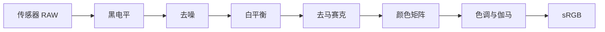

<!-- Generated by scripts/build.py from data/*.yaml. Edit the YAML files, not this file. -->

# Awesome Neural ISP · 中文

[English](README.md) · **简体中文**

**汇集神经相机 ISP 的论文、公开代码与预训练权重，并提供其所基于的经典成像流水线入门指南。**

[交互式论文库](https://ruilin.li/Awesome-Neural-ISP/zh-CN.html) · [预训练权重索引](WEIGHTS.zh-CN.md) · [ISP 入门](guide/isp-101.zh-CN.md) · [贡献指南](CONTRIBUTING.zh-CN.md)

这份目录覆盖完整神经 ISP、RAW 图像复原、颜色与色调处理、可控渲染、逆向 ISP、机器视觉成像与参数调优。每篇论文记录公开代码和预训练权重状态，权重链接以官方仓库为依据。中文标题为阅读辅助译名，同时保留正式英文标题与方法名，便于检索和引用。

目前共 **417 篇独立文献**，其中 **206 篇有公开代码**（含非官方实现），**133 篇提供预训练权重**，另有 **29 个数据集**。每篇文献仅归入一个任务主分类，可控与移动端 / 高效 ISP 作为跨任务专题；两个参赛实现合并于对应报告下，不重复计数。

代码与权重统计包含明确标识的第三方实现；当前权重索引中有 1 篇属于此情况。

文献更新：**2026-10-28**；最近一次全面代码与权重链接核验：**2026-10-11**。新增条目另行核验，详见[来源与更新记录](guide/literature-update-2026-10-28.md)。

摘要修订：**2026-11-05**；分类复核：**2026-11-05**。详见[分类规则与完整审计](guide/classification-2026-11-05.zh-CN.md)和[摘要修订记录](guide/summary-revision-2026-11-05.md)。

**表格说明。** 各分类内先列有权重的论文，再列仅有代码或未公开代码的论文；各组按年份降序排列。“仓库内”表示检查点直接保存在仓库中；“非官方”表示第三方实现；“待发布”表示占位仓库或尚未发布实现；“—”表示未发现公开代码。

## 目录

- [ISP 入门](#isp-入门)
- [研究脉络](#研究脉络)
- [跨任务专题](#跨任务专题)
- [论文](#论文)
  - [端到端 RAW→sRGB](#端到端-rawsrgb)（35 篇，13 篇有权重）
  - [RAW 去噪与噪声建模](#raw-去噪与噪声建模)（28 篇，13 篇有权重）
  - [弱光成像与曝光校正](#弱光成像与曝光校正)（35 篇，11 篇有权重）
  - [去马赛克与重马赛克](#去马赛克与重马赛克)（32 篇，8 篇有权重）
  - [RAW 去模糊与其他复原](#raw-去模糊与其他复原)（14 篇，3 篇有权重）
  - [RAW 超分辨率与重采样](#raw-超分辨率与重采样)（11 篇，2 篇有权重）
  - [连拍融合与 HDR 成像](#连拍融合与-hdr-成像)（42 篇，13 篇有权重）
  - [RAW 视频](#raw-视频)（20 篇，9 篇有权重）
  - [白平衡与颜色恒常性](#白平衡与颜色恒常性)（52 篇，19 篇有权重）
  - [颜色校正、色调与修图](#颜色校正色调与修图)（17 篇，13 篇有权重）
  - [逆向 ISP 与 RAW 合成](#逆向-isp-与-raw-合成)（32 篇，9 篇有权重）
  - [RAW 压缩与联合编码](#raw-压缩与联合编码)（8 篇，3 篇有权重）
  - [面向机器视觉的 ISP](#面向机器视觉的-isp)（45 篇，13 篇有权重）
  - [ISP 参数与管线优化](#isp-参数与管线优化)（16 篇，1 篇有权重）
  - [挑战报告、综述与评测](#挑战报告综述与评测)（30 篇，3 篇有权重）
- [数据集](#数据集)
- [工具与开源 ISP](#工具与开源-isp)
- [学习资料](#学习资料)
- [相关目录](#相关目录)
- [贡献](#贡献)
- [关于本目录](#关于本目录)
- [许可](#许可)

## ISP 入门

传感器记录带噪声的线性马赛克信号，每个像素只感知一种颜色；ISP 将其变成可直接显示的图像。[完整指南](guide/isp-101.zh-CN.md)逐步介绍这些阶段，并提供可运行的 [NumPy 简易管线](guide/minimal_isp.py)。

| 传统阶段 | 作用 | 相关研究 |
|:--|:--|:--|
| 黑电平、坏点、镜头阴影 | 消除传感器偏移与光学衰减 | 通常保留传统方法 |
| 去噪 | 去除泊松–高斯传感器噪声 | [去噪与噪声](#raw-去噪与噪声建模) · [弱光与曝光](#弱光成像与曝光校正) · [连拍 / HDR](#连拍融合与-hdr-成像) · [RAW 视频](#raw-视频) |
| 去马赛克 | 插值重建每个像素缺失的两个颜色通道 | [去马赛克 / 重马赛克](#去马赛克与重马赛克) |
| 白平衡、颜色校正、色调与伽马 | 校正光源颜色并映射至显示空间 | [色彩 / 色调 / 修图](#颜色校正色调与修图) |
| 完整管线 | RAW 输入，sRGB 输出 | [端到端 ISP](#端到端-rawsrgb) · [移动端 / 高效 ISP](#移动端与高效-isp) |
| 可控渲染 | 暴露编辑参数、相机条件或可替换模块 | [可控神经 ISP](#可控神经-isp) |
| 逆向管线 | 从 sRGB 重建 RAW | [逆向 ISP / RAW 合成](#逆向-isp-与-raw-合成) |
| 面向机器的输出 | 服务检测、分割等任务 | [机器视觉](#面向机器视觉的-isp) |
| ISP 参数 | 自动优化与传统控制基线 | [ISP 参数与管线优化](#isp-参数与管线优化) |

## 研究脉络

- **CNN、注意力与生成式 ISP。** 目录同时包含金字塔 CNN 管线、Transformer 与状态空间复原，以及扩散、流匹配和自回归渲染或重建。这些结构并存，分别应对质量、训练与部署约束。 代表工作：PyNET · LiteISPNet · LDM-ISP · RAW-Flow · Retinex-RAWMamba · VAR-ISP
- **面对不完美或缺失的配对数据。** 跨相机 RAW 与 RGB 可能存在几何和颜色差异。对齐感知损失、合成训练数据与传感器域转换分别处理其中不同问题。MAI 2025 与 NTIRE 2026 包含明确的非配对手机 ISP 赛题。 代表工作：LiteISPNet · Unprocessing · Day-to-Night · Rawformer · NTIRE 2026 Unpaired ISP
- **拍摄条件感知。** EXIF 设置、设备嵌入、标定颜色矩阵与拍摄时间提供不同条件信息；输入这些信息不自动意味着暴露了用户编辑控制。 代表工作：ParamISP · MetaISP · Uni-ISP · CRISPnet · CCMNet · Time-Aware AWB
- **部署效率取决于硬件。** 移动 ISP 挑战评测目标设备上的执行，紧凑与二值化设计也出现在去噪、去马赛克和视频中。参数量、量化程度和实测延迟回答的是不同效率问题。 代表工作：MicroISP · PyNET-V2 Mobile · PMRID · BRVE · BinRVR · BMTNet
- **面向感知与动作的成像。** 任务驱动渲染、直接 RAW 推理、学习式管线选择及输入适配器，为下游模型优化信息。基准涵盖检测、分割、匹配和机器人操作。 代表工作：Dirty Pixels · AdaptiveISP · RAW-Adapter · TA-ISP · POS-ISP · RawVLA
- **区分不同可控能力。** 可控神经 ISP 分别标注用户参数、参考风格调整、可替换学习阶段与相机条件化。仅处理颜色的编辑、逆向重建和自动调优通过独立标签关联，保留各自主分类。 代表工作：CtrlISP · Modular Neural ISP · DRIFT · Deep-FlexISP · Neural Photo-Finishing · ParamISP

## 跨任务专题

专题允许与任务主分类交叉，专题数量不累加至独立文献总数。

### 可控神经 ISP

学习式渲染中的显式用户参数、风格或参考控制、可替换学习模块与相机条件化输出。逐篇标明控制接口，区分交互式编辑与相机条件化。仅处理颜色的模块和传统参数调优基线保留在各自主分类。

- [CtrlISP: Rescuing Low-Light RAW Images via Controllable Neural ISP](https://openaccess.thecvf.com/content/CVPR2026F/html/Zhang_CtrlISP_Rescuing_Low-Light_RAW_Images_via_Controllable_Neural_ISP_CVPRF_2026_paper.html) — 2026 · 弱光与曝光 · 用户参数
- [DRIFT: Deep Restoration, ISP Fusion, and Tone-mapping](https://openaccess.thecvf.com/content/CVPR2026W/NTIRE/html/Majee_DRIFT_Deep_Restoration_ISP_Fusion_and_Tone-mapping_CVPRW_2026_paper.html) — 2026 · 连拍 / HDR · 用户参数, 参考 / 风格
- [Modular Neural Image Signal Processing](https://arxiv.org/abs/2512.08564) — 2026 · 端到端 ISP · 可替换学习模块, 参考 / 风格, 用户参数
- [Uni-ISP: Toward Unifying the Learning of ISPs from Multiple Mobile Cameras](https://arxiv.org/abs/2406.01003) — 2025 · 端到端 ISP · 相机 / 拍摄条件
- [ParamISP: Learned Forward and Inverse ISPs using Camera Parameters](https://arxiv.org/abs/2312.13313) — 2024 · 端到端 ISP · 相机 / 拍摄条件
- [MetaISP – Exploiting Global Scene Structure for Accurate Multi-Device Color Rendition](https://arxiv.org/abs/2401.03220) — 2023 · 端到端 ISP · 相机 / 拍摄条件
- [CRISPnet: Color Rendition ISP Net](https://arxiv.org/abs/2203.10562) — 2022 · 端到端 ISP · 相机 / 拍摄条件
- [Deep-FlexISP: A Three-Stage Framework for Night Photography Rendering](https://openaccess.thecvf.com/content/CVPR2022W/NTIRE/html/Liu_Deep-FlexISP_A_Three-Stage_Framework_for_Night_Photography_Rendering_CVPRW_2022_paper.html) — 2022 · 弱光与曝光 · 参考 / 风格
- [Neural Photo-Finishing](https://doi.org/10.1145/3550454.3555526) — 2022 · ISP 参数与管线优化 · 可替换学习模块, 用户参数, 参考 / 风格

### 移动端与高效 ISP

明确针对移动端、边缘设备或传感器计算约束设计或评测的方法，跨越完整 ISP、去噪、去马赛克与视频。这里按部署条件归集，覆盖不同成像任务；不据少数论文推断整个领域的训练范式变化。

- [An Extensible and Lightweight Unified Architecture for Demosaicing Pixel-bin Image Sensors](https://arxiv.org/abs/2606.13136) — 2026 · 去马赛克 / 重马赛克
- [Binarized High-Efficiency RAW Video Restoration and Beyond](https://arxiv.org/abs/2608.16756) — 2026 · RAW 视频
- [DRIFT: Deep Restoration, ISP Fusion, and Tone-mapping](https://openaccess.thecvf.com/content/CVPR2026W/NTIRE/html/Majee_DRIFT_Deep_Restoration_ISP_Fusion_and_Tone-mapping_CVPRW_2026_paper.html) — 2026 · 连拍 / HDR · 用户参数, 参考 / 风格
- [Efficient Real-Time Raw-to-Raw Denoising for Extreme Low-Light Ultra HD Video on Mobile Devices](https://openaccess.thecvf.com/content/CVPR2026/html/Pochimireddy_Efficient_Real-Time_Raw-to-Raw_Denoising_for_Extreme_Low-Light_Ultra_HD_Video_CVPR_2026_paper.html) — 2026 · RAW 视频
- [Freeze the Structure, Free the Color: Fourier-Domain Training for Unpaired Smartphone ISP](https://openaccess.thecvf.com/content/CVPR2026W/NTIRE/html/Kim_Freeze_the_Structure_Free_the_Color_Fourier-Domain_Training_for_Unpaired_CVPRW_2026_paper.html) — 2026 · 端到端 ISP
- [Lightweight Unpaired Smartphone ISP Transfer with Semantic Pseudo-Pairing](https://arxiv.org/abs/2605.07495) — 2026 · 端到端 ISP
- [Binarized Mamba-Transformer for Lightweight Quad Bayer HybridEVS Demosaicing](https://arxiv.org/abs/2503.16134) — 2025 · 去马赛克 / 重马赛克
- [Learned Lightweight Smartphone ISP with Unpaired Data](https://arxiv.org/abs/2505.10420) — 2025 · 端到端 ISP
- [Lightweight Quad Bayer HybridEVS Demosaicing via State Space Augmented Cross-Attention](https://arxiv.org/abs/2508.06058) — 2025 · 去马赛克 / 重马赛克
- [γ-Quant: Towards Learnable Quantization for Low-bit Pattern Recognition](https://arxiv.org/abs/2509.22448) — 2025 · 机器视觉
- [Binarized Low-light Raw Video Enhancement](https://arxiv.org/abs/2403.19944) — 2024 · RAW 视频
- [CoDISP: Exploring Compressed Domain Camera ISP with RGB-guided Encoder](https://openaccess.thecvf.com/content/CVPR2024W/MAI/html/Zhang_CoDISP_Exploring_Compressed_Domain_Camera_ISP_with_RGB-guided_Encoder_CVPRW_2024_paper.html) — 2024 · 连拍 / HDR
- [Enabling ISP-less Low-Power Computer Vision](https://arxiv.org/abs/2210.05451) — 2023 · 机器视觉
- [Fully Quantized Always-on Face Detector Considering Mobile Image Sensors](https://arxiv.org/abs/2311.01001) — 2023 · 机器视觉
- [PyNET-QxQ: An Efficient PyNET Variant for QxQ Bayer Pattern Demosaicing in CMOS Image Sensors](https://arxiv.org/abs/2203.04314) — 2023 · 去马赛克 / 重马赛克
- [Raw Instinct: Trust Your Classifiers and Skip the Conversion](https://arxiv.org/abs/2403.14439) — 2023 · 机器视觉
- [SYENet: A Simple Yet Effective Network for Multiple Low-Level Vision Tasks with Real-time Performance on Mobile Device](https://openaccess.thecvf.com/content/ICCV2023/html/Gou_SYENet_A_Simple_Yet_Effective_Network_for_Multiple_Low-Level_Vision_ICCV_2023_paper.html) — 2023 · 端到端 ISP
- [Improving the Energy Efficiency and Robustness of tinyML Computer Vision using Log-Gradient Input Images](https://arxiv.org/abs/2203.02571) — 2022 · 机器视觉
- [LAN: Lightweight Attention-Based Network for RAW-to-RGB Smartphone Image Processing](https://openaccess.thecvf.com/content/CVPR2022W/NTIRE/html/Raimundo_LAN_Lightweight_Attention-Based_Network_for_RAW-to-RGB_Smartphone_Image_Processing_CVPRW_2022_paper.html) — 2022 · 端到端 ISP
- [LW-ISP: A Lightweight Model with ISP and Deep Learning](https://arxiv.org/abs/2210.03904) — 2022 · 端到端 ISP
- [MicroISP: Processing 32MP Photos on Mobile Devices with Deep Learning](https://arxiv.org/abs/2211.06770) — 2022 · 端到端 ISP
- [PyNet-V2 Mobile: Efficient On-Device Photo Processing With Neural Networks](https://arxiv.org/abs/2211.06263) — 2022 · 端到端 ISP
- [CSAnet: High Speed Channel Spatial Attention Network for Mobile ISP](https://openaccess.thecvf.com/content/CVPR2021W/MAI/html/Hsyu_CSAnet_High_Speed_Channel_Spatial_Attention_Network_for_Mobile_ISP_CVPRW_2021_paper.html) — 2021 · 端到端 ISP
- [Del-Net: A Single-Stage Network for Mobile Camera ISP](https://arxiv.org/abs/2108.01623) — 2021 · 端到端 ISP
- [Efficient Multi-Stage Video Denoising with Recurrent Spatio-Temporal Fusion](https://arxiv.org/abs/2103.05407) — 2021 · RAW 视频
- [Restoring Extremely Dark Images in Real Time](https://openaccess.thecvf.com/content/CVPR2021/html/Lamba_Restoring_Extremely_Dark_Images_in_Real_Time_CVPR_2021_paper.html) — 2021 · 弱光与曝光
- [Practical Deep Raw Image Denoising on Mobile Devices](https://arxiv.org/abs/2010.06935) — 2020 · 去噪与噪声
- [PyNET-CA: Enhanced PyNET with Channel Attention for End-to-End Mobile Image Signal Processing](https://arxiv.org/abs/2104.02895) — 2020 · 端到端 ISP
- [Replacing Mobile Camera ISP with a Single Deep Learning Model](https://arxiv.org/abs/2002.05509) — 2020 · 端到端 ISP
- [Towards Fast and Light-Weight Restoration of Dark Images](https://arxiv.org/abs/2011.14133) — 2020 · 弱光与曝光
- [Deep Demosaicing for Edge Implementation](https://arxiv.org/abs/1904.00775) — 2019 · 去马赛克 / 重马赛克
- [ISP4ML: Understanding the Role of Image Signal Processing in Efficient Deep Learning Vision Systems](https://arxiv.org/abs/1911.07954) — 2019 · 机器视觉

## 论文

### 端到端 RAW→sRGB

学习从 RAW 到显示图像的完整映射；以弱光、多帧、视频或下游任务为主要目标的工作归入对应主分类。移动部署与可控能力按跨任务维度归集。

**提供预训练权重（13）**

| 论文 | 发表信息 | 代码 | 权重 |
|:--|:--|:--|:--|
| **[Lightweight Unpaired Smartphone ISP Transfer with Semantic Pseudo-Pairing](https://arxiv.org/abs/2605.07495)** 利用语义伪配对实现轻量非配对手机 ISP 迁移 针对 RAW 与 RGB 数据无配对监督的问题，以 DINOv2 语义嵌入和融合 Gromov–Wasserstein 最优传输在图像与图块层面构建伪配对，再训练仅约七千参数的颜色 CNN，减少结构改动与训练不稳定性。 | CVPRW (NTIRE) 2026 | [代码](https://github.com/nuniniyujin/Unpaired-ISP) PyTorch | [模型检查点（Google Drive，见 checkpoints/weight_url.txt）](https://drive.google.com/drive/folders/1kwby-1qOq67RGABkmkLD3OXLC5eYK3OM?usp=sharing) |
| **[Modular Neural Image Signal Processing](https://arxiv.org/abs/2512.08564)** 模块化神经图像信号处理 针对整体式神经 ISP 难以控制中间过程的问题，将去噪、颜色处理、照片风格处理和上采样拆成可替换学习模块，支持更换风格模块与交互编辑，并可从 RAW 反复重新渲染。 <i>备注：官方仓库宣布论文已被 SIGGRAPH Asia 2026 录用（核验日期：2026-10-28）；提供独立编辑图形界面。</i> | SIGGRAPH Asia 2026 | [代码](https://github.com/mahmoudnafifi/modular_neural_isp) PyTorch | [denoising/models/\*.pth（lite/base/large）](https://github.com/mahmoudnafifi/modular_neural_isp/tree/main/denoising/models) [photofinishing/models/\*.pth（多种风格）](https://github.com/mahmoudnafifi/modular_neural_isp/tree/main/photofinishing/models) |
| **[ISPDiffuser: Learning RAW-to-sRGB Mappings with Texture-Aware Diffusion Models and Histogram-Guided Color Consistency](https://arxiv.org/abs/2503.19283)** ISPDiffuser：利用纹理感知扩散模型与直方图引导的色彩一致性学习 RAW 到 sRGB 映射 针对细节重建与颜色迁移相互干扰的问题，先用带纹理增强损失的扩散模型恢复灰度细节，再以直方图引导模块和颜色一致性损失完成灰度到 sRGB 映射，分别约束纹理和颜色。 | AAAI 2025 | [代码](https://github.com/RenYangSCU/ISPDiffuser) PyTorch | [ZRR / MAI 权重（Google Drive）](https://drive.google.com/drive/folders/1smqKEttfKNEZfS8OT-g9yoMOCoRs90Gy?usp=sharing) [镜像（百度网盘，提取码 f1gv）](https://pan.baidu.com/s/1eAAZf0TbHakxrqwyl2AZVA?pwd=f1gv) |
| **[Learned Lightweight Smartphone ISP with Unpaired Data](https://arxiv.org/abs/2505.10420)** 利用非配对数据学习轻量智能手机 ISP 针对逐像素对齐训练数据采集昂贵的问题，在预训练特征图上使用多个判别器和多项损失训练移动端 ISP，在保持输入内容的同时学习目标 RGB 数据集的颜色与纹理统计。 | CVPRW (MAI) 2025 | [代码](https://github.com/AndreiiArhire/Learned-Lightweight-Smartphone-ISP-with-Unpaired-Data) PyTorch | [pretrained/models/{ZRR,Fujifilm}（仓库内）](https://github.com/AndreiiArhire/Learned-Lightweight-Smartphone-ISP-with-Unpaired-Data/tree/main/pretrained) |
| **[ParamISP: Learned Forward and Inverse ISPs using Camera Parameters](https://arxiv.org/abs/2312.13313)** ParamISP：利用相机参数学习正向与逆向 ISP 针对 ISP 映射随 ISO、曝光等拍摄参数变化的问题，ParamNet 将 EXIF 参数编码为控制特征，调制正向和逆向 ISP 网络，支持参数感知重建、RAW 域处理和跨相机外观迁移。 | CVPR 2024 | [代码](https://github.com/woo525/ParamISP) PyTorch | [官方权重（Google Drive，逆向与正向）](https://drive.google.com/drive/folders/1L7ZSikYt5eaCOEINpjjwmPX0CoZLbBG6) |
| **[MetaISP – Exploiting Global Scene Structure for Accurate Multi-Device Color Rendition](https://arxiv.org/abs/2401.03220)** MetaISP：利用全局场景结构实现准确的多设备色彩渲染 针对神经 ISP 忽略不同手机语义感知颜色风格的问题，采用受交叉协方差启发的注意力提取全局语义，并以目标设备元数据控制渲染；缺少光源信息时进行估计，实现单模型多设备颜色重现。 | VMV 2023 | [代码](https://github.com/vccimaging/MetaISP) PyTorch | [MetaISPNet 权重（Google Drive）](https://drive.google.com/drive/folders/1tLWlx0LDUjQ9niZje0cfLKt98dx1VEIR?usp=sharing) |
| **[LAN: Lightweight Attention-Based Network for RAW-to-RGB Smartphone Image Processing](https://openaccess.thecvf.com/content/CVPR2022W/NTIRE/html/Raimundo_LAN_Lightweight_Attention-Based_Network_for_RAW-to-RGB_Smartphone_Image_Processing_CVPRW_2022_paper.html)** LAN：用于智能手机 RAW 到 RGB 图像处理的轻量注意力网络 针对手机 RAW 渲染质量与推理成本的矛盾，通过卷积学习输入马赛克结构，结合轻量注意力和无监督预训练，在保持移动端推理效率的同时兼顾感知质量与重建保真度。 | CVPRW (NTIRE) 2022 | [代码](https://github.com/draimundo/LAN) TensorFlow | [models/LAN_iteration_200000.ckpt（仓库内）](https://github.com/draimundo/LAN/tree/master/models) |
| **[MicroISP: Processing 32MP Photos on Mobile Devices with Deep Learning](https://arxiv.org/abs/2211.06770)** MicroISP：利用深度学习在移动设备上处理 3200 万像素照片 针对手机高分辨率处理的算力与内存限制，设计可按设备能力调整规模、兼容移动加速器的紧凑网络；发布手机与中画幅相机配对的 UltraISP 数据，并在测试设备上实现最高 32MP 图像的亚秒级处理。 <i>备注：仅限学术用途。</i> | ECCVW 2022 | [代码](https://github.com/aiff22/MicroISP) TensorFlow | [pretrained_weights/MicroISP.ckpt（仓库内）](https://github.com/aiff22/MicroISP/tree/master/pretrained_weights) |
| **[Learning RAW-to-sRGB Mappings with Inaccurately Aligned Supervision](https://openaccess.thecvf.com/content/ICCV2021/html/Zhang_Learning_RAW-to-sRGB_Mappings_With_Inaccurately_Aligned_Supervision_ICCV_2021_paper.html)** 在不精确配准监督下学习 RAW 到 sRGB 映射 针对颜色差异妨碍跨相机配准监督的问题，联合学习 RAW-to-sRGB 与图像配准，用目标引导的全局颜色模块在不移动像素的情况下先匹配颜色，从而训练轻量 ISP 主干。 <i>备注：README 还通过百度网盘提供 ZRR（提取码 8sq1）及预处理后的 SR-RAW。</i> | ICCV 2021 | [代码](https://github.com/cszhilu1998/RAW-to-sRGB) PyTorch | [ZRR / SR-RAW 预训练模型（Google Drive）](https://drive.google.com/drive/folders/12eMNZh-A9E4bVup-Kcy_F0_c0IToUyw7?usp=sharing) |
| **[AWNet: Attentive Wavelet Network for Image ISP](https://arxiv.org/abs/2008.09228)** AWNet：用于图像 ISP 的注意力小波网络 针对 RAW 细节恢复与大感受野的计算成本问题，结合小波变换、注意力和全局上下文模块，利用多尺度分解重建纹理，并通过非局部特征学习颜色映射。 | ECCVW (AIM) 2020 | [代码](https://github.com/Charlie0215/AWNet-Attentive-Wavelet-Network-for-Image-ISP) PyTorch | [demosaiced_model（Google Drive）](https://drive.google.com/file/d/1uhohG6cYkM_-W4dGLl8yGlo85UMF6KEK/view?usp=sharing) [Raw_model（Google Drive）](https://drive.google.com/file/d/1jBwEm7_zbU55qOlGAVuOAQ8BIwx2g7Fw/view?usp=sharing) |
| **[PyNET-CA: Enhanced PyNET with Channel Attention for End-to-End Mobile Image Signal Processing](https://arxiv.org/abs/2104.02895)** PyNET-CA：结合通道注意力的增强 PyNET，用于端到端移动图像信号处理 针对 PyNET 的特征选择与上采样重建问题，在金字塔 CNN 中加入通道注意力和亚像素重建模块，形成端到端手机 RAW-to-RGB 模型，并在 AIM 神经 ISP 挑战中评测。 <i>备注：作者提醒，在 PyTorch &gt; 1.4 时可能无法复现实验结果。</i> | ECCVW (AIM) 2020 | [代码](https://github.com/egyptdj/skyb-aim2020-public) PyTorch | [pretrained_model.zip（Dropbox）](https://www.dropbox.com/s/psoz0auaynu3e5x/pretrained_model.zip?dl=0) |
| **[Replacing Mobile Camera ISP with a Single Deep Learning Model](https://arxiv.org/abs/2002.05509)** 以单个深度学习模型替代移动相机 ISP 针对手工调节手机 ISP 各阶段的复杂性，使用逐层训练的金字塔 CNN 从手机 RAW 直接重建单反风格 RGB，联合学习复原与渲染，并发布含一万组图像对的 ZRR 数据集。 <i>备注：PyTorch 版本位于 aiff22/PyNET-PyTorch；训练还需要 VGG-19。</i> | CVPRW 2020 | [代码](https://github.com/aiff22/PyNET) TensorFlow / PyTorch | [PyNET_pretrained.zip（TensorFlow）](https://download.ai-benchmark.com/s/C4a3C5WxB8p2my8/download/PyNET_pretrained.zip) [pynet_level_0.pth（PyTorch 版本）](https://download.ai-benchmark.com/s/A5wkJNztkpex8T4/download/pynet_level_0.pth) |
| **[W-Net: Two-stage U-Net with misaligned data for raw-to-RGB mapping](https://arxiv.org/abs/1911.08656)** W-Net：利用错位数据完成 RAW 到 RGB 映射的两阶段 U-Net 针对跨相机训练对配准不准且缺少元数据的问题，串联两个 U-Net，并设计对错位较不敏感、对颜色更敏感的损失；通过不同损失训练模型的集成完成 RAW-to-RGB 重建。 | ICCVW (AIM) 2019 | [代码](https://github.com/khuhm/W-Net) | [预训练模型（Google Drive）](https://drive.google.com/drive/folders/1eH_prE7EWEUqxJes5IfHTdsFyqP64o7w?usp=sharing) |

**仅有代码或尚未公开（22）**

| 论文 | 发表信息 | 代码 |
|:--|:--|:--|
| **[RGB-Event ISP: The Dataset and Benchmark](https://arxiv.org/abs/2501.19129)** RGB-Event ISP：数据集与基准 针对事件引导 ISP 缺乏数据与评测基准的问题，采集覆盖 24 个场景的 3,373 组像素对齐 RAW/事件数据，提供以色卡为参考的传统管线、神经 ISP 基线和事件引导模型，用于分析事件信息的作用。 <i>备注：数据集位于 Hugging Face 的 yunfanlu/RGB-Event-ISP-Dataset 及百度网盘；仅限非商业研究用途。</i> | ICLR 2025 | [代码](https://github.com/yunfanLu/RGB-Event-ISP) |
| **[Enhancing RAW-to-sRGB with Decoupled Style Structure in Fourier Domain](https://arxiv.org/abs/2401.02161)** 在傅里叶域解耦风格与结构以增强 RAW 到 sRGB 映射 针对手机 RAW 与单反 RGB 在颜色和空间结构上的差异，采用相位增强、幅度细化和颜色适配三个子网络，在傅里叶域分别优化结构与外观后再融合，减轻共享表征的任务冲突。 <i>备注：README 明确说明不会发布模型检查点，需要自行训练。</i> | AAAI 2024 | [代码](https://github.com/alexhe101/FourierISP) PyTorch |
| **[SYENet: A Simple Yet Effective Network for Multiple Low-Level Vision Tasks with Real-time Performance on Mobile Device](https://openaccess.thecvf.com/content/ICCV2023/html/Gou_SYENet_A_Simple_Yet_Effective_Network_for_Multiple_Low-Level_Vision_ICCV_2023_paper.html)** SYENet：在移动设备上实时执行多种低层视觉任务的简洁高效网络 针对移动端多种低层视觉任务难以统一且计算量大的问题，以二次连接单元融合两个非对称分支，并设计回归焦点损失；约六千参数的架构可用于 ISP、低光增强和超分辨率。 <i>备注：README 说明了加载预训练模型的参数，但未找到权重下载链接；提供 ONNX 导出脚本。</i> | ICCV 2023 | [代码](https://github.com/sanechips-multimedia/syenet) PyTorch |
| **[PyNet-V2 Mobile: Efficient On-Device Photo Processing With Neural Networks](https://arxiv.org/abs/2211.06263)** PyNet-V2 Mobile：利用神经网络进行高效端侧照片处理 针对高分辨率神经 ISP 难以在手机运行的问题，按移动算子与加速器约束重新设计 CNN，在 UltraISP 数据上评估 12MP RAW 渲染，并报告手机及 NPU/APU 的实际推理时延。 <i>备注：README 中预训练模型的 Google Drive 链接返回 404（核验日期：2026-10-11）。</i> | ICPR 2022 | [代码](https://github.com/gmalivenko/PyNET-v2) TensorFlow / Keras |
| **[CameraNet: A Two-Stage Framework for Effective Camera ISP Learning](https://arxiv.org/abs/1908.01481)** CameraNet：高效相机 ISP 学习的两阶段框架 针对复原保真度与外观增强目标不一致的问题，将 ISP 拆成分别监督、渐进训练的两个 CNN 模块：先恢复传感器图像，再学习颜色和外观增强，降低单网络同时处理多任务的训练难度。 <i>备注：官方代码基于 TensorFlow 1.15；README 仅提供 HDR+／SID 预处理数据，未找到权重链接。</i> | IEEE TIP 2019 | [代码](https://github.com/zhetongliang/CameraNet_official) TensorFlow |
| **[HighEr-Resolution Network for Image Demosaicing and Enhancing](https://arxiv.org/abs/1911.08098)** 用于图像去马赛克与增强的高分辨率网络 针对高分辨率图块训练显存占用大且不稳定的问题，以高低分辨率双路径融合局部多尺度特征与全局信息，并采用渐进训练稳定优化，实现联合去马赛克与增强。 <i>备注：README 中挑战权重 114.pth／115.pth 的两个 OneDrive 链接均返回 404（核验日期：2026-10-11）。</i> | ICCVW (AIM) 2019 | [代码](https://github.com/MKFMIKU/RAW2RGBNet) PyTorch |
| **[RPBA-Net: An Interpretable Residual Pyramid Bilateral Affine Network for RAW-Domain ISP Enhancement](https://arxiv.org/abs/2605.03626)** RPBA-Net：用于 RAW 域 ISP 增强的可解释残差金字塔双边仿射网络 针对 RAW 增强中模块割裂、映射难解释和部署开销的问题，预测恒等映射引导的残差仿射校正与金字塔双边网格，通过引导驱动的自适应切片和跨尺度融合，联合恢复颜色、全局色调与局部纹理。 | arXiv 2026 | — |
| **[Freeze the Structure, Free the Color: Fourier-Domain Training for Unpaired Smartphone ISP](https://openaccess.thecvf.com/content/CVPR2026W/NTIRE/html/Kim_Freeze_the_Structure_Free_the_Color_Fourier-Domain_Training_for_Unpaired_CVPRW_2026_paper.html)** 固定结构、释放色彩：面向非配对手机 ISP 的傅里叶域训练 针对非配对颜色学习破坏几何结构的问题，先稳定并冻结 FourierISP 的结构分支，再结合处理模糊图像的 ViT 判别器、逆向循环一致性及 VGG 感知损失，通过分阶段训练学习颜色。 | CVPRW (NTIRE) 2026 | — |
| **[Visual Autoregressive Priors for RAW-to-sRGB Image Signal Processing](https://arxiv.org/abs/2609.18302)** 用于 RAW 到 sRGB 图像信号处理的视觉自回归先验 针对配准不准与元数据缺失的 RAW-to-sRGB 重建，将冻结的视觉自回归模型适配为 RAW 条件的逐尺度预测器，并以小波分解的颜色损失分别约束低频色调和色度边缘，用少量可训练参数利用生成先验。 | ECCVW (LoViF) 2026 | — |
| **[EvRAW: Event-guided Structural and Color Modeling for RAW-to-sRGB Image Reconstruction](https://doi.org/10.1145/3746027.3754983)** EvRAW：事件引导的结构与色彩建模，用于 RAW 到 sRGB 图像重建 针对动态 RAW-to-sRGB 的运动模糊与偏色，以事件运动线索增强结构，通过区域伽马校正和通道颜色解码恢复颜色，并采集像素对齐 RAW/事件数据。 | ACM MM 2025 | — |
| **[SemiISP/SemiIE: Semi-Supervised Image Signal Processor and Image Enhancement Leveraging One-to-Many Mapping sRGB-to-RAW](https://arxiv.org/abs/2504.02345)** SemiISP/SemiIE：利用一对多 sRGB 到 RAW 映射实现半监督 ISP 与图像增强 针对个性化 ISP 成对训练数据不足的问题，学习一对多 sRGB-to-RAW 重建，用合成配对数据与真实配对数据共同进行半监督训练，使已有 ISP 和图像增强模型能够利用额外 sRGB 图像。 | arXiv 2025 | — |
| **[Uni-ISP: Toward Unifying the Learning of ISPs from Multiple Mobile Cameras](https://arxiv.org/abs/2406.01003)** Uni-ISP：迈向多移动相机 ISP 的统一学习 针对每款相机单独训练 ISP 难以扩展的问题，以设备嵌入为条件联合学习正向和逆向映射；发布多手机同步采集的 FiveCam RAW–sRGB 数据，并评估新设备适配与跨相机渲染。 | IEEE TIP 2025 | — |
| **[Experts-Guided Unbalanced Optimal Transport for ISP Learning from Unpaired and/or Paired Data](https://arxiv.org/abs/2512.05635)** 专家引导的非平衡最优传输：利用非配对及配对数据学习 ISP 针对成对 RAW–sRGB 数据采集昂贵的问题，以非平衡最优传输训练现有 ISP 架构，并用颜色、结构和频域专家判别器提供针对性约束；同时支持配对与非配对训练，降低目标域异常样本的影响。 <i>备注：仓库目前仅包含 README。</i> | arXiv 2025 | [代码仓库（待发布）](https://github.com/gosha20777/EGUOT-ISP) |
| **[RMFA-Net: A Neural ISP for Real RAW to RGB Image Reconstruction](https://arxiv.org/abs/2406.11469)** RMFA-Net：面向真实 RAW 到 RGB 图像重建的神经 ISP 针对黑电平、CFA 结构与曝光不均处理不当造成的偏色和细节损失，结合隐式黑电平校正、保留高频信息的三通道拆分和基于 Retinex 的显式色调映射，并提供轻量部署版本。 | arXiv 2024 | — |
| **[Simple Image Signal Processing using Global Context Guidance](https://arxiv.org/abs/2404.11569)** 利用全局上下文引导的简洁图像信号处理 针对图块训练缺少全局光照信息的问题，从完整 RAW 提取全局上下文来引导轻量 ISP，使颜色与色调估计利用整幅图像；该模块也可接入其他神经 ISP 架构。 | ICIP 2024 | — |
| **[CRISPnet: Color Rendition ISP Net](https://arxiv.org/abs/2203.10562)** CRISPnet：色彩渲染 ISP 网络 针对传统手机 ISP 随场景调整颜色的特性，以图像元数据和分类得到的全局语义共同指导颜色渲染，并采集不同光照、曝光及增益下的真实与 HDR 显示器数据进行评测。 | arXiv 2022 | — |
| **[LW-ISP: A Lightweight Model with ISP and Deep Learning](https://arxiv.org/abs/2210.03904)** LW-ISP：结合 ISP 与深度学习的轻量模型 针对神经 ISP 参数与计算开销大的问题，在 U-Net 中设计细粒度注意力和上采样模块，并以异构蒸馏将教师模型的干净图像特征与重建信息传给轻量学生网络。 | BMVC 2022 | — |
| **[Transform your Smartphone into a DSLR Camera: Learning the ISP in the Wild](https://arxiv.org/abs/2203.10636)** 将智能手机变成单反相机：在真实环境中学习 ISP 针对手机与单反弱配对图像的颜色及空间错位，结合颜色条件 ISP、参数化颜色对齐和全局上下文 Transformer 预测器，以掩码配准损失剔除不可靠运动区域，并发布 ISPW 数据集。 <i>备注：仓库目前仅提供 ISPW 数据集下载；README 表示代码即将发布。</i> | ECCV 2022 | [代码仓库（待发布）](https://github.com/4rdhendu/TransformPhone2DSLR) |
| **[CSAnet: High Speed Channel Spatial Attention Network for Mobile ISP](https://openaccess.thecvf.com/content/CVPR2021W/MAI/html/Hsyu_CSAnet_High_Speed_Channel_Spatial_Attention_Network_for_Mobile_ISP_CVPRW_2021_paper.html)** CSAnet：用于移动 ISP 的高速通道空间注意力网络 针对端到端 RAW-to-RGB 的保真度与手机速度需求，结合通道注意力和以空洞深度卷积实现的轻量空间注意力，用简化双注意力模块降低 ISP 推理成本。 | CVPRW (MAI) 2021 | — |
| **[Del-Net: A Single-Stage Network for Mobile Camera ISP](https://arxiv.org/abs/2108.01623)** Del-Net：用于移动相机 ISP 的单阶段网络 针对传统 ISP 误差累积与端到端网络过重的问题，以多尺度 CNN 的空间和通道注意力建模全局颜色，用轻量残差注意力块去噪，在手机计算预算下联合学习 RAW-to-RGB 管线。 | arXiv 2021 | — |
| **[Deep Camera: A Fully Convolutional Neural Network for Image Signal Processing](https://arxiv.org/abs/1908.09191)** Deep Camera：用于图像信号处理的全卷积神经网络 针对顺序 ISP 各阶段误差累积的问题，以单个全卷积网络端到端联合学习坏点校正、去噪、白平衡、曝光校正、去马赛克、颜色变换和伽马编码，直接从 Bayer 数据重建 RGB。 | ICCVW 2019 | — |
| **[DeepISP: Towards Learning an End-to-End Image Processing Pipeline](https://arxiv.org/abs/1801.06724)** DeepISP：迈向端到端图像处理管线学习 针对低光 RAW 复原与颜色渲染分开优化的问题，联合学习局部去噪、去马赛克和全局颜色调整，并采集三星 S7 低光与正常曝光图像对，用于评估完整神经成像管线。 | IEEE TIP 2018 | — |

[返回目录](#目录)

### RAW 去噪与噪声建模

单幅 RAW 去噪，以及传感器噪声的标定、建模与合成。以亮度和成像恢复为主要目标的工作归入弱光增强，多帧与时序处理归入连拍或视频。

**提供预训练权重（13）**

| 论文 | 发表信息 | 代码 | 权重 |
|:--|:--|:--|:--|
| **[2-Shots in the Dark: Low-Light Denoising with Minimal Data Acquisition](https://arxiv.org/abs/2512.03245)** 2-Shots in the Dark：以最少数据采集实现低光去噪 针对相机专用去噪训练数据采集昂贵的问题，每个 ISO 仅需一张噪声图和一张暗帧；以泊松分布模拟散粒噪声，以傅里叶域频谱采样保留信号无关噪声的空间与统计结构，合成去噪训练数据。 | CVPR 2026 | [代码](https://github.com/IVRL/2-Shots-in-the-Dark) PyTorch | [SID/ELD、LRID 模型与暗场资源（Google Drive）](https://drive.google.com/drive/folders/1Hz4rzV8578lHCTzQkwCHE2nrphQy1QYG?usp=sharing) |
| **[Learning Physics-Informed Noise Models from Dark Frames for Low-Light Raw Image Denoising](https://arxiv.org/abs/2310.09126)** 从暗场帧学习物理知识引导的噪声模型，用于低光 RAW 图像去噪 针对噪声建模依赖干净/噪声配对数据的问题，从暗帧训练物理信息神经代理，结合物理引导噪声解耦、物理感知代理模型和可微分布损失，并发布 LRID 数据集。 <i>备注：提供索尼 A7S2 与 IMX686 的 PNNP 权重；PNNP 本身的训练代码未开源。</i> | IEEE TPAMI 2026 | [代码](https://github.com/fenghansen/PNNP) PyTorch | [模型检查点与资源（百度网盘，提取码 vmcl）](https://pan.baidu.com/s/1WMv2x7yqg0kMTBCddqkCLQ?pwd=vmcl) [LRID 数据集（Hugging Face）](https://huggingface.co/datasets/hansen97/LRID) |
| **[Learned Nonlocal Feature Matching and Filtering for RAW Image Denoising](https://arxiv.org/abs/2604.17453)** 用于 RAW 图像去噪的可学习非局部特征匹配与滤波 针对 RAW 去噪中自相似先验与深度特征的结合问题，在多尺度学习特征上执行邻域匹配、协同滤波和聚合，将经典非局部图块去噪流程转为可训练网络模块。 | arXiv 2026 | [代码](https://github.com/MIA-UIB/nonlocal-matchfilter) PyTorch | [GitHub Releases（含权重）](https://github.com/MIA-UIB/nonlocal-matchfilter/releases) |
| **[YOND: Practical Blind Raw Image Denoising Free from Camera-Specific Data Dependency](https://arxiv.org/abs/2506.03645)** YOND：摆脱相机专属数据依赖的实用盲 RAW 图像去噪 针对未知相机去噪依赖专用数据的问题，结合由粗到细噪声估计、期望匹配方差稳定变换和 SNR 引导网络，校正稳定化偏差，并支持自动适配与手动调节去噪强度。 | IEEE TPAMI 2025 | [代码](https://github.com/fenghansen/YOND_public) PyTorch | [SNR-Net 权重与训练数据（百度网盘，提取码 nn4v）](https://pan.baidu.com/s/1tAJW_57v2jWJ605MWKMKVg?pwd=nn4v) [在线演示（Hugging Face Spaces）](https://huggingface.co/spaces/hansen97/YOND) |
| **[Noise Modeling in One Hour: Minimizing Preparation Efforts for Self-supervised Low-Light RAW Image Denoising](https://arxiv.org/abs/2505.00045)** 一小时噪声建模：最小化自监督低光 RAW 去噪的准备工作 针对相机噪声合成的标定与采样准备繁琐的问题，通过噪声性质分析省去显式系统增益标定和信号无关噪声建档，构建去噪训练数据，将准备时间由数天缩短至数小时。 | CVPR 2025 | [代码](https://github.com/SonyResearch/raw_image_denoising) PyTorch | [预训练模型检查点（Google Drive）](https://drive.google.com/drive/folders/1KyR9f6SIciXWv29owm0xYPCOnaMd9YWh?usp=sharing) |
| **[Learning Joint Denoising, Demosaicing, and Compression from the Raw Natural Image Noise Dataset](https://arxiv.org/abs/2501.08924)** 从 RAW 自然图像噪声数据集学习联合去噪、去马赛克与压缩 针对去噪跨传感器和渲染风格泛化的问题，发布自然 RAW 配对数据并比较 Bayer 与线性 RGB 复原；联合学习 RAW 去噪与压缩，提高率失真效率并保留后续处理空间。 <i>备注：权重采用 GPL3 与 CC-BY-4.0 双重许可。</i> | arXiv 2025 | [代码](https://github.com/trougnouf/rawnind_jddc) PyTorch | [预训练模型（Google Drive）](https://drive.google.com/drive/folders/12Uc5sT4OWx02sviUS_boDk1zDSDRVorw?usp=sharing) |
| **[DualDn: Dual-domain Denoising via Differentiable ISP](https://arxiv.org/abs/2409.18783)** DualDn：通过可微 ISP 实现双域去噪 针对 RAW 细节保留与 sRGB 感知质量难兼顾的问题，以可微 ISP 连接 RAW 和 sRGB 两级去噪器并联合训练，同时提供真实采集的相机无关去噪数据集。 <i>备注：两个模型都采用 Restormer 主干，在 MIT-Adobe FiveK 上训练；README 表格还提供测试集和可视化结果。</i> | ECCV 2024 | [代码](https://github.com/OpenImagingLab/DualDn) PyTorch | [pretrained_model.zip，合成数据测试（OneDrive）](https://mycuhk-my.sharepoint.com/:u:/g/personal/1155231343_link_cuhk_edu_hk/Eb2uUHfx8pRBimlrVRbR0dUB5arCuP6Vx5g3LKxImOUv3w?e=XLXLKC) [DualDn_Big.pth，真实拍摄数据／DND（OneDrive）](https://mycuhk-my.sharepoint.com/:u:/g/personal/1155231343_link_cuhk_edu_hk/EeSssinwPSRLvC2zOTdmAd8BLLtF3MaKfFw2kYv25WthkQ?e=bbO0Ql) |
| **[Make Explicit Calibration Implicit: Calibrate Denoiser Instead of the Noise Model](https://arxiv.org/abs/2308.03448)** 让显式标定隐式化：标定去噪器而非噪声模型 针对传感器噪声显式标定耗时且跨相机迁移困难的问题，先在虚拟相机上预训练，再以少量真实图像对微调、隐式标定去噪器，并通过结构调整缩短信号合成与真实噪声的差距。 <i>备注：自 2025 年 12 月起还包含 UltraLED 代码与数据。</i> | ICCV 2023 | [代码](https://github.com/Srameo/LED) PyTorch | [模型库（Google Drive）](https://drive.google.com/drive/folders/11MYkjzbPIZ7mJbu9vrgaVC-OwGcOFKsM?usp=sharing) [相关文件（百度网盘，提取码 iay5）](https://pan.baidu.com/s/17rA_8GvfNPZJY5Zl9dyILw?pwd=iay5) [按相机／方法整理的权重表](https://github.com/Srameo/LED/blob/main/docs/pretrained-models.md) |
| **[Towards General Low-Light Raw Noise Synthesis and Modeling](https://arxiv.org/abs/2307.16508)** 迈向通用低光 RAW 噪声合成与建模 针对简单分布难以描述信号无关噪声的问题，结合物理散粒噪声模型与学习式生成噪声模型，并以多尺度傅里叶 Transformer 判别器约束噪声分布，发布 LRD 用于跨传感器评测。 <i>备注：噪声合成模型因商业许可限制未发布。</i> | ICCV 2023 | [代码](https://github.com/fengzhang427/LRD) PyTorch | [RAW 去噪模型（Google Drive）](https://drive.google.com/file/d/1VkgHyEU6hNsXLL1vRfFWWLZCmGYGyi_h/view?usp=sharing) [镜像（百度网盘，提取码 ujzm）](https://pan.baidu.com/s/1iMNrQh5P4g2prhhk2Tcu_g) |
| **[Pseudo-ISP: Learning Pseudo In-camera Signal Processing Pipeline from A Color Image Denoiser](https://arxiv.org/abs/2103.10234)** Pseudo-ISP：从彩色图像去噪器学习伪相机内信号处理管线 针对 sRGB 去噪器遇到新传感器或 ISP 时的噪声失配，从噪声输入和伪干净输出学习伪 ISP 与 RAW 噪声模型，再利用非配对干净图像交替进行合成数据生成与去噪器适配。 | arXiv 2021 | [代码](https://github.com/happycaoyue/Pseudo-ISP) PyTorch | [预训练去噪模型（百度网盘，提取码 6aj4）](https://pan.baidu.com/s/1W8_Uemrm8coX3wFZ_Jlw1g) |
| **[Rethinking Noise Synthesis and Modeling in Raw Denoising](https://openaccess.thecvf.com/content/ICCV2021/html/Zhang_Rethinking_Noise_Synthesis_and_Modeling_in_Raw_Denoising_ICCV_2021_paper.html)** 重新思考 RAW 去噪中的噪声合成与建模 针对传感器参数噪声模型不准确的问题，直接从真实传感器噪声采样，以图案对齐的图块采样保留空间相关性，以高比特重建补足量化掩盖的变化，合成真实 RAW 噪声。 | ICCV 2021 | [代码](https://github.com/zhangyi-3/noise-synthesis) PyTorch | [预训练模型（百度网盘，提取码 v4dh）](https://pan.baidu.com/s/1RMYgubpdKZFO8JUkdTC7vg?pwd=v4dh) |
| **[A Physics-based Noise Formation Model for Extreme Low-light Raw Denoising](https://arxiv.org/abs/2003.12751)** 用于极低光 RAW 去噪的基于物理的噪声形成模型 针对极低光合成训练忽略相机电子噪声的问题，建立包含散粒、长尾读出、行和量化噪声的 CMOS 模型及可复现标定流程，并发布多相机数据集检验合成噪声到真实拍摄的泛化。 <i>备注：TPAMI 2021 扩展版的 arXiv 编号为 2108.02158；亦可通过 Vandermode/NoiseModel 仓库访问。</i> | CVPR 2020 | [代码](https://github.com/Vandermode/ELD) PyTorch | [ELD 数据与预训练模型（Google Drive）](https://drive.google.com/drive/folders/1QoEhB1P-hNzAc4cRb7RdzyEKktexPVgy?usp=sharing) [镜像（百度网盘，提取码 0lby）](https://pan.baidu.com/s/11ksugpPH5uyDL-Z6S71Q5g) |
| **[Practical Deep Raw Image Denoising on Mobile Devices](https://arxiv.org/abs/2010.06935)** 移动设备上的实用深度 RAW 图像去噪 针对多 ISO RAW 去噪网络难以轻量部署的问题，以标定的传感器噪声合成训练数据，并用 k-Sigma 变换统一不同增益下的噪声变化，使紧凑网络覆盖较大 ISO 范围并报告手机时延。 | ECCV 2020 | [代码](https://github.com/MegEngine/PMRID) PyTorch / MegEngine | [models/torch_pretrained.ckp + mge_pretrained.ckp（仓库内）](https://github.com/MegEngine/PMRID/tree/main/models) [基准数据（Kaggle 镜像；README 还列有 OneDrive）](https://www.kaggle.com/datasets/1bdc5cd707cfbb3ee842eb3cbfe93495dbba88017d29f295f8edbcb8f8790556) |

**仅有代码或尚未公开（15）**

| 论文 | 发表信息 | 代码 |
|:--|:--|:--|
| **[GALOSH: Blind, Training-Free Denoising of Raw Bayer and sRGB Images by Parallel-Friendly Local Shrinkage](https://arxiv.org/abs/2607.03768)** GALOSH：通过适合并行计算的局部收缩，对 RAW Bayer 与 sRGB 图像进行免训练盲去噪 针对学习式去噪的数据需求与非局部搜索开销，逐图估计泊松–高斯噪声，经广义 Anscombe 稳定化后对亮度作局部 Walsh–Hadamard 收缩，再进行亮度引导的色度回归，支持并行与定点实现。 <i>备注：无需训练，也没有网络权重；Releases 提供 Windows 可执行程序。</i> | arXiv 2026 | [代码](https://github.com/luxgrain/GALOSH) C++ / Python |
| **[SeNM-VAE: Semi-Supervised Noise Modeling with Hierarchical Variational Autoencoder](https://openaccess.thecvf.com/content/CVPR2024/html/Zheng_SeNM-VAE_Semi-Supervised_Noise_Modeling_with_Hierarchical_Variational_Autoencoder_CVPR_2024_paper.html)** SeNM-VAE：利用层次化变分自编码器进行半监督噪声建模 针对有限配对数据的噪声学习，以变分图模型描述干净与退化图像的条件分布，用联合目标整合配对和非配对样本，合成去噪及超分辨率训练对。 | CVPR 2024 | [代码](https://github.com/zhengdihan/SeNM-VAE) PyTorch |
| **[Physics-Guided ISO-Dependent Sensor Noise Modeling for Extreme Low-Light Photography](https://openaccess.thecvf.com/content/CVPR2023/html/Cao_Physics-Guided_ISO-Dependent_Sensor_Noise_Modeling_for_Extreme_Low-Light_Photography_CVPR_2023_paper.html)** 面向极低光摄影的物理引导、ISO 相关传感器噪声建模 针对不同 ISO 下复杂传感器噪声难以统一建模的问题，以各类物理噪声源和 ISO 依赖性约束归一化流组件，并采集配对图像、平场与偏置帧，用于噪声学习与去噪评测。 <i>备注：仓库主要用于发布数据集。</i> | CVPR 2023 | [代码](https://github.com/happycaoyue/LLD) |
| **[Noise2NoiseFlow: Realistic Camera Noise Modeling without Clean Images](https://openaccess.thecvf.com/content/CVPR2022/html/Maleky_Noise2NoiseFlow_Realistic_Camera_Noise_Modeling_Without_Clean_Images_CVPR_2022_paper.html)** Noise2NoiseFlow：无需干净图像的真实相机噪声建模 针对真实噪声建模缺少干净参考的问题，仅用噪声图像对联合训练 Noise Flow 归一化流和去噪器，支持弱监督噪声合成与复原，避免依赖干净/噪声配对真值。 | CVPR 2022 | [代码](https://github.com/SamsungLabs/Noise2NoiseFlow) PyTorch |
| **[Learnability Enhancement for Low-light Raw Denoising: Where Paired Real Data Meets Noise Modeling](https://arxiv.org/abs/2207.06103)** 增强低光 RAW 去噪的可学习性：真实配对数据与噪声建模的结合 针对真实配对数据量少、噪声分布复杂导致难学的问题，解耦噪声后进行散粒噪声增强和暗电流阴影校正，同时扩充训练变化、降低去噪映射复杂度。 <i>备注：README 提供 ISO 噪声参数与数据；预训练权重在后续 PNNP／LRID 版本中发布。</i> | ACM MM 2022 | [代码](https://github.com/megvii-research/PMN) PyTorch |
| **[Learning Camera-Aware Noise Models](https://arxiv.org/abs/2008.09370)** 学习相机感知的噪声模型 针对固定统计分布难以覆盖真实传感器噪声的问题，从实测数据训练相机感知 GAN 噪声模型，用单一生成模型表达多相机和增益设置下的不同噪声特性。 <i>备注：README 中模型检查点文件夹的 Google Drive 链接返回 404（核验日期：2026-10-11）。</i> | ECCV 2020 | [代码](https://github.com/arcchang1236/CA-NoiseGAN) PyTorch |
| **[Noise Flow: Noise Modeling with Conditional Normalizing Flows](https://arxiv.org/abs/1908.08453)** Noise Flow：利用条件归一化流进行噪声建模 针对 Gaussian 近似无法充分表达真实噪声的问题，将条件归一化流与信号相关物理噪声组件结合，用紧凑模型学习以相机和增益为条件的分布，支持噪声密度估计与采样。 <i>备注：自动下载 SIDD_Medium_Raw；未找到单独的权重链接。</i> | ICCV 2019 | [代码](https://github.com/BorealisAI/noise_flow) TensorFlow |
| **[Learning Raw Image Denoising with Bayer Pattern Unification and Bayer Preserving Augmentation](https://arxiv.org/abs/1904.12945)** 通过 Bayer 图案统一化与 Bayer 保持增强学习 RAW 图像去噪 针对不同 Bayer 图案难以混合训练、RGB 增强操作会破坏 CFA 的问题，结合 BayerUnify 图案统一和 Bayer 保持增强，再训练改进 U-Net，支持异构 RAW 数据的联合去噪学习。 <i>备注：仓库仅包含 BayerUnify/Aug 工具函数。</i> | CVPRW (NTIRE) 2019 | [代码](https://github.com/Jiaming-Liu/BayerUnifyAug) |
| **[A High-Quality Denoising Dataset for Smartphone Cameras](https://openaccess.thecvf.com/content_cvpr_2018/html/Abdelhamed_A_High-Quality_Denoising_CVPR_2018_paper.html)** 面向智能手机相机的高质量去噪数据集 针对手机真实去噪缺少可靠参考图像的问题，设计系统性的干净真值估计流程，从五款手机、十个场景采集约三万张噪声图像，提供 RAW/sRGB 去噪数据与评测基准。 <i>备注：仓库包含真值估计代码；数据集位于 SIDD 网站。</i> | CVPR 2018 | [代码](https://github.com/AbdoKamel/sidd-ground-truth-image-estimation) |
| **[RPG-VST: Robust Poisson-Gaussian Variance Stabilization for Blind RAW Denoising](https://arxiv.org/abs/2607.24291)** RPG-VST：用于盲 RAW 去噪的鲁棒泊松-高斯方差稳定化 针对异常观测使盲噪声标定不稳定，逐 CFA 平面以带物理约束的 Student-t 对数方差拟合泊松–高斯参数，再按稳定化噪声可靠性选择鲁棒或最小二乘拟合，接入冻结去噪器。 | IEEE SPL 2026 | — |
| **[Why Low-Light Cameras Go Color Blind: Removing Color Bias in Raw Denoising](https://arxiv.org/abs/2607.11090)** 为什么低光相机会色盲：消除 RAW 去噪中的色彩偏差 针对盲低光去噪跨相机时的严重偏色，分析黑电平误差造成的颜色偏置，并以网络从噪声输入估计全局黑电平偏差，减少对相机专用标定的依赖。 | ICCP 2026 | — |
| **[Non-parametric Sensor Noise Modeling and Synthesis](https://www.ecva.net/papers/eccv_2024/papers_ECCV/html/3438_ECCV_2024_paper.php)** 非参数传感器噪声建模与合成 针对参数分布难完整描述传感器噪声，直接从拍摄数据估计逐强度概率质量函数并在 ISO 间插值，还支持仅有噪声图像时追加合成噪声。 | ECCV 2024 | — |
| **[Contrastive Learning for Low-light Raw Denoising](https://arxiv.org/abs/2305.03352)** 用于低光 RAW 去噪的对比学习 针对极暗噪声下高频细节易丢失的问题，设计去噪对比正则，使复原特征靠近干净图像、远离噪声输入，并用 Wnet 特征嵌入网络提取高频信息。 | AAAI 2023 | — |
| **[ELMformer: Efficient Raw Image Restoration with a Locally Multiplicative Transformer](https://arxiv.org/abs/2208.14704)** ELMformer：利用局部乘性 Transformer 高效复原 RAW 图像 针对单通道 RAW 的颜色结构与高效复原需求，提出 ELMformer Transformer：以双向融合投影结合空间与颜色信息，以局部乘性自注意力传递相关特征，同时用于去噪和去模糊。 <i>备注：仓库仅包含 README。</i> | ACM MM 2022 | [代码仓库（待发布）](https://github.com/leonmakise/ELMformer) |
| **[NODE: Extreme Low Light Raw Image Denoising using a Noise Decomposition Network](https://arxiv.org/abs/1909.05249)** NODE：利用噪声分解网络进行极低光 RAW 图像去噪 针对极低光下坏点、读出和散粒噪声共同放大的问题，以多任务 RAW 域网络显式分别估计坏点噪声、Gaussian 读出噪声与 Poisson 散粒噪声，再重建干净图像。 | arXiv 2019 | — |

[返回目录](#目录)

### 弱光成像与曝光校正

以弱光 RAW 成像、亮度恢复和曝光校正为核心，也收录可解释的传统管线基线。仅研究噪声的工作归入去噪，多帧融合和视频时序方法分别归入连拍与视频。

**提供预训练权重（11）**

| 论文 | 发表信息 | 代码 | 权重 |
|:--|:--|:--|:--|
| **[LDM-ISP: Enhancing Neural ISP for Low Light with Latent Diffusion Models](https://arxiv.org/abs/2312.01027)** LDM-ISP：利用潜空间扩散模型改进低光神经 ISP 针对极暗 RAW 缺少可恢复细节的问题，训练轻量调制模块将 RAW 信息注入预训练潜扩散 U-Net，并将潜空间低频内容生成与解码阶段高频细节保留分开处理。 <i>备注：作者称发布模型为重新训练的版本，得分略高于论文所报结果。</i> | ICRA 2025 | [代码](https://github.com/csqiangwen/LDM-ISP) PyTorch | [pretrained_models（OneDrive/SharePoint）](https://hkustconnect-my.sharepoint.com/:f:/g/personal/qwenab_connect_ust_hk/EglycxTmf0RNqWc5C3uvRRcBGISUNq2rsOiOqx_fT23Scg?e=kb1BNY) |
| **[Learning to See in the Extremely Dark](https://arxiv.org/abs/2506.21132)** 学习在极暗环境中看见 针对低至 0.0001 lux 的增强缺少数据，以标定合成流程构建三个照度区间的 RAW/sRGB 配对 SIED 数据；扩散模型结合自适应光照校正与颜色一致性损失恢复曝光和颜色。 | ICCV 2025 | [代码](https://github.com/JianghaiSCU/SIED) PyTorch | [预训练模型（OneDrive）](https://1drv.ms/f/c/e379fe7c770e3033/Ekg7dQ-J7PxCuJ3_-FQ_uNsB0ZWvwL2HUK3dSFcogki0jA?e=XWToVn) [镜像（百度网盘，提取码 m9zp）](https://pan.baidu.com/s/1m3pP50qopY8TRoGwt6wrjA) |
| **[Hierarchical Mixing Architecture for Low-light RAW Image Enhancement](https://arxiv.org/abs/2510.15497)** 用于低光 RAW 图像增强的层次化混合架构 针对低光质量与效率的矛盾，在分层大小尺度块中结合通道注意力和 Mamba，以局部分布调整学习区域亮度及对比度统计，并通过多先验融合维持域一致性。 | arXiv 2025 | [代码](https://github.com/Cynicarlos/HiMA) PyTorch | [预训练模型（Google Drive）](https://drive.google.com/drive/folders/196hPm0aLqpgsxLryKqKpE0UKgvXE_0ap?usp=drive_link) [预训练模型（百度网盘，提取码 8fem）](https://pan.baidu.com/s/146zs6nfFdNcTmA3ytsd7vQ?pwd=8fem) |
| **[Retinex-RAWMamba: Bridging Demosaicing and Denoising for Low-Light RAW Image Enhancement](https://arxiv.org/abs/2409.07040)** Retinex-RAWMamba：连接去马赛克与去噪以增强低光 RAW 图像 针对 RAW 去噪、去马赛克和曝光校正的耦合，设计适配不同 CFA 的 Mamba 架构，以 Retinex 分解模块解耦光照与反射，降低对手动线性增亮的依赖。 <i>备注：各模型检查点还提供百度网盘镜像。</i> | IEEE TCSVT 2024 | [代码](https://github.com/Cynicarlos/RetinexRawMamba) PyTorch | [索尼模型（Google Drive）](https://drive.google.com/file/d/1eAgm5HHDH0CBUsl-czZ7Kdues3tAPy7W/view?usp=drive_link) [富士模型（Google Drive）](https://drive.google.com/file/d/1C9x-VcHdkFt-7MQONSkZAWtttu3Gtp12/view?usp=drive_link) [MCR 模型（Google Drive）](https://drive.google.com/file/d/1OOuyC7PcODPrcNm1uXx2CZwIS8mchtj7/view?usp=drive_link) |
| **[DNF: Decouple and Feedback Network for Seeing in the Dark](https://openaccess.thecvf.com/content/CVPR2023/html/Jin_DNF_Decouple_and_Feedback_Network_for_Seeing_in_the_Dark_CVPR_2023_paper.html)** DNF：用于暗光成像的解耦与反馈网络 针对去噪与颜色映射混合造成的域歧义，分离 RAW 域去噪与 sRGB 重建，并在阶段间反馈特征，避免仅传递中间图像导致的信息损失，以较少参数完成低光增强。 | CVPR 2023 | [代码](https://github.com/Srameo/DNF) PyTorch | [SID 索尼模型（Google Drive）](https://drive.google.com/file/d/1FHreF_UHFutkiQ0LMdWjX2fahznka0Cb/view?usp=share_link) [SID 富士模型（Google Drive）](https://drive.google.com/file/d/1WfwZLBbj0EUf_QTYS8Qq5Rzk2iV8QKQ7/view?usp=share_link) [MCR 模型（Google Drive）](https://drive.google.com/file/d/1kFYnqJTYfYkRWcojGxgV9DpVup4uFFBR/view?usp=share_link) [SID 索尼模型（百度网盘，提取码 eoiz）](https://pan.baidu.com/s/1-r29zUvCS-Wa2wEYovX89g?pwd=eoiz) |
| **[ExposureDiffusion: Learning to Expose for Low-light Image Enhancement](https://arxiv.org/abs/2307.07710)** ExposureDiffusion：学习曝光以增强低光图像 针对通用扩散需从纯噪声开始、推理步骤多的问题，将物理曝光过程嵌入扩散，直接从噪声输入逐步恢复，并以自适应残差层抑制已充分曝光区域的过度修正。 <i>备注：与 R2LCM 为同一作者。</i> | ICCV 2023 | [代码](https://github.com/wyf0912/ExposureDiffusion) PyTorch | [SID_Pg / SID_PGru / SID_real 等模型（Google Drive）](https://drive.google.com/drive/folders/1qdxZBg-GsYxHaDj3Zd_NikYiweqDOFzo?usp=drive_link) |
| **[Abandoning the Bayer-Filter to See in the Dark](https://openaccess.thecvf.com/content/CVPR2022/html/Dong_Abandoning_the_Bayer-Filter_To_See_in_the_Dark_CVPR_2022_paper.html)** 抛弃 Bayer 滤色阵列以看清暗处 针对 Bayer 滤光片损失光子的问题，以神经模拟器从彩色 RAW 合成单色 RAW，再用通道注意力融合两者增强低光图像；采集真实单色/彩色配对 MCR 数据用于训练。 <i>备注：MCR 数据集也可从百度网盘获取，提取码 22cv。</i> | CVPR 2022 | [代码](https://github.com/TCL-AILab/Abandon_Bayer-Filter_See_in_the_Dark) PyTorch | [MCR_pretrained_model（Google Drive）](https://drive.google.com/file/d/1GDQxKobmIxw1hn9EToghcBNmKcnT_eJo/view?usp=sharing) [SID_pretrained_model（Google Drive）](https://drive.google.com/file/d/1m4Os_EpOQpBbaFXcHbEQA048prMrE8Rl/view?usp=sharing) |
| **[Rendering Nighttime Image Via Cascaded Color and Brightness Compensation](https://arxiv.org/abs/2204.08970)** 通过级联色彩与亮度补偿渲染夜间图像 针对夜间光源复杂且数据不足的问题，串联颜色补偿与亮度补偿网络分别建模两类属性，并发布带专家白平衡和色调标注的高分辨率夜景 RAW–RGB 数据集 NR2R。 <i>备注：README 列出了第二阶段及其他权重。</i> | CVPRW (NTIRE) 2022 | [代码](https://github.com/njuvision/CBUnet) PyTorch | [第一阶段 cube++.pth（Google Drive）](https://drive.google.com/file/d/1K8CgwXp0Pk7yPNUWXOF6zbK9iHgpiVDS/view?usp=sharing) |
| **[Restoring Extremely Dark Images in Real Time](https://openaccess.thecvf.com/content/CVPR2021/html/Lamba_Restoring_Extremely_Dark_Images_in_Real_Time_CVPR_2021_paper.html)** 实时复原极暗图像 针对极暗复原推理慢且依赖外部曝光增益的问题，将主要计算放在粗尺度并支持多尺度并行，以仅依赖输入的放大模块估计增益，降低高分辨率增强成本。 <i>备注：仓库另含 SID／SGN／DID 的对比训练脚本。</i> | CVPR 2021 | [代码](https://github.com/MohitLamba94/Restoring-Extremely-Dark-Images-In-Real-Time) PyTorch | [demo_imgs/weights（仓库内，由 demo.py 直接加载）](https://github.com/MohitLamba94/Restoring-Extremely-Dark-Images-In-Real-Time/tree/main/demo_imgs) |
| **[EEMEFN: Low-Light Image Enhancement via Edge-Enhanced Multi-Exposure Fusion Network](https://doi.org/10.1609/aaai.v34i07.7013)** EEMEFN：通过边缘增强多曝光融合网络进行低光图像增强 针对单张极暗 RAW 细节与边缘难恢复的问题，构建多曝光表示并融合互补特征，再通过边缘增强分支细化结构，将曝光处理与边界重建结合。 <i>备注：发表于 AAAI 2020，无 arXiv 版本。</i> | AAAI 2020 | [代码](https://github.com/MinfengZhu/EEMEFN) PyTorch | [索尼／富士模型（MEGA）](https://mega.nz/file/uBUhDCaS#sl_3X-ceBsConxcytAH-FUmBfbaO2Zh6e4X3GIVf24w) |
| **[Learning to See in the Dark](https://arxiv.org/abs/1805.01934)** 学习在黑暗中看见 针对极低信噪比下传统 ISP 效果受限的问题，以全卷积 U-Net 直接学习短曝光 RAW 到长曝光 sRGB 的映射，并发布 Sony/Fuji 配对数据，建立可复现的低光成像基准。 <i>备注：2025 年 9 月作者因存储成本移除了数据集下载脚本，数据需手动下载；模型仍可通过脚本获取。</i> | CVPR 2018 | [代码](https://github.com/cchen156/Learning-to-See-in-the-Dark) TensorFlow | [python download_models.py（脚本下载）](https://github.com/cchen156/Learning-to-See-in-the-Dark#testing) |

**仅有代码或尚未公开（24）**

| 论文 | 发表信息 | 代码 |
|:--|:--|:--|
| **[NEC-Diff: Noise-Robust Event-RAW Complementary Diffusion for Seeing Motion in Extreme Darkness](https://arxiv.org/abs/2603.20005)** NEC-Diff：噪声鲁棒的事件与 RAW 互补扩散，在极暗环境中看清运动 针对极暗运动场景的强噪声，使用扩散框架融合互补的事件与 RAW 观测恢复结构，并建立 REAL 数据集，提供 0.001–0.8 lux 下 47,800 组像素对齐 RAW、事件和参考数据。 <i>备注：数据集正在分批上传；尚无权重。</i> | CVPR 2026 | [代码](https://github.com/jinghan-xu/NEC-Diff) |
| **[ERIENet: An Efficient RAW Image Enhancement Network under Low-Light Environment](https://arxiv.org/abs/2512.15186)** ERIENet：低光环境中的高效 RAW 图像增强网络 针对低光 RAW 增强的计算开销，采用全并行多尺度架构与通道感知残差密集卷积块，并以绿色通道引导分支利用 Bayer 中更丰富的绿色采样信息，辅助高效重建。 <i>备注：仓库含训练和测试代码；未找到权重。</i> | ICVISP 2025 | [代码](https://github.com/whiteknight-WJN/An-Efficient-RAW-Image-Enhancement-Network-under-Low-Light-Environment) PyTorch |
| **[TS-Diff: Two-Stage Diffusion Model for Low-Light RAW Image Enhancement](https://arxiv.org/abs/2505.04281)** TS-Diff：用于低光 RAW 图像增强的两阶段扩散模型 针对扩散增强跨相机适配困难的问题，在虚拟传感器上预训练相机特征整合模块，再平均并用少量目标 RAW 微调；颜色校正器在扩散过程中动态调整全局颜色分布。 <i>备注：pretrained_models/ 目录仅包含占位文件。</i> | IJCNN 2025 | [代码](https://github.com/CircccleK/TS-Diff) PyTorch |
| **[Deep-FlexISP: A Three-Stage Framework for Night Photography Rendering](https://openaccess.thecvf.com/content/CVPR2022W/NTIRE/html/Liu_Deep-FlexISP_A_Three-Stage_Framework_for_Night_Photography_Rendering_CVPRW_2022_paper.html)** Deep-FlexISP：夜间摄影渲染的三阶段框架 针对夜景噪声、颜色和亮度相互干扰的问题，将 RAW 去噪、白平衡与 Bayer-to-sRGB 映射拆为级联子网络，通过弱耦合任务分解简化训练，并为中间处理与风格调整提供自由度。 <i>备注：包含 2022 年模型的 Docker 镜像链接（Google Drive）返回 404（核验日期：2026-10-11）；仓库 Night_Photography_2023 目录提供的是团队 2023 年参赛模型检查点。</i> | CVPRW (NTIRE) 2022 | [代码](https://github.com/q935970314/Deep-FlexISP) |
| **[Day-to-Night Image Synthesis for Training Nighttime Neural ISPs](https://openaccess.thecvf.com/content/CVPR2022/html/Punnappurath_Day-to-Night_Image_Synthesis_for_Training_Nighttime_Neural_ISPs_CVPR_2022_paper.html)** 用于训练夜间神经 ISP 的日转夜图像合成 针对夜景神经 ISP 训练数据采集昂贵的问题，将日间 RAW 转为带不同噪声水平的夜间 RAW，生成对齐的干净/噪声图像对，再结合少量真实夜景数据训练 ISP。 <i>备注：README 提及 pretrained_\* 目录，但仓库中未找到权重文件，且数据集链接为空。</i> | CVPR 2022 | [代码](https://github.com/SamsungLabs/day-to-night) PyTorch |
| **[Towards Fast and Light-Weight Restoration of Dark Images](https://arxiv.org/abs/2011.14133)** 迈向快速轻量的暗光图像复原 针对暗图复原计算量大且需手设增益的问题，以打包/解包操作将主要特征处理移至低分辨率，并从输入估计放大因子，降低计算量与曝光配置负担。 | BMVC 2020 | [代码](https://github.com/MohitLamba94/LLPackNet) PyTorch |
| **[CtrlISP: Rescuing Low-Light RAW Images via Controllable Neural ISP](https://openaccess.thecvf.com/content/CVPR2026F/html/Zhang_CtrlISP_Rescuing_Low-Light_RAW_Images_via_Controllable_Neural_ISP_CVPRF_2026_paper.html)** CtrlISP：通过可控神经 ISP 挽救低光 RAW 图像 针对极低光增强输出固定、用户难以调节的问题，串联可微 ISP 模块：DenoiseNet 通过空间交互与引导处理暗电流阴影噪声，ColorNet 预测颜色渲染参数，使亮度与风格可调。 | CVPR Findings 2026 | — |
| **[When Extreme Darkness Meets Motion Blur: MeanFlow for Unified RAW Restoration](https://arxiv.org/abs/2608.01720)** 当极暗场景遇到运动模糊：用于统一 RAW 复原的 MeanFlow 针对极暗与运动模糊耦合退化，以域条件校准的 RAW tokenizer 对齐曝光域，再用单次求值 MeanFlow 增强，结合物理引导细化，并建立保留传感器噪声的 SIDED 运动退化基准。 | arXiv 2026 | — |
| **[Beyond Pixel Fidelity: Minimizing Perceptual Distortion and Color Bias in Night Photography Rendering](https://arxiv.org/abs/2604.28136)** 超越像素保真度：最小化夜间摄影渲染中的感知失真与色彩偏差 针对夜景高反差下的偏色与感知失真，提出 pHVI-ISPNet：结合 HVI 色彩空间、RAW 特征处理与小波特征传播，并采用随曝光变化的损失权重和特征分布损失，兼顾细节恢复与颜色恒常性。 | ICIP 2026 | — |
| **[Unified RAW Image Exposure Correction and Restoration via Linear Illumination and Frequency-Adaptive Enhancement](https://arxiv.org/abs/2610.28191)** 通过线性光照与频率自适应增强实现统一 RAW 图像曝光校正与复原 针对 RAW 欠曝与过曝的统一恢复，以 LICN 预测通道感知线性增益，再由双分支频率网络及动态卷积修复残余退化，并提供覆盖 223 个场景的 1,784 组真实图像对。 <i>备注：2026-10-20 发布。作者仓库将该工作标为 ACAIT 2026，但仅含 README；截至 2026-10-28 尚无实现代码与权重。</i> | arXiv 2026 | [代码仓库（待发布）](https://github.com/yingkai-zhang/RIECR) |
| **[DarkDiff: Advancing Low-Light Raw Enhancement by Retasking Diffusion Models for Camera ISP](https://arxiv.org/abs/2505.23743)** DarkDiff：将扩散模型改用于相机 ISP，推进低光 RAW 增强 针对像素回归 ISP 易过度平滑的问题，将预训练生成扩散模型重新适配为低光 RAW 成像管线，利用已有图像先验恢复暗区感知细节和颜色，并在多个低光 RAW 基准评估。 | arXiv 2025 | — |
| **[Physics-Guided Rectified Flow for Low-light RAW Image Enhancement](https://arxiv.org/abs/2509.08330)** 用于低光 RAW 图像增强的物理引导整流流 针对全局噪声标定忽略像素差异的问题，建立加性与乘性噪声模型并逐像素标定、合成，结合物理引导 rectified flow 完成增强，并采集 Sony A7S II 室内 LLID 基准。 | arXiv 2025 | — |
| **[Towards Realistic Low-Light Image Enhancement via ISP Driven Data Modeling](https://arxiv.org/abs/2504.12204)** 通过 ISP 驱动的数据建模实现更真实的低光图像增强 针对低光合成数据与真实成像失配的问题，先将正常曝光图像逆处理为 RAW，再施加退化并改变白平衡、色调和伽马等 ISP 阶段，生成训练对，以卷积 U-Net 验证数据有效性。 | arXiv 2025 | — |
| **[Rethinking Reconstruction and Denoising in the Dark: New Perspective, General Architecture and Beyond](https://openaccess.thecvf.com/content/CVPR2025/html/Ma_Rethinking_Reconstruction_and_Denoising_in_the_Dark_New_Perspective_General_CVPR_2025_paper.html)** 重新思考暗光中的重建与去噪：新视角、通用架构及其拓展 针对串联去噪与重建不能充分共享信息的问题，以颜色与噪声感知主干连接轻量任务头，采用任务专属监督和双头交互，在特征层面联合学习两项任务。 | CVPR 2025 | — |
| **[DiffuseRAW: End-to-End Generative RAW Image Processing for Low-Light Images](https://arxiv.org/abs/2402.18575)** DiffuseRAW：用于低光图像的端到端生成式 RAW 图像处理 针对在已处理图像上使用生成先验难以应对极暗信号的问题，直接以低光 RAW 微调预训练潜扩散模型，生成长曝光风格的处理图像，端到端学习 RAW 到输出的成像管线。 | arXiv 2023 | — |
| **[Back to the Future: A Night Photography Rendering ISP Without Deep Learning](https://openaccess.thecvf.com/content/CVPR2023W/NTIRE/html/Zini_Back_to_the_Future_A_Night_Photography_Rendering_ISP_Without_CVPRW_2023_paper.html)** 回到未来：不依赖深度学习的夜间摄影渲染 ISP 针对夜景神经 ISP 的数据需求、计算成本和可解释性问题，构建无需训练数据、参数较少的浅层传统处理管线，并通过 NTIRE 夜景渲染主观评测验证视觉效果，为学习式方法提供参考。 | CVPRW (NTIRE) 2023 | — |
| **[Learning to See Low-Light Images via Feature Domain Adaptation](https://arxiv.org/abs/2312.06723)** 通过特征域适应学习看清低光图像 针对两阶段低光网络计算量大、单阶段又存在域歧义的问题，以干净 RAW 监督去噪编码器，经适配行缓存的 Lineformer 转换特征；推理时移除 RAW 监督分支，保留单阶段效率。 | arXiv 2023 | — |
| **[Shallow Camera Pipeline for Night Photography Rendering](https://arxiv.org/abs/2204.08972)** 用于夜间摄影渲染的浅层相机管线 针对夜景主观渲染缺少明确真值的问题，以局部亮度增强、全局直方图调整和暗区更强的去噪构建低参数手工管线，在改善动态范围的同时避免画面灰白和亮区细节损失。 <i>备注：论文称录用后发布代码；尚未找到仓库。</i> | arXiv 2022 | — |
| **[Towards Low Light Enhancement with RAW Images](https://arxiv.org/abs/2112.14022)** 迈向利用 RAW 图像的低光增强 针对 RAW 增强优势来源不清及实际输入受限的问题，提出因子化增强模型量化分析 RAW 属性；REENet 在训练时利用 RAW 信息，测试时可仅输入 sRGB。 | IEEE TIP 2022 | — |
| **[Progressive Joint Low-light Enhancement and Noise Removal for Raw Images](https://arxiv.org/abs/2106.14844)** 面向 RAW 图像的渐进式联合低光增强与去噪 针对高分辨率 RAW 联合增强在新相机上需大量重采数据的问题，结合系数估计分支与联合增强去噪分支，同时处理亮度、颜色和噪声，降低相机专用适配的数据需求。 | IEEE TIP 2022 | — |
| **[Few-Shot Domain Adaptation for Low Light RAW Image Enhancement](https://arxiv.org/abs/2303.15528)** 面向低光 RAW 图像增强的小样本域适应 针对低光增强模型跨相机失效的问题，用源相机标注数据结合不超过十组目标样本进行少样本域适配，并采集 Nikon 短长曝光配对数据验证跨相机迁移。 | BMVC 2021 | — |
| **[Sky Optimization: Semantically Aware Image Processing of Skies in Low-Light Photography](https://openaccess.thecvf.com/content_CVPRW_2020/html/w31/Liba_Sky_Optimization_Semantically_Aware_Image_Processing_of_Skies_in_Low-Light_CVPRW_2020_paper.html)** 天空优化：低光摄影中具有语义感知能力的天空图像处理 针对夜空噪声与颜色处理需要独立于前景的问题，从部分标注构建天空掩码数据集，训练低分辨率分割网络，再以加权引导滤波细化上采样，支持仅对天空调整白平衡、色调和噪声。 | CVPRW 2020 | — |
| **[Learning an Adaptive Model for Extreme Low-light Raw Image Processing](https://arxiv.org/abs/2004.10447)** 学习用于极低光 RAW 图像处理的自适应模型 针对 RAW 增亮依赖手设参数的问题，亮度预测模块估计场景目标曝光，曝光迁移模块完成渲染，并设计图像增强向量及 Campus 数据集进行监督，实现内容自适应亮度控制。 | IET Image Processing 2020 | — |
| **[Learning Digital Camera Pipeline for Extreme Low-Light Imaging](https://arxiv.org/abs/1904.05939)** 学习用于极低光成像的数字相机管线 针对极低光传统管线输出昏暗且噪声大的问题，以结合逐像素与感知特性的损失训练神经相机管线，将短曝光 RAW 转为充分曝光的 sRGB，并同时进行保真度与主观评测。 | arXiv 2019 | — |

[返回目录](#目录)

### 去马赛克与重马赛克

以 CFA 重建或排列转换为核心，涵盖联合去噪及 Bayer、Quad、Nona、HybridEVS 等模式。专门的超分辨率和其他 RAW 退化另设分类；仅用连拍训练不等于推理时进行多帧融合。

**提供预训练权重（8）**

| 论文 | 发表信息 | 代码 | 权重 |
|:--|:--|:--|:--|
| **[Modeling Dual-Exposure Quad-Bayer Patterns for Joint Denoising and Deblurring](https://arxiv.org/abs/2412.07256)** 对双曝光 Quad-Bayer 图案建模以联合去噪与去模糊 针对短曝光噪声与长曝光模糊的权衡，建立双曝光 Quad Bayer 物理采集模型并训练分层 CNN，以 B2QB 从 Bayer 合成训练观测，联合去噪与去模糊。 <i>备注：D2 数据集约 43.5 GB，百度网盘提取码 0fbf。</i> | IEEE TIP 2025 | [代码](https://github.com/zhaoyuzhi/QRNet) PyTorch | [QRNet 预训练模型（百度网盘，提取码 l5nw）](https://pan.baidu.com/s/1H6aJr4uRnsrjm96T0XrSXQ?pwd=l5nw) |
| **[Binarized Mamba-Transformer for Lightweight Quad Bayer HybridEVS Demosaicing](https://arxiv.org/abs/2503.16134)** 用于轻量 Quad Bayer HybridEVS 去马赛克的二值化 Mamba-Transformer 针对 Quad Bayer HybridEVS 去马赛克开销，结合二值 Mamba 投影与 Swin Transformer，同时保留全精度选择性扫描，以较低计算成本建模全局和局部关系。 | CVPR 2025 | [代码](https://github.com/Clausy9/BMTNet) PyTorch | [预训练模型（Google Drive）](https://drive.google.com/file/d/1bn7Pxt05H2bJd3MFVB600_UXbkECq9pg/view?usp=sharing) |
| **[Examining Joint Demosaicing and Denoising for Single-, Quad-, and Nona-Bayer Patterns](https://arxiv.org/abs/2504.07145)** 考察单 Bayer、Quad-Bayer 与 Nona-Bayer 图案的联合去马赛克与去噪 针对不同 CFA 联合复原缺乏统一比较的问题，系统评测 Single、Quad 和 Nona Bayer，并设计兼顾坏点校正的 maskout 训练，采集 638 张具有挑战场景的 RAW 数据。 | ICCP 2025 | [代码](https://github.com/SamsungLabs/unified-demosaicing) PyTorch | [PyTorch/models/iso{400..3200}.pth（仓库内）](https://github.com/SamsungLabs/unified-demosaicing/tree/main/PyTorch/models) |
| **[DemosaicFormer: Coarse-to-Fine Demosaicing Network for HybridEVS Camera](https://arxiv.org/abs/2406.07951)** DemosaicFormer：面向 HybridEVS 相机的由粗到细去马赛克网络 针对 HybridEVS 颜色重建与缺陷像素问题，采用粗去马赛克和像素校正两阶段结构，并以多尺度门控模块交换跨分辨率特征，完成由粗到细的重建。 | CVPRW (MIPI) 2024 | [代码](https://github.com/QUEAHREN/DemosaicFormer) PyTorch | [模型（Google Drive）](https://drive.google.com/file/d/1Fc9LA5KRoprYMlQ8gZmsddKHdDQW0Z8z/view?usp=drive_link) |
| **[Joint Demosaicking and Denoising Benefits from a Two-stage Training Strategy](https://arxiv.org/abs/2009.06205)** 联合去马赛克与去噪受益于两阶段训练策略 针对 CFA 观测保留与联合训练稳定性，先在无噪声数据上训练传统插值加残差 CNN 的去马赛克器，再训练第二个 CNN 去除插值噪声，并与端到端联合学习比较。 | J. Comput. Appl. Math. 2023 | [代码](https://github.com/Yuguo-math/JDMDN-TwoStage) PyTorch | [Demosaic/{lightweight,normal}.pkl 与 Denoise/（仓库内）](https://github.com/Yuguo-math/JDMDN-TwoStage) |
| **[CDLNet: Noise-Adaptive Convolutional Dictionary Learning Network for Blind Denoising and Demosaicing](https://arxiv.org/abs/2112.00913)** CDLNet：用于盲去噪与去马赛克的噪声自适应卷积字典学习网络 针对去噪网络可解释性与噪声适配问题，将卷积字典学习迭代展开为可训练网络，用于去噪及联合去马赛克，并评估不同模型规模与无监督训练。 | IEEE OJSP 2022 | [代码](https://github.com/nikopj/CDLNet-OJSP) PyTorch | [trained_nets/{CDLNet-s2030, JDD_CDLNet-s0120}（仓库内）](https://github.com/nikopj/CDLNet-OJSP/tree/HEAD/trained_nets) |
| **[Residual Swin Transformer Channel Attention Network for Image Demosaicing](https://arxiv.org/abs/2204.07098)** 用于图像去马赛克的残差 Swin Transformer 通道注意力网络 针对去马赛克中空间依赖与通道交互的联合建模，堆叠残差 Swin Transformer 块并在相邻块间加入通道注意力，以紧凑网络重建缺失颜色。 | EUVIP 2022 | [代码](https://github.com/xingwz/RSTCANet) PyTorch | [dm_model_zoo/RSTCANet_{B,S,L}.pth（仓库内）](https://github.com/xingwz/RSTCANet/tree/master/dm_model_zoo) |
| **[Beyond Joint Demosaicking and Denoising: An Image Processing Pipeline for a Pixel-bin Image Sensor](https://arxiv.org/abs/2104.09398)** 超越联合去马赛克与去噪：面向像素合并图像传感器的处理管线 针对含噪像素合并传感器的重建问题，结合深度和空间注意力及感知损失完成联合去噪去马赛克，并扩展为手机图像重建与增强管线。 | CVPRW (NTIRE) 2021 | [代码](https://github.com/sharif-apu/BJDD_CVPR21) PyTorch | [Quad-Bayer 权重（Google Drive）](https://drive.google.com/drive/folders/1_ziIMjK9vGg-P_7Wxit96bnfHiO4_wQw?usp=sharinge) [Bayer 权重（Google Drive）](https://drive.google.com/drive/folders/125hFTHR5qpJy4AKhtjxFhZJ5aPxQI4TE?usp=sharing) |

**仅有代码或尚未公开（24）**

| 论文 | 发表信息 | 代码 |
|:--|:--|:--|
| **[Efficient Deep Demosaicing with Spatially Downsampled Isotropic Networks](https://arxiv.org/abs/2601.00703)** 利用空间下采样各向同性网络实现高效深度去马赛克 针对去马赛克计算成本，先进行空间降采样，再用数学架构设计的各向同性全卷积网络处理，评估降采样对去马赛克和联合去噪效率及质量的影响。 | WACVW 2026 | [代码](https://github.com/cory-fan/jd3net) PyTorch |
| **[PyNET-QxQ: An Efficient PyNET Variant for QxQ Bayer Pattern Demosaicing in CMOS Image Sensors](https://arxiv.org/abs/2203.04314)** PyNET-QxQ：用于 CMOS 图像传感器 QxQ Bayer 图案去马赛克的高效 PyNET 变体 针对 QxQ Bayer 非标准 CFA 的去马赛克与移动端算力限制，裁剪 PyNET 金字塔网络并采用渐进知识蒸馏，以不足原模型 2.5% 的参数保留边缘和纹理恢复能力。 <i>备注：README 要求放置 best_acc_model.pth，但未提供下载链接。</i> | IEEE Access 2023 | [代码](https://github.com/Minhyeok01/PyNET-QxQ) |
| **[SAGAN: Adversarial Spatial-asymmetric Attention for Noisy Nona-Bayer Reconstruction](https://arxiv.org/abs/2110.08619)** SAGAN：用于带噪 Nona-Bayer 重建的对抗空间非对称注意力 针对 Nona-Bayer 重建伪影，利用空间非对称注意力学习双向变换和大核全局上下文，并结合对抗学习联合去噪与全彩重建。 | BMVC 2021 | [代码](https://github.com/sharif-apu/SAGAN_BMVC21) PyTorch |
| **[Deep Joint Demosaicking and Denoising](https://groups.csail.mit.edu/graphics/demosaicnet/)** 深度联合去马赛克与去噪 针对联合去噪去马赛克的困难纹理与噪声，通过大规模难例挖掘训练卷积重建模型，直接处理含噪马赛克，并支持 Bayer 和 X-Trans 图案。 <i>备注：PyTorch 版本未实现噪声感知模型；请参考较早的 Caffe 仓库 mgharbi/demosaicnet_caffe。</i> | SIGGRAPH Asia (TOG) 2016 | [代码](https://github.com/mgharbi/demosaicnet) PyTorch |
| **[SegDem: Segmentation helps Demosaicing](https://arxiv.org/abs/2608.07916)** SegDem：让分割帮助去马赛克 针对去马赛克缺少显式场景结构信息的问题，以实例分割预训练区域和边界表征，再将解码器迁移至 RAW 重建，在 CNN、Transformer 和状态空间主干及多种 CFA 上验证。 | arXiv 2026 | — |
| **[Structural Guidance for Unified Joint Demosaicing and Denoising](https://arxiv.org/abs/2608.09995)** 结构引导的统一联合去马赛克与去噪 针对稀疏含噪 CFA 缺少结构监督的问题，将马赛克、CFA 掩码和噪声水平统一输入，经可训练适配器对齐预训练结构编码器的域，再残差融合结构与复原特征。 | arXiv 2026 | — |
| **[An Extensible and Lightweight Unified Architecture for Demosaicing Pixel-bin Image Sensors](https://arxiv.org/abs/2606.13136)** 面向像素合并图像传感器去马赛克的可扩展轻量统一架构 针对每种像素合并 CFA 需独立网络的问题，设计模块化轻量统一去马赛克架构，并以无需训练的 CFA 识别模块检测输入图案，支持扩展到 Quad、Nona 等传感器。 | arXiv 2026 | — |
| **[Lightweight Quad Bayer HybridEVS Demosaicing via State Space Augmented Cross-Attention](https://arxiv.org/abs/2508.06058)** 通过状态空间增强交叉注意力实现轻量 Quad Bayer HybridEVS 去马赛克 针对 HybridEVS 事件像素缺失与去马赛克耦合的问题，TSANet 先补全再重建颜色，以 Cross-Swin State Block 结合位置先验、交叉注意力和线性复杂度状态空间建模。 | arXiv 2025 | — |
| **[How to Best Combine Demosaicing and Denoising?](https://arxiv.org/abs/2408.06684)** 如何最佳结合去马赛克与去噪？ 针对去噪与去马赛克顺序选择，分析插值后噪声统计并比较低复杂度管线；中等噪声采用适配后的后级去噪，高噪声则先部分去噪、去马赛克后再次去噪。 | Inverse Probl. Imaging 2024 | — |
| **[SDAT: Sub-Dataset Alternation Training for Improved Image Demosaicing](https://arxiv.org/abs/2303.15792)** SDAT：通过子数据集交替训练改进图像去马赛克 针对去马赛克训练的数据偏置，将数据划分为具有不同偏置的子集并交替优化，在不修改架构的情况下验证对多种重建主干的改善。 | IEEE OJSP 2023 | — |
| **[Joint Demosaicing and Denoising with Double Deep Image Priors](https://arxiv.org/abs/2309.09426)** 利用双深度图像先验联合去马赛克与去噪 针对缺少外部训练数据的联合去噪去马赛克，直接在单张 RAW 观测上优化两个深度图像先验网络，并评估不同噪声类型和强度下的重建能力。 | arXiv 2023 | — |
| **[Inheriting Bayer's Legacy: Joint Remosaicing and Denoising for Quad Bayer Image Sensor](https://arxiv.org/abs/2303.13571)** 继承 Bayer 的传统：Quad Bayer 图像传感器的联合重马赛克与去噪 针对 Quad Bayer 难以复用标准 Bayer ISP 的问题，以双头网络联合重马赛克与去噪，结合 Swin 与小波处理，并通过摩尔纹和拉链伪影难例后训练改善困难区域。 | arXiv 2023 | — |
| **[Toward Moiré-Free and Detail-Preserving Demosaicking](https://arxiv.org/abs/2305.08585)** 迈向无摩尔纹且保留细节的去马赛克 针对摩尔纹抑制与细节保留的冲突，解耦光谱和空间特征聚合，加强颜色维度的全局交互并保留局部空间对比，用于去马赛克及联合去噪。 | arXiv 2023 | — |
| **[Efficient Unified Demosaicing for Bayer and Non-Bayer Patterned Image Sensors](https://openaccess.thecvf.com/content/ICCV2023/html/Lee_Efficient_Unified_Demosaicing_for_Bayer_and_Non-Bayer_Patterned_Image_Sensors_ICCV_2023_paper.html)** 面向 Bayer 与非 Bayer 图案传感器的高效统一去马赛克 针对 Bayer 与非 Bayer 传感器模型重复的问题，KLAP 仅适配少量 CFA 专属滤波器，其推理期元学习版本进一步处理真实传感器中的未知伪影。 | ICCV 2023 | — |
| **[StereoISP: Rethinking Image Signal Processing for Dual Camera Systems](https://arxiv.org/abs/2211.07390)** StereoISP：重新思考双相机系统的图像信号处理 针对单视图 ISP 未利用双摄额外观测的问题，利用双目视差联合处理两路 RAW，完成去噪和去马赛克，并在合成双目 RAW 数据上评估这一初步管线。 | arXiv 2022 | — |
| **[Deep Joint Demosaicing and High Dynamic Range Imaging within a Single Shot](https://arxiv.org/abs/2111.07281)** 单次拍摄中的深度联合去马赛克与高动态范围成像 针对空间变化曝光中颜色稀疏及像素过欠曝的问题，以空间变化卷积处理 Bayer 结构，通过曝光引导抑制无效观测，联合优化单次拍摄 HDR 与去马赛克。 | arXiv 2021 | — |
| **[Learning to Jointly Deblur, Demosaick and Denoise Raw Images](https://arxiv.org/abs/2104.06459)** 学习联合去除 RAW 图像模糊、马赛克与噪声 针对已知模糊下分步处理产生伪影的问题，设计可解释的联合去马赛克去模糊模块，以真实逆 ISP 生成 RAW 训练，并校正实拍相机颜色相关点扩散模糊。 | arXiv 2021 | — |
| **[Joint Demosaicking and Denoising in the Wild: The Case of Training Under Ground Truth Uncertainty](https://arxiv.org/abs/2101.04442)** 真实环境中的联合去马赛克与去噪：在真值不确定时训练 针对干净真值本身有误差的问题，以两阶段概率退化和共轭先验描述不确定性，通过 ELBO 训练联合复原网络，并以弱先验微调适配分布外输入。 | AAAI 2021 | — |
| **[Joint Demosaicing and Denoising with Self Guidance](https://openaccess.thecvf.com/content_CVPR_2020/html/Liu_Joint_Demosaicing_and_Denoising_With_Self_Guidance_CVPR_2020_paper.html)** 利用自引导进行联合去马赛克与去噪 针对 Bayer 绿色采样更密的结构，先恢复绿色再引导其他缺失颜色，并以密度图引导适应不同空间频率，扩展到联合去噪去马赛克及超分辨率。 <i>备注：仓库 README 仅有待办事项，代码尚未发布。</i> | CVPR 2020 | [代码仓库（待发布）](https://github.com/laulampaul/sgnet) |
| **[A Review of an Old Dilemma: Demosaicking First, or Denoising First?](https://openaccess.thecvf.com/content_CVPRW_2020/html/w31/Jin_A_Review_of_an_Old_Dilemma_Demosaicking_First_or_Denoising_CVPRW_2020_paper.html)** 重访一个老难题：先去马赛克还是先去噪？ 针对去马赛克与去噪顺序争议，系统回顾并评测含噪马赛克管线，分析插值后噪声，说明先去马赛克时传统去噪器需要的统计适配。 | CVPRW (NTIRE) 2020 | — |
| **[Joint Demosaicking and Denoising by Fine-Tuning of Bursts of Raw Images](https://arxiv.org/abs/1905.05092)** 通过微调 RAW 连拍图像联合去马赛克与去噪 针对合成训练与真实传感器噪声的差距，直接从马赛克连拍学习联合去噪去马赛克，无需 RGB 真值，并通过连拍专属自监督微调适配当前拍摄。 | ICCV 2019 | — |
| **[Deep Demosaicing for Edge Implementation](https://arxiv.org/abs/1904.00775)** 面向边缘部署的深度去马赛克 针对边缘设备去马赛克开销与拉链、伪色问题，设计紧凑深度重建模型并分析伪影形成，评估重建精度和计算需求的权衡。 | ICIAR 2019 | — |
| **[Deep Image Demosaicking using a Cascade of Convolutional Residual Denoising Networks](https://arxiv.org/abs/1803.05215)** 利用级联卷积残差去噪网络进行深度图像去马赛克 针对联合复原的可解释性与训练数据需求，将正则化优化过程展开为级联卷积残差去噪器，在保留显式迭代去马赛克结构的同时学习图像先验。 | ECCV 2018 | — |
| **[Learning Deep Convolutional Networks for Demosaicing](https://arxiv.org/abs/1802.03769)** 学习用于去马赛克的深度卷积网络 针对不同 CFA 布局重建难统一的问题，训练深层 CNN 去马赛克并联合优化 CFA 设计与重建，进一步评测空间变化曝光和颜色条件下的单次 HDR 成像。 | arXiv 2018 | — |

[返回目录](#目录)

### RAW 去模糊与其他复原

涵盖 RAW 去模糊、去雨、去反射、去摩尔纹、屏下成像及混合退化复原；以去马赛克、去噪或超分辨率为主要目标的工作归入对应分类。

**提供预训练权重（3）**

| 论文 | 发表信息 | 代码 | 权重 |
|:--|:--|:--|:--|
| **[DSDNet: Raw Domain Demoiréing via Dual Color-Space Synergy](https://arxiv.org/abs/2504.15756)** DSDNet：通过双色彩空间协同进行 RAW 域去摩尔纹 针对去摩尔纹与颜色保真冲突的问题，以动态调制协同注意力融合 RAW 和 YCbCr 双流，并用亮度–色度自适应 Transformer 解耦两类表征，分别约束亮度与颜色。 | ACM MM 2025 | [代码](https://github.com/xxxxxxxxDSDNet/DSDNet-official) PyTorch | [预训练模型（Google Drive）](https://drive.google.com/drive/folders/1hjJLFLX4pvBUxhPIvk6XCvCBLZNQIZ7N?usp=drive_link) [镜像（百度网盘，提取码 ewnv）](https://pan.baidu.com/s/14_hywe6NE320qwFjwMJ31A) |
| **[Image Demoireing in RAW and sRGB Domains](https://arxiv.org/abs/2312.09063)** RAW 与 sRGB 域的图像去摩尔纹 针对单域去摩尔纹信息不足的问题，结合 RAW 与 sRGB，以跳连中的门控反馈和频率选择模块分别处理特征，再用 RGB 引导神经 ISP 恢复设备相关颜色。 | ECCV 2024 | [代码](https://github.com/rebeccaeexu/RRID) PyTorch | [预训练模型（Dropbox）](https://www.dropbox.com/scl/fo/wxhxlj6y064fbx4lrotcd/APoEwRwRT82LnW8wzDqvW24?rlkey=ghf505sfpkr8y9z5psourzpk6&st=enbcm5va&dl=0) |
| **[Panel-Specific Degradation Representation for Raw Under-Display Camera Image Restoration](https://www.ecva.net/papers/eccv_2024/papers_ECCV/html/6479_ECCV_2024_paper.php)** 用于屏下相机 RAW 图像复原的面板特定退化表征 针对不同屏下 OLED 面板造成的退化差异，以无监督三元组损失学习面板隐式表征，再作为先验指导轻量复原 Transformer，并采集对齐的真实传感器级屏下图像。 | ECCV 2024 | [代码](https://github.com/OBAKSA/DREUDC) PyTorch | [数据集与预训练模型（Google Drive）](https://drive.google.com/drive/folders/1k4RQQJhNNKa3J_XC0lI2XGojL8xWCUA9?usp=sharing) |

**仅有代码或尚未公开（11）**

| 论文 | 发表信息 | 代码 |
|:--|:--|:--|
| **[Efficient RAW Image Deblurring with Adaptive Frequency Modulation](https://arxiv.org/abs/2505.24407)** 利用自适应频率调制高效去除 RAW 图像模糊 针对 RAW 去模糊效率与频率选择问题，在频域处理特征，并根据频谱位置自适应调制不同分量，完成 RAW-to-RAW 复原，也验证对 sRGB 去模糊的扩展。 <i>备注：README 要求将预训练模型放入 checkpoints，但未提供下载链接。</i> | arXiv 2025 | [代码](https://github.com/WenlongJiao/FrENet) PyTorch |
| **[Toward Efficient Deep Blind Raw Image Restoration](https://arxiv.org/abs/2409.18204)** 迈向高效深度盲 RAW 图像复原 针对跨相机盲复原的退化泛化问题，在 RAW 域模拟传感器噪声、运动模糊与相机抖动，以多传感器数据训练，在非线性 ISP 处理前恢复细节。 | ICIP 2024 | [代码](https://github.com/mv-lab/AISP) |
| **[R3: Reconstruction, Raw, and Rain: Deraining Directly in the Bayer Domain](https://arxiv.org/abs/2509.24022)** R3：重建、RAW 与雨——直接在 Bayer 域去雨 针对 ISP 颜色混合、裁剪和细节损失妨碍去雨的问题，先在 Bayer 域复原再渲染，并提供比特深度匹配的 RAW/sRGB 雨景基准与颜色不变的信息守恒评估指标。 | WACV 2026 | — |
| **[RDDM: Practicing RAW Domain Diffusion Model for Real-world Image Restoration](https://arxiv.org/abs/2508.19154)** RDDM：将 RAW 域扩散模型用于真实世界图像复原 针对 RAW 分布与预训练扩散域不一致的问题，设计 RAW VAE 编码并解码到增强线性图像，以可配置多 Bayer LoRA 适配 CFA，结合可扩展合成流程构建训练对。 <i>备注：仓库目前仅包含 README 与图片。</i> | arXiv 2025 | [代码仓库（待发布）](https://github.com/YanCHEN-fr/RDDM) |
| **[Removing Reflections from RAW Photos](https://openaccess.thecvf.com/content/CVPR2025/html/Kee_Removing_Reflections_from_RAW_Photos_CVPR_2025_paper.html)** 从 RAW 照片中去除反射 针对真实反射分离的歧义，以光度和几何准确的 RAW 混合合成数据训练，并可加入反向视角照片作为上下文；低分辨率分离模型结合学习式上采样恢复完整分辨率。 | CVPR 2025 | — |
| **[Training Neural Networks on RAW and HDR Images for Restoration Tasks](https://arxiv.org/abs/2312.03640)** 在 RAW 与 HDR 图像上训练复原神经网络 针对 RAW/HDR 网络应在线性域还是显示编码域训练的问题，在去噪、去模糊和超分辨率中比较线性损失与 PQ、PU21、μ-law 编码，分析感知均匀表示对学习的影响。 | CVPRW (NTIRE) 2025 | — |
| **[Learning Degradation-Independent Representations for Camera ISP Pipelines](https://openaccess.thecvf.com/content/CVPR2024/html/Guo_Learning_Degradation-Independent_Representations_for_Camera_ISP_Pipelines_CVPR_2024_paper.html)** 面向相机 ISP 管线的退化无关表征学习 针对传感器噪声、去马赛克和 ISP 参数共同造成的复杂退化，进一步提炼自监督基线特征以获得退化无关表征，提升盲复原、检测和实例分割在未知成像条件下的泛化能力。 | CVPR 2024 | — |
| **[End-to-end Rain Streak Removal with RAW Images](https://arxiv.org/abs/2312.13304)** 利用 RAW 图像端到端去除雨纹 针对先 ISP 后去雨造成的信息损失，联合学习 RAW 处理和雨纹去除，在 RAW 空间合成雨纹训练对，并检验跨相机与不同渲染管线的泛化。 | arXiv 2023 | — |
| **[Deep Contrastive Patch-Based Subspace Learning for Camera Image Signal Processing](https://arxiv.org/abs/2104.00253)** 面向相机图像信号处理的深度对比图像块子空间学习 针对同一图像中噪声和伪影分布不均的问题，PSL-AE 以对比学习将噪声与干净图块映射到局部子空间，再训练各聚类的解码器，实现随图块变化的复原。 | IEEE AIC 2023 | — |
| **[ISP-Agnostic Image Reconstruction for Under-Display Cameras](https://arxiv.org/abs/2111.01511)** 面向屏下相机的 ISP 无关图像重建 针对屏下复原与设备渲染风格耦合的问题，在传统 ISP 前恢复 RAW，保留后续渲染自由度，并以 HDR 显示器采集与增强流程获得多样高反差真实数据。 | arXiv 2021 | — |
| **[Raw Image Deblurring](https://arxiv.org/abs/2012.04264)** RAW 图像去模糊 针对非线性渲染前去模糊的研究缺口，建立 RAW/已处理图像配对的 Deblur-RAW 数据及 RAW 复原网络，并检验跨传感器迁移和现有模型使用 RAW 训练的收益。 | IEEE TMM 2020 | — |

[返回目录](#目录)

### RAW 超分辨率与重采样

单幅 RAW 超分辨率、真实退化建模与学习式 RAW 缩小；以分辨率变化为核心的联合去马赛克超分也归入此类。多帧超分分别归入连拍或视频。

**提供预训练权重（2）**

| 论文 | 发表信息 | 代码 | 权重 |
|:--|:--|:--|:--|
| **[End-to-End Learning for Joint Image Demosaicing, Denoising and Super-Resolution](https://openaccess.thecvf.com/content/CVPR2021/html/Xing_End-to-End_Learning_for_Joint_Image_Demosaicing_Denoising_and_Super-Resolution_CVPR_2021_paper.html)** 用于联合图像去马赛克、去噪与超分辨率的端到端学习 针对去噪、去马赛克与超分辨率分步处理的误差累积，以单个 CNN 联合学习三项任务，比较不同任务组合和损失，并验证平均绝对误差监督的作用。 | CVPR 2021 | [代码](https://github.com/xingwz/End-to-End-JDNDMSR) Keras | [models/jdndmsr+_model.h5 等（仓库内）](https://github.com/xingwz/End-to-End-JDNDMSR/tree/main/models) |
| **[Deep Residual Network for Joint Demosaicing and Super-Resolution](https://arxiv.org/abs/1802.06573)** 用于联合去马赛克与超分辨率的深度残差网络 针对放大过程加重去马赛克伪影的问题，以残差 CNN 直接从低分辨率 Bayer 重建高分辨率 RGB，一步联合恢复缺失颜色与空间细节。 <i>备注：第三方 PyTorch 复现。</i> | CIC 2018 | [非官方代码](https://github.com/Linwei-Chen/Deep-Residual-Network-for-JointDemosaicing-and-Super-Resolution) PyTorch | [第三方复现权重（百度网盘）](https://pan.baidu.com/s/1QtwMmSbTNTfosQ3eEDW2Pg) |

**仅有代码或尚未公开（9）**

| 论文 | 发表信息 | 代码 |
|:--|:--|:--|
| **[BSRAW: Improving Blind RAW Image Super-Resolution](https://arxiv.org/abs/2312.15487)** BSRAW：改进盲 RAW 图像超分辨率 针对真实 RAW 盲超分辨率的退化失配，在 ISP 非线性处理前模拟传感器噪声、失焦和曝光等退化，训练 RAW 模型，并提供 DSLM 实拍评测数据。 <i>备注：代码与退化工具位于 mv-lab/AISP 的 imresutils 中。</i> | WACV 2024 | [代码](https://github.com/mv-lab/AISP) |
| **[Rethinking Learning-based Demosaicing, Denoising, and Super-Resolution Pipeline](https://arxiv.org/abs/1905.02538)** 重新思考基于学习的去马赛克、去噪与超分辨率管线 针对去噪、去马赛克与超分辨率顺序不清的问题，比较不同管线，并以可移除任务头施加中间监督，支持 DN→SR→DM 顺序，发布 PixelShift200 评测数据。 <i>备注：README 提供 PixelShift200 与 DIV2K 数据链接。</i> | ICCP 2022 | [代码](https://github.com/guochengqian/TENet) PyTorch |
| **[Towards Real Scene Super-Resolution with Raw Images](https://arxiv.org/abs/1905.12156)** 迈向利用 RAW 图像的真实场景超分辨率 针对真实超分辨率退化失配与辐射信息损失，模拟相机成像生成训练数据，以双 CNN 利用 RAW，再用空间变化颜色变换校正超分辨率输出。 <i>备注：仓库包含 TPAMI 2021 扩展版代码。README 中 ×2／×4 模型文件夹的 Google Drive 链接返回 404（核验日期：2026-10-11）。</i> | CVPR 2019 | [代码](https://github.com/xuxy09/RawSR) TensorFlow |
| **[Zoom to Learn, Learn to Zoom](https://arxiv.org/abs/1905.05169)** 通过变焦学习，学习如何变焦 针对真实数字变焦缺少高分辨率参考和轻微错位问题，以光学变焦采集 SR-RAW 图像对，并设计上下文双边 CoBi 损失训练对小位移鲁棒的深度超分模型。 <i>备注：README 提供 SR-RAW 数据集（Google Drive／百度网盘，提取码 wi02）和快速推理说明。</i> | CVPR 2019 | [代码](https://github.com/ceciliavision/zoom-learn-zoom) TensorFlow |
| **[RAW-Domain Degradation Models for Realistic Smartphone Super-Resolution](https://openaccess.thecvf.com/content/CVPR2026/html/Mosleh_RAW-Domain_Degradation_Models_for_Realistic_Smartphone_Super-Resolution_CVPR_2026_paper.html)** 面向真实智能手机超分辨率的 RAW 域退化模型 针对 RAW 超分辨率合成退化不真实的问题，标定设备专属模糊与噪声，并将已渲染图像逆处理为手机 RAW，训练马赛克域超分辨率后在未参与训练的设备实拍图像上评测。 | CVPR 2026 | — |
| **[Learning Arbitrary-Scale RAW Image Downscaling with Wavelet-based Recurrent Reconstruction](https://arxiv.org/abs/2507.23219)** 通过基于小波的循环重建学习任意尺度 RAW 图像下采样 针对任意倍率 RAW 缩小的结构纹理损失，以小波低频缩放和高频预测模块进行递归重建，加入高频能量约束，并提供非整数倍率 Real-NIRD 实拍基准。 <i>备注：代码即将发布。</i> | ACM MM 2025 | [代码仓库（待发布）](https://github.com/RenYangSCU/ASRD) |
| **[Camera-Specific Imaging Simulation for Raw Domain Image Super Resolution](https://doi.org/10.1145/3746027.3754785)** 面向 RAW 域图像超分辨率的相机特定成像模拟 针对相机专用 RAW 超分训练对难采集，以子图分解加速物理模拟；LatentKAN 结合阶段监督迭代特征融合及可学习 Kolmogorov–Arnold 激活，缓解频谱偏置。 | ACM MM 2025 | — |
| **[RBSFormer: Enhanced Transformer Network for Raw Image Super-Resolution](https://openaccess.thecvf.com/content/CVPR2024W/NTIRE/html/Jiang_RBSFormer_Enhanced_Transformer_Network_for_Raw_Image_Super-Resolution_CVPRW_2024_paper.html)** RBSFormer：用于 RAW 图像超分辨率的增强 Transformer 网络 针对 sRGB 域复杂 ISP 退化影响超分辨率的问题，使用增强交叉协方差注意力与门控前馈模块构建 RAW Transformer，结合 RAW 增强和混合集成改善重建。 | CVPRW (NTIRE) 2024 | — |
| **[Joint Demosaicing and Super-Resolution (JDSR): Network Design and Perceptual Optimization](https://arxiv.org/abs/1911.03558)** 联合去马赛克与超分辨率：网络设计与感知优化 针对 CFA 联合重建与放大的感知质量，结合预去马赛克网络及残差密集压缩激励模块，以相对判别器和预激励感知损失改善纹理区域。 | IEEE TCI 2020 | — |

[返回目录](#目录)

### 连拍融合与 HDR 成像

涵盖静态多帧融合复原、超分与 HDR，以及传感器域单次曝光 HDR 重建。弱光多帧融合归入此类，生成连续时序输出的方法归入视频。

**提供预训练权重（13）**

| 论文 | 发表信息 | 代码 | 权重 |
|:--|:--|:--|:--|
| **[Dynamic Exposure Burst Image Restoration](https://arxiv.org/abs/2603.21784)** 动态曝光连拍图像复原 针对固定连拍曝光难适应运动和光照，BAENet 根据预览、运动与增益预测逐帧曝光，通过可微连拍模拟器和分阶段训练联合优化采集与复原。 | CVPR 2026 | [代码](https://github.com/woo525/DEBIR) PyTorch | [官方权重（Google Drive）](https://drive.google.com/drive/folders/13MfH52gQVCwDvasXscaVnv6zUwokCBJe) |
| **[BurstM: Deep Burst Multi-scale SR using Fourier Space with Optical Flow](https://arxiv.org/abs/2409.15384)** BurstM：结合光流与傅里叶空间的深度连拍多尺度超分辨率 针对连拍超分辨率的倍率灵活性，以光流对齐帧并预测连续傅里叶系数表示高频纹理，使同一模型支持多个输出倍率。 | ECCV 2024 | [代码](https://github.com/Egkang-Luis/BurstM) PyTorch | [SyntheticBurst 模型（Google Drive）](https://drive.google.com/file/d/1XzBOV_F2un0nBWBdCCQCmDzvXlmee-cO/view?usp=sharing) [BurstSR 模型（Google Drive）](https://drive.google.com/file/d/1id83q_IOF7qawO5_4WJ4ZGOFvxkcwbFw/view?usp=sharing) |
| **[Burstormer: Burst Image Restoration and Enhancement Transformer](https://arxiv.org/abs/2304.01194)** Burstormer：用于连拍图像复原与增强的 Transformer 针对复杂连拍运动与帧间通信，采用 Transformer 结合可变形配准、参考特征增强和循环连拍采样，逐步融合局部及非局部信息后上采样。 <i>备注：其他任务的权重列在相应子目录的 README 中。</i> | CVPR 2023 | [代码](https://github.com/akshaydudhane16/Burstormer) PyTorch | [合成连拍超分辨率检查点（OneDrive）](https://mbzuaiac-my.sharepoint.com/:u:/g/personal/akshay_dudhane_mbzuai_ac_ae/ER8mPnjoSIZAnaKA8YyCeE8BA_uQr_73b5qRZx9sh9Rzvw?e=Sc4HFJ) |
| **[RawHDR: High Dynamic Range Image Reconstruction from a Single Raw Image](https://arxiv.org/abs/2309.02020)** RawHDR：从单张 RAW 图像重建高动态范围图像 针对单张 RAW 的高光与阴影恢复，学习困难/容易曝光区域掩码，结合通道间强度引导和全局空间引导，并提供 RAW/HDR 配对数据。 | ICCV 2023 | [代码](https://github.com/yunhao-zou/RawHDR) PyTorch | [预训练模型（OneDrive）](https://1drv.ms/u/c/451f7e5b32aa37e0/EaqD9NpDCCFDlHQ68yWLYFQBsNFXk1fBvWkDWcy6Dq95Gw?e=gqyglJ) |
| **[Towards Real-World Burst Image Super-Resolution: Benchmark and Method](https://arxiv.org/abs/2309.04803)** 迈向真实世界连拍图像超分辨率：基准与方法 针对真实连拍密集配准难可靠的问题，结合单应配准与联邦亲和融合，发布 RealBSR-RAW/RGB 数据，用于研究真实退化和多帧互补细节。 <i>备注：模型检查点的 Google Drive 副本返回 404（核验日期：2026-10-11）。</i> | ICCV 2023 | [代码](https://github.com/yjsunnn/FBANet) PyTorch | [RealBSR 检查点 model_best.pth（百度网盘，提取码 f9ew）](https://pan.baidu.com/s/1y0OSXD9ExMj4mQ8Sj0VpoA?pwd=f9ew) |
| **[Joint Demosaicing and Deghosting of Time-Varying Exposures for Single-Shot HDR Imaging](https://openaccess.thecvf.com/content/ICCV2023/html/Kim_Joint_Demosaicing_and_Deghosting_of_Time-Varying_Exposures_for_Single-Shot_HDR_ICCV_2023_paper.html)** 针对时变曝光联合去马赛克与去鬼影，实现单次拍摄 HDR 成像 针对时间变化 Quad-Bayer 曝光的鬼影，提取马赛克多曝光特征，以多尺度 Transformer 对齐空间与颜色位移，并提供对应传感器数据用于联合 HDR 去马赛克。 | ICCV 2023 | [代码](https://github.com/KAIST-VCLAB/singshot-hdr-demosaicing) PyTorch | [预训练模型 best_psnr_mu.pt（Google Drive）](https://drive.google.com/file/d/19W4kWG1YngX10CCT-f9rn7TdqIIpunjc/view?usp=sharing) |
| **[BSRT: Improving Burst Super-Resolution with Swin Transformer and Flow-Guided Deformable Alignment](https://arxiv.org/abs/2204.08332)** BSRT：结合 Swin Transformer 与光流引导可变形配准改进连拍超分辨率 针对连拍运动与细节融合，以 Swin Transformer 主干结合金字塔光流引导可变形配准，建模长程结构并聚合多帧互补纹理。 | CVPRW (NTIRE) 2022 | [代码](https://github.com/Algolzw/BSRT) PyTorch | [全部预训练权重（Google Drive）](https://drive.google.com/file/d/1Bv1ZwoE3s8trhG--wjB0Yt6WJIQPpvsn/view?usp=sharing) |
| **[Burst Image Restoration and Enhancement](https://openaccess.thecvf.com/content/CVPR2022/html/Dudhane_Burst_Image_Restoration_and_Enhancement_CVPR_2022_paper.html)** 连拍图像复原与增强 针对连拍互补细节与退化的区分，先以边缘增强模块配准，再构造伪连拍特征，逐级自适应聚合并提高分辨率，实现复原与增强。 <i>备注：各子任务权重列在 Burst_Super_Resolution／Burst De-noising 子目录的 README 中。</i> | CVPR 2022 | [代码](https://github.com/akshaydudhane16/BIPNet) PyTorch | [合成连拍超分辨率模型 BIPNet.ckpt（OneDrive）](https://mbzuaiac-my.sharepoint.com/:u:/g/personal/akshay_dudhane_mbzuai_ac_ae/EYlxq0X49fRGiFD3kMxnM6IB7VNtwhd3atNr4oc1b1psbA?e=pLN14I) |
| **[A Differentiable Two-stage Alignment Scheme for Burst Image Reconstruction with Large Shift](https://openaccess.thecvf.com/content/CVPR2022/html/Guo_A_Differentiable_Two-Stage_Alignment_Scheme_for_Burst_Image_Reconstruction_With_CVPR_2022_paper.html)** 面向大位移连拍图像重建的可微两阶段配准方案 针对连拍大位移配准成本，先用可微渐进块匹配进行图块级对齐，再于完整分辨率特征中隐式细化像素配准，用于联合去噪与去马赛克。 | CVPR 2022 | [代码](https://github.com/GuoShi28/2StageAlign) PyTorch | [experiments/.../models（仓库内）](https://github.com/GuoShi28/2StageAlign/tree/main/experiments/J0007_JDDB_PBMNet_wgr_ncc_gt_s2h/models) |
| **[EBSR: Feature Enhanced Burst Super-Resolution with Deformable Alignment](https://openaccess.thecvf.com/content/CVPR2021W/NTIRE/html/Luo_EBSR_Feature_Enhanced_Burst_Super-Resolution_With_Deformable_Alignment_CVPRW_2021_paper.html)** EBSR：利用可变形配准进行特征增强连拍超分辨率 针对连拍纹理配准与重建，结合特征增强金字塔可变形配准、跨非局部融合和长程拼接重建，并以级联残差路径改善阶段间信息传递。 | CVPRW (NTIRE) 2021 | [代码](https://github.com/Algolzw/EBSR) PyTorch | [合成赛道模型（Google Drive）](https://drive.google.com/file/d/1_WA2chhITIsCj6qImcEM2lD6c-iJsRpy/view?usp=sharing) [真实赛道模型（Google Drive）](https://drive.google.com/file/d/1Zz21YwNtiKZCjerrZsdvcWyubqTJBwaD/view?usp=sharing) |
| **[Joint Denoising and Demosaicking with Green Channel Prior for Real-world Burst Images](https://arxiv.org/abs/2101.09870)** 利用绿色通道先验对真实世界连拍图像联合去噪与去马赛克 针对真实连拍噪声下结构恢复，利用 Bayer 绿色通道采样更密、质量更好的先验指导联合去噪去马赛克，用可靠观测辅助缺失颜色重建。 | IEEE TIP 2021 | [代码](https://github.com/GuoShi28/GCP-Net) PyTorch | [experiments/gcpnet_model/600000_G.pth（仓库内）](https://github.com/GuoShi28/GCP-Net/blob/main/experiments/gcpnet_model/600000_G.pth) |
| **[Deep Reparametrization of Multi-Frame Super-Resolution and Denoising](https://arxiv.org/abs/2108.08286)** 多帧超分辨率与去噪的深度重参数化 针对物理多帧融合与学习先验结合，以学习误差度量和潜图像特征重新参数化 MAP 目标，将成像模型移入潜空间，统一用于连拍去噪和超分辨率。 | ICCV 2021 | [代码](https://github.com/goutamgmb/deep-rep) PyTorch | [模型库（由安装脚本自动下载）](https://github.com/goutamgmb/deep-rep#model-zoo) |
| **[Deep Burst Super-Resolution](https://openaccess.thecvf.com/content/CVPR2021/html/Bhat_Deep_Burst_Super-Resolution_CVPR_2021_paper.html)** 深度连拍超分辨率 针对多帧 RAW 数字变焦，以光流配准噪声帧、注意力融合后生成去噪放大 RGB，并提供手机连拍与单反高分辨率参考配对的 BurstSR 数据。 <i>备注：挑战赛工具包：goutamgmb/NTIRE21_BURSTSR。</i> | CVPR 2021 | [代码](https://github.com/goutamgmb/deep-burst-sr) PyTorch | [模型库（由安装脚本自动下载）](https://github.com/goutamgmb/deep-burst-sr#model-zoo) |

**仅有代码或尚未公开（29）**

| 论文 | 发表信息 | 代码 |
|:--|:--|:--|
| **[Kernel-Aware Burst Blind Super-Resolution](https://arxiv.org/abs/2112.07315)** 核感知的连拍盲超分辨率 针对未知模糊下连拍超分失效，估计模糊核先验并用其调制金字塔可变形配准，将退化信息纳入 RAW 多帧融合。 | WACV 2023 | [代码](https://github.com/shermanlian/KBNet) PyTorch |
| **[Basis Prediction Networks for Effective Burst Denoising with Large Kernels](https://openaccess.thecvf.com/content_CVPR_2020/html/Xia_Basis_Prediction_Networks_for_Effective_Burst_Denoising_With_Large_Kernels_CVPR_2020_paper.html)** 利用基预测网络实现高效大核连拍去噪 针对大核连拍去噪输出张量过大的问题，预测共享全局基核和逐像素混合系数，通过低维分解利用时空自相似性，减少内存和计算。 <i>备注：README 和 scripts/download_models.sh 中的 Google Drive 模型文件链接返回 404（核验日期：2026-10-11）。</i> | CVPR 2020 | [代码](https://github.com/likesum/bpn) TensorFlow |
| **[Burst Denoising with Kernel Prediction Networks](https://arxiv.org/abs/1712.02327)** 利用核预测网络进行连拍去噪 针对手持连拍联合配准和去噪，从噪声帧与噪声水平预测空间变化时空卷积核，并结合真实噪声模拟及退火损失减少训练局部最优。 <i>备注：仅提供训练代码与合成数据管线。</i> | CVPR 2018 | [代码](https://github.com/google/burst-denoising) TensorFlow |
| **[BurstGP: Enhancing Raw Burst Image Super Resolution with Generative Priors](https://arxiv.org/abs/2604.23508)** BurstGP：利用生成先验增强 RAW 连拍图像超分辨率 针对连拍超分纹理不足，以多帧扩散先验增强传统重建器，结合退化感知条件和 sRGB 到线性域逆变换，在保留线性域保真度的同时控制生成细节。 | arXiv 2026 | — |
| **[DRIFT: Deep Restoration, ISP Fusion, and Tone-mapping](https://openaccess.thecvf.com/content/CVPR2026W/NTIRE/html/Majee_DRIFT_Deep_Restoration_ISP_Fusion_and_Tone-mapping_CVPRW_2026_paper.html)** DRIFT：深度复原、ISP 融合与色调映射 针对手机多帧复原与色调渲染的联合需求，以感知对抗损失训练 MFP 网络完成配准、去噪、去马赛克和超分辨率，再由独立色调映射网络提供可调且与参考管线一致的高分辨率输出。 | CVPRW (NTIRE) 2026 | — |
| **[GenMFSR: Generative Multi-Frame Image Restoration and Super-Resolution](https://arxiv.org/abs/2603.19187)** GenMFSR：生成式多帧图像复原与超分辨率 针对多帧 RAW 重建缺少生成先验，配准连拍观测并将生成约束在 RAW 高频区域，联合去噪、去马赛克与超分辨率，同时抑制低频伪影。 | arXiv 2026 | — |
| **[LatentBurst: A Fast and Efficient Multi Frame Super-Resolution for Hexadeca-Bayer Pattern CIS images](https://arxiv.org/abs/2604.23268)** LatentBurst：面向十六合一 Bayer 图案 CMOS 图像传感器图像的快速高效多帧超分辨率 针对 Hexadeca-Bayer 连拍移动端重建，以潜空间金字塔配准融合和高效 U-Net 处理大运动，并用光流微调及两步蒸馏缩小合成到真实的域差距。 | arXiv 2026 | — |
| **[RawMetaDiff: Unlocking Extreme Darkness from Dual-Exposure RAW with Meta-Guided Diffusion](https://openaccess.thecvf.com/content/CVPR2026/html/Liu_RawMetaDiff_Unlocking_Extreme_Darkness_from_Dual-Exposure_RAW_with_Meta-Guided_Diffusion_CVPR_2026_paper.html)** RawMetaDiff：通过元数据引导扩散挖掘双曝光 RAW 中的极暗场景信息 针对极暗双曝光错位，以 RAW 元数据引导扩散：通道颜色迁移对齐全局统计，元数据归一化交叉注意力建立空间对应并恢复暗部细节，发布约千组 DERaw 数据。 | CVPR 2026 | — |
| **[Bricker to BRACE: A Bracket Exposure RAW Dataset and Restoration Model for Flicker-Banding](https://arxiv.org/abs/2606.29845)** 从 Bricker 到 BRACE：针对闪烁条纹的包围曝光 RAW 数据集与复原模型 针对随曝光变化的闪烁条纹，以频率感知先验和多尺度空间交叉注意力融合包围曝光 RAW，并建立合成/真实 Bricker 数据与条纹频率一致性指标。 <i>备注：README 中模型与数据下载仍列为待办事项。</i> | arXiv 2026 | [代码仓库（待发布）](https://github.com/ZZH-qwq/BRACE) |
| **[Keyframe-Centric State-Space Modeling for Burst Image Super-Resolution](https://arxiv.org/abs/2503.19634)** 以关键帧为中心的连拍图像超分辨率状态空间建模 针对连拍超分辨率长序列开销，将主要重建计算集中在关键帧，以 Gather–Aggregate–Scatter 传递亚像素信息，用小波条件状态空间路由强调高频并保留原视角特征。 | SIGGRAPH Asia 2026 | — |
| **[Neural Block-wise Auto-exposure for Single-Shot High Dynamic Range Imaging](https://arxiv.org/abs/2610.18733)** 用于单次拍摄高动态范围成像的神经分块自动曝光 针对单次 HDR 采集的局部亮度差异，根据预览图及其曝光时间预测每个不重叠 16×16 传感器块的曝光，并比较 RAW 与 sRGB 预览条件。 <i>备注：2026-10-09 发布，2026-10-16 修订。2026-10-28 核验时，论文与仓库检索均未发现实现代码或预训练检查点链接。</i> | arXiv 2026 | — |
| **[QMambaBSR: Burst Image Super-Resolution with Query State Space Model](https://arxiv.org/abs/2408.08665)** QMambaBSR：利用查询状态空间模型进行连拍图像超分辨率 针对连拍亚像素细节与随机噪声难分，以帧间查询和帧内状态空间扫描提取一致信息，再根据亚像素分布预测自适应上采样核，重建场景细节。 | CVPR 2025 | — |
| **[CoDISP: Exploring Compressed Domain Camera ISP with RGB-guided Encoder](https://openaccess.thecvf.com/content/CVPR2024W/MAI/html/Zhang_CoDISP_Exploring_Compressed_Domain_Camera_ISP_with_RGB-guided_Encoder_CVPRW_2024_paper.html)** CoDISP：利用 RGB 引导编码器探索压缩域相机 ISP 针对高分辨率多帧 ISP 内存开销大的问题，以迁移学习将 RAW 映射到学习式 RGB 压缩潜空间，在紧凑潜域完成配准、去噪和去马赛克，减少下游模块的输入存储需求。 | CVPRW (MAI) 2024 | — |
| **[Improving Bracket Image Restoration and Enhancement with Flow-guided Alignment and Enhanced Feature Aggregation](https://arxiv.org/abs/2404.10358)** 利用光流引导配准与增强特征聚合改进包围曝光图像复原与增强 针对包围曝光中的噪声、模糊和错位，IREANet 用光流指导可变形配准及空间注意力，再以增强残差块和单向循环聚合特征，结合 Bayer 保持增强训练。 | CVPRW (NTIRE) 2024 | — |
| **[Efficient HDR Reconstruction from Real-World Raw Images](https://arxiv.org/abs/2306.10311)** 从真实世界 RAW 图像高效重建 HDR 针对 RAW HDR 部署开销与鬼影，RepUNet 采用结构重参数化及运动配准损失，并提供 RealRaw-HDR 数据生成流程和真实拍摄基准。 | arXiv 2023 | — |
| **[Gated Multi-Resolution Transfer Network for Burst Restoration and Enhancement](https://arxiv.org/abs/2304.06703)** 用于连拍复原与增强的门控多分辨率迁移网络 针对退化连拍的精细重建，分别以多尺度特征配准、转置注意力合并和分辨率迁移上采样完成对齐、聚合及输出恢复。 | CVPR 2023 | — |
| **[Self-Supervised Burst Super-Resolution](https://openaccess.thecvf.com/content/ICCV2023/html/Bhat_Self-Supervised_Burst_Super-Resolution_ICCV_2023_paper.html)** 自监督连拍超分辨率 针对连拍超分缺少高分辨率参考，用可学习前向成像模型仅从含噪低分辨率连拍建立自监督，利用混叠高频恢复细节，并适配真实动态运动。 | ICCV 2023 | — |
| **[End-to-End Single-Frame Image Signal Processing for High Dynamic Range Scenes](https://openaccess.thecvf.com/content/WACV2023/html/Dinh_End-to-End_Single-Frame_Image_Signal_Processing_for_High_Dynamic_Range_Scenes_WACV_2023_paper.html)** 面向高动态范围场景的端到端单帧图像信号处理 针对 HDR 场景依赖多帧采集的问题，以多帧融合结果监督单帧 Bayer ISP，通过亮度增强与相机颜色设置的多头混合模块处理阴影、高光和颜色，结合监督、无监督及对抗损失训练。 | WACV 2023 | — |
| **[High Dynamic Range and Super-Resolution from Raw Image Bursts](https://arxiv.org/abs/2207.14671)** 从 RAW 连拍图像同时获得高动态范围与超分辨率 针对 HDR 与分辨率分开处理的问题，联合处理手持包围曝光 RAW 连拍，利用空间和曝光互补性同时重建高分辨率 HDR 彩色图像。 | SIGGRAPH (TOG) 2022 | — |
| **[Lucas-Kanade Reloaded: End-to-End Super-Resolution from Raw Image Bursts](https://openaccess.thecvf.com/content/ICCV2021/html/Lecouat_Lucas-Kanade_Reloaded_End-to-End_Super-Resolution_From_Raw_Image_Bursts_ICCV_2021_paper.html)** Lucas-Kanade 重装上阵：从 RAW 连拍图像进行端到端超分辨率 针对亚像素配准与可解释重建，将可学习 Lucas–Kanade 配准和图像先验纳入端到端 RAW 算法，利用连拍混叠中的额外信息恢复高分辨率。 | ICCV 2021 | — |
| **[Merging-ISP: Multi-Exposure High Dynamic Range Image Signal Processing](https://arxiv.org/abs/1911.04762)** Merging-ISP：多曝光高动态范围图像信号处理 针对 HDR 融合与 ISP 分步处理的误差传播，以统一神经管线联合学习多曝光合并、去马赛克和渲染，直接从 RAW 观测生成最终 HDR 图像。 | GCPR 2021 | — |
| **[Burst Photography for Learning to Enhance Extremely Dark Images](https://arxiv.org/abs/2006.09845)** 通过连拍摄影学习增强极暗图像 针对极暗连拍噪声高且细节弱的问题，粗网络先预测低分辨率干净 RAW，再由精细网络恢复纹理；以排列不变的特征融合聚合多帧信息，避免依赖输入顺序。 | IEEE TIP 2021 | — |
| **[Deep Snapshot HDR Imaging Using Multi-Exposure Color Filter Array](https://arxiv.org/abs/2011.10232)** 利用多曝光滤色阵列实现深度单次拍摄 HDR 成像 针对多曝光 CFA 的缺失颜色与曝光融合，以亮度归一化输入和损失联合学习 HDR 重建，使亮暗区域误差贡献不受绝对辐射值主导。 | ACCV 2020 | — |
| **[Low-light Image Restoration with Short- and Long-exposure Raw Pairs](https://arxiv.org/abs/2007.00199)** 利用短曝光与长曝光 RAW 图像对进行低光图像复原 针对短曝光噪声与长曝光模糊的互补关系，模拟低光成像生成真实退化训练对，训练 LSFNet 处理配准与融合，联合抑制运动模糊、噪声和颜色失真。 | arXiv 2020 | — |
| **[Burst Denoising via Temporally Shifted Wavelet Transforms](https://www.ecva.net/papers/eccv_2020/papers_ECCV/html/1848_ECCV_2020_paper.php)** 通过时间移位小波变换进行连拍去噪 针对可变长度连拍去噪的效率，用时间移位处理小波特征，以高频子带保留局部细节、低频子带描述结构，并利用真实噪声模型训练。 | ECCV 2020 | — |
| **[A Decoupled Learning Scheme for Real-world Burst Denoising from Raw Images](https://www.ecva.net/papers/eccv_2020/papers_ECCV/html/4913_ECCV_2020_paper.php)** 面向真实世界 RAW 连拍去噪的解耦学习方案 针对运动估计与传感器噪声相互干扰，设计分别学习运动和噪声统计的多帧 CNN，并在合成及真实动态 RAW 序列上评估解耦融合。 | ECCV 2020 | — |
| **[Handheld Mobile Photography in Very Low Light](https://arxiv.org/abs/1910.11336)** 极低光下的手持移动摄影 针对手持低光下噪声与运动模糊，以运动测量决定曝光和帧数，噪声感知配准融合多帧，再用学习式白平衡与专门色调映射恢复颜色并保留夜景观感。 | ACM TOG (SIGGRAPH Asia) 2019 | — |
| **[Iterative Residual CNNs for Burst Photography Applications](https://arxiv.org/abs/1811.12197)** 面向连拍摄影应用的迭代残差卷积网络 针对深度连拍处理缺乏物理结构，将近端梯度式优化展开为迭代残差 CNN，结合逐帧前向成像模型处理去噪与去马赛克，不固定帧数和顺序。 | CVPR 2019 | — |
| **[Deep Burst Denoising](https://arxiv.org/abs/1712.05790)** 深度连拍去噪 针对任意帧数的噪声融合，在单帧去噪器上加入循环全卷积整合，逐步利用历史观测，并验证其在去噪与超分辨率中的应用。 | ECCV 2018 | — |

[返回目录](#目录)

### RAW 视频

涵盖 RAW 视频去噪、增强、去摩尔纹、超分与 HDR 重建。连续时序输出及一致性要求与多帧生成单图的连拍任务不同；以识别为目标的视频工作归入机器视觉。

**提供预训练权重（9）**

| 论文 | 发表信息 | 代码 | 权重 |
|:--|:--|:--|:--|
| **[RViDeformer: Efficient Raw Video Denoising Transformer with a Larger Benchmark Dataset](https://arxiv.org/abs/2305.00767)** RViDeformer：高效 RAW 视频去噪 Transformer 与更大规模基准数据集 针对真实运动去噪数据不足与注意力计算昂贵的问题，重拍屏幕构建 ReCRVD，并设计融合局部、降采样全局及邻帧窗口的多分支时空 Transformer，以重参数化降低推理开销。 | IEEE TCSVT 2025 | [代码](https://github.com/cao-cong/RViDeformer) PyTorch | [RViDeformer 与 ISP 权重（Google Drive）](https://drive.google.com/drive/folders/1HJuJfofg3hsoPB3yHJCkfeel2Uf53ejF?usp=sharing) [镜像（百度网盘，提取码 4g5b）](https://pan.baidu.com/s/14srTNWoeEgyn7gL2WUpoFQ) |
| **[Binarized Low-light Raw Video Enhancement](https://arxiv.org/abs/2403.19944)** 二值化低光 RAW 视频增强 针对二值网络难以完成时序融合且量化损失大的问题，用空间与时间移位实现低成本对齐和融合，并以分布感知二值卷积补偿低光 RAW 视频增强中的量化损失。 <i>备注：README 还提供第二组模型，位于 Google Drive／百度网盘，提取码 wq1u。</i> | CVPR 2024 | [代码](https://github.com/zhanggengchen/BRVE) PyTorch | [LLRVD 模型（Google Drive）](https://drive.google.com/file/d/1D0ehgOPrCzH_DxdGciihBoEvcZ-8G5lu/view?usp=sharing) [镜像（百度网盘，提取码 4v88）](https://pan.baidu.com/s/1HH1aH-wGJJ3LJOOc-WSBTg?pwd=4v88) |
| **[Recaptured Raw Screen Image and Video Demoiréing via Channel and Spatial Modulations](https://arxiv.org/abs/2310.20332)** 通过通道与空间调制去除重拍屏幕 RAW 图像和视频中的摩尔纹 针对 RAW 各颜色通道摩尔纹特性不同的问题，通过通道和空间调制融合颜色分离与混合分支，并提供对齐 RAW 视频数据及交替图案辅助的时间配准方法。 | NeurIPS 2023 | [代码](https://github.com/tju-chengyijia/VD_raw) PyTorch | [完整模型（百度网盘，提取码 f5g4）](https://pan.baidu.com/s/1ThF7LZ20RkjBUbb-w3Hwqw) [基线模型检查点（仓库内）](https://github.com/tju-chengyijia/VD_raw/blob/main/model_dir_cwb/nets/checkpoint_000040.tar) |
| **[Real-RawVSR: Real-World Raw Video Super-Resolution with a Benchmark Dataset](https://arxiv.org/abs/2209.12475)** Real-RawVSR：真实世界 RAW 视频超分辨率与基准数据集 针对真实 RAW 视频超分辨率缺少数据，以分光双相机采集 450 组低高分辨率视频对；双分支网络协同配准并融合打包 RGGB 与原始 Bayer 序列，重建高分辨率 sRGB。 <i>备注：数据集位于百度网盘，提取码 hxyl。</i> | ECCV 2022 | [代码](https://github.com/zmzhang1998/Real-RawVSR) PyTorch | [训练完成的模型（Google Drive）](https://drive.google.com/drive/folders/1zBMWiRq352HvurnVDxG0t-_OPVXAwtcQ?usp=sharing) |
| **[Dancing under the Stars: Video Denoising in Starlight](https://openaccess.thecvf.com/content/CVPR2022/html/Monakhova_Dancing_Under_the_Stars_Video_Denoising_in_Starlight_CVPR_2022_paper.html)** 星空下的舞蹈：星光条件下的视频去噪 针对低于 0.001 lux 的星光视频噪声，用 GAN 调整物理相机噪声模型，结合合成视频与真实噪声静态图训练去噪器，并采集运动星光视频验证极端照度表现。 | CVPR 2022 | [代码](https://github.com/monakhova/starlight_denoising) PyTorch | [噪声模型与去噪器（Google Drive）](https://drive.google.com/drive/folders/1Tf3R6MqSlzfPXExkbDP7FjPhU1Ak4p43?usp=sharing) |
| **[Unidirectional Video Denoising by Mimicking Backward Recurrent Modules with Look-ahead Forward Ones](https://arxiv.org/abs/2204.05532)** 通过前瞻前向循环模块模拟后向模块，实现单向视频去噪 针对双向循环去噪需要离线处理、时延和内存高的问题，结合前向循环与近未来前瞻模块，利用前向变形和边界扩展补偿运动缺失像素，实现固定时延的视频去噪。 | ECCV 2022 | [代码](https://github.com/nagejacob/FloRNN) PyTorch | [预训练模型（Google Drive）](https://drive.google.com/drive/folders/1A854tOA6_qB14ax3JZ7bb7tLo0UovkyI?usp=sharing) [预训练模型（百度网盘，提取码 ogua）](https://pan.baidu.com/s/1YomcegvdtoxVPr96odCo8w?pwd=ogua) |
| **[Supervised Raw Video Denoising with a Benchmark Dataset on Dynamic Scenes](https://arxiv.org/abs/2003.14013)** 动态场景基准数据集与监督式 RAW 视频去噪 针对动态场景难取得干净真值的问题，通过可控运动的逐静态时刻重复拍摄建立 CRVD；利用时空与通道相关性分别处理打包 Bayer 子序列，再融合 RAW 并可输出 sRGB。 | CVPR 2020 | [代码](https://github.com/cao-cong/RViDeNet) PyTorch | [训练完成的模型（Google Drive）](https://drive.google.com/open?id=1UdP2Pnn6lHeLC6TUN21sq81XyqL3ujNg) [训练完成的模型（百度网盘，提取码 xssc）](https://pan.baidu.com/s/16nVuu1fGMS0LJqU4z4LAUQ) |
| **[Seeing Motion in the Dark](https://openaccess.thecvf.com/content_ICCV_2019/html/Chen_Seeing_Motion_in_the_Dark_ICCV_2019_paper.html)** 在黑暗中看清运动 针对动态场景无法取得长曝光视频真值的问题，以静态 RAW 视频训练孪生网络并加入时间稳定性损失，使模型泛化到运动场景，同时发布 DRV 低光视频基准。 | ICCV 2019 | [代码](https://github.com/cchen156/Seeing-Motion-in-the-Dark) TensorFlow | [预训练模型（Google Drive）](https://drive.google.com/drive/folders/1OO97dDJp9GlqijGfcvKpas2PZB0q9o8n?usp=sharing) |
| **[Learning to See Moving Objects in the Dark](https://openaccess.thecvf.com/content_ICCV_2019/html/Jiang_Learning_to_See_Moving_Objects_in_the_Dark_ICCV_2019_paper.html)** 学习在黑暗中看清运动物体 针对运动低光场景缺少真实配对视频的问题，以分光光学系统同步采集亮暗视频，并用结合二维与三维操作的全卷积网络学习 RAW-to-RGB 时空增强。 | ICCV 2019 | [代码](https://github.com/MichaelHYJiang/Learning-to-See-Moving-Objects-in-the-Dark) TensorFlow | [python download_model.py（脚本下载）](https://github.com/MichaelHYJiang/Learning-to-See-Moving-Objects-in-the-Dark) |

**仅有代码或尚未公开（11）**

| 论文 | 发表信息 | 代码 |
|:--|:--|:--|
| **[High Dynamic Range Video Reconstruction from Single-Exposure Raw Sequences](https://arxiv.org/abs/2609.27274)** 从单曝光 RAW 序列重建高动态范围视频 针对单曝光 RAW 视频的高光恢复，分别对齐 Bayer 通道，以曝光感知权重融合，并用曝光互补掩码修复饱和区域；发布逐帧带 HDR 参考的手机 RAW 视频数据。 | arXiv 2026 | [代码](https://github.com/supeixian/RawHDRV) PyTorch |
| **[Efficient Multi-Stage Video Denoising with Recurrent Spatio-Temporal Fusion](https://arxiv.org/abs/2103.05407)** 通过循环时空融合实现高效多阶段视频去噪 针对移动端 RAW 视频去噪成本，依次执行历史帧递归融合、融合表示去噪和高频细化；各阶段在可学习可逆线性变换域运行，降低复杂度并支持端到端训练。 <i>备注：非官方 PyTorch 复现；官方代码尚未开源。</i> | CVPR 2021 | [非官方代码](https://github.com/Baymax-chen/EMVD) |
| **[Binarized High-Efficiency RAW Video Restoration and Beyond](https://arxiv.org/abs/2608.16756)** 二值化高效 RAW 视频复原及其拓展 针对 RAW 视频复原开销，设计二值信息交互模块联合建模时空特征，并以激活分布感知二值卷积减轻量化误差，支持多比特精度选择与多种视频复原任务。 <i>备注：仓库目前仅包含 README。</i> | IEEE TPAMI 2026 | [代码仓库（待发布）](https://github.com/Tony1882880/BinRVR) |
| **[Efficient Real-Time Raw-to-Raw Denoising for Extreme Low-Light Ultra HD Video on Mobile Devices](https://openaccess.thecvf.com/content/CVPR2026/html/Pochimireddy_Efficient_Real-Time_Raw-to-Raw_Denoising_for_Extreme_Low-Light_Ultra_HD_Video_CVPR_2026_paper.html)** 面向移动设备极低光超高清视频的高效实时 RAW 到 RAW 去噪 针对商业 ISP 中超高清低光视频的实时与功耗限制，结合跨传感器数据构建、移动端低复杂度网络和训练后重参数化、结构重整及量化，提供可嵌入现有管线的 RAW-to-RAW 方案。 | CVPR 2026 | — |
| **[DarkVRAI: Capture-Condition Conditioning and Burst-Order Selective Scan for Low-light RAW Video Denoising](https://arxiv.org/abs/2509.00917)** DarkVRAI：利用拍摄条件调制与连拍顺序选择性扫描进行低光 RAW 视频去噪 针对低光视频难配准与时序信息利用不足的问题，用拍摄元数据指导配准和去噪，并设计按连拍顺序的选择性扫描 BOSS 建模长程时序关系。 | ICASSP 2025 | — |
| **[Alignment-free Raw Video Demoireing](https://arxiv.org/abs/2408.10679)** 无需配准的 RAW 视频去摩尔纹 针对视频去摩尔纹显式配准开销大的问题，DemMamba 结合频率辅助空间处理与时序 Mamba，通过双向时间扫描和通道注意力融合帧间信息，保持输出一致性。 | arXiv 2024 | — |
| **[Combining Pre- and Post-Demosaicking Noise Removal for RAW Video](https://arxiv.org/abs/2410.02572)** 结合去马赛克前后噪声去除的 RAW 视频处理 针对视频噪声水平变化与纹理保留的问题，加权组合去马赛克前后的自相似去噪器，并在两级前加入时间轨迹预滤波；噪声越强越侧重前级 RAW 去噪。 | IEEE TIP 2024 | — |
| **[HDR Video Reconstruction with a Large Dynamic Dataset in Raw and sRGB Domains](https://arxiv.org/abs/2304.04773)** 结合 RAW 与 sRGB 域大规模动态数据集的 HDR 视频重建 针对动态 HDR 视频真实监督不足，以交错传感器同步捕获不同曝光，建立 85 个场景的 RAW/sRGB 目标；Raw-HDRNet 用金字塔光流引导可变形卷积对齐邻帧。 | arXiv 2023 | — |
| **[Toward Accurate and Temporally Consistent Video Restoration from Raw Data](https://arxiv.org/abs/2312.16247)** 迈向从 RAW 数据获得准确且时序一致的视频复原 针对 RAW 视频联合去噪去马赛克中的闪烁问题，以潜空间状态传播复用前帧信息，设计数据时间一致性与关系感知一致性损失，减轻不准光流监督造成的误差。 <i>备注：仓库仅包含 README。</i> | arXiv 2023 | [代码仓库（待发布）](https://github.com/GuoShi28/VJDD) |
| **[HDR Video Reconstruction with Tri-Exposure Quad-Bayer Sensors](https://arxiv.org/abs/2103.10982)** 利用三曝光 Quad-Bayer 传感器重建 HDR 视频 针对交错多曝光下的运动 HDR 重建，以三曝光 Quad-Bayer 网络分解子任务，并用平衡高光与阴影贡献的 LDR 重建损失缓解动态范围导致的训练偏差。 | arXiv 2021 | — |
| **[Enhancing Low Light Videos by Exploring High Sensitivity Camera Noise](https://openaccess.thecvf.com/content_ICCV_2019/html/Wang_Enhancing_Low_Light_Videos_by_Exploring_High_Sensitivity_Camera_Noise_ICCV_2019_paper.html)** 通过探索高感光度相机噪声增强低光视频 针对高增益下简单噪声假设失效的问题，从物理来源建立高感光噪声模型并合成亮暗视频，用基于 LSTM 的网络联合学习时序去噪与亮度恢复。 | ICCV 2019 | — |

[返回目录](#目录)

### 白平衡与颜色恒常性

光源估计、跨相机颜色恒常性、混合光照和拍摄后白平衡编辑，以及相关数据集。通用调色、LUT 增强与色调映射归入色彩与色调分类。

**提供预训练权重（19）**

| 论文 | 发表信息 | 代码 | 权重 |
|:--|:--|:--|:--|
| **[RL-AWB: Deep Reinforcement Learning for Auto White Balance Correction in Low-Light Night-time Scenes](https://arxiv.org/abs/2601.05249)** RL-AWB：面向低光夜间场景自动白平衡校正的深度强化学习 针对噪声夜景白平衡，从显著灰像素统计估计起步，以强化学习预测逐图参数，无需推理时参考光源，并提供多传感器夜间数据。 <i>备注：另提供 download.sh／download.bat 一键下载脚本。</i> | ECCV 2026 | [代码](https://github.com/BrianChen1120/RL-AWB) PyTorch | [NCC 模型（Dropbox）](https://www.dropbox.com/scl/fi/b9sgxxeu481gr4znv5l63/NCC_model.zip?rlkey=664d2tqily9shzktn08npmqxh&st=9vt59fmj&dl=1) |
| **[White-Balance First, Adjust Later: Cross-Camera Color Constancy via Vision-Language Evaluation](https://arxiv.org/abs/2605.19613)** 先白平衡、后调整：通过视觉语言评估实现跨相机色彩恒常性 针对跨相机白平衡泛化，先粗校正，再以视觉语言模型感知评估迭代细调，通过轻量适配提供反馈，避免直接回归光源 RGB。 <i>备注：采用 Apache-2.0 许可证。</i> | CVPR 2026 | [代码](https://github.com/NothingIknow/VLM-CC) PyTorch | [LoRA 适配器（Hugging Face）](https://huggingface.co/PeanutBrain/vlm-cc) |
| **[Perception-Inspired Color Space Design for Photo White Balance Editing](https://arxiv.org/abs/2512.09383)** 面向照片白平衡编辑的感知启发色彩空间设计 针对白平衡编辑中亮度与颜色纠缠，学习带可调色度映射的感知 HSI 空间，并设计适配的 Mamba 网络，通过表示设计改善校正。 | WACV 2026 | [代码](https://github.com/YangCheng58/WB_Color_Space) PyTorch | [models/best.pth（仓库内）](https://github.com/YangCheng58/WB_Color_Space/tree/main/models) |
| **[ABC-Former: Auxiliary Bimodal Cross-domain Transformer with Interactive Channel Attention for White Balance](https://openaccess.thecvf.com/content/CVPR2025/html/Chiu_ABC-Former_Auxiliary_Bimodal_Cross-domain_Transformer_with_Interactive_Channel_Attention_for_CVPR_2025_paper.html)** ABC-Former：结合交互式通道注意力的辅助双模态跨域白平衡 Transformer 针对白平衡忽略全局颜色趋势，以双模态跨域 Transformer 融合 sRGB、CIELab 和 RGB 直方图信息，通过交互通道注意力传递互补全局线索。 <i>备注：README 还提供另一个模型文件夹。</i> | CVPR 2025 | [代码](https://github.com/ytpeng-aimlab/ABC-Former) PyTorch | [预训练模型（Google Drive）](https://drive.google.com/drive/folders/18hIjNPnQlaWZLpLVvg_T0nFuYbVl-yzk?usp=sharing) |
| **[CCMNet: Leveraging Calibrated Color Correction Matrices for Cross-Camera Color Constancy](https://arxiv.org/abs/2504.07959)** CCMNet：利用已标定色彩校正矩阵实现跨相机色彩恒常性 针对未知相机光源估计，利用已标定 CCM 将标准光源颜色投影至传感器空间，并通过相机与 CCM 插值增强减少过拟合，实现无需重训的跨相机估计。 | ICCV 2025 | [代码](https://github.com/DY112/CCMNet) PyTorch | [models/test_\*.pth（仓库内，留一法）](https://github.com/DY112/CCMNet/tree/main/models) |
| **[GCC: Generative Color Constancy via Diffusing a Color Checker](https://arxiv.org/abs/2502.17435)** GCC：通过扩散生成色卡实现生成式色彩恒常性 针对跨相机光源估计，以扩散模型确定性补绘色卡再读取颜色，用拉普拉斯分解保留色卡结构，并以掩码增强处理标注不准。 <i>备注：README 还提供 Gehler 训练模型和预处理数据集（Hugging Face）。</i> | CVPR 2025 | [代码](https://github.com/chenwei891213/GCC-official) PyTorch | [NUS-8 训练模型（Hugging Face）](https://huggingface.co/StevenChangWei/gcc_train_on_nus8) [演示（Hugging Face Spaces）](https://huggingface.co/spaces/StevenChangWei/GCC-Demo) |
| **[Time-Aware Auto White Balance in Mobile Photography](https://arxiv.org/abs/2504.05623)** 移动摄影中的时间感知自动白平衡 针对轻量手机光源估计，将颜色、时间、位置和拍摄元数据输入约五千参数模型，并采集 3,224 张带上下文元数据的手机图像。 <i>备注：相同内容也位于 SamsungLabs/time-aware-awb。</i> | ICCV 2025 | [代码](https://github.com/mahmoudnafifi/time-aware-awb) PyTorch | [models/model-awb\*.pt（仓库内）](https://github.com/mahmoudnafifi/time-aware-awb/tree/main/models) |
| **[Revisiting Image Fusion for Multi-Illuminant White-Balance Correction](https://arxiv.org/abs/2503.14774)** 重新审视用于多光源白平衡校正的图像融合 针对多光源白平衡线性融合不足，以紧凑 Transformer 建模五种白平衡预设间的空间依赖，并提供一万六千余张带校正参考的多光源图像。 | ICCV 2025 | [代码](https://github.com/davidserra9/revisitingMIWB) PyTorch | [weights/（仓库内，每个约 38 KB）](https://github.com/davidserra9/revisitingMIWB/tree/main/weights) |
| **[Modeling the Lighting in Scenes as Style for Auto White-Balance Correction](https://arxiv.org/abs/2210.09090)** 将场景光照建模为风格以校正自动白平衡 针对混合光照白平衡，多头提取光照风格并预测预设白平衡图像的空间融合权重，无需显式光源估计，同时支持单光源与多光源。 <i>备注：基于 mixedillWB 框架，在 Afifi 等人的合成混合光源数据集上评估。</i> | WACV 2023 | [代码](https://github.com/birdortyedi/lighting-as-style-awb-correction) PyTorch | [models/download.py（脚本下载，图像块大小 64／128）](https://github.com/birdortyedi/lighting-as-style-awb-correction/blob/master/models/download.py) |
| **[Deterministic Neural Illumination Mapping for Efficient Auto-White Balance Correction](https://arxiv.org/abs/2308.03939)** 通过确定性神经光照映射实现高效自动白平衡校正 针对白平衡校正随分辨率开销增加，学习标准光源及输出校正投影矩阵，以确定性颜色映射处理图像，并兼容已有 AWB 主干。 | ICCVW 2023 | [代码](https://github.com/birdortyedi/DeNIM) PyTorch | [weights.zip（Dropbox）](https://www.dropbox.com/scl/fi/1fw1xeibigiflar5kqki3/weights.zip?rlkey=wiw15xnxmxm9nn05ving1v4ls&dl=0) |
| **[Auto White-Balance Correction for Mixed-Illuminant Scenes](https://arxiv.org/abs/2109.08750)** 混合光源场景的自动白平衡校正 针对空间混合光照无法用单一光源校正，先渲染多种预设白平衡，再学习逐像素融合图，生成局部校正结果。 | WACV 2022 | [代码](https://github.com/mahmoudnafifi/mixedillWB) PyTorch | [models/WB_model_\*.pth（仓库内）](https://github.com/mahmoudnafifi/mixedillWB/tree/main/models) |
| **[Large Scale Multi-Illuminant (LSMI) Dataset for Developing White Balance Algorithm under Mixed Illumination](https://openaccess.thecvf.com/content/ICCV2021/html/Kim_Large_Scale_Multi-Illuminant_LSMI_Dataset_for_Developing_White_Balance_Algorithm_ICCV_2021_paper.html)** 用于混合光照白平衡算法开发的大规模多光源数据集 LSMI 针对真实混合光照监督不足，采集 7,486 张多相机多场景图像，通过不同灯光组合差分获得真值，并比较逐像素神经白平衡与图块处理。 <i>备注：获取数据集需要提交申请表。</i> | ICCV 2021 | [代码](https://github.com/DY112/LSMI-dataset) PyTorch | [U-Net 预训练参数（OneDrive）](https://1drv.ms/f/s!AmcRzvPhtvytnVnNy7u31Unr46WD?e=zyQHua) |
| **[Cross-Camera Convolutional Color Constancy](https://arxiv.org/abs/2011.11890)** 跨相机卷积色彩恒常性 针对未知传感器光源估计，推理时加入该相机的额外无标注图像进行传导式适配，使颜色特征匹配测试传感器光谱特性。 | ICCV 2021 | [代码](https://github.com/mahmoudnafifi/C5) PyTorch | [models/C5_m_7_h_64\*.pth（仓库内）](https://github.com/mahmoudnafifi/C5/tree/main/models) |
| **[Deep White-Balance Editing](https://arxiv.org/abs/2004.01354)** 深度白平衡编辑 针对相机渲染后白平衡难修改，用端到端网络预测室内与室外白平衡结果并映射至全分辨率，在 sRGB 上支持校正和中间色温编辑。 | CVPR 2020 | [代码](https://github.com/mahmoudnafifi/Deep_White_Balance) PyTorch / MATLAB | [PyTorch/models/net\*.pth（仓库内）](https://github.com/mahmoudnafifi/Deep_White_Balance/tree/master/PyTorch/models) |
| **[Interactive White Balancing for Camera-Rendered Images](https://arxiv.org/abs/2009.12632)** 相机渲染图像的交互式白平衡 针对拍摄后用户白平衡控制，将非线性颜色映射直接联系到用户选择的参考颜色，无需 RAW 即可交互调整相机渲染图像。 <i>备注：非深度学习方法；模型为 MATLAB .mat 文件。</i> | CIC 2020 | [代码](https://github.com/mahmoudnafifi/Interactive_WB_correction) MATLAB | [models/model\*.mat（仓库内）](https://github.com/mahmoudnafifi/Interactive_WB_correction/tree/HEAD/models) |
| **[Cascading Convolutional Color Constancy](https://arxiv.org/abs/1912.11180)** 级联卷积色彩恒常性 针对跨场景相机光源回归不稳定，以加权乘累加损失训练相关的级联卷积假设，显式进行由粗到细的校正。 | AAAI 2020 | [代码](https://github.com/yhlscut/C4) PyTorch | [预训练模型（OneDrive）](https://mailscuteducn-my.sharepoint.com/:u:/g/personal/eeyu_huanglin_mail_scut_edu_cn/EWC9feVv13NFpHZAUz1rj9wBHmYXvHZEILfVPaAOzKgDLg?e=6dUS8C) |
| **[When Color Constancy Goes Wrong: Correcting Improperly White-Balanced Images](https://openaccess.thecvf.com/content_CVPR_2019/html/Afifi_When_Color_Constancy_Goes_Wrong_Correcting_Improperly_White-Balanced_Images_CVPR_2019_paper.html)** 当色彩恒常性出错：校正白平衡不当的图像 针对非线性相机处理后白平衡难恢复，从六万五千余组错误/正确图像对检索近邻并拟合非线性颜色映射，支持未见相机校正。 | CVPR 2019 | [代码](https://github.com/mahmoudnafifi/WB_sRGB) MATLAB / Python | [WB_sRGB_Python/models/\*.npy（仓库内）](https://github.com/mahmoudnafifi/WB_sRGB/tree/master/WB_sRGB_Python/models) |
| **[Sensor-Independent Illumination Estimation for DNN Models](https://arxiv.org/abs/1912.06888)** 面向深度神经网络模型的传感器无关光照估计 针对逐传感器重训白平衡，学习保留 RAW 线性的传感器无关工作空间，先规范化未知相机颜色，再用共享神经光源估计器。 <i>备注：PyTorch 版本请参阅 README 中的 Colab。</i> | BMVC 2019 | [代码](https://github.com/mahmoudnafifi/SIIE) MATLAB | [models/\*.mat（仓库内，留一数据集训练）](https://github.com/mahmoudnafifi/SIIE/tree/master/models) |
| **[FC4: Fully Convolutional Color Constancy with Confidence-weighted Pooling](https://openaccess.thecvf.com/content_cvpr_2017/html/Hu_FC4_Fully_Convolutional_CVPR_2017_paper.html)** FC4：具有置信度加权池化的全卷积色彩恒常性 针对图像区域提供的光源信息不等，以全卷积网络预测局部光源和置信度，通过置信度加权池化形成全局估计并端到端训练。 | CVPR 2017 | [代码](https://github.com/yuanming-hu/fc4) TensorFlow | [ColorChecker 预训练模型（GitHub Release）](https://github.com/yuanming-hu/fc4/releases/download/pretrained/pretrained_colorchecker.zip) |

**仅有代码或尚未公开（33）**

| 论文 | 发表信息 | 代码 |
|:--|:--|:--|
| **[Learning Camera-Agnostic White-Balance Preferences](https://arxiv.org/abs/2507.01342)** 学习与相机无关的白平衡偏好 针对跨相机审美白平衡不一致，在相机无关空间学习从中性校正到偏好校正的紧凑后映射，可接在现有 AWB 后用于未见传感器。 <i>备注：受许可限制，仅发布灰世界基线部分。</i> | ICCVW (MIPI) 2025 | [代码](https://github.com/SamsungLabs/aesthetics-pref-awb) |
| **[WB LUTs: Contrastive Learning for White Balancing Lookup Tables](https://arxiv.org/abs/2404.10133)** WB LUTs：用于白平衡查找表的对比学习 针对高分辨率实时白平衡，以对比学习和难例挖掘训练 3D LUT 校正器，增强紧凑查表预测，避免全分辨率密集网络推理。 | arXiv 2024 | [代码](https://github.com/skrmanne/3DLUT_sRGB_WB) |
| **[A Multi-Hypothesis Approach to Color Constancy](https://arxiv.org/abs/2002.12896)** 色彩恒常性的多假设方法 针对跨相机光源歧义，以候选光源分别校正图像，用相机无关 CNN 评估无彩色似然，再根据后验分布学习最终估计。 | CVPR 2020 | [代码](https://github.com/huawei-noah/multi_hyp_cc) PyTorch |
| **[Quasi-Unsupervised Color Constancy](https://openaccess.thecvf.com/content_CVPR_2019/html/Bianco_Quasi-Unsupervised_Color_Constancy_CVPR_2019_paper.html)** 准无监督色彩恒常性 针对缺少光源标签，从近似白平衡网络图像的灰度版本训练无彩色像素检测 CNN，再据选中像素估计光源，并支持后续监督微调。 | CVPR 2019 | [代码](https://github.com/claudio-unipv/quasi-unsupervised-cc) |
| **[What Else Can Fool Deep Learning? Addressing Color Constancy Errors on Deep Neural Network Performance](https://arxiv.org/abs/1912.06960)** 还有什么能欺骗深度学习？应对色彩恒常性误差对深度神经网络性能的影响 针对白平衡错误降低识别性能，模拟真实颜色恒常性退化而非普通颜色抖动，比较增强训练与预校正对分类、分割鲁棒性的作用。 <i>备注：数据增强工具支持 MATLAB／Python／PyTorch；不需要权重。</i> | ICCV 2019 | [代码](https://github.com/mahmoudnafifi/WB_color_augmenter) |
| **[Semantic White Balance: Semantic Color Constancy Using Convolutional Neural Network](https://arxiv.org/abs/1802.00153)** 语义白平衡：利用卷积神经网络实现语义色彩恒常性 针对颜色统计中的光源歧义，将分割语义与颜色、空间信息共同输入 CNN，联合估计光源颜色和伽马参数。 <i>备注：第三方 PyTorch 复现。</i> | arXiv 2018 | [非官方代码](https://github.com/AchrafTahar/Semantic-Color-Constancy-Using-CNN) PyTorch |
| **[Fast Fourier Color Constancy](https://arxiv.org/abs/1611.07596)** 快速傅里叶色彩恒常性 针对快速且带不确定性的光源估计，在傅里叶域对周期对数色度直方图定位，预测光源后验，并支持时间平滑和校准训练。 <i>备注：提供 MATLAB 训练／调参代码。</i> | CVPR 2017 | [代码](https://github.com/google/ffcc) MATLAB |
| **[Color Constancy Using CNNs](https://arxiv.org/abs/1504.04548)** 利用卷积神经网络实现色彩恒常性 针对光源估计依赖手工特征，以卷积、最大池化和回归输出构成浅层图块 CNN，联合学习空间颜色特征与光照预测，并探索局部光源估计。 <i>备注：第三方复现。</i> | CVPRW 2015 | [非官方代码](https://github.com/WhuEven/CNN_model_ColorConstancy) |
| **[SAFE: Scene-Aware Feature Modulation for Color Constancy with Learned Color Space in Pure-Color Scenes](https://arxiv.org/abs/2608.13967)** SAFE：利用可学习色彩空间与场景感知特征调制，实现纯色场景色彩恒常性 针对大面积纯色导致色度线索塌缩，以四 token 场景感知光照表征结合可学习颜色空间归一化，根据场景复杂度重加权估计线索。 | arXiv 2026 | — |
| **[A General Pipeline for Dense Illuminant Estimation via Physically Based Synthetic Data](https://arxiv.org/abs/2610.06508)** 通过基于物理的合成数据进行稠密光源估计的通用管线 针对逐像素光源真值采集昂贵，从物理渲染三维场景推导稠密光源色度，生成 74,321 张受控照明图像，预训练单光源及多光源估计器。 | CIC 2026 | — |
| **[Integral Fast Fourier Color Constancy](https://arxiv.org/abs/2502.03494)** 积分式快速傅里叶色彩恒常性 针对傅里叶颜色恒常性难处理混合光源，以积分 UV 直方图加速任意区域统计，并行进行傅里叶卷积，高效生成空间平滑光源图。 | CVPR 2025 | — |
| **[NightCC: Nighttime Color Constancy via Adaptive Channel Masking](https://openaccess.thecvf.com/content/CVPR2024/html/Li_NightCC_Nighttime_Color_Constancy_via_Adaptive_Channel_Masking_CVPR_2024_paper.html)** NightCC：通过自适应通道掩蔽实现夜间色彩恒常性 针对无标注夜景光源估计，用自适应通道掩码与逐像素光照不确定性约束日到夜域适配，抑制多光源训练中的不可靠伪标签。 | CVPR 2024 | — |
| **[Optimizing Illuminant Estimation in Dual-Exposure HDR Imaging](https://www.ecva.net/papers/eccv_2024/papers_ECCV/html/206_ECCV_2024_paper.php)** 优化双曝光 HDR 成像中的光源估计 针对 HDR 曝光互补信息未用于白平衡，提取双曝光特征并接入 MLP 和卷积颜色恒常性估计器，利用已有双曝光观测推断光源。 | ECCV 2024 | — |
| **[Attentive Illumination Decomposition Model for Multi-Illuminant White Balancing](https://arxiv.org/abs/2402.18277)** 用于多光源白平衡的注意力光照分解模型 针对多光源分离，用槽注意力分别表示各光源并预测色度与权重图，以质心匹配损失约束槽激活，再融合空间光照图。 <i>备注：README 表示因专利原因无法发布代码，仅提供演示。</i> | CVPR 2024 | [代码仓库（待发布）](https://github.com/DY112/AID) |
| **[MIMT: Multi-Illuminant Color Constancy via Multi-Task Local Surface and Light Color Learning](https://arxiv.org/abs/2211.08772)** MIMT：通过局部表面与光源色彩的多任务学习实现多光源色彩恒常性 针对多光源下表面颜色与光照混淆，加入无彩色像素检测和表面相似性辅助任务，并以局部特征保持约束维持光照变化下的表面一致性。 | arXiv 2022 | — |
| **[Learning Enriched Illuminants for Cross and Single Sensor Color Constancy](https://arxiv.org/abs/2203.11068)** 学习丰富光源分布以实现跨传感器与单传感器色彩恒常性 针对跨传感器光源样本不足，对已白平衡 RAW/sRGB 施加传感器无关随机光源，并用共享主干、阶段专属注意力的级联模型高效学习。 | arXiv 2022 | — |
| **[CLCC: Contrastive Learning for Color Constancy](https://openaccess.thecvf.com/content/CVPR2021/html/Lo_CLCC_Contrastive_Learning_for_Color_Constancy_CVPR_2021_paper.html)** CLCC：用于色彩恒常性的对比学习 针对颜色恒常性特征易受外观干扰，以 RAW 颜色增强构建对比样本，学习光源相关表示，提高训练光源稀疏区域的稳健性。 | CVPR 2021 | — |
| **[INTEL-TAU: A Color Constancy Dataset](https://arxiv.org/abs/1910.10404)** INTEL-TAU：色彩恒常性数据集 针对相机和场景泛化评测，发布三款相机的 7,022 张高分辨率图像及光源参考，提供手机颜色阴影校正前后版本并评测已有估计器。 | IEEE Access 2021 | — |
| **[Leveraging the Availability of Two Cameras for Illuminant Estimation](https://openaccess.thecvf.com/content/CVPR2021/html/Abdelhamed_Leveraging_the_Availability_of_Two_Cameras_for_Illuminant_Estimation_CVPR_2021_paper.html)** 利用双相机信息进行光源估计 针对光源估计的光谱歧义，将两种传感器观测输入小型网络，利用响应差异估计光源，并提供双摄数据与单图重模型比较。 | CVPR 2021 | — |
| **[Multi-color balance for color constancy](https://arxiv.org/abs/2105.10228)** 用于色彩恒常性的多色平衡 针对单白点校正无法约束其他颜色，根据多个目标与参考颜色对应计算 n 色变换，准确校正锚点并推广至其他颜色。 | ICIP 2021 | — |
| **[End-to-End Illuminant Estimation Based on Deep Metric Learning](https://openaccess.thecvf.com/content_CVPR_2020/html/Xu_End-to-End_Illuminant_Estimation_Based_on_Deep_Metric_Learning_CVPR_2020_paper.html)** 基于深度度量学习的端到端光源估计 针对光源特征受场景外观影响，联合训练光源引导三元组网络与回归，聚合照明一致样本，无需额外光源分类阶段。 | CVPR 2020 | — |
| **[A Benchmark for Temporal Color Constancy](https://arxiv.org/abs/2003.03763)** 时序色彩恒常性基准 针对时序光源估计缺少统一评测，提供 600 段真实手机取景序列、固定划分和时序基线，在共同协议下比较二十余种方法。 | arXiv 2020 | — |
| **[Multi-Domain Learning for Accurate and Few-Shot Color Constancy](https://openaccess.thecvf.com/content_CVPR_2020/html/Xiao_Multi-Domain_Learning_for_Accurate_and_Few-Shot_Color_Constancy_CVPR_2020_paper.html)** 用于准确、小样本色彩恒常性的多域学习 针对新相机少样本颜色恒常性，共享特征提取器和光源估计器，仅学习相机专属通道重加权，在未知设备上只更新小规模适配参数。 | CVPR 2020 | — |
| **[Bag of Color Features For Color Constancy](https://arxiv.org/abs/1906.04445)** 用于色彩恒常性的色彩特征袋 针对轻量光源估计，将局部颜色特征池化为词袋并以自注意力重加权，在不依赖全局空间布局的情况下推广统计颜色线索。 | IEEE TIP 2020 | — |
| **[Fast Color Constancy with Patch-wise Bright Pixels](https://arxiv.org/abs/1911.07177)** 利用图像块级亮像素实现快速色彩恒常性 针对快速免训练光源估计，降采样分块并按各块亮度选取部分最亮像素，再仅对选中观测计算灰世界统计。 | arXiv 2019 | — |
| **[Convolutional Mean: A Simple Convolutional Neural Network for Illuminant Estimation](https://arxiv.org/abs/2001.04911)** 卷积均值：用于光源估计的简单卷积神经网络 针对低时延光源估计，以约一千一百参数 CNN 处理 48×32 缩略图，评估无需高分辨率深主干的精度与开销权衡。 | BMVC 2019 | — |
| **[Learning to Separate Multiple Illuminants in a Single Image](https://arxiv.org/abs/1811.12481)** 学习分离单张图像中的多个光源 针对单图双光源分离，以物理启发网络和损失预测逐像素反射色度，再结合光源分离公式恢复各单光源下的场景外观。 | CVPR 2019 | — |
| **[Formulating Camera-Adaptive Color Constancy as a Few-shot Meta-Learning Problem](https://arxiv.org/abs/1811.11788)** 将相机自适应色彩恒常性建模为小样本元学习问题 针对未知相机快速适配，将光源回归按色温组织为具有物理意义的任务，跨相机元学习后仅需少量目标设备样本微调。 | arXiv 2018 | — |
| **[Recurrent Color Constancy](https://openaccess.thecvf.com/content_iccv_2017/html/Qian_Recurrent_Color_Constancy_ICCV_2017_paper.html)** 循环色彩恒常性 针对光源估计未利用取景历史，以卷积 LSTM 和模拟序列训练 RCC-Net，联合学习时空线索并与单帧及时序基线比较。 | ICCV 2017 | — |
| **[Unsupervised Learning for Color Constancy](https://arxiv.org/abs/1712.00436)** 用于色彩恒常性的无监督学习 针对缺少标定光源标签，先近似训练图像未知光照再学习估计器参数，并扩展为利用未标定图像进行跨传感器迁移。 | arXiv 2017 | — |
| **[Deep Structured-Output Regression Learning for Computational Color Constancy](https://arxiv.org/abs/1607.03856)** 用于计算色彩恒常性的深度结构化输出回归学习 针对光源颜色分量存在相关性，将 CNN 特征学习与结构化多输出回归结合，学习颜色维度间依赖，避免将各分量独立预测。 | ICPR 2016 | — |
| **[Convolutional Color Constancy](https://arxiv.org/abs/1507.00410)** 卷积色彩恒常性 针对光源估计欠约束，将其转为二维对数色度定位，训练判别卷积模型区分正确与错误白平衡假设。 | ICCV 2015 | — |
| **[Color Constancy by Learning to Predict Chromaticity from Luminance](https://arxiv.org/abs/1506.02167)** 通过学习从亮度预测色度实现色彩恒常性 针对轻量且不依赖空间语义的光源估计，学习以像素亮度为条件的自然图像色度似然，并端到端优化统计以降低场景光源误差。 | NeurIPS 2015 | — |

[返回目录](#目录)

### 颜色校正、色调与修图

颜色标定、调色、LUT、色调映射与摄影修图。部分方法处理已渲染 RGB，作为 ISP 后期模块或历史背景收录，不视为完整 RAW→RGB 管线。

**提供预训练权重（13）**

| 论文 | 发表信息 | 代码 | 权重 |
|:--|:--|:--|:--|
| **[PrefLUT: Reusable and Refinable Personalized Color Editing from Pairwise Preferences](https://arxiv.org/abs/2609.34133)** PrefLUT：从成对偏好获得可复用、可细化的个性化色彩编辑 针对单次参考无法积累用户偏好，将喜欢与不喜欢的图像对编码为可复用、可更新的画像，控制 LUT 与强度预测，无需逐用户优化，并设计受控偏好验证协议。 | arXiv 2026 | [代码](https://github.com/LouckXu/PrefLUT) PyTorch | [weights/preflut.pt（仓库内）](https://github.com/LouckXu/PrefLUT/tree/main/weights) |
| **[Leveraging Multispectral Sensors for Color Correction in Mobile Cameras](https://arxiv.org/abs/2512.08441)** 利用多光谱传感器进行移动相机色彩校正 针对 RGB 颜色歧义，端到端联合处理高分辨率 RGB 和辅助低分辨率多光谱数据，并按不同相机响应从光谱数据构建训练与评测集。 <i>备注：数据集位于 Hugging Face：LucaCogo/MobileSpectralCCDataset。</i> | CVPR 2026 | [代码](https://github.com/LucaCogo/Mobile-Spectral-CC) PyTorch | [pretrained/（仓库内，每款相机一个文件夹）](https://github.com/LucaCogo/Mobile-Spectral-CC/tree/main/pretrained) |
| **[NILUT: Conditional Neural Implicit 3D Lookup Tables for Image Enhancement](https://arxiv.org/abs/2306.11920)** NILUT：用于图像增强的条件神经隐式 3D 查找表 针对多颜色风格 LUT 存储开销，以小型隐式神经函数表示连续三维颜色变换，通过条件控制共享多种风格并连续混合。 | AAAI 2024 | [代码](https://github.com/mv-lab/nilut) PyTorch | [models/nilutx3style.pt 等（仓库内）](https://github.com/mv-lab/nilut/tree/main/models) |
| **[Lookup Table meets Local Laplacian Filter: Pyramid Reconstruction Network for Tone Mapping](https://papers.nips.cc/paper_files/paper/2023/hash/b3a08d179347e33414badadf100e4e8d-Abstract-Conference.html)** 当查找表遇见局部拉普拉斯滤波：用于色调映射的金字塔重建网络 针对 HDR 色调映射效率与局部边缘保留，以低分辨率 Transformer 预测逐像素基 LUT 权重，再用学习式局部拉普拉斯滤波细化金字塔高频，减少高分辨率卷积。 <i>备注：由于公司政策，NeurIPS 版本未发布，仅发布 TPAMI 版本。</i> | NeurIPS 2023 | [代码](https://github.com/fengzhang427/LLF-LUT) PyTorch | [TPAMI 预训练模型（Google Drive）](https://drive.google.com/file/d/1fkMj0peUbkX2ETC4rCxy0FAL7Gyxgg26/view?usp=sharing) [镜像（百度网盘，提取码 fegh）](https://pan.baidu.com/s/1zPkdl0MG6nYNR4ZNC8fqoA?pwd=fegh) |
| **[AdaInt: Learning Adaptive Intervals for 3D Lookup Tables on Real-time Image Enhancement](https://arxiv.org/abs/2204.13983)** AdaInt：为实时图像增强的 3D 查找表学习自适应间隔 针对 LUT 均匀采样利用率，以可微自适应间隔变换学习三维颜色空间非均匀采样点，可接入已有实时 LUT 增强器。 | CVPR 2022 | [代码](https://github.com/ImCharlesY/AdaInt) PyTorch | [pretrained/AiLUT-\*.pth（仓库内）](https://github.com/ImCharlesY/AdaInt/tree/main/pretrained) |
| **[SepLUT: Separable Image-adaptive Lookup Tables for Real-time Image Enhancement](https://arxiv.org/abs/2207.08351)** SepLUT：用于实时图像增强的可分离图像自适应查找表 针对 LUT 存储与颜色表达的权衡，将增强分为分量独立的 1D LUT 和分量相关的 3D LUT，学习图像自适应的可分离级联变换。 | ECCV 2022 | [代码](https://github.com/ImCharlesY/SepLUT) PyTorch | [pretrained/SepLUT-\*.pth（仓库内）](https://github.com/ImCharlesY/SepLUT/tree/main/pretrained) |
| **[CURL: Neural Curve Layers for Global Image Enhancement](https://arxiv.org/abs/1911.13175)** CURL：用于全局图像增强的神经曲线层 针对学习增强的可解释性，在 RGB、HSV 和 CIELab 联合预测调整曲线，以多颜色空间损失训练，并与局部多尺度主干结合。 | ICPR 2020 | [代码](https://github.com/sjmoran/CURL) PyTorch | [pretrained_models/adobe_dpe（仓库内）](https://github.com/sjmoran/CURL) |
| **[DeepLPF: Deep Local Parametric Filters for Image Enhancement](https://arxiv.org/abs/2003.13985)** DeepLPF：用于图像增强的深度局部参数化滤镜 针对照片局部调整，以网络回归椭圆、渐变和多项式滤镜参数，再按空间区域应用可解释滤镜，实现局部自动增强。 | CVPR 2020 | [代码](https://github.com/sjmoran/DeepLPF) PyTorch | [pretrained_models/adobe_dpe（仓库内）](https://github.com/sjmoran/DeepLPF) |
| **[Learning Image-adaptive 3D Lookup Tables for High Performance Photo Enhancement in Real-time](https://arxiv.org/abs/2009.14468)** 学习图像自适应 3D 查找表，实现高性能实时照片增强 针对高分辨率增强计算开销，联合学习基 3D LUT 和预测图像相关权重的小型 CNN，以融合查表替代逐像素密集神经处理。 | IEEE TPAMI 2020 | [代码](https://github.com/HuiZeng/Image-Adaptive-3DLUT) PyTorch | [pretrained_models/{sRGB,XYZ}（仓库内）](https://github.com/HuiZeng/Image-Adaptive-3DLUT/tree/master/pretrained_models) |
| **[Conditional Sequential Modulation for Efficient Global Image Retouching](https://arxiv.org/abs/2009.10390)** 用于高效全局图像精修的条件序列调制 针对逐像素独立修图的效率，以全局条件特征调制逐像素 MLP，通过紧凑基础网络和条件网络学习全局颜色与色调操作。 | ECCV 2020 | [代码](https://github.com/hejingwenhejingwen/CSRNet) PyTorch | [experiments/pretrain_models/csrnet.pth（仓库内）](https://github.com/hejingwenhejingwen/CSRNet/tree/master/experiments/pretrain_models) |
| **[Exposure: A White-Box Photo Post-Processing Framework](https://arxiv.org/abs/1709.09602)** Exposure：白盒照片后处理框架 针对偏好修图缺少前后配对数据，以对抗目标训练强化学习代理选择可解释滤镜和参数，学习参考照片集的风格分布。 <i>备注：按 README 说明运行 evaluate.py 即会使用预训练模型。</i> | TOG 2018 | [代码](https://github.com/yuanming-hu/exposure) TensorFlow | [exposure_models 发布版本](https://github.com/yuanming-hu/exposure_models/releases) |
| **[DSLR-Quality Photos on Mobile Devices with Deep Convolutional Networks](https://arxiv.org/abs/1704.02470)** 利用深度卷积网络在移动设备上生成单反级照片 针对手机照片与单反照片的外观差距，在多手机配对数据集上以内容、颜色和对抗纹理损失训练残差 CNN，同时改善颜色与清晰度；其输入为已处理照片，任务属于 RGB 图像增强。 | ICCV 2017 | [代码](https://github.com/aiff22/DPED) TensorFlow | [models_orig/{iphone,sony,blackberry}_orig（仓库内）](https://github.com/aiff22/DPED/tree/master/models_orig) |
| **[Deep Bilateral Learning for Real-Time Image Enhancement](https://arxiv.org/abs/1707.02880)** 用于实时图像增强的深度双边学习 针对手机实时近似复杂修图算子，在低分辨率双边网格预测局部仿射系数，再切片应用于全分辨率，从示例编辑学习内容自适应变换。 <i>备注：google/hdrnet 的 README 仍指向已不在该仓库中的 pretrained_models 文件夹；下载脚本位于 mgharbi/hdrnet。</i> | SIGGRAPH (TOG) 2017 | [代码](https://github.com/google/hdrnet) TensorFlow | [原 TensorFlow 仓库的 pretrained_models/download.py（脚本从 MIT CSAIL 下载）](https://github.com/mgharbi/hdrnet/tree/master/pretrained_models) |

**仅有代码或尚未公开（4）**

| 论文 | 发表信息 | 代码 |
|:--|:--|:--|
| **[Adaptive Color Grading](https://arxiv.org/abs/2609.21169)** 自适应色彩分级 针对阴影与高光需独立调色，以标注视频帧训练 K 近邻预测色调区域阈值，将各区域 CIELAB 调整合成为单个可部署 3D LUT，并提供开放调色工具。 <i>备注：仓库包含示例训练数据；RAW HDR 视频数据集计划托管于 HDRVS 页面。</i> | CIC 2026 | [代码](https://github.com/SamsungLabs/adaptive-color-grading) Python (scikit-learn) |
| **[FlowTool: Controlling Tool Parameter in Image Retouching via Flow Matching](https://arxiv.org/abs/2609.35673)** FlowTool：通过流匹配控制图像精修工具参数 针对图像与指令驱动的可编辑工具参数预测，以视觉语言主干和扩散 Transformer 构建条件 rectified flow，经分阶段流匹配与奖励后训练直接建模联合参数分布。 | arXiv 2026 | — |
| **[LoopLUT: 3D Lookup Tables with Progressive Region Refinement for Real-Time 4K Image Enhancement](https://arxiv.org/abs/2609.33593)** LoopLUT：通过渐进区域细化的 3D 查找表实现实时 4K 图像增强 针对快速 LUT 缺少局部自适应，以全局 LUT 串联区域条件残差 LUT，低分辨率门控划分区域，使高分辨率渲染仅需少量固定查表次数。 | arXiv 2026 | — |
| **[Illuminant-Adaptive 3D Lookup Tables for Camera Color Correction](https://arxiv.org/abs/2607.11681)** 用于相机色彩校正的光源自适应 3D 查找表 针对光源光谱变化下的颜色校正，以光源色度表征控制非线性 3D LUT，并用 Tucker 分解压缩计算，提供 1,473 种光源光谱用于评测。 <i>备注：代码将在论文录用后发布。</i> | arXiv 2026 | [代码仓库（待发布）](https://github.com/claudiom4sir/C2LUT) |

[返回目录](#目录)

### 逆向 ISP 与 RAW 合成

涵盖 RGB→RAW 或线性色彩重建、RAW 生成和跨相机 RAW 映射，也包括不以学习式编码为核心的稀疏元数据方法。以熵编码或率失真优化为核心的工作归入压缩；双向模型按主要研究贡献归类。

**提供预训练权重（9）**

| 论文 | 发表信息 | 代码 | 权重 |
|:--|:--|:--|:--|
| **[RAW-Flow: Advancing RGB-to-RAW Image Reconstruction with Deterministic Latent Flow Matching](https://arxiv.org/abs/2601.20364)** RAW-Flow：利用确定性潜空间流匹配推进 RGB 到 RAW 图像重建 针对 RGB-to-RAW 逆问题的细节与颜色歧义，采用跨尺度 RGB 上下文引导的确定性潜空间流匹配，以双域自编码器及特征对齐稳定 RGB 与 RAW 间的传输。 | AAAI (Oral) 2026 | [代码](https://github.com/liuzhen03/RAW-Flow) PyTorch | [nikon_d700 / canon_eos_5d 权重（Google Drive）](https://drive.google.com/drive/folders/1pUWOdyogxZSumnRCv9HcffCR4sl4Ue60?usp=sharing) |
| **[RawGen: Learning Camera Raw Image Generation](https://arxiv.org/abs/2604.00093)** RawGen：学习相机 RAW 图像生成 针对 RAW 数据稀缺且生成模型偏向已渲染图像，在潜空间和像素域适配扩散先验，支持文本到 RAW 及 sRGB 逆处理，并以多渲染到同一线性场景的训练对约束物理一致性。 <i>备注：官方仓库本身不含权重，指向作者仓库 DY112/RawGen。</i> | arXiv 2026 | [代码](https://github.com/SamsungLabs/RawGen) PyTorch (diffusers) | [kontext_lora.pt + vae_decoder_xyz.pt（Google Drive，作者仓库 DY112/RawGen）](https://drive.google.com/drive/folders/1OkODPg1XDHLRX4-kVDphTtT-CY8CK9-3) |
| **[SpiralDiff: Spiral Diffusion with LoRA for RGB-to-RAW Conversion Across Cameras](https://arxiv.org/abs/2603.14885)** SpiralDiff：结合 LoRA 的螺旋扩散，实现跨相机 RGB 到 RAW 转换 针对亮度相关逆重建难度和多相机适配，以信号相关扩散权重结合相机感知 LoRA，用少量传感器专属参数适配共享 RGB-to-RAW 模型。 <i>备注：采用 Apache-2.0 许可证。README 的模型链接 huggingface.co/Chuancy/SpiralDiff 返回 404；检查点实际位于存放 FiveK DNG 数据的数据集仓库中。</i> | CVPR 2026 | [代码](https://github.com/Chuancy-TJU/SpiralDiff) PyTorch | [checkpoints.zip（Hugging Face 数据集仓库）](https://huggingface.co/datasets/Chuancy/SpiralDiff/blob/main/checkpoints.zip) |
| **[Overexposure Mask Fusion: Generalizable Reverse ISP Multi-Step Refinement](https://arxiv.org/abs/2210.11511)** 过曝掩码融合：可泛化逆向 ISP 的多步细化 针对 RGB 饱和区域逆重建，先预测去马赛克 RAW，再以过曝掩码进行多步细化，使感知监督可用，并可接入其他重建主干。 | ECCVW (AIM) 2022 | [代码](https://github.com/SenseBrainTech/overexposure-mask-reverse-ISP) PyTorch | [trained_models/（仓库内，S7 数据）](https://github.com/SenseBrainTech/overexposure-mask-reverse-ISP/tree/master/trained_models) |
| **[CIE XYZ Net: Unprocessing Images for Low-Level Computer Vision Tasks](https://arxiv.org/abs/2006.12709)** CIE XYZ Net：面向低层计算机视觉任务的图像逆处理 针对 RAW 目标依赖特定传感器的问题，学习将非线性 sRGB 逆处理为统一 CIE XYZ，为低层复原与颜色视觉任务提供场景参考表示。 <i>备注：论文结果使用 MATLAB 版本；PyTorch 权重是为方便使用提供的移植版本。</i> | IEEE TPAMI 2021 | [代码](https://github.com/mahmoudnafifi/CIE_XYZ_NET) MATLAB / PyTorch | [PyTorch/models/model_sRGB-XYZ-sRGB.pth（仓库内）](https://github.com/mahmoudnafifi/CIE_XYZ_NET/tree/master/PyTorch/models) |
| **[Invertible Image Signal Processing](https://openaccess.thecvf.com/content/CVPR2021/html/Xing_Invertible_Image_Signal_Processing_CVPR_2021_paper.html)** 可逆图像信号处理 针对另存完整 RAW 的空间开销，采用可逆神经 RAW/sRGB 管线并加入可微 JPEG 模拟，在压缩失真下联合训练渲染与 RAW 重建。 | CVPR 2021 | [代码](https://github.com/yzxing87/Invertible-ISP) PyTorch | [pretrained/canon.pth、nikon.pth（仓库内）](https://github.com/yzxing87/Invertible-ISP/tree/main/pretrained) |
| **[CycleISP: Real Image Restoration via Improved Data Synthesis](https://arxiv.org/abs/2003.07761)** CycleISP：通过改进数据合成实现真实图像复原 针对渲染域简单噪声合成不真实，学习相机正逆向映射并在中间注入传感器噪声，生成一致的 RAW/sRGB 噪声与干净训练对。 | CVPR 2020 | [代码](https://github.com/swz30/CycleISP) PyTorch | [全部模型（Google Drive）](https://drive.google.com/drive/folders/1cHRfWPjFpTPrvBm7B4iTMEVZ4ABfjmxW?usp=sharing) |
| **[Single-Image HDR Reconstruction by Learning to Reverse the Camera Pipeline](https://arxiv.org/abs/2004.01179)** 通过学习逆转相机管线进行单图像 HDR 重建 针对 LDR 渲染造成的信息损失，用三个专属 CNN 逆转量化、非线性相机响应和裁剪，再联合微调，减少物理结构化 HDR 重建中的阶段误差。 | CVPR 2020 | [代码](https://github.com/alex04072000/SingleHDR) TensorFlow | [模型检查点 ckpt（Google Drive）](https://drive.google.com/file/d/1e9vP8YPEjGcvXCa0Bfqwxw7qks7dH-VE/view?usp=sharing) |
| **[Unprocessing Images for Learned Raw Denoising](https://arxiv.org/abs/1811.11127)** 面向学习型 RAW 去噪的图像逆处理 针对 RAW 去噪数据不足，对普通照片逆转色调、颜色和增益处理后注入传感器噪声，并经正向 ISP 计算损失，使训练考虑后续照片渲染。 <i>备注：位于 google-research 单一大仓库的子目录中。</i> | CVPR 2019 | [代码](https://github.com/google-research/google-research/tree/master/unprocessing) TensorFlow | [训练完成的模型（Google Drive）](https://drive.google.com/file/d/1MTFr-uaIKv5aWe7nXlhTaHBestLUiDLZ/view?usp=sharing) |

**仅有代码或尚未公开（23）**

| 论文 | 发表信息 | 代码 |
|:--|:--|:--|
| **[MERIT: Multi-domain Efficient RAW Image Translation](https://arxiv.org/abs/2603.20836)** MERIT：多域高效 RAW 图像转换 针对每对相机独立训练转换器难扩展，以多尺度大核条件注意力和传感器噪声对齐损失训练共享 RAW 生成器，并提供五传感器配对与非配对 MDRAW 数据。 | CVPR 2026 | [代码](https://github.com/WJ-Huang/MERIT-Multi-domain-Efficient-RAW-Image-Translation) PyTorch |
| **[Edit-aware RAW Reconstruction](https://arxiv.org/abs/2512.05859)** 编辑感知的 RAW 重建 针对重建 RAW 在后续编辑中失真的问题，以随机采样参数的模块化可微 ISP 模拟多种调整，通过编辑后误差训练，使复原不局限于默认渲染。 <i>备注：仓库包含 NILUT 与色调曲线辅助模型；主模型需利用 S24 数据自行训练。</i> | CVPR 2026 | [代码](https://github.com/SamsungLabs/edit-aware-raw) PyTorch |
| **[RAW-Diffusion: RGB-Guided Diffusion Models for High-Fidelity RAW Image Generation](https://arxiv.org/abs/2411.13150)** RAW-Diffusion：用于高保真 RAW 图像生成的 RGB 引导扩散模型 针对标注 RAW 数据稀缺，将多分辨率 RGB 引导特征注入反向扩散残差块，生成传感器专用 RAW，并构建 BDD100K-RAW 与 Cityscapes-RAW 用于检测训练。 <i>备注：README 未提供权重。</i> | WACV 2025 | [代码](https://github.com/SonyResearch/RAW-Diffusion) PyTorch |
| **[ReRAW: RGB-to-RAW Image Reconstruction via Stratified Sampling for Efficient Object Detection on the Edge](https://arxiv.org/abs/2503.03782)** ReRAW：通过分层采样进行 RGB 到 RAW 重建，用于高效边缘目标检测 针对边缘检测器缺少训练 RAW，以多头网络预测伽马空间 RAW 候选，并按亮度分层选取训练样本，改善亮像素重建后用于检测预训练。 | CVPR 2025 | [代码](https://github.com/SonyResearch/ReRAW) PyTorch |
| **[Improved Mapping Between Illuminations and Sensors for RAW Images](https://arxiv.org/abs/2508.14730)** 改进 RAW 图像在光照与传感器之间的映射 针对 RAW 受传感器光谱与光源共同影响，采集 390 种照明、四款相机和 18 个场景，改进光源及传感器映射，并检验生成数据对神经 ISP 训练的作用。 | JOSA A 2025 | [代码](https://github.com/SamsungLabs/illum-sensor-mapping) |
| **[Rawformer: Unpaired Raw-to-Raw Translation for Learnable Camera ISPs](https://arxiv.org/abs/2404.10700)** Rawformer：面向可学习相机 ISP 的非配对 RAW 到 RAW 转换 针对已有神经 ISP 难适配新传感器，采用 Transformer 编码解码器进行非配对 RAW-to-RAW 转换，将新相机观测映射到原 ISP 的传感器域。 <i>备注：README 待办列表中的上传预训练模型事项尚未完成。</i> | ECCV 2024 | [代码](https://github.com/gosha20777/rawformer) PyTorch |
| **[Generalizing ISP Model by Unsupervised Raw-to-raw Mapping](https://doi.org/10.1145/3664647.3681666)** 通过无监督 RAW 到 RAW 映射提升 ISP 模型泛化能力 针对无相机配对数据的 ISP 迁移，以 CSTPP 预测逐图块颜色空间变换参数，使用 CycleGAN 式训练，适应空间变化光照并转换传感器域。 | ACM MM 2024 | [代码](https://github.com/ydxxxx/Unsupervised-Raw-to-raw-Mapping) PyTorch |
| **[Graphics2RAW: Mapping Computer Graphics Images to Sensor RAW Images](https://openaccess.thecvf.com/content/ICCV2023/html/Seo_Graphics2RAW_Mapping_Computer_Graphics_Images_to_Sensor_RAW_Images_ICCV_2023_paper.html)** Graphics2RAW：将计算机图形图像映射为传感器 RAW 图像 针对图形渲染与真实传感器 RAW 的差异，用少量目标相机 RAW-DNG 样本将同一场景映射至多相机与光源，并发布 292 张真实感 CG 图像用于低光训练。 | ICCV 2023 | [代码](https://github.com/SamsungLabs/graphics2raw) |
| **[Learning sRGB-to-Raw-RGB De-rendering with Content-Aware Metadata](https://openaccess.thecvf.com/content/CVPR2022/html/Nam_Learning_sRGB-to-Raw-RGB_De-Rendering_With_Content-Aware_Metadata_CVPR_2022_paper.html)** 利用内容感知元数据学习 sRGB 到 RAW-RGB 逆渲染 针对 RAW 元数据采样效率，联合学习内容感知采样与重建网络，选择更有价值的原始 RAW 样本，并用在线微调进一步适配当前图像。 <i>备注：README 中的数据集链接为空。</i> | CVPR 2022 | [代码](https://github.com/SamsungLabs/content-aware-metadata) |
| **[Semi-Supervised Raw-to-Raw Mapping](https://arxiv.org/abs/2106.13883)** 半监督 RAW 到 RAW 映射 针对少配对跨传感器颜色映射，结合小规模配对集与较大的各相机非配对集训练，并采集双手机 RAW 数据评估半监督转换。 <i>备注：提供 DNG 数据及预计算映射。</i> | BMVC 2021 | [代码](https://github.com/mahmoudnafifi/raw2raw) PyTorch |
| **[Beyond Calibration: Physically Informed Learning for Raw-to-Raw Mapping](https://arxiv.org/abs/2506.08650)** 超越标定：物理知识引导的 RAW 到 RAW 映射学习 针对跨相机与光源变化下的颜色一致性，用轻量神经物理模型模拟指定光照 RAW 并估计设备变换，支持物理测量初始化以及配对或非配对训练。 | arXiv 2025 | — |
| **[SEL-CIE: Knowledge-Guided Self-Supervised Learning Framework for CIE-XYZ Reconstruction from Non-Linear sRGB Images](https://arxiv.org/abs/2405.12265)** SEL-CIE：从非线性 sRGB 重建 CIE-XYZ 的知识引导自监督学习框架 针对线性颜色重建配对数据不足，将知识引导自监督与已有 sRGB/XYZ 配对数据结合，联合重建 CIE XYZ 及重渲染 sRGB，并在 sRGB2XYZ 评测。 | WSCG 2024 | — |
| **[Prior Metadata-Driven RAW Reconstruction: Eliminating the Need for Per-Image Metadata](https://doi.org/10.1145/3664647.3680819)** 先验元数据驱动的 RAW 重建：无需逐图像元数据 针对逐图元数据开销，从离线 RAW 参考中搜索相似像素，将检索先验送入神经重建器，并压缩参考池以降低搜索和存储成本。 | ACM MM 2024 | — |
| **[Leveraging Frame Affinity for sRGB-to-RAW Video De-rendering](https://openaccess.thecvf.com/content/CVPR2024/html/Zhang_Leveraging_Frame_Affinity_for_sRGB-to-RAW_Video_De-rendering_CVPR_2024_paper.html)** 利用帧间亲和关系进行 sRGB 到 RAW 视频逆渲染 针对视频逆渲染的时序一致性，利用运动提取时间亲和先验，再根据前帧学习场景及位置相关空间映射，并建立 RAW 视频逆渲染基准。 | CVPR 2024 | — |
| **[A Learnable Color Correction Matrix for RAW Reconstruction](https://arxiv.org/abs/2409.02497)** 用于 RAW 重建的可学习色彩校正矩阵 针对驾驶感知缺少 RAW 数据，以单卷积层实现可学习颜色校正矩阵近似逆 ISP，低成本生成模拟 RAW，并评估其对检测器预训练的作用。 | BMVC 2024 | — |
| **[Self-Supervised Reversed Image Signal Processing via Reference-Guided Dynamic Parameter Selection](https://arxiv.org/abs/2303.13916)** 通过参考引导的动态参数选择实现自监督逆向图像信号处理 针对无元数据和配对数据的逆 ISP，根据参考 RAW 动态选择逆管线参数，生成匹配其传感器及环境的 RAW 风格图像，并评估检测训练用途。 | arXiv 2023 | — |
| **[Metadata-Based RAW Reconstruction via Implicit Neural Functions](https://openaccess.thecvf.com/content/CVPR2023/html/Li_Metadata-Based_RAW_Reconstruction_via_Implicit_Neural_Functions_CVPR_2023_paper.html)** 通过隐式神经函数进行基于元数据的 RAW 重建 针对稀疏元数据辅助 RAW 重建，以隐式神经函数从坐标及对应 sRGB 值预测 RAW，在当前图像元数据上自监督拟合，无需预训练相机 ISP。 | CVPR 2023 | — |
| **[Reversing Image Signal Processors by Reverse Style Transferring](https://arxiv.org/abs/2210.09074)** 通过反向风格迁移逆转图像信号处理器 针对 ISP 操作能否视作可移除风格的问题，RST-ISP-Net 用自适应特征归一化进行端到端逆风格迁移，并在 AIM 逆 ISP 任务中研究 sRGB-to-RAW。 | ECCVW 2022 | — |
| **[Model-Based Image Signal Processors via Learnable Dictionaries](https://arxiv.org/abs/2201.03210)** 通过可学习字典构建基于模型的图像信号处理器 针对 ISP 可逆性与可解释性的结合，在模型驱动双向 RAW/RGB 管线中学习参数字典，通过字典采样生成合理增强数据，支持少标注训练。 <i>备注：mv-lab/AISP/mbispld 目录仅含论文 PDF 和配图。</i> | AAAI 2022 | — |
| **[Spatially Aware Metadata for Raw Reconstruction](https://openaccess.thecvf.com/content/WACV2021/html/Punnappurath_Spatially_Aware_Metadata_for_Raw_Reconstruction_WACV_2021_paper.html)** 用于 RAW 重建的空间感知元数据 针对空间变化色调映射难以逆处理，将分布于图像各处的少量 RAW 样本作为元数据保存，再辅助重建，降低采集阶段计算和存储开销。 | WACV 2021 | — |
| **[Raw Bayer Pattern Image Synthesis for Computer Vision-oriented Image Signal Processing Pipeline Design](https://arxiv.org/abs/2110.12823)** 面向计算机视觉的 ISP 管线设计中的 RAW Bayer 图像合成 针对 RAW 感知标注数据不足，通过额外去马赛克变换约束 GAN 的 RGB-to-Bayer 生成，支持任意尺寸图像，并评测合成 RAW 的端到端检测训练。 | arXiv 2021 | — |
| **[Generating Training Data for Denoising Real RGB Images via Camera Pipeline Simulation](https://arxiv.org/abs/1904.08825)** 通过相机管线模拟生成真实 RGB 图像去噪训练数据 针对 JPEG 去噪训练噪声不真实，模拟 RAW 噪声及后续完整相机管线，通过消融分析真实去马赛克与去噪模拟对训练数据的作用。 | arXiv 2019 | — |
| **[Modelling the Scene Dependent Imaging in Cameras with a Deep Neural Network](https://arxiv.org/abs/1707.08350)** 利用深度神经网络建模相机中依赖场景的成像过程 针对自动模式成像变换随场景变化、固定辐射响应模型难以描述的问题，利用多尺度可学习直方图层将全局和局部上下文嵌入像素特征，同时学习 RAW-to-sRGB 与逆向映射。 | ICCV 2017 | — |

[返回目录](#目录)

### RAW 压缩与联合编码

无损或有损 RAW 编码、JPEG 加学习式元数据的重建，以及渲染与压缩联合优化。以码率、存储或熵编码为核心，区别于一般逆向 ISP。

**提供预训练权重（3）**

| 论文 | 发表信息 | 代码 | 权重 |
|:--|:--|:--|:--|
| **[Raw-JPEG Adapter: Efficient Raw Image Compression with JPEG](https://arxiv.org/abs/2509.19624)** Raw-JPEG Adapter：利用 JPEG 高效压缩 RAW 图像 针对线性 RAW 难用标准 JPEG 高效存储，学习紧凑可逆的空间及可选频域变换，将参数写入 JPEG 注释字段，在兼容标准编解码器的同时支持 RAW 重建。 | ECCV 2026 | [代码](https://github.com/SamsungLabs/raw-jpeg-adapter) PyTorch | [models/raw_jpeg_adapter_q_\*.pth（仓库内）](https://github.com/SamsungLabs/raw-jpeg-adapter/tree/main/models) |
| **[RAWIC: Bit-Depth Adaptive Lossless Raw Image Compression](https://arxiv.org/abs/2603.28105)** RAWIC：位深自适应的无损 RAW 图像压缩 针对不同比特深度 RAW 的无损压缩，将 Bayer 打包为 RGGB 图块，以逐图块比特深度调制学习式熵模型，使概率估计适应局部信号范围。 <i>备注：README 还列有百度网盘镜像。</i> | ICME 2026 | [代码](https://github.com/chunbaobao/RAWIC) PyTorch | [主模型与消融模型（北京大学网盘）](https://disk.pku.edu.cn/link/AACF89B6C4E991420B9FF93197230EA21D) |
| **[Raw Image Reconstruction with Learned Compact Metadata](https://openaccess.thecvf.com/content/CVPR2023/html/Wang_Raw_Image_Reconstruction_With_Learned_Compact_Metadata_CVPR_2023_paper.html)** 利用学习型紧凑元数据重建 RAW 图像 针对保留 JPEG 时 RAW 辅助存储开销，学习紧凑潜元数据和 sRGB 引导熵上下文模型，根据区域信息量分配比特，改善单位存储的重建质量。 | CVPR 2023 | [代码](https://github.com/wyf0912/R2LCM) PyTorch | [索尼模型（Google Drive）](https://drive.google.com/file/d/19IFLxyreqNOWA573phNyvBUBwRwmXHtt/view?usp=sharing) [三星模型（Google Drive）](https://drive.google.com/file/d/1xcEAgJztsI6QWaEpjqQzrYolKvHPzwZc/view?usp=sharing) |

**仅有代码或尚未公开（5）**

| 论文 | 发表信息 | 代码 |
|:--|:--|:--|
| **[MambaRaw: Selective State Space Modeling for Efficient 4K Raw Image Reconstruction](https://arxiv.org/abs/2606.24479)** MambaRaw：通过选择性状态空间建模实现高效 4K RAW 图像重建 针对 JPEG 辅助 4K RAW 重建的熵建模成本，在信息密集图块上进行选择性状态空间扫描，并用能量感知残差细化联合建模空间与能量上下文。 <i>备注：每个 λ 值都需要单独训练。</i> | ECCV 2026 | [代码](https://github.com/Peizeli1/MambaRaw) PyTorch |
| **[An End-to-End Real-World Camera Imaging Pipeline](https://arxiv.org/abs/2411.10773)** 端到端真实世界相机成像管线 针对真实相机中的空间相关光学失真与压缩冗余，RealCamNet 用坐标感知模块校正暗角和暗电流阴影，用坐标无关映射压缩模块处理色调与冗余，并采集真实数据进行端到端率失真评测。 | ACM MM 2024 | — |
| **[Beyond Learned Metadata-based Raw Image Reconstruction](https://arxiv.org/abs/2306.12058)** 超越基于学习型元数据的 RAW 图像重建 针对 JPEG 辅助 RAW 重建的元数据效率，采用非对称多分辨率特征和条件上下文模型编码紧凑潜元数据，以迭代编码掩码实现单模型可变码率。 | arXiv 2023 | — |
| **[RAWtoBit: A Fully End-to-end Camera ISP Network](https://arxiv.org/abs/2208.07639)** RAWtoBit：完全端到端的相机 ISP 网络 针对神经 ISP 通常未联合优化压缩的问题，直接学习 RAW 到码流的率失真优化网络，并以分别专长于 ISP 和压缩的两个教师模型进行蒸馏，将两项任务纳入统一管线。 | ECCV 2022 | — |
| **[Lossless Compression of Mosaic Images with Convolutional Neural Network Prediction](https://arxiv.org/abs/2001.10484)** 利用卷积神经网络预测对马赛克图像进行无损压缩 针对 RAW 无损压缩的空间光谱冗余，以高阶非线性 CNN 预测马赛克样本并无损编码残差，针对传感器颜色图案建模相关性。 | arXiv 2020 | — |

[返回目录](#目录)

### 面向机器视觉的 ISP

面向检测、分割、识别、匹配、运动估计与机器人动作的 RAW 成像。以特定下游奖励选择管线的方法归入此类；同时支持多种目标的通用 ISP 搜索方法归入参数调优。

**提供预训练权重（13）**

| 论文 | 发表信息 | 代码 | 权重 |
|:--|:--|:--|:--|
| **[POS-ISP: Pipeline Optimization at the Sequence Level for Task-aware ISP](https://arxiv.org/abs/2604.06938)** POS-ISP：面向任务感知 ISP 的序列级管线优化 针对管线搜索反复执行的开销，一次预测完整 ISP 模块顺序与参数，以序列级强化学习仅根据最终任务奖励优化，无需中间监督。 | CVPR Findings 2026 | [代码](https://github.com/w1jyun/POS-ISP) PyTorch | [weights/\*.pth（仓库内：LOD / LIS / KITTI）](https://github.com/w1jyun/POS-ISP/tree/main/weights) |
| **[RAWild: Sensor-Agnostic RAW Object Detection via Physics-Guided Curve and Grid Modeling](https://arxiv.org/abs/2605.05941)** RAWild：通过物理引导的曲线与网格建模实现传感器无关 RAW 目标检测 针对跨传感器检测域差异，以 RAW 统计驱动全局 Bézier 色调和局部双边网格颜色调整，并通过物理模拟改变光谱、照明与传感器非理想因素进行训练。 | NeurIPS 2026 | [代码](https://github.com/I2WM/RAWild) PyTorch | [检测／分割模型检查点（Google Drive）](https://drive.google.com/drive/folders/1gJlPLMO7Ty0XszLQTJkoZUIxeqbOwKqd?usp=sharing) |
| **[SimROD: A Simple Baseline for Raw Object Detection with Global and Local Enhancements](https://arxiv.org/abs/2503.07101)** SimROD：结合全局与局部增强的简洁 RAW 目标检测基线 针对 RAW 检测的低成本适配，学习仅四参数的全局伽马变换，并以绿色通道指导局部增强，结合动态范围调整与 Bayer 结构细节。 | AAAI 2026 | [代码](https://github.com/ocean146/SimROD) PyTorch | [全部权重（百度网盘，提取码 2025）](https://pan.baidu.com/s/17zEp6-Zz49M7q1O6e5cUfw) [全部权重（Google Drive）](https://drive.google.com/file/d/1zoT8VOwrtebnmDEtXfdQQeRvkVNoXOIx/view?usp=sharing) |
| **[Task-Aware Image Signal Processor for Advanced Visual Perception](https://arxiv.org/abs/2509.13762)** 面向先进视觉感知的任务感知图像信号处理器 针对完整神经渲染器过重及传统调参表达受限，以紧凑 RAW-to-RGB 适配器预测多尺度调制算子，面向预训练检测和分割模型优化昼夜表征。 | CVPR 2026 | [代码](https://github.com/CVL-UESTC/TA-ISP) PyTorch (mmdet/mmseg) | [预训练模型（GitHub Release v0.0）](https://github.com/CVL-UESTC/TA-ISP/releases/tag/v0.0) |
| **[Dark-ISP: Enhancing RAW Image Processing for Low-Light Object Detection](https://arxiv.org/abs/2509.09183)** Dark-ISP：增强 RAW 图像处理以实现低光目标检测 针对低光渲染与检测目标不一致，将线性标定及非线性色调模块可微化、内容自适应化，通过物理先验和 Self-Boost 机制协同训练各阶段。 <i>备注：README 另有 Google Drive 链接，并称其为官方实现。</i> | ICCV 2025 | [代码](https://github.com/WildCoder566/Dark-ISP) PyTorch (mmdet) | [模型检查点（百度网盘，提取码 2025）](https://pan.baidu.com/s/1i9xUtQFjoFxC5mIbxJcq9A?pwd=2025) |
| **[Real-Time Scene-Adaptive Tone Mapping for High-Dynamic Range Object Detection](https://arxiv.org/abs/2608.30400)** 用于高动态范围目标检测的实时场景自适应色调映射 针对 HDR RAW 与 LDR 预训练检测器的差距，结合神经光度标定和尺度不变局部色调映射，通过任务微调迁移检测，并在 Jetson 上评估实时约束。 | NeurIPS 2025 | [代码](https://github.com/MEYE66/Real-Time-Scene-Adaptive-Tone-Mapping-for-High-Dynamic-Range-Object-Detection) | [tmo_pre.pt（仓库 pretrained_model/ 内）](https://github.com/MEYE66/Real-Time-Scene-Adaptive-Tone-Mapping-for-High-Dynamic-Range-Object-Detection/tree/HEAD/pretrained_model) [含检测器的完整模型（Google Drive）](https://drive.google.com/drive/folders/1NVflxRPlnr1naFMG_EXgVjm1M85G9Jmm?usp=sharing) |
| **[AdaptiveISP: Learning an Adaptive Image Signal Processor for Object Detection](https://arxiv.org/abs/2410.22939)** AdaptiveISP：学习用于目标检测的自适应图像信号处理器 针对不同场景需不同处理结构与设置，以检测奖励训练强化学习策略选择 ISP 模块和参数，联合优化管线顺序及设置。 <i>备注：README 中两个检查点的文字标签与文件名对应关系颠倒；下载后请按文件名区分。</i> | NeurIPS 2024 | [代码](https://github.com/OpenImagingLab/AdaptiveISP) PyTorch | [ckpt-lod-df-1.0（Release）](https://github.com/OpenImagingLab/AdaptiveISP/releases/download/v1.0/ckpt-lod-df-1.0.pth) [ckpt-lod-df-0.98（Release）](https://github.com/OpenImagingLab/AdaptiveISP/releases/download/v1.0/ckpt-lod-df-0.98.pth) [yolov3.pt（Release）](https://github.com/OpenImagingLab/AdaptiveISP/releases/download/v1.0/yolov3.pt) |
| **[ISP-Teacher: Image Signal Process with Disentanglement Regularization for Unsupervised Domain Adaptive Dark Object Detection](https://doi.org/10.1609/aaai.v38i7.28569)** ISP-Teacher：结合解耦正则化的图像信号处理，用于无监督域适应暗光目标检测 针对日间检测迁移至无标注暗场景，以 ISP 引导教师学生学习并加入解耦正则，将成像变换与无监督域适配结合，减少目标域标注需求。 <i>备注：发表于 AAAI 2024 论文集，无 arXiv 版本；README 另有 Google Drive 镜像。</i> | AAAI 2024 | [代码](https://github.com/zhangyin1996/ISP-Teacher) PyTorch | [BDD100k 预训练模型（百度网盘，提取码 1234）](https://pan.baidu.com/s/1vYYKX9BdlQIHY-Y7E9n5nA?pwd=1234) |
| **[Efficient Visual Computing with Camera RAW Snapshots](https://arxiv.org/abs/2212.07778)** 利用相机 RAW 快照进行高效视觉计算 针对无 ISP 视觉缺少 RAW 数据，以 CycleGAN 目标训练模块化 CycleR2R 非配对 RAW/RGB 映射，用模拟 RAW 将已有检测器与压缩模型适配传感器观测。 <i>备注：MultiRAW 数据集也位于南京大学网盘。</i> | IEEE TPAMI 2024 | [代码](https://github.com/njuvision/rho-vision) PyTorch | [预训练模型（南京大学网盘）](https://box.nju.edu.cn/f/d1e199cd5ada49b88ad9/) |
| **[Instance Segmentation in the Dark](https://arxiv.org/abs/2304.14298)** 暗光中的实例分割 针对低光分割中的特征噪声，结合自适应加权降采样、平滑导向卷积及扰动抑制学习，并提供合成 RAW 增强和两千余组配对实例标注图像。 <i>备注：README 表格提供多种主干网络的模型链接。</i> | IJCV 2023 | [代码](https://github.com/Linwei-Chen/LIS) PyTorch | [Mask R-CNN 及其他模型（百度网盘）](https://pan.baidu.com/s/16GdAxJ7GX3I9v8Mtm2xpIQ) |
| **[Image-Adaptive YOLO for Object Detection in Adverse Weather Conditions](https://arxiv.org/abs/2112.08088)** 面向恶劣天气目标检测的图像自适应 YOLO 针对雾天与暗场景检测，由小型 CNN 预测可微图像滤波参数，与 YOLOv3 联合训练，以检测反馈学习逐图增强，无需干净图像监督。 | AAAI 2022 | [代码](https://github.com/wenyyu/Image-Adaptive-YOLO) TensorFlow | [测试集与模型（Google Drive）](https://drive.google.com/drive/folders/1P0leuiGHH69kVxyNVFuiCdCYXyYquPqM) [镜像（百度网盘，提取码 iayl）](https://pan.baidu.com/s/1GQE_80rEzs0uCrzauHxwdw) |
| **[Dirty Pixels: Towards End-to-End Image Processing and Perception](https://arxiv.org/abs/1701.06487)** Dirty Pixels：迈向端到端图像处理与感知 针对成像与识别分开优化，以可微架构联合训练去马赛克、去噪、去模糊、色调映射和分类，使用下游任务监督并在合成及实拍数据验证。 <i>备注：采用 MIT 许可证。</i> | ACM TOG 2021 | [代码](https://github.com/princeton-computational-imaging/DirtyPixels) TensorFlow | [README：代码、数据与训练完成的模型](https://github.com/princeton-computational-imaging/DirtyPixels) |
| **[Multitask AET with Orthogonal Tangent Regularity for Dark Object Detection](https://arxiv.org/abs/2205.03346)** 结合正交切线正则性的多任务自编码变换，用于暗光目标检测 针对暗场景目标与光照退化表征纠缠，联合检测和自编码变换并施加正交切空间正则，借助合成低光从普通标注检测集训练。 <i>备注：百度网盘镜像提取码为 1234。</i> | ICCV 2021 | [代码](https://github.com/cuiziteng/ICCV_MAET) PyTorch (mmdet) | [MAET-COCO（Google Drive）](https://drive.google.com/file/d/1C7qntr0bW7piaNZPqPzpNZ0fIs8th-Qh/view?usp=sharing) [MAET-EXDark（Google Drive）](https://drive.google.com/file/d/1XCP4IgW579WlGljegDCjYpQA0V3vq7-E/view?usp=sharing) |

**仅有代码或尚未公开（32）**

| 论文 | 发表信息 | 代码 |
|:--|:--|:--|
| **[RAWDet-7: A Multi-Scenario Benchmark for Object Detection and Description on Quantized RAW Images](https://arxiv.org/abs/2602.03760)** RAWDet-7：量化 RAW 图像目标检测与描述的多场景基准 针对 RAW 低比特量化下的检测信息损失，提供多相机多光照七类目标标注，以及来自高分辨率 sRGB 的对象描述，支持检测和描述的联合评测。 <i>备注：基准代码基于 MMDetection。</i> | TMLR 2026 | [代码](https://github.com/Mishalfatima/RawDet-7) |
| **[RAW-Adapter: Adapting Pre-trained Visual Model to Camera RAW Images and A Benchmark](https://arxiv.org/abs/2503.17027)** RAW-Adapter：将预训练视觉模型适配至相机 RAW 图像及其基准 针对 RAW 鲁棒性评测不足，扩展学习式 ISP 输入适配和模型适配，提供 17 类传感器域退化及 RAW 增强，评估成像与环境变化下的预训练视觉模型。 <i>备注：RAW-Bench 标为即将发布。</i> | arXiv 2025 | [代码](https://github.com/cuiziteng/ECCV_RAW_Adapter) |
| **[γ-Quant: Towards Learnable Quantization for Low-bit Pattern Recognition](https://arxiv.org/abs/2509.22448)** γ-Quant：迈向低比特模式识别的可学习量化 针对低带宽传感器识别，学习任务专属非线性量化替代固定均匀分级，并比较四比特 RAW 检测与十二比特参考的性能。 <i>备注：目前仅发布惯性传感器部分；视觉实验代码计划稍后发布。</i> | GCPR 2025 | [代码](https://github.com/Mishalfatima/Gamma-Quant) |
| **[Towards RAW Object Detection in Diverse Conditions](https://arxiv.org/abs/2411.15678)** 迈向多样条件下的 RAW 目标检测 针对多天气光照 RAW 检测，提供 7,785 张、62 类标注数据，并通过蒸馏 sRGB 模型知识进行 RAW 域预训练，缩小预训练域差距且无需额外预处理模块。 <i>备注：README 主要介绍数据集下载（百度网盘／TeraBox）。</i> | CVPR 2025 | [代码](https://github.com/lzyhha/AODRaw) |
| **[RAW-Adapter: Adapting Pre-trained Visual Model to Camera RAW Images](https://arxiv.org/abs/2408.14802)** RAW-Adapter：将预训练视觉模型适配至相机 RAW 图像 针对复用 sRGB 预训练检测与分割模型，学习 ISP 输入适配器和模型中间适配器，同时调整 RAW 输入分布与任务特征。 <i>备注：README 无权重；扩展版 RAW-Bench 位于 arXiv 2503.17027。</i> | ECCV 2024 | [代码](https://github.com/cuiziteng/ECCV_RAW_Adapter) PyTorch (mmdet/mmseg) |
| **[Toward RAW Object Detection: A New Benchmark and A New Model](https://openaccess.thecvf.com/content/CVPR2023/html/Xu_Toward_RAW_Object_Detection_A_New_Benchmark_and_a_New_CVPR_2023_paper.html)** 迈向 RAW 目标检测：新基准与新模型 针对检测未充分利用 HDR 传感器信息，建立 ROD RAW 基准，以逐图自适应动态范围模块和检测器联合优化，并分析纹理与像素分布的影响。 <i>备注：RAOD 代码随 TA-ISP 仓库分发，含华为第三方声明；ROD 数据位于百度网盘，提取码 udqg。</i> | CVPR 2023 | [代码](https://github.com/CVL-UESTC/TA-ISP/tree/main/RAOD) |
| **[GenISP: Neural ISP for Low-Light Machine Cognition](https://arxiv.org/abs/2205.03688)** GenISP：用于低光机器认知的神经 ISP 针对跨传感器低光检测，先转到设备无关颜色空间，再分两级预测全局颜色参数，以预训练检测器指导训练，并提供带标注 RAW-NOD 数据。 <i>备注：第三方复现；数据集位于 igor-morawski/RAW-NOD。</i> | CVPRW (NTIRE) 2022 | [非官方代码](https://github.com/Capsar/DL-GenISP) |
| **[Matching in the Dark: A Dataset for Matching Image Pairs of Low-light Scenes](https://arxiv.org/abs/2109.03585)** 暗光中的匹配：用于低光场景图像对匹配的数据集 针对极暗场景局部匹配，建立 MID RAW 图像对数据，对比八种增强与十一种匹配流程，研究保留的传感器精度能否改善特征对应。 <i>备注：仓库仅提供 MID 数据集（Google Drive，约 460 GB），无模型。</i> | ICCV 2021 | [代码](https://github.com/Wenzhengchina/Matching-in-the-Dark) |
| **[Crafting Object Detection in Very Low Light](https://github.com/ying-fu/LODDataset)** 构建极低光环境下的目标检测 针对极低光检测缺少基准，采集低光/正常光 RAW 配对及目标标注，评测传感器域处理，分析增强选择与检测性能的关系。 <i>备注：数据集仓库提供百度网盘下载，提取码 2021；AdaptiveISP 等项目提供整理版本。</i> | BMVC 2021 | [代码](https://github.com/ying-fu/LODDataset) |
| **[FreqAdapt: Frequency-Adaptive Processing for RAW Object Detection](https://arxiv.org/abs/2608.03385)** FreqAdapt：用于 RAW 目标检测的频率自适应处理 针对 RAW 检测的轻量适配，联合编码傅里叶幅度、相位和空间特征预测 ISP 参数，再以可学习频率感知融合增强检测相关细节。 | arXiv 2026 | — |
| **[RawVLA: Embodied Neural Image Signal Processor For Robotic Manipulation](https://arxiv.org/abs/2609.37530)** RawVLA：面向机器人操作的具身神经图像信号处理器 针对成像对机器人动作的影响，分析增益、噪声、颜色、色调和位深后，为冻结视觉语言动作策略训练流式神经 ISP，并建立正常与恶劣采集条件下的 RawVLA-Bench。 | arXiv 2026 | — |
| **[UniISP: A Unified ISP Framework for Both Human and Machine Vision](https://arxiv.org/abs/2605.07359)** UniISP：兼顾人类与机器视觉的统一 ISP 框架 针对观看与机器感知目标不同，以混合注意力完成视觉监督渲染，再通过特征适配器把 ISP 中间信息传给下游网络，在共享处理中保留任务线索。 | arXiv 2026 | — |
| **[Making the Discrete Continuous: Synthetic RAW Augmentations for Fine-Grained Evaluation of Person Detection Performance in Low Light](https://arxiv.org/abs/2605.22455)** 让离散变连续：利用合成 RAW 增强精细评估低光下的行人检测性能 针对行人检测测试光照分布稀疏，以匹配相机噪声模型的 RAW 低光增强连续生成不同照度样本，并对比真实与合成数据的性能变化趋势。 | CVPRW 2026 | — |
| **[Beyond Bayer: Task-Optimal Sensor Co-Design for Robust Autonomous-Driving Segmentation](https://arxiv.org/abs/2606.24096)** 超越 Bayer：面向鲁棒自动驾驶分割的任务最优传感器协同设计 针对自动驾驶分割的传感器设计，通过可微 RAW-to-task 管线联合研究 CFA 与光学设置；受控实验支持学习 2×2 CFA 权重、保留恒等 PSF 的配置。 | arXiv 2026 | — |
| **[Keypoint Detection and Description for Raw Bayer Images](https://arxiv.org/abs/2503.08673)** RAW Bayer 图像的关键点检测与描述 针对机器人局部特征依赖完整 ISP 的开销，设计保留通道信息的两种 RAW 卷积核，联合学习 Bayer 关键点与描述子，并评测旋转及尺度鲁棒性。 | arXiv 2025 | — |
| **[Spatial-Frequency Aware for Object Detection in RAW Image](https://arxiv.org/abs/2508.01396)** RAW 图像目标检测中的空间频率感知 针对检测中频谱操作缺少直观结构，将各频带逆变换为空间图，再与空间特征融合，利用轮廓和纹理线索进行 RAW 增强。 | arXiv 2025 | — |
| **[Beyond RGB: Adaptive Parallel Processing for RAW Object Detection](https://arxiv.org/abs/2503.13163)** 超越 RGB：用于 RAW 目标检测的自适应并行处理 针对人眼导向 ISP 不适合检测，以任务优化 RAW 适配模块并行处理输入并自适应融合分支输出，为检测器提供互补表征。 | ICCV 2025 | — |
| **[Efficient Bayer-Domain Video Computer Vision with Fast Motion Estimation and Learned Perception Residual](https://arxiv.org/abs/2508.05990)** 通过快速运动估计与学习型感知残差实现高效 Bayer 域视频计算机视觉 针对视频感知冗余计算，直接输入 Bayer 并用快速并行运动估计传播特征，以轻量感知残差网络修正不准运动造成的特征误差。 <i>备注：同团队相关工作：利用运动估计实现高效 Bayer 域计算机视觉，arXiv 2501.15119。</i> | arXiv 2025 | — |
| **[DynamicISP: Dynamically Controlled Image Signal Processor for Image Recognition](https://arxiv.org/abs/2211.01146)** DynamicISP：用于图像识别的动态控制图像信号处理器 针对任务感知 ISP 的轻量需求，根据上一帧识别结果动态控制当前帧传统 ISP 参数，在保留低成本模块的同时提高适应性。 | ICCV 2023 | — |
| **[Raw Instinct: Trust Your Classifiers and Skip the Conversion](https://arxiv.org/abs/2403.14439)** Raw Instinct：相信分类器，跳过转换 针对分类是否需要 RGB 转换的问题，在配对 RAW/RGB 数据上训练两种 CNN，对比准确率与总时延，并发布直接传感器域识别数据集。 <i>备注：数据集已在 Kaggle 发布，名称 raw-instinct。</i> | PRAI 2023 | — |
| **[Rawgment: Noise-Accounted RAW Augmentation Enables Recognition in a Wide Variety of Environments](https://openaccess.thecvf.com/content/CVPR2023/html/Yoshimura_Rawgment_Noise-Accounted_RAW_Augmentation_Enables_Recognition_in_a_Wide_Variety_CVPR_2023_paper.html)** Rawgment：考虑噪声的 RAW 增强，使识别适应多样环境 针对识别模型面对未知采集条件，在 RAW 增强中显式计入噪声并对齐增强后的噪声量，缩小域差距，减少逐环境采集需求。 | CVPR 2023 | — |
| **[Enabling ISP-less Low-Power Computer Vision](https://arxiv.org/abs/2210.05451)** 实现无需 ISP 的低功耗计算机视觉 针对无 ISP 低功耗视觉缺少训练集，将已有 RGB 数据逆处理为 RAW，结合直接推理与像素内模拟去马赛克，提供 RAW COCO 并评估精度、能耗和带宽。 | WACV 2023 | — |
| **[Raw or Cooked? Object Detection on RAW Images](https://arxiv.org/abs/2301.08965)** 生图还是熟图？RAW 图像目标检测 针对人眼优化预处理未必适合检测，联合学习 RAW 处理操作与检测器权重，并在 PASCALRAW 上比较传统 RGB 及已有 RAW 方法。 | SCIA 2023 | — |
| **[Adaptive Illumination Mapping for Shadow Detection in Raw Images](https://openaccess.thecvf.com/content/ICCV2023/html/Sun_Adaptive_Illumination_Mapping_for_Shadow_Detection_in_Raw_Images_ICCV_2023_paper.html)** 用于 RAW 图像阴影检测的自适应光照映射 针对 ISP 牺牲全局对比影响阴影检测，将 HDR RAW 自适应映射到多个亮度区间，以阴影反馈联合训练映射与检测，并建立七千张 RAW 基准。 | ICCV 2023 | — |
| **[Fully Quantized Always-on Face Detector Considering Mobile Image Sensors](https://arxiv.org/abs/2311.01001)** 考虑移动图像传感器特性的全量化常开人脸检测器 针对传感器内常开人脸检测，以传感器感知合成 RAW 训练浅层三值权重网络，在严格计算和带宽限制下评估 ISP 前低比特检测。 | ICCVW (LBQNN) 2023 | — |
| **[All You Need is RAW: Defending Against Adversarial Attacks with Camera Image Pipelines](https://arxiv.org/abs/2112.09219)** 你只需要 RAW：利用相机成像管线抵御对抗攻击 针对对抗扰动防御，将 RGB 经学习映射投影至 Bayer RAW 再由相机管线渲染，利用 RAW 分布作模型无关预处理先验，无需攻击专属训练。 | ECCV 2022 | — |
| **[Improving the Energy Efficiency and Robustness of tinyML Computer Vision using Log-Gradient Input Images](https://arxiv.org/abs/2203.02571)** 利用对数梯度输入图像提高 tinyML 计算机视觉的能效与鲁棒性 针对 tinyML 输入带宽与光照敏感性，以量化对数梯度图输入 CNN，评估首层极低比特量化、剪枝潜力及曝光变化下的识别稳定性。 | arXiv 2022 | — |
| **[ISP Distillation](https://arxiv.org/abs/2101.10203)** ISP 蒸馏 针对跳过 ISP 后的识别性能下降，用无人工标签的 RAW/RGB 图像对，将 RGB 教师预测蒸馏到 RAW 学生，完成输入域适配。 | IEEE OJSP 2021 | — |
| **[Lightweight HDR Camera ISP for Robust Perception in Dynamic Illumination Conditions via Fourier Adversarial Networks](https://arxiv.org/abs/2204.01795)** 通过傅里叶对抗网络构建轻量 HDR 相机 ISP，实现动态照明条件下的鲁棒感知 针对光照变化下的感知，先平衡亮度再利用频率先验去噪，以傅里叶频谱对抗学习约束轻量 CNN，并评测对检测和分割的影响。 | BMVC 2021 | — |
| **[Optical Flow in the Dark](https://openaccess.thecvf.com/content_CVPR_2020/html/Zheng_Optical_Flow_in_the_Dark_CVPR_2020_paper.html)** 暗光中的光流 针对先增强可能破坏运动一致性，利用物理 RAW 噪声合成训练数据，直接学习含噪低光光流，并采集覆盖多曝光的真实 RAW 基准。 | CVPR 2020 | — |
| **[ISP4ML: Understanding the Role of Image Signal Processing in Efficient Deep Learning Vision Systems](https://arxiv.org/abs/1911.07954)** ISP4ML：理解图像信号处理在高效深度学习视觉系统中的作用 针对分类所需 ISP 阶段不清，模拟可配置传感器及 ISP，在多种管线设置下训练 ImageNet CNN，量化精度与处理成本关系。 | arXiv 2019 | — |
| **[Reconfiguring the Imaging Pipeline for Computer Vision](https://arxiv.org/abs/1705.04352)** 为计算机视觉重配置成像管线 针对视觉系统能耗，以可逆成像模拟测试八类算法，提出摄影与视觉双模式，通过可调分辨率和 ADC 精度实现无 ISP 低功耗传感器配置。 | ICCV 2017 | — |

[返回目录](#目录)

### ISP 参数与管线优化

通过代理模型、搜索、强化学习或语言指导，优化或预测传统及可微 ISP 的参数与模块顺序，涵盖通用和多目标系统。可供用户编辑的学习式渲染还可进入可控神经 ISP。

**提供预训练权重（1）**

| 论文 | 发表信息 | 代码 | 权重 |
|:--|:--|:--|:--|
| **[Goal Conditioned Reinforcement Learning for Photo Finishing Tuning](https://arxiv.org/abs/2503.07300)** 用于照片精修调优的目标条件强化学习 针对不可微照片处理管线搜索耗时的问题，以目标图像为条件训练强化学习策略，把渲染管线视为黑盒，迭代预测参数，支持对齐目标和风格参考且无需可微代理。 | NeurIPS 2024 | [代码](https://github.com/OpenImagingLab/RLPixTuner) PyTorch | [envs/checkpoints/best_model\*.zip（仓库内）](https://github.com/OpenImagingLab/RLPixTuner) |

**仅有代码或尚未公开（15）**

| 论文 | 发表信息 | 代码 |
|:--|:--|:--|
| **[EMOVIS: Emotion-Optimized Image Processing](https://arxiv.org/abs/2605.03131)** EMOVIS：情绪优化的图像处理 针对成像管线缺少情绪表达控制的问题，通过标定用户实验将四类目标情绪映射到饱和度、局部色调、锐度等参数，在传统硬件处理阶段中实现情绪导向渲染。 <i>备注：这是传统免训练 ISP 控制基线，并非神经 ISP；官方处理代码已公开，无需学习型模型检查点（核验日期：2026-10-28）。</i> | ICIP 2026 | [代码](https://github.com/dorbarber79/EMOVIS) Python / NumPy / OpenCV |
| **[DRL-ISP: Multi-Objective Camera ISP with Deep Reinforcement Learning](https://arxiv.org/abs/2207.03081)** DRL-ISP：基于深度强化学习的多目标相机 ISP 针对不同视觉目标需要不同处理的问题，深度强化学习代理根据任务奖励，从 51 个学习式或传统 ISP 工具中迭代选择操作，同时确定处理顺序及复原、颜色等工具组合。 <i>备注：包含 scripts/4.copy_weights.sh 与预处理数据链接（SharePoint）。</i> | IROS 2022 | [代码](https://github.com/UkcheolShin/DRL-ISP) PyTorch |
| **[ReconfigISP: Reconfigurable Camera Image Processing Pipeline](https://arxiv.org/abs/2109.04760)** ReconfigISP：可重配置的相机图像处理管线 针对固定 ISP 结构难以适应不同传感器和任务的问题，训练传统模块的可微代理并进行可微架构搜索，同时调整模块组合和参数，以代理校准维持搜索过程的准确性。 <i>备注：README 提供一加数据集（Google Drive）。</i> | ICCV 2021 | [代码](https://github.com/yuke93/ReconfigISP) PyTorch |
| **[ChameleonTuner: Automatic ISP Color Tuning in Subjective Scenarios](https://openaccess.thecvf.com/content/WACV2026/html/Tan_ChameleonTuner_Automatic_ISP_Color_Tuning_in_Subjective_Scenarios_WACV_2026_paper.html)** ChameleonTuner：主观场景中的自动 ISP 色彩调优 针对视角与视野差异使逐像素 LUT 标定不可靠的问题，建立区域颜色对应，在专用 3D LUT 参数空间进行多目标搜索，实现无像素对齐参考的可解释主观颜色调优。 <i>备注：仓库表示代码即将发布。</i> | WACV 2026 | [代码仓库（待发布）](https://github.com/AISmartPerception/ChameleonTuner) |
| **[Language-based Color ISP Tuning](https://arxiv.org/abs/2509.10765)** 基于语言的色彩 ISP 调优 针对文字描述难直接对应 ISP 参数的问题，实现可微颜色处理模块，以预训练视觉语言模型的图文目标为损失，通过梯度下降调整传统渲染参数，匹配用户描述的风格。 | CIC 2025 | — |
| **[Multimodal Large Language Model-Guided ISP Hyperparameter Optimization with Dynamic Preference Learning](https://openaccess.thecvf.com/content/ICCV2025/html/Sun_Multimodal_Large_Language_Model-Guided_ISP_Hyperparameter_Optimization_with_Dynamic_Preference_ICCV_2025_paper.html)** 结合动态偏好学习的多模态大语言模型引导 ISP 超参数优化 针对 ISP 搜索缺少语义理解与偏好反馈的问题，引入多模态大模型生成的场景和质量描述，并结合动态样本对生成与 DPO 对齐偏好，减少人工偏好标注需求。 | ICCV 2025 | — |
| **[PQDynamicISP: Dynamically Controlled Image Signal Processor for Any Image Sensors Pursuing Perceptual Quality](https://arxiv.org/abs/2403.10091)** PQDynamicISP：追求感知质量、适配不同图像传感器的动态控制 ISP 针对传统 ISP 表达能力有限、完整神经渲染器过重的问题，动态预测轻量处理函数的全局与局部参数，以单条受控管线适配图像内容和不同传感器。 <i>备注：属于依据图像内容自动控制，并未提供面向用户的编辑界面，因此归入 ISP 参数调优。2026-10-28 未找到官方实现。</i> | arXiv 2024 | — |
| **[Learning to Exploit the Sequence-Specific Prior Knowledge for Image Processing Pipelines Optimization](https://openaccess.thecvf.com/content/CVPR2023/html/Qin_Learning_To_Exploit_the_Sequence-Specific_Prior_Knowledge_for_Image_Processing_CVPR_2023_paper.html)** 学习利用序列特定先验知识优化图像处理管线 针对 ISP 参数搜索忽略模块结构的问题，利用处理模块先后关系和参数相似性顺序预测超参数，并在检测、分割及图像质量目标上评估结构先验的作用。 | CVPR 2023 | — |
| **[Attention-Aware Learning for Hyperparameter Prediction in Image Processing Pipelines](https://www.ecva.net/papers/eccv_2022/papers_ECCV/html/4948_ECCV_2022_paper.php)** 用于图像处理管线超参数预测的注意力感知学习 针对所有图像共用固定 ISP 设置的问题，以多注意力网络建立 RAW 内容到参数空间的映射，并利用下游任务反馈端到端训练，为检测、分割和人眼观看预测逐图设置。 | ECCV 2022 | — |
| **[Neural Photo-Finishing](https://doi.org/10.1145/3550454.3555526)** 神经照片精修 针对传统照片处理需保留细粒度控制又不可求导，为各处理步骤设计神经代理并级联，支持图像视频风格迁移、ISP 滑杆参数回归与照片导向神经去马赛克。 | SIGGRAPH Asia (TOG) 2022 | — |
| **[End-to-End High Dynamic Range Camera Pipeline Optimization](https://openaccess.thecvf.com/content/CVPR2021/html/Robidoux_End-to-End_High_Dynamic_Range_Camera_Pipeline_Optimization_CVPR_2021_paper.html)** 端到端高动态范围相机管线优化 针对 HDR 成像与下游任务分开优化的问题，以混合零阶和一阶块坐标下降联合调节 ISP 参数及检测器权重，并在 RAW 数据中模拟信噪比转换区伪影以考虑传感器特性。 | CVPR 2021 | — |
| **[Reinforcement Learning of Self Enhancing Camera Image and Signal Processing](https://arxiv.org/abs/2111.07499)** 通过强化学习实现自增强相机图像与信号处理 针对图块伪影和异质噪声，聚类变分自编码特征，以软演员–评论家代理将噪声图块向邻近干净子空间变换，通过递归自增强和奖励驱动去块效应改善结果。 | arXiv 2021 | — |
| **[Hardware-in-the-loop End-to-end Optimization of Camera Image Processing Pipelines](https://openaccess.thecvf.com/content_CVPR_2020/html/Mosleh_Hardware-in-the-Loop_End-to-End_Optimization_of_Camera_Image_Processing_Pipelines_CVPR_2020_paper.html)** 硬件在环的端到端相机图像处理管线优化 针对可微代理与实际硬件 ISP 存在偏差的问题，将零阶随机多目标优化器直接连接硬件，根据检测、分割或观看目标反馈进行参数调优，避免代理误差。 | CVPR 2020 | — |
| **[Hyperparameter Optimization in Black-box Image Processing using Differentiable Proxies](https://doi.org/10.1145/3306346.3322996)** 利用可微代理优化黑盒图像处理超参数 针对任意目标下的黑盒 ISP 调优，以硬件在环训练 CNN 直接映射配置到评价指标，再进行一阶搜索，无需显式近似每个底层图像变换。 | SIGGRAPH (TOG) 2019 | — |
| **[Automatic ISP Image Quality Tuning using Non-linear Optimization](https://arxiv.org/abs/1902.09023)** 利用非线性优化自动调整 ISP 图像质量 针对 ISP 模块依赖专家长时间手调的问题，结合自动参考生成、图像质量目标和非线性优化，以黑盒方式调节去噪、去马赛克和锐化模块，减少人工配置工作量。 | ICIP 2018 | — |

[返回目录](#目录)

### 挑战报告、综述与评测

挑战报告、综述、评测协议与观点论文。同一报告只计为一篇文献，单独发布的参赛实现作为该报告下的资源保留；数据集论文按其评测任务归类。

**提供预训练权重（3）**

| 论文 | 发表信息 | 代码 | 权重 |
|:--|:--|:--|:--|
| **[Learned Smartphone ISP on Mobile GPUs with Deep Learning, Mobile AI & AIM 2022 Challenge: Report](https://arxiv.org/abs/2211.03885)** 利用深度学习在移动 GPU 上实现智能手机 ISP：Mobile AI 与 AIM 2022 挑战赛报告 针对真实手机 GPU 神经 ISP，以 UltraISP 配对数据和 Snapdragon 8 Gen 1 硬件评测 TensorFlow Lite 模型，同时报告渲染保真度与手机实测时延。 | ECCVW 2022 | [代码](https://github.com/mv-lab/AISP) TensorFlow Lite | [mai22-learnedisp/model.tflite 与 .h5（基线）](https://github.com/mv-lab/AISP/tree/main/mai22-learnedisp) |
| **[AIM 2020 Challenge on Learned Image Signal Processing Pipeline](https://arxiv.org/abs/2011.04994)** AIM 2020 学习型图像信号处理管线挑战赛 针对手机到单反神经渲染，以 Huawei P20 RAW 对应 Canon 参考，结合保真度和用户感知评测，汇总去马赛克、复原及颜色映射管线。 <b>实现资源：MW-ISPNet。</b>针对 AIM 2020 手机 RAW 到单反 RGB 的重建任务，MW-ISPNet 结合 U-Net、多级小波和残差通道注意力进行复原与颜色渲染；所链接文献为记载该方案的挑战报告。 | ECCVW 2020 | MW-ISPNet：[代码](https://github.com/cszhilu1998/MW-ISPNet) PyTorch | [MW-ISPNet · 赛道 1 模型（Google Drive）](https://drive.google.com/drive/folders/1lt5eXn49LgLzdj3z7k7lPK0B7obiLIHd?usp=sharing) [MW-ISPNet · 赛道 2 模型（Google Drive）](https://drive.google.com/drive/folders/1uyU1huZnh8Wf7BYFkXVfrTl64EuFNcO7?usp=sharing) |
| **[NTIRE 2020 Challenge on Real Image Denoising: Dataset, Methods and Results](https://arxiv.org/abs/2005.04117)** NTIRE 2020 真实图像去噪挑战赛：数据集、方法与结果 针对传感器与显示域真实噪声去除，提供 SIDD+ 评测数据并设置 Bayer/sRGB 赛道，按共同去噪协议比较参赛模型。 <b>实现资源：MWRCANet。</b>针对真实 Bayer 噪声，结合多级小波分解与残差通道注意力聚合复原特征；所链接 NTIRE 2020 报告记载该 RAW 赛道方案及 SIDD+ 评测协议。 | CVPRW 2020 | MWRCANet：[代码](https://github.com/happycaoyue/NTIRE20_raw_image_denoising_winner_MWRCANet) PyTorch | [MWRCANet · RAW 模型 dn_mwrcanet_raw_c1.pth（Google Drive）](https://drive.google.com/drive/folders/1T23SqUEE1_oGGBK-gaRJ3L1jfVctRQtX?usp=sharing) [MWRCANet · 镜像（百度网盘，提取码 0odp）](https://pan.baidu.com/s/1Hbo86y3NYYf-WtLONRH3Sg) |

**仅有代码或尚未公开（27）**

| 论文 | 发表信息 | 代码 |
|:--|:--|:--|
| **[Benchmarking RAW and RGB Restoration in Image Signal Processors](https://arxiv.org/abs/2609.02831)** 图像信号处理器中 RAW 与 RGB 域图像复原的基准评测 针对复原位置与训练适配影响混淆，在多设备、ISP 和噪声模糊条件下比较 ISP 前 RAW 与 ISP 后 RGB，分析考虑 ISP 的监督比单纯选择域更关键。 <i>备注：代码已合并至 mv-lab/AISP 仓库。</i> | BMVC 2026 | [代码](https://github.com/mv-lab/AISP) |
| **[MIPI 2022 Challenge on Quad-Bayer Re-mosaic: Dataset and Report](https://arxiv.org/abs/2209.07060)** MIPI 2022 Quad-Bayer 重马赛克挑战赛：数据集与报告 针对 Quad 传感器复用 Bayer 管线，设置全分辨率 Quad-to-Bayer 插值及联合去噪，提供数据与统一挑战协议比较重马赛克方法。 | ECCVW (MIPI) 2022 | [代码](https://github.com/mipi-challenge/MIPI2022) |
| **[MIPI 2022 Challenge on RGBW Sensor Re-mosaic: Dataset and Report](https://arxiv.org/abs/2209.08471)** MIPI 2022 RGBW 传感器重马赛克挑战赛：数据集与报告 针对 RGBW 观测转换为标准 Bayer，评测全分辨率重马赛克与去噪，提供传感器专属数据并按统一重建协议比较算法。 <i>备注：仓库列出各赛道的数据和获胜方案链接。</i> | ECCVW (MIPI) 2022 | [代码](https://github.com/mipi-challenge/MIPI2022) |
| **[Reversed Image Signal Processing and RAW Reconstruction. AIM 2022 Challenge Report](https://arxiv.org/abs/2210.11153)** 逆向图像信号处理与 RAW 重建：AIM 2022 挑战赛报告 针对无元数据 RGB 到传感器图像恢复，设置两个手机逆 ISP 赛道，汇总基线与 RAW 重建方法，支持下游复原训练数据生成。 | ECCVW 2022 | [代码](https://github.com/mv-lab/AISP/tree/main/aim22-reverseisp) |
| **[NTIRE 2021 Challenge on Burst Super-Resolution: Methods and Results](https://openaccess.thecvf.com/content/CVPR2021W/NTIRE/html/Bhat_NTIRE_2021_Challenge_on_Burst_Super-Resolution_Methods_and_Results_CVPRW_2021_paper.html)** NTIRE 2021 连拍超分辨率挑战赛：方法与结果 针对含噪 RAW 连拍四倍重建，分设合成与真实手持赛道，比较配准、融合及重建设计，联合评测去噪、去马赛克与超分。 <i>备注：提供官方工具包与测试集。</i> | CVPRW 2021 | [代码](https://github.com/goutamgmb/NTIRE21_BURSTSR) |
| **[NTIRE 2026 Challenge on Learned Smartphone ISP with Unpaired Data: Methods and Results](https://openaccess.thecvf.com/content/CVPR2026W/NTIRE/html/Perevozchikov_NTIRE_2026_Challenge_on_Learned_Smartphone_ISP_with_Unpaired_Data_CVPRW_2026_paper.html)** NTIRE 2026 非配对数据学习型智能手机 ISP 挑战赛：方法与结果 针对无配对 ISP 学习缺少基准，建立覆盖九百余个 Pixel 6 场景的 UP-ISP 与统一 RAW-to-sRGB 协议，报告官方基线及各队非配对训练方案。 | CVPRW 2026 | — |
| **[The Need for Neural ISP in the Small-Pixel Era: How Shrinking Pixels Push Optics to the Limit and Neural Restoration Pushes Back](https://arxiv.org/abs/2606.07675)** 小像素时代对神经 ISP 的需求：像素缩小如何将光学性能推向极限，以及神经复原如何弥补 针对缩小像素后的成像极限，在五种像素间距下模拟长焦模组并比较分阶段和神经 ISP，分析残余光学像差及低信噪比多帧恢复。 | arXiv 2026 | — |
| **[A Reference-Free Framework for Evaluating Single-Frame ISP Pipelines](https://arxiv.org/abs/2607.23321)** 用于评估单帧 ISP 管线的无参考框架 针对无干净参考的管线评估，根据输出和 ISO 预测代理 sRGB 参考，再计算标准全参考指标；ISP 组件变化时以轻量 LoRA 适配评估器。 | arXiv 2026 | — |
| **[AIM 2025 Low-light RAW Video Denoising Challenge: Dataset, Methods and Results](https://arxiv.org/abs/2508.16830)** AIM 2025 低光 RAW 视频去噪挑战赛：数据集、方法与结果 针对跨传感器时序去噪，提供十四种手机传感器的 756 组十帧序列及平均参考，在多光照曝光下以 PSNR/SSIM 评测保留 Bayer 的末帧输出。 | ICCVW 2025 | — |
| **[AIM 2025 Challenge on Real-World RAW Image Denoising](https://arxiv.org/abs/2510.06601)** AIM 2025 真实世界 RAW 图像去噪挑战赛 针对合成训练的跨相机去噪，以五款单反真实低光 RAW 评测噪声合成、网络和训练方案，同时考虑全参考保真度与无参考质量指标。 | ICCVW 2025 | — |
| **[NTIRE 2025 Challenge on RAW Image Restoration and Super-Resolution](https://arxiv.org/abs/2506.02197)** NTIRE 2025 RAW 图像复原与超分辨率挑战赛 针对盲传感器域复原评测，设置未知退化下 RAW 去噪去模糊和二倍 Bayer 超分任务，汇总可用于相机管线的方法与结果。 | CVPRW 2025 | — |
| **[NTIRE 2025 Challenge on Night Photography Rendering](https://openaccess.thecvf.com/content/CVPR2025W/NTIRE/html/Ershov_NTIRE_2025_Challenge_on_Night_Photography_Rendering_CVPRW_2025_paper.html)** NTIRE 2025 夜间摄影渲染挑战赛 针对夜景渲染与专业相机参考的比较，以分光器采集手机和专业相机图像对，结合 PSNR/SSIM 与观众相似性评分，汇总参赛处理管线。 | CVPRW 2025 | — |
| **[RAW Image Reconstruction from RGB on Smartphones. NTIRE 2025 Challenge Report](https://arxiv.org/abs/2506.01947)** 从智能手机 RGB 重建 RAW 图像：NTIRE 2025 挑战赛报告 针对无拍摄元数据的手机 RAW 生成，评测从对应 sRGB 逆转 ISP，记录重建数据、基线及高效参赛模型，支持可复用 RAW 数据合成。 | CVPRW 2025 | — |
| **[A Comprehensive Survey on Image Signal Processing Approaches for Low-Illumination Image Enhancement](https://arxiv.org/abs/2502.05995)** 用于低照度图像增强的图像信号处理方法综合综述 针对低照度增强方法分散，按传统、深度学习和混合方法组织文献，从 ISP 角度比较亮度、对比度、噪声和细节处理策略。 | arXiv 2025 | — |
| **[Learned Smartphone ISP on Mobile GPUs, Mobile AI 2025 Challenge: Report](https://openaccess.thecvf.com/content/CVPR2025W/MAI/html/Ignatov_Learned_Smartphone_ISP_on_Mobile_GPUs_Mobile_AI_2025_Challenge_CVPRW_2025_paper.html)** 移动 GPU 上的学习型智能手机 ISP：Mobile AI 2025 挑战赛报告 针对神经手机 ISP 的实际部署，汇总移动 GPU RAW-to-RGB 挑战方案及质量时延权衡，记录基准与各队管线设计。 | CVPRW 2025 | — |
| **[MIPI 2024 Challenge on Demosaic for HybridEVS Camera: Methods and Results](https://arxiv.org/abs/2405.04867)** MIPI 2024 HybridEVS 相机去马赛克挑战赛：方法与结果 针对含交错事件像素的 HybridEVS 重建，评测 RAW 到全彩去马赛克方案并比较重建策略，记录针对该传感器的挑战基准与结果。 | CVPRW 2024 | — |
| **[MIPI 2024 Challenge on Few-shot RAW Image Denoising: Methods and Results](https://arxiv.org/abs/2406.07006)** MIPI 2024 小样本 RAW 图像去噪挑战赛：方法与结果 针对相机去噪标定数据需求，以共同挑战协议评测少样本 RAW 去噪，汇总噪声建模、适配和重建方案及实测结果。 | CVPRW 2024 | — |
| **[NTIRE 2024 Challenge on Night Photography Rendering](https://openaccess.thecvf.com/content/CVPR2024W/NTIRE/html/Ershov_NTIRE_2024_Challenge_on_Night_Photography_Rendering_CVPRW_2024_paper.html)** NTIRE 2024 夜间摄影渲染挑战赛 针对夜景照片质量与移动效率，在手机 RAW 渲染中同时评估观众偏好和运行时间，设置质量、效率评选并汇总领先处理管线。 | CVPRW 2024 | — |
| **[Deep RAW Image Super-Resolution. A NTIRE 2024 Challenge Survey](https://arxiv.org/abs/2404.16223)** 深度 RAW 图像超分辨率：NTIRE 2024 挑战赛综述 针对盲 RAW 超分比较，要求在未知模糊与噪声下将 Bayer 放大二倍，并按统一设置汇总领先方案。 | CVPRW 2024 | — |
| **[MIPI 2023 Challenge on RGBW Remosaic: Methods and Results](https://arxiv.org/abs/2304.10551)** MIPI 2023 RGBW 重马赛克挑战赛：方法与结果 针对 RGBW 传感器复用 Bayer 管线，评测联合重马赛克去噪，以 PSNR、SSIM、LPIPS 及分布指标比较领先方案，记录挑战协议与结果。 | CVPRW (MIPI) 2023 | — |
| **[NTIRE 2023 Challenge on Night Photography Rendering](https://openaccess.thecvf.com/content/CVPR2023W/NTIRE/html/Shutova_NTIRE_2023_Challenge_on_Night_Photography_Rendering_CVPRW_2023_paper.html)** NTIRE 2023 夜间摄影渲染挑战赛 针对目标传感器训练数据有限的夜景渲染，提供标定色卡而非大规模训练集，通过观众与摄影师偏好排序比较 RAW-to-sRGB 方案。 | CVPRW 2023 | — |
| **[ISP meets Deep Learning: A Survey on Deep Learning Methods for Image Signal Processing](https://arxiv.org/abs/2305.11994)** 当 ISP 遇见深度学习：图像信号处理深度学习方法综述 针对模块与完整神经 ISP 研究联系，综述去马赛克、去噪、增强及端到端 RAW 渲染，比较数据和结果，讨论后续研究限制。 | ACM Computing Surveys 2023 | — |
| **[NTIRE 2022 Challenge on Night Photography Rendering](https://openaccess.thecvf.com/content/CVPR2022W/NTIRE/html/Ershov_NTIRE_2022_Challenge_on_Night_Photography_Rendering_CVPRW_2022_paper.html)** NTIRE 2022 夜间摄影渲染挑战赛 针对夜景主观渲染评测，先用观众平均意见再以专业摄影师排序评价 RAW-to-sRGB，记录十三支队伍的管线与视觉结果。 | CVPRW 2022 | — |
| **[NTIRE 2022 Burst Super-Resolution Challenge](https://openaccess.thecvf.com/content/CVPR2022W/NTIRE/html/Bhat_NTIRE_2022_Burst_Super-Resolution_Challenge_CVPRW_2022_paper.html)** NTIRE 2022 连拍超分辨率挑战赛 针对多帧重建比较，要求噪声 RAW 连拍输出四倍 RGB，联合考查去噪、去马赛克及超分，并区分精确合成真值和近似对齐单反参考的真实赛道。 | CVPRW 2022 | — |
| **[Learned Smartphone ISP on Mobile NPUs with Deep Learning, Mobile AI 2021 Challenge: Report](https://arxiv.org/abs/2105.07809)** 利用深度学习在移动 NPU 上实现智能手机 ISP：Mobile AI 2021 挑战赛报告 针对移动 NPU 神经 ISP，提供 Sony Quad-Bayer RAW 与中画幅 RGB 图像对，评测兼容 NPU 的模型，同时报告保真度和全高清实测时延。 | CVPRW 2021 | — |
| **[AIM 2019 Challenge on RAW to RGB Mapping: Methods and Results](https://doi.org/10.1109/ICCVW.2019.00443)** AIM 2019 RAW 到 RGB 映射挑战赛：方法与结果 针对真实手机到单反 ISP 评测，设置结合去马赛克、去噪和颜色渲染的 RAW-to-RGB 任务，记录跨相机数据上的参赛方案及保真与感知结果。 | ICCVW 2019 | — |
| **[NTIRE 2019 Challenge on Real Image Denoising: Methods and Results](https://openaccess.thecvf.com/content_CVPRW_2019/html/NTIRE/Abdelhamed_NTIRE_2019_Challenge_on_Real_Image_Denoising_Methods_and_Results_CVPRW_2019_paper.html)** NTIRE 2019 真实图像去噪挑战赛：方法与结果 针对真实手机去噪统一评测，设置基于 SIDD 的 RAW 与 sRGB 赛道，以共同测试图像和定量重建指标比较网络及训练策略。 | CVPRW 2019 | — |

[返回目录](#目录)

## 数据集

| 数据集 | 年份 | 采集方式 | 规模 | 用途 | 链接 |
|:--|:--|:--|:--|:--|:--|
| **Fujifilm UltraISP** MicroISP / MAI 2022 | 2022 | 手机传感器 RAW 与富士 GFX100（1.02 亿像素）图像配对 | 高分辨率图像对 | 移动端 ISP 与非配对 ISP 训练 | [数据集](https://github.com/gosha20777/mai-25/releases/tag/1.0.0) |
| **ISPW** 将智能手机变成单反相机 | 2022 | 真实场景中的手机与单反弱配对图像 | — | 弱对齐条件下的 ISP 学习；仓库 README 中的 ETH 下载链接返回 404（2026-10-11 检查） | [数据集](https://github.com/4rdhendu/TransformPhone2DSLR) |
| **MAI21 Learned ISP** MAI 2021 挑战赛 | 2021 | Sony IMX586 手机 RAW 与富士 GFX100 sRGB 配对 | 需要在 CodaLab 注册 | 手机 NPU 上的 ISP 训练与运行时间评测 | [数据集](https://competitions.codalab.org/competitions/28054) |
| **ZRR (Zurich RAW to RGB)** PyNET | 2020 | 华为 P20（Sony IMX380）RAW 与佳能 5D Mark IV sRGB 配对 | 约 1 万对全分辨率图像，裁剪为 448×448 训练图块 | 主要的端到端 RAW-to-sRGB 基准（LiteISPNet、PyNET、AWNet 等） | [数据集](https://download.ai-benchmark.com/s/GsfikXymMKHxCwr) |
| **LRID** PNNP | 2026 | 多个 ISO 下的弱光 RAW（Sony、IMX686 等） | 总计约 523 GB | 弱光 RAW 去噪与噪声建模 | [数据集](https://huggingface.co/datasets/hansen97/LRID) |
| **ELD** ELD | 2020 | 多款相机拍摄的极弱光 RAW | — | 基于物理成因的噪声建模与弱光 RAW 去噪评测 | [数据集](https://drive.google.com/drive/folders/1QoEhB1P-hNzAc4cRb7RdzyEKktexPVgy?usp=sharing) |
| **SIDD** Abdelhamed 等 | 2018 | 5 款智能手机的 RAW 与 sRGB 噪声 / 干净图像对 | 约 3 万张噪声图像 | 真实噪声建模与去噪（Noise Flow 等） | [数据集](https://abdokamel.github.io/sidd/) |
| **DND** Plötz 与 Roth | 2017 | 4 款消费级相机拍摄的真实噪声图像 | 50 对图像，在线评测 | 在线 RAW / sRGB 去噪基准 | [数据集](https://noise.visinf.tu-darmstadt.de/) |
| **MCR** Abandoning the Bayer-Filter to See in the Dark | 2022 | 配对的单色传感器与彩色传感器图像 | — | 弱光 RAW 增强 | [数据集](https://drive.google.com/file/d/1Q3NYGyByNnEKt_mREzD2qw9L2TuxCV_r/view?usp=share_link) |
| **SID** Learning to See in the Dark | 2018 | Sony α7S II（Bayer）与富士 X-T2（X-Trans）的短曝光和长曝光图像 | 5,094 张短曝光 RAW 图像 | 弱光 RAW-to-sRGB；自 2025-09 起需手动下载（Sony 25 GB / Fuji 52 GB） | [数据集](https://github.com/cchen156/Learning-to-See-in-the-Dark) |
| **PixelShift200** TENet | 2022 | Sony 像素位移技术的全彩采样 | 210 张 4K 图像 | 为去马赛克及联合去噪、去马赛克、超分辨率提供真实参考图像 | [数据集](http://guochengqian.github.io/project/pixelshift200) |
| **SR-RAW** Zoom to Learn | 2019 | Sony FE 24-240 镜头在多个焦距下拍摄的光学变焦 RAW | 500 个序列 | RAW 超分辨率；LiteISPNet 也用其评估 RAW-to-sRGB | [数据集](https://drive.google.com/drive/folders/1FHhcrZjYvFm-zliziQIRVzYjlZUCikai?usp=sharing) |
| **BurstSR** DBSR | 2021 | 三星 Galaxy S8 连拍与佳能 5D Mark IV 图像配对 | 包含真实与合成赛道 | 连拍超分辨率 | [数据集](https://github.com/goutamgmb/NTIRE21_BURSTSR) |
| **HDR+ Burst** Hasinoff 等 | 2016 | Google 手机 RAW 连拍及 HDR+ 输出 | 3,640 组连拍 | 连拍融合与 ISP 训练（CameraNet 等） | [数据集](https://hdrplusdata.org/) |
| **Camera-Native VR180** Lu 2026 | 2026 | 两台 Blackmagic URSA Cine Immersive 立体鱼眼相机；每个样本同时提供 Blackmagic RAW、鱼眼及半等距柱状投影 HEVC，并附出厂镜头标定 | 1,211 个样本（636 段立体视频，多数为 90 fps；575 组立体静态图像） | 用于立体 / 沉浸式视频处理与编码的相机原生 RAW 数据（CC BY-NC 4.0） | [数据集](https://huggingface.co/datasets/lulinxuan/VR180) |
| **CRVD** RViDeNet | 2020 | 监控相机拍摄的动态场景 RAW 视频 | 多个 ISO 下的视频对 | RAW 视频去噪 | [数据集](https://drive.google.com/drive/folders/1TZhNrsJ4tmKaU7b9b_9hkJIhwMi9Tfk3?usp=sharing) |
| **S24 RAW-sRGB** Time-Aware AWB | 2025 | 三星 Galaxy S24 Ultra RAW、相机内 sRGB 与专家 Lightroom 渲染图像 | — | 自动白平衡、神经 ISP、编辑感知 RAW 重建 | [数据集](https://github.com/SamsungLabs/time-aware-awb/tree/main/s24-raw-srgb-dataset) |
| **LSMI** LSMI | 2021 | 混合光源 RAW，附逐像素光源图 | 7,486 张图像 | 多光源白平衡 | [数据集](https://github.com/DY112/LSMI-dataset) |
| **Cube+** Banić 等 | 2019 | 佳能 550D RAW，利用色卡标注光源 | 2,070 张图像 | 颜色恒常性 | [数据集](https://ipg.fer.hr/ipg/resources/color_constancy) |
| **Rendered WB (Set1/Set2)** WB_sRGB | 2019 | 使用多款相机及白平衡预设渲染的 sRGB | 约 6.5 万张图像 | sRGB 白平衡校正与编辑 | [数据集](https://yorkucvil.github.io/projects/public_html/sRGB_WB_correction/dataset.html) |
| **NUS 8-Camera** Cheng 等 | 2014 | 来自 8 款相机的 RAW 光源估计数据 | 约 1,700 张图像 | 颜色恒常性（C5、CCMNet、GCC 等） | [数据集](https://yorkucvil.github.io/projects/public_html/illuminant/illuminant.html) |
| **MIT-Adobe FiveK** Bychkovsky 等 | 2011 | 来自多款相机的 5,000 张 RAW，每张均由 5 位专家润饰 | 5,000 张 | InvISP、RAW-Flow、颜色 / LUT 方法与逆向 ISP | [数据集](https://data.csail.mit.edu/graphics/fivek/) |
| **NTIRE 2025 RGB2RAW** NTIRE 2025 挑战赛 | 2025 | 多款智能手机的 RGB 与 RAW 图像 | — | RGB-to-RAW 重建 | [数据集](https://huggingface.co/datasets/marcosv/rgb2raw) |
| **AODRaw** AODRaw | 2025 | 覆盖不同天气和光照条件的 RAW | 7,785 张 6000×4000 图像 | RAW 检测与 RAW 预训练 | [数据集](https://github.com/lzyhha/AODRaw) |
| **ROD** RAOD | 2023 | 驾驶场景中的 24 位 HDR RAW | 约 2.5 万张图像 | RAW 检测（TA-ISP、SimROD） | [数据集](https://pan.baidu.com/s/1aBroLAj_0XeyQSzJdKrJ7g?pwd=udqg) |
| **LIS** Instance Segmentation in the Dark | 2023 | 弱光 RAW 实例分割数据 | — | 弱光 RAW 分割 | [数据集](https://github.com/Linwei-Chen/LIS) |
| **RAW-NOD** GenISP | 2022 | Nikon / Sony 夜间 RAW，附检测标注 | 7,000 余张图像 | 弱光 RAW 检测 | [数据集](https://github.com/igor-morawski/RAW-NOD) |
| **LOD** Crafting Object Detection in Very Low Light | 2021 | 弱光 / 正常光照 RAW 图像对，附检测标注 | 2,230 对图像 | 弱光 RAW 检测（AdaptiveISP、RAW-Adapter、Dark-ISP） | [数据集](https://pan.baidu.com/s/1J0tLRr4IcxPxogcoKKs3Hw?pwd=nips) |
| **PASCALRAW** Omid-Zohoor 等 | 2014 | Nikon D3200 RAW，附 VOC 格式标注 | 4,259 张图像 | RAW 目标检测 | [数据集](https://purl.stanford.edu/hq050zr7488) |

## 工具与开源 ISP

**RAW 读写**

- [rawpy](https://github.com/letmaik/rawpy)：读取几乎所有相机 RAW / DNG 文件，并执行基本后处理；是 RAW 数据集预处理的常用工具。 Python
- [LibRaw](https://github.com/LibRaw/LibRaw)：dcraw 的后继项目，可从几乎所有相机格式中提取 RAW 像素、CFA 排列、黑电平、白平衡和其他元数据。 C++

**传统 ISP 管线与算法**

- [fast-openISP](https://github.com/QiuJueqin/fast-openISP)：完整传统 ISP 流水线，包括黑电平校正、坏点校正、去马赛克、自动白平衡、颜色校正矩阵、伽马、去噪与锐化，便于与学习式模型比较。 Python / NumPy
- [openISP](https://github.com/cruxopen/openISP)：传统 ISP 的早期开源参考实现。 Python
- [Infinite-ISP](https://github.com/10x-Engineers/Infinite-ISP)：按硬件 ISP 模块组织传统算法，并计划加入学习式模块。 Python
- [simple-camera-pipeline](https://github.com/AbdoKamel/simple-camera-pipeline)：轻量 RAW→sRGB 相机流水线，提供 MATLAB / Python 版本，常用于渲染 SIDD 及类似数据。 MATLAB / Python
- [ISP-pipeline-hdrplus](https://github.com/jhfmat/ISP-pipeline-hdrplus)：传统 ISP 实现，包含 HDR+ 多帧融合和标定工具；测试图像与工具托管在百度网盘，提取码 aaaa。 Python
- [colour-demosaicing](https://github.com/colour-science/colour-demosaicing)：面向 Bayer 马赛克的经典 CFA 去马赛克算法，包括双线性插值、Malvar 2004 与 Menon 2007 DDFAPD。 Python
- [colour](https://github.com/colour-science/colour)：色彩科学工具箱，包含颜色空间、色适应、色卡数据，以及 CIEDE2000 等色差指标。 Python
- [hdr-plus](https://github.com/timothybrooks/hdr-plus)：HDR+ 连拍对齐与融合流水线的开放实现。 C++ / Halide

**神经 ISP 工具箱**

- [mv-lab/AISP](https://github.com/mv-lab/AISP)：Marcos Conde 等开发的学习式 ISP 工具箱，包含 RAW 退化生成、挑战赛基线、LPIENet、NILUT 等。 PyTorch / TF

**RAW 编辑器**

- [darktable](https://github.com/darktable-org/darktable)：开源 RAW 显影工具，采用模块化、基于场景亮度的处理流水线。 C
- [RawTherapee](https://github.com/Beep6581/RawTherapee)：开源 RAW 显影工具，提供多种去马赛克、去噪与色调映射选项。 C++

## 学习资料

**教程与综述**

- [理解相机内渲染流水线及 AI / 深度学习的作用](http://www.eecs.yorku.ca/~mbrown/ICCV2023_Brown.html) — Michael S. Brown (ICCV 2023 tutorial)。介绍色彩科学、传统 ISP 阶段以及深度学习带来的变化；课件可在线获取。
- [移动计算摄影导览](https://doi.org/10.1146/annurev-vision-093019-115521) — Delbracio, Kelly, Brown, Milanfar (Annual Review of Vision Science 2021)。综述手机相机流水线，涵盖连拍融合到学习式处理。
- [使用 MATLAB 处理 RAW 图像](https://rcsumner.net/raw_guide/RAWguide.pdf) — Rob Sumner。附代码的逐步教程，从 RAW 文件生成可显示的图像。
- [彩色图像处理流水线](https://doi.org/10.1109/MSP.2005.1407713) — Ramanath, Snyder, Yoo, Drew (IEEE Signal Processing Magazine 2005)。数字静态相机成像流水线各阶段的经典综述。
- [用于操控相机成像流水线的软件平台](https://doi.org/10.1007/978-3-319-46448-0_26) — Karaimer and Brown (ECCV 2016)。开放相机流水线的每个阶段，可检查并修改中间结果。

**书籍**

- [计算机视觉：算法与应用（第 2 版）](https://szeliski.org/Book/) — Richard Szeliski (2022)。可免费在线阅读；第 2.3 节介绍数字相机与图像形成。
- [数字静态相机的图像传感器与信号处理](https://doi.org/10.1201/9781420026856) — Junichi Nakamura (ed.), CRC Press。介绍数字静态相机的传感器物理、噪声与处理链路。

**各阶段的经典文献**

- 噪声
  - [CCD 相机辐射定标与噪声估计](https://doi.org/10.1109/34.276126) — Healey and Kondepudy, TPAMI 1994
  - [单幅 RAW 数据的实用泊松–高斯噪声建模与拟合](https://doi.org/10.1109/TIP.2008.2001399) — Foi et al., TIP 2008
  - [基于稀疏三维变换域协同滤波的图像去噪（BM3D）](https://doi.org/10.1109/TIP.2007.901238) — Dabov et al., TIP 2007
  - [泊松–高斯噪声广义 Anscombe 变换的最优逆变换](https://doi.org/10.1109/TIP.2012.2202675) — Mäkitalo and Foi, TIP 2013
- 去马赛克
  - [Bayer 排列彩色图像去马赛克的高质量线性插值](https://doi.org/10.1109/ICASSP.2004.1326587) — Malvar, He and Cutler, ICASSP 2004
  - [自适应同质性引导去马赛克算法](https://doi.org/10.1109/TIP.2004.838691) — Hirakawa and Parks, TIP 2005
  - [去马赛克：颜色滤波阵列插值](https://doi.org/10.1109/MSP.2005.1407714) — Gunturk et al., IEEE Signal Processing Magazine 2005
- 白平衡
  - [物体颜色感知的空间处理模型（灰度世界）](https://doi.org/10.1016/0016-0032(80)90058-7) — Buchsbaum, Journal of the Franklin Institute 1980
  - [基于边缘的颜色恒常性（灰度边缘）](https://doi.org/10.1109/TIP.2007.901808) — van de Weijer, Gevers and Gijsenij, TIP 2007
  - [计算颜色恒常性：综述与实验](https://doi.org/10.1109/TIP.2011.2118224) — Gijsenij, Gevers and van de Weijer, TIP 2011
- 色调映射与 HDR
  - [从照片恢复高动态范围辐亮度图](https://doi.org/10.1145/258734.258884) — Debevec and Malik, SIGGRAPH 1997
  - [数字图像的摄影色调再现](https://doi.org/10.1145/566654.566575) — Reinhard et al., SIGGRAPH 2002
  - [曝光融合](https://doi.org/10.1109/PG.2007.17) — Mertens, Kautz and Van Reeth, Pacific Graphics 2007
- 连拍摄影
  - [移动相机高动态范围与弱光成像的连拍摄影（HDR+）](https://doi.org/10.1145/2980179.2980254) — Hasinoff et al., SIGGRAPH Asia 2016
  - [手持多帧超分辨率](https://doi.org/10.1145/3306346.3323024) — Wronski et al., SIGGRAPH 2019

## 相关目录

- [mv-lab/AISP](https://github.com/mv-lab/AISP)：AI 图像信号处理与计算摄影工具箱和论文集。
- [starkfan007/awesome-ISP](https://github.com/starkfan007/awesome-ISP)：ISP 框架、论文、库与学习资源。
- [SintonZZ/Awesome-AI-ISP](https://github.com/SintonZZ/Awesome-AI-ISP)：AI-ISP 相关研究。
- [mikeroyal/ISP-Guide](https://github.com/mikeroyal/ISP-Guide)：图像信号处理硬件与软件的综合指南。
- [Hedlen/awesome-sRGB2RAW-InvISP](https://github.com/Hedlen/awesome-sRGB2RAW-InvISP)：逆向 ISP（sRGB-to-RAW）论文。
- [Kobaayyy/Awesome-CVPR2025-CVPR2024-CVPR2021-CVPR2020-Low-Level-Vision](https://github.com/Kobaayyy/Awesome-CVPR2025-CVPR2024-CVPR2021-CVPR2020-Low-Level-Vision)：按 CVPR 年份整理的底层视觉论文。
- [DarrenPan/Awesome-CVPR2024-Low-Level-Vision](https://github.com/DarrenPan/Awesome-CVPR2024-Low-Level-Vision)：CVPR 2024 底层视觉论文；同一作者还维护其他会议的目录。
- [lcybuzz/Low-Level-Vision-Paper-Record](https://github.com/lcybuzz/Low-Level-Vision-Paper-Record)：按主题长期更新的底层视觉论文记录。

## 贡献

欢迎补充遗漏论文、新发布权重或失效链接。英文源数据位于 [`data/`](data/)，中文译文位于 [`data/i18n/`](data/i18n/)。中英文 README、权重索引与网页统一生成。条目格式、分类边界和维护方式见[贡献指南](CONTRIBUTING.zh-CN.md)。

## 关于本目录

**收集方式。** 初始目录筛选了 CVF Open Access 的 CVPR、ICCV、WACV 及 NTIRE、Mobile AI、MIPI、AIM 等工作坊，并参考 ECVA、NeurIPS、arXiv 关键词搜索与相关论文目录。此次更新复查近期 RAW/ISP 论文及官方代码仓库，具体来源和变更见[更新记录](guide/literature-update-2026-10-28.md)。

**代码与权重。** 全面仓库核验日期为 2026-10-11，新增或修订条目的核验日期在备注或更新记录中注明。权重链接及网盘提取码来自官方说明；未下载或运行检查点。托管文件可能变化，权重仍受各作者许可约束。

**覆盖范围。** 本目录不是穷尽式综述；新近会议论文和仅在期刊发表的工作可能遗漏。通常不收录仅在 sRGB 上评测的通用复原骨干、完全不涉及 RAW 的一般去噪或弱光增强、RAW 域 NeRF/3DGS，以及多光谱或偏振去马赛克。与 ISP 成像直接相关的颜色模块与传统控制基线会保留并注明定位。

## 许可

本目录以 [CC0 1.0](LICENSE) 发布。在法律允许范围内，贡献者放弃本目录的著作权及相关权利；所链接论文、代码和模型仍适用各自许可。
