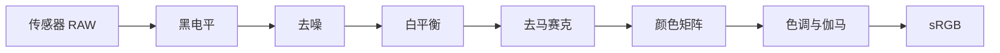

<!-- Generated by scripts/build.py from data/*.yaml. Edit the YAML files, not this file. -->

# Awesome Neural ISP · 中文

[English](README.md) · **简体中文**

**汇集神经相机 ISP 的论文、公开代码与预训练权重，并提供其所基于的经典成像流水线入门指南。**

[交互式论文库](https://ruilin.li/Awesome-Neural-ISP/zh-CN.html) · [预训练权重索引](WEIGHTS.zh-CN.md) · [ISP 入门](guide/isp-101.zh-CN.md) · [贡献指南](CONTRIBUTING.zh-CN.md)

这份目录覆盖完整神经 ISP、RAW 图像复原、颜色与色调处理、可控渲染、逆向 ISP、机器视觉成像与参数调优。每篇论文记录公开代码和预训练权重状态，权重链接以官方仓库为依据。中文标题为阅读辅助译名，同时保留正式英文标题与方法名，便于检索和引用。

目前共 **419 篇论文**，其中 **205 篇有公开代码**（含非官方实现），**132 篇提供预训练权重**，另有 **29 个数据集**。

文献更新：**2026-10-28**；最近一次全面代码与权重链接核验：**2026-10-11**。新增条目另行核验，详见[来源与更新记录](guide/literature-update-2026-10-28.md)。

**表格说明。** 各分类内先列有权重的论文，再列仅有代码或未公开代码的论文；各组按年份降序排列。“仓库内”表示检查点直接保存在仓库中；“非官方”表示第三方实现；“待发布”表示占位仓库或尚未发布实现；“—”表示未发现公开代码。

## 目录

- [ISP 入门](#isp-入门)
- [研究脉络](#研究脉络)
- [论文](#论文)
  - [端到端 RAW-to-sRGB](#端到端-raw-to-srgb)（38 篇，9 篇有权重）
  - [可控神经 ISP](#可控神经-isp)（5 篇，3 篇有权重）
  - [移动端与轻量化 ISP](#移动端与轻量化-isp)（12 篇，4 篇有权重）
  - [RAW 去噪与噪声建模](#raw-去噪与噪声建模)（28 篇，13 篇有权重）
  - [弱光 RAW 增强](#弱光-raw-增强)（32 篇，12 篇有权重）
  - [去马赛克、联合复原与 RAW 超分辨率](#去马赛克联合复原与-raw-超分辨率)（55 篇，14 篇有权重）
  - [连拍与 HDR](#连拍与-hdr)（38 篇，13 篇有权重）
  - [RAW 视频](#raw-视频)（15 篇，6 篇有权重）
  - [白平衡、颜色与色调](#白平衡颜色与色调)（68 篇，31 篇有权重）
  - [逆向 ISP、RAW 重建与压缩](#逆向-ispraw-重建与压缩)（37 篇，12 篇有权重）
  - [面向机器视觉的 ISP](#面向机器视觉的-isp)（45 篇，13 篇有权重）
  - [ISP 参数调优](#isp-参数调优)（16 篇，1 篇有权重）
  - [挑战赛与综述](#挑战赛与综述)（30 篇，1 篇有权重）
- [数据集](#数据集)
- [工具与开源 ISP](#工具与开源-isp)
- [学习资料](#学习资料)
- [相关目录](#相关目录)
- [贡献](#贡献)
- [关于本目录](#关于本目录)
- [许可](#许可)

## ISP 入门

传感器记录带噪声的线性马赛克信号，每个像素只感知一种颜色；ISP 将其变成可直接显示的图像。[完整指南](guide/isp-101.zh-CN.md)逐步介绍这些阶段，并提供可运行的 [NumPy 简易管线](guide/minimal_isp.py)。

| 传统阶段 | 作用 | 相关研究 |
|:--|:--|:--|
| 黑电平、坏点、镜头阴影 | 消除传感器偏移与光学衰减 | 通常保留传统方法 |
| 去噪 | 去除泊松–高斯传感器噪声 | [RAW 去噪](#raw-去噪与噪声建模) · [弱光 RAW](#弱光-raw-增强) · [连拍 / HDR](#连拍与-hdr) · [RAW 视频](#raw-视频) |
| 去马赛克 | 插值重建每个像素缺失的两个颜色通道 | [去马赛克 / 超分](#去马赛克联合复原与-raw-超分辨率) |
| 白平衡、颜色校正、色调与伽马 | 校正光源颜色并映射至显示空间 | [白平衡 / 颜色 / 色调](#白平衡颜色与色调) |
| 完整管线 | RAW 输入，sRGB 输出 | [端到端 ISP](#端到端-raw-to-srgb) · [移动端 ISP](#移动端与轻量化-isp) |
| 可控渲染 | 暴露编辑参数、相机条件或可替换模块 | [可控 ISP](#可控神经-isp) |
| 逆向管线 | 从 sRGB 重建 RAW | [逆向 ISP](#逆向-ispraw-重建与压缩) |
| 面向机器的输出 | 服务检测、分割等任务 | [机器视觉 ISP](#面向机器视觉的-isp) |
| ISP 参数 | 自动优化与传统控制基线 | [ISP 调参](#isp-参数调优) |

## 研究脉络

- **从 CNN 到生成式 ISP。** CNN 曾是截至 2023 年的主流。随后 Transformer 和 Mamba 进入弱光增强与去马赛克；从 2025 年起，扩散与流匹配同时用于正向 ISP 和 RGB-to-RAW。 代表工作：PyNET → LiteISPNet → ISPDiffuser · LDM-ISP · RAW-Flow · SpiralDiff
- **训练数据仍是瓶颈。** 手机 RAW 与单反 sRGB 通常无法精确对齐，也存在颜色差异。应对方法从对齐感知损失发展到合成数据与跨相机 RAW 映射；2025–2026 年的挑战赛进一步转向完全非配对训练。 代表工作：LiteISPNet · Unprocessing · Day-to-Night · Rawformer · NTIRE 2026 非配对 ISP
- **将相机元数据输入网络。** 显式编码 EXIF、ISO、颜色矩阵与拍摄时间，以支持跨相机泛化和可控渲染。 代表工作：ParamISP · MetaISP · CCMNet · Time-Aware AWB · PMRID k-Sigma
- **部署：从挑战赛走向低比特网络。** MAI 挑战赛在手机 NPU 上测量提交方案的运行时间，催生了 MicroISP、PyNET-V2 等紧凑设计。显式量化与二值化研究主要集中在 RAW 视频和去马赛克。 代表工作：MAI 2021/2022/2025 · MicroISP · BRVE · BinRVR · BMTNet · RAWDet-7
- **服务于机器感知的 ISP。** 自 2023 年起，RAW 检测数据集与方法快速增长，包括联合训练的 ISP、通过强化学习选择的 ISP 模块序列，以及直接接收 RAW 的适配器。 代表工作：Dirty Pixels · AdaptiveISP · RAW-Adapter · TA-ISP · POS-ISP · RAWild
- **重新走向可控与模块化。** “可控神经 ISP”专题区分用户编辑与可替换处理阶段，以及相机／风格条件化。自动参数调优和任务驱动优化仍独立归类；NILUT 与编辑感知 RAW 重建则串联颜色模块和逆向成像。 代表工作：CtrlISP · Modular Neural ISP（SIGGRAPH Asia 2026）· ParamISP · MetaISP · Uni-ISP

## 论文

### 端到端 RAW-to-sRGB

用一个网络替代完整 ISP。早期方法主要基于 CNN（DeepISP、PyNET、LiteISPNet），近期引入扩散与自回归先验。RAW/sRGB 训练对的不精确对齐是持续难题。显式渲染控制、相机条件化与模块化编辑见“可控神经 ISP”。

**提供预训练权重（9）**

| 论文 | 发表信息 | 代码 | 权重 |
|:--|:--|:--|:--|
| **[ISPDiffuser](https://arxiv.org/abs/2503.19283)** ISPDiffuser：利用纹理感知扩散模型与直方图引导的色彩一致性学习 RAW 到 sRGB 映射 ISPDiffuser: Learning RAW-to-sRGB Mappings with Texture-Aware Diffusion Models and Histogram-Guided Color Consistency 采用纹理感知损失与直方图引导的色彩一致性约束，构建 RAW 到 sRGB 扩散模型。 | AAAI 2025 | [代码](https://github.com/RenYangSCU/ISPDiffuser) PyTorch | [ZRR / MAI 权重（Google Drive）](https://drive.google.com/drive/folders/1smqKEttfKNEZfS8OT-g9yoMOCoRs90Gy?usp=sharing) [镜像（百度网盘，提取码 f1gv）](https://pan.baidu.com/s/1eAAZf0TbHakxrqwyl2AZVA?pwd=f1gv) |
| **[CBUnet](https://arxiv.org/abs/2204.08970)** 通过级联色彩与亮度补偿渲染夜间图像 Rendering Nighttime Image Via Cascaded Color and Brightness Compensation 级联色彩补偿和亮度补偿网络，用于夜间 RAW 图像渲染。 <i>备注：README 列出了第二阶段及其他权重。</i> | CVPRW (NTIRE) 2022 | [代码](https://github.com/njuvision/CBUnet) PyTorch | [第一阶段 cube++.pth（Google Drive）](https://drive.google.com/file/d/1K8CgwXp0Pk7yPNUWXOF6zbK9iHgpiVDS/view?usp=sharing) |
| **[LiteISPNet](https://openaccess.thecvf.com/content/ICCV2021/html/Zhang_Learning_RAW-to-sRGB_Mappings_With_Inaccurately_Aligned_Supervision_ICCV_2021_paper.html)** 在不精确配准监督下学习 RAW 到 sRGB 映射 Learning RAW-to-sRGB Mappings with Inaccurately Aligned Supervision 联合配准与全局色彩映射，处理 RAW／sRGB 训练对的空间错位与色彩差异；包含轻量 LiteISPNet。 <i>备注：README 还通过百度网盘提供 ZRR（提取码 8sq1）及预处理后的 SR-RAW。</i> | ICCV 2021 | [代码](https://github.com/cszhilu1998/RAW-to-sRGB) PyTorch | [ZRR / SR-RAW 预训练模型（Google Drive）](https://drive.google.com/drive/folders/12eMNZh-A9E4bVup-Kcy_F0_c0IToUyw7?usp=sharing) |
| **[AWNet](https://arxiv.org/abs/2008.09228)** AWNet：用于图像 ISP 的注意力小波网络 AWNet: Attentive Wavelet Network for Image ISP 结合小波变换与注意力，使用 RAW／去马赛克图像双输入，是 AIM 2020 排名前列的方案。 | ECCVW (AIM) 2020 | [代码](https://github.com/Charlie0215/AWNet-Attentive-Wavelet-Network-for-Image-ISP) PyTorch | [demosaiced_model（Google Drive）](https://drive.google.com/file/d/1uhohG6cYkM_-W4dGLl8yGlo85UMF6KEK/view?usp=sharing) [Raw_model（Google Drive）](https://drive.google.com/file/d/1jBwEm7_zbU55qOlGAVuOAQ8BIwx2g7Fw/view?usp=sharing) |
| **[MW-ISPNet](https://arxiv.org/abs/2011.04994)** MW-ISPNet：AIM 2020 学习型 ISP 获胜方案（见挑战报告） MW-ISPNet (AIM 2020 Learned ISP winning solution; see the challenge report) 采用多级小波与残差通道注意力的 U-Net，在 AIM 2020 两个赛道均排名第一。 | ECCVW (AIM) 2020 | [代码](https://github.com/cszhilu1998/MW-ISPNet) PyTorch | [赛道 1 模型（Google Drive）](https://drive.google.com/drive/folders/1lt5eXn49LgLzdj3z7k7lPK0B7obiLIHd?usp=sharing) [赛道 2 模型（Google Drive）](https://drive.google.com/drive/folders/1uyU1huZnh8Wf7BYFkXVfrTl64EuFNcO7?usp=sharing) |
| **[PyNET](https://arxiv.org/abs/2002.05509)** 以单个深度学习模型替代移动相机 ISP Replacing Mobile Camera ISP with a Single Deep Learning Model 在华为 P20 RAW 与佳能 5D Mark IV 照片构成的 ZRR 数据集上，逐层训练倒金字塔多尺度网络。 <i>备注：PyTorch 版本位于 aiff22/PyNET-PyTorch；训练还需要 VGG-19。</i> | CVPRW 2020 | [代码](https://github.com/aiff22/PyNET) TensorFlow / PyTorch | [PyNET_pretrained.zip（TensorFlow）](https://download.ai-benchmark.com/s/C4a3C5WxB8p2my8/download/PyNET_pretrained.zip) [pynet_level_0.pth（PyTorch 版本）](https://download.ai-benchmark.com/s/A5wkJNztkpex8T4/download/pynet_level_0.pth) |
| **[PyNET-CA](https://arxiv.org/abs/2104.02895)** PyNET-CA：加入通道注意力的增强 PyNET，用于端到端移动 ISP PyNET-CA: Enhanced PyNET with Channel Attention for End-to-End Mobile ISP 为 PyNET 加入通道注意力和子像素上采样，是 AIM 2020 ISP 赛道方案。 <i>备注：作者提醒，在 PyTorch &gt; 1.4 时可能无法复现实验结果。</i> | ECCVW (AIM) 2020 | [代码](https://github.com/egyptdj/skyb-aim2020-public) PyTorch | [pretrained_model.zip（Dropbox）](https://www.dropbox.com/s/psoz0auaynu3e5x/pretrained_model.zip?dl=0) |
| **[W-Net](https://arxiv.org/abs/1911.08656)** W-Net：利用错位数据完成 RAW 到 RGB 映射的两阶段 U-Net W-Net: Two-stage U-Net with misaligned data for raw-to-RGB mapping AIM 2019 RAW 到 RGB 参赛方案，以两阶段 U-Net 处理手机 RAW 与单反 RGB 之间错位的监督数据。 | ICCVW (AIM) 2019 | [代码](https://github.com/khuhm/W-Net) | [预训练模型（Google Drive）](https://drive.google.com/drive/folders/1eH_prE7EWEUqxJes5IfHTdsFyqP64o7w?usp=sharing) |
| **[DPED](https://arxiv.org/abs/1704.02470)** 利用深度卷积网络在移动设备上生成单反级照片 DSLR-Quality Photos on Mobile Devices with Deep Convolutional Networks 对手机照片进行 sRGB 到 sRGB 增强，使其达到单反照片风格与质量；采用 DPED 数据集，是 PyNET 学习型 ISP 系列的前身。 | ICCV 2017 | [代码](https://github.com/aiff22/DPED) TensorFlow | [models_orig/{iphone,sony,blackberry}_orig（仓库内）](https://github.com/aiff22/DPED/tree/master/models_orig) |

**仅有代码或尚未公开（29）**

| 论文 | 发表信息 | 代码 |
|:--|:--|:--|
| **[RGB-Event ISP](https://arxiv.org/abs/2501.19129)** RGB-Event ISP：数据集与基准 RGB-Event ISP: The Dataset and Benchmark 面向混合 RGB-事件传感器的首个 ISP 数据集与基准，研究事件数据对去马赛克、去噪和色彩处理的帮助。 <i>备注：数据集位于 Hugging Face 的 yunfanlu/RGB-Event-ISP-Dataset 及百度网盘；仅限非商业研究用途。</i> | ICLR 2025 | [代码](https://github.com/yunfanLu/RGB-Event-ISP) |
| **[FourierISP](https://arxiv.org/abs/2401.02161)** 在傅里叶域解耦风格与结构以增强 RAW 到 sRGB 映射 Enhancing RAW-to-sRGB with Decoupled Style Structure in Fourier Domain 在傅里叶域中将风格（色彩／亮度）与结构解耦并分别学习。 <i>备注：README 明确说明不会发布模型检查点，需要自行训练。</i> | AAAI 2024 | [代码](https://github.com/alexhe101/FourierISP) PyTorch |
| **[Day-to-Night](https://openaccess.thecvf.com/content/CVPR2022/html/Punnappurath_Day-to-Night_Image_Synthesis_for_Training_Nighttime_Neural_ISPs_CVPR_2022_paper.html)** 用于训练夜间神经 ISP 的日转夜图像合成 Day-to-Night Image Synthesis for Training Nighttime Neural ISPs 从日间 RAW 合成带噪声和多光源的夜间 RAW，以训练夜间神经 ISP。 <i>备注：README 提及 pretrained_\* 目录，但仓库中未找到权重文件，且数据集链接为空。</i> | CVPR 2022 | [代码](https://github.com/SamsungLabs/day-to-night) PyTorch |
| **[Deep-FlexISP](https://openaccess.thecvf.com/content/CVPR2022W/NTIRE/html/Liu_Deep-FlexISP_A_Three-Stage_Framework_for_Night_Photography_Rendering_CVPRW_2022_paper.html)** Deep-FlexISP：夜间摄影渲染的三阶段框架 Deep-FlexISP: A Three-Stage Framework for Night Photography Rendering NTIRE 2022 夜间渲染获胜方案，包含去噪、白平衡与色调映射三个阶段。 <i>备注：包含 2022 年模型的 Docker 镜像链接（Google Drive）返回 404（核验日期：2026-10-11）；仓库 Night_Photography_2023 目录提供的是团队 2023 年参赛模型检查点。</i> | CVPRW (NTIRE) 2022 | [代码](https://github.com/q935970314/Deep-FlexISP) |
| **[CameraNet](https://arxiv.org/abs/1908.01481)** CameraNet：高效相机 ISP 学习的两阶段框架 CameraNet: A Two-Stage Framework for Effective Camera ISP Learning 将 ISP 拆分为分别监督的复原和增强子网络，缓解单个网络同时学习去噪与色彩调整的冲突。 <i>备注：官方代码基于 TensorFlow 1.15；README 仅提供 HDR+／SID 预处理数据，未找到权重链接。</i> | IEEE TIP 2019 | [代码](https://github.com/zhetongliang/CameraNet_official) TensorFlow |
| **[HERN](https://arxiv.org/abs/1911.08098)** 用于图像去马赛克与增强的高分辨率网络 HighEr-Resolution Network for Image Demosaicing and Enhancing AIM 2019 RAW 到 RGB 获胜方案，采用高分辨率细节分支与低分辨率全局分支的双分支设计。 <i>备注：README 中挑战权重 114.pth／115.pth 的两个 OneDrive 链接均返回 404（核验日期：2026-10-11）。</i> | ICCVW (AIM) 2019 | [代码](https://github.com/MKFMIKU/RAW2RGBNet) PyTorch |
| **[DRIFT](https://openaccess.thecvf.com/content/CVPR2026W/NTIRE/html/Majee_DRIFT_Deep_Restoration_ISP_Fusion_and_Tone-mapping_CVPRW_2026_paper.html)** DRIFT：深度复原、ISP 融合与色调映射 DRIFT: Deep Restoration, ISP Fusion, and Tone-mapping 将图像复原、ISP 融合与色调映射整合到统一框架中。 | CVPRW (NTIRE) 2026 | — |
| **[NPR Color Bias](https://arxiv.org/abs/2604.28136)** 超越像素保真度：最小化夜间摄影渲染中的感知失真与色彩偏差 Beyond Pixel Fidelity: Minimizing Perceptual Distortion and Color Bias in Night Photography Rendering 在夜间摄影渲染中联合约束感知失真与色彩偏差。 | ICIP 2026 | — |
| **[RPBA-Net](https://arxiv.org/abs/2605.03626)** RPBA-Net：用于 RAW 域 ISP 增强的可解释残差金字塔双边仿射网络 RPBA-Net: An Interpretable Residual Pyramid Bilateral Affine Network for RAW-Domain ISP Enhancement 利用残差金字塔与双边仿射网格实现可解释的 RAW 域 ISP 增强。 | arXiv 2026 | — |
| **[VAR-ISP](https://arxiv.org/abs/2609.18302)** 用于 RAW 到 sRGB 图像信号处理的视觉自回归先验 Visual Autoregressive Priors for RAW-to-sRGB Image Signal Processing 将视觉自回归（VAR）生成先验引入 RAW 到 sRGB 处理。 | ECCVW (LoViF) 2026 | — |
| **[EGUOT-ISP](https://arxiv.org/abs/2512.05635)** 专家引导的非平衡最优传输：利用非配对及配对数据学习 ISP Experts-Guided Unbalanced Optimal Transport for ISP Learning from Unpaired and/or Paired Data 通过专家引导的非平衡最优传输统一配对与非配对 ISP 学习。 <i>备注：仓库目前仅包含 README。</i> | arXiv 2025 | [代码仓库（待发布）](https://github.com/gosha20777/EGUOT-ISP) |
| **[EvRAW](https://scholar.google.com/scholar?q=%22EvRAW%22+RAW-to-sRGB)** EvRAW：事件引导的结构与色彩建模，用于 RAW 到 sRGB 图像重建 EvRAW: Event-guided Structural and Color Modeling for RAW-to-sRGB Image Reconstruction 借助事件相机信息进行结构与色彩建模，实现 RAW 到 sRGB 重建。 | ACM MM 2025 | — |
| **[SemiISP](https://arxiv.org/abs/2504.02345)** SemiISP/SemiIE：利用一对多 sRGB 到 RAW 映射实现半监督 ISP 与图像增强 SemiISP/SemiIE: Semi-Supervised Image Signal Processor and Image Enhancement Leveraging One-to-Many Mapping sRGB-to-RAW 通过一对多的 sRGB 到 RAW 合成扩充训练对，以半监督方式训练 ISP。 | arXiv 2025 | — |
| **[DiR](https://openaccess.thecvf.com/content/CVPR2024/html/Guo_Learning_Degradation-Independent_Representations_for_Camera_ISP_Pipelines_CVPR_2024_paper.html)** 面向相机 ISP 管线的退化无关表征学习 Learning Degradation-Independent Representations for Camera ISP Pipelines 学习与退化无关的表征，提高 ISP 对未知噪声、模糊等退化的鲁棒性。 | CVPR 2024 | — |
| **[Real-World Camera Pipeline](https://arxiv.org/abs/2411.10773)** 端到端真实世界相机成像管线 An End-to-End Real-World Camera Imaging Pipeline 面向真实智能手机成像管线的端到端 ISP，覆盖去噪、色彩与色调处理。 | ACM MM 2024 | — |
| **[RMFA-Net](https://arxiv.org/abs/2406.11469)** RMFA-Net：面向真实 RAW 到 RGB 图像重建的神经 ISP RMFA-Net: A Neural ISP for Real RAW to RGB Image Reconstruction 采用多频率注意力融合，处理真实智能手机 RAW 图像的 ISP 网络。 | arXiv 2024 | — |
| **[Simple ISP](https://arxiv.org/abs/2404.11569)** 利用全局上下文引导的简洁图像信号处理 Simple Image Signal Processing using Global Context Guidance 为轻量 ISP 主干加入全局上下文引导模块，提高整幅图像的色调一致性。 | ICIP 2024 | — |
| **[Back to the Future ISP](https://openaccess.thecvf.com/content/CVPR2023W/NTIRE/html/Zini_Back_to_the_Future_A_Night_Photography_Rendering_ISP_Without_CVPRW_2023_paper.html)** 回到未来：不依赖深度学习的夜间摄影渲染 ISP Back to the Future: A Night Photography Rendering ISP Without Deep Learning 构建不使用深度学习的夜间摄影渲染 ISP，为学习型方法提供参考基线。 | CVPRW (NTIRE) 2023 | — |
| **[Contrastive Subspace ISP](https://arxiv.org/abs/2104.00253)** 面向相机图像信号处理的深度对比图像块子空间学习 Deep Contrastive Patch-Based Subspace Learning for Camera Image Signal Processing 利用图像块子空间与对比学习来学习 ISP 模块。 | IEEE AIC 2023 | — |
| **[Single-Frame HDR ISP](https://openaccess.thecvf.com/content/WACV2023/html/Dinh_End-to-End_Single-Frame_Image_Signal_Processing_for_High_Dynamic_Range_Scenes_WACV_2023_paper.html)** 面向高动态范围场景的端到端单帧图像信号处理 End-to-End Single-Frame Image Signal Processing for High Dynamic Range Scenes 在高动态范围场景中对单帧 RAW 图像执行端到端 ISP。 | WACV 2023 | — |
| **[CRISPnet](https://arxiv.org/abs/2203.10562)** CRISPnet：色彩渲染 ISP 网络 CRISPnet: Color Rendition ISP Net 融合全局场景语义与元数据，以实现准确的色彩渲染。 | arXiv 2022 | — |
| **[ISPW / LiteISP-in-the-wild](https://arxiv.org/abs/2203.10636)** 将智能手机变成单反相机：在真实环境中学习 ISP Transform your Smartphone into a DSLR Camera: Learning the ISP in the Wild 利用真实环境采集的弱配对手机与单反数据（ISPW）学习 ISP，处理配准与色彩差异。 <i>备注：仓库目前仅提供 ISPW 数据集下载；README 表示代码即将发布。</i> | ECCV 2022 | [代码仓库（待发布）](https://github.com/4rdhendu/TransformPhone2DSLR) |
| **[RAWtoBit](https://arxiv.org/abs/2208.07639)** RAWtoBit：完全端到端的相机 ISP 网络 RAWtoBit: A Fully End-to-end Camera ISP Network 将 ISP 与图像压缩合并为单个端到端网络，直接从 RAW 输出比特流。 | ECCV 2022 | — |
| **[Shallow Night Pipeline](https://arxiv.org/abs/2204.08972)** 用于夜间摄影渲染的浅层相机管线 Shallow Camera Pipeline for Night Photography Rendering NTIRE 2022 夜间摄影渲染方案，由少量可学习模块构成浅层相机管线。 <i>备注：论文称录用后发布代码；尚未找到仓库。</i> | arXiv 2022 | — |
| **[StereoISP](https://arxiv.org/abs/2211.07390)** StereoISP：重新思考双相机系统的图像信号处理 StereoISP: Rethinking Image Signal Processing for Dual Camera Systems 对双相机系统采集的两路 RAW 数据联合执行 ISP。 | arXiv 2022 | — |
| **[Sky Optimization](https://openaccess.thecvf.com/content_CVPRW_2020/html/w31/Liba_Sky_Optimization_Semantically_Aware_Image_Processing_of_Skies_in_Low-Light_CVPRW_2020_paper.html)** 天空优化：低光摄影中具有语义感知能力的天空图像处理 Sky Optimization: Semantically Aware Image Processing of Skies in Low-Light Photography 在手机夜景 ISP 中利用轻量分割网络单独处理天空区域，与 Google Night Sight 相关。 | CVPRW 2020 | — |
| **[Deep Camera](https://arxiv.org/abs/1908.09191)** Deep Camera：用于图像信号处理的全卷积神经网络 Deep Camera: A Fully Convolutional Neural Network for Image Signal Processing 以单个全卷积网络替代完整相机 ISP 的早期尝试。 | ICCVW 2019 | — |
| **[DeepISP](https://arxiv.org/abs/1801.06724)** DeepISP：迈向端到端图像处理管线学习 DeepISP: Towards Learning an End-to-End Image Processing Pipeline 最早的端到端学习型 ISP 之一，包含局部去噪／去马赛克和全局色调／色彩调整两阶段，并提供三星 S7 数据集。 | IEEE TIP 2018 | — |
| **[Scene-Dependent Imaging](https://arxiv.org/abs/1707.08350)** 利用深度神经网络建模相机中依赖场景的成像过程 Modelling the Scene Dependent Imaging in Cameras with a Deep Neural Network 以深度神经网络建模相机随场景变化的 RAW 到 sRGB 渲染，是学习型 ISP 的早期尝试之一。 | ICCV 2017 | — |

[返回目录](#目录)

### 可控神经 ISP

通过显式控制信号或可替换阶段调节学习式成像。用户可编辑管线包括 CtrlISP 与 Modular Neural ISP；相机／风格条件化包括 ParamISP、MetaISP 与 Uni-ISP，但元数据条件化不必然提供用户编辑界面。NILUT 和白平衡编辑等局部模块仍归入“白平衡、颜色与色调”，编辑感知 RAW 重建仍归入“逆向 ISP”。自动参数预测与传统 ISP 控制归入“ISP 参数调优”，面向下游任务奖励的优化归入“面向机器视觉的 ISP”。

**提供预训练权重（3）**

| 论文 | 发表信息 | 代码 | 权重 |
|:--|:--|:--|:--|
| **[Modular Neural ISP](https://arxiv.org/abs/2512.08564)** 模块化神经图像信号处理 Modular Neural Image Signal Processing 将神经 ISP 拆分为可替换的去噪、自动白平衡／色彩校正矩阵、照片精修和上采样模块，并提供交互式照片编辑界面。 <i>备注：官方仓库宣布论文已被 SIGGRAPH Asia 2026 录用（核验日期：2026-10-28）；提供独立编辑图形界面。</i> | SIGGRAPH Asia 2026 | [代码](https://github.com/mahmoudnafifi/modular_neural_isp) PyTorch | [denoising/models/\*.pth（lite/base/large）](https://github.com/mahmoudnafifi/modular_neural_isp/tree/main/denoising/models) [photofinishing/models/\*.pth（多种风格）](https://github.com/mahmoudnafifi/modular_neural_isp/tree/main/photofinishing/models) |
| **[ParamISP](https://arxiv.org/abs/2312.13313)** ParamISP：利用相机参数学习正向与逆向 ISP ParamISP: Learned Forward and Inverse ISPs using Camera Parameters 将曝光、ISO、焦距等 EXIF 参数编码进网络，同时学习正向和逆向 ISP，并针对各相机型号分别训练。 | CVPR 2024 | [代码](https://github.com/woo525/ParamISP) PyTorch | [官方权重（Google Drive，逆向与正向）](https://drive.google.com/drive/folders/1L7ZSikYt5eaCOEINpjjwmPX0CoZLbBG6) |
| **[MetaISP](https://arxiv.org/abs/2401.03220)** MetaISP：利用全局场景结构实现准确的多设备色彩渲染 MetaISP – Exploiting Global Scene Structure for Accurate Multi-Device Color Rendition 利用全局场景特征与设备元数据，使单个网络能够渲染多款智能手机各自的色彩风格。 | VMV 2023 | [代码](https://github.com/vccimaging/MetaISP) PyTorch | [MetaISPNet 权重（Google Drive）](https://drive.google.com/drive/folders/1tLWlx0LDUjQ9niZje0cfLKt98dx1VEIR?usp=sharing) |

**仅有代码或尚未公开（2）**

| 论文 | 发表信息 | 代码 |
|:--|:--|:--|
| **[CtrlISP](https://openaccess.thecvf.com/content/CVPR2026F/html/Zhang_CtrlISP_Rescuing_Low-Light_RAW_Images_via_Controllable_Neural_ISP_CVPRF_2026_paper.html)** CtrlISP：通过可控神经 ISP 挽救低光 RAW 图像 CtrlISP: Rescuing Low-Light RAW Images via Controllable Neural ISP 提供可控神经 ISP，让用户调整低光 RAW 图像的亮度与风格。 | CVPR Findings 2026 | — |
| **[Uni-ISP](https://arxiv.org/abs/2406.01003)** Uni-ISP：迈向多移动相机 ISP 的统一学习 Uni-ISP: Toward Unifying the Learning of ISPs from Multiple Mobile Cameras 以单个模型学习多款智能手机的 ISP，并支持相机之间的风格迁移。 | IEEE TIP 2025 | — |

[返回目录](#目录)

### 移动端与轻量化 ISP

为手机 NPU 和 GPU 实时运行设计的 ISP，主要来自 Mobile AI（MAI）和 NTIRE 挑战赛。自 2025 年起，研究重心转向无需配对数据的训练。

**提供预训练权重（4）**

| 论文 | 发表信息 | 代码 | 权重 |
|:--|:--|:--|:--|
| **[Unpaired ISP Transfer](https://arxiv.org/abs/2605.07495)** 利用语义伪配对实现轻量非配对手机 ISP 迁移 Lightweight Unpaired Smartphone ISP Transfer with Semantic Pseudo-Pairing 通过语义伪配对构建训练对，实现非配对手机 ISP 迁移，是 NTIRE 2026 非配对 ISP 赛道方案。 | CVPRW (NTIRE) 2026 | [代码](https://github.com/nuniniyujin/Unpaired-ISP) PyTorch | [模型检查点（Google Drive，见 checkpoints/weight_url.txt）](https://drive.google.com/drive/folders/1kwby-1qOq67RGABkmkLD3OXLC5eYK3OM?usp=sharing) |
| **[Unpaired Lightweight ISP](https://arxiv.org/abs/2505.10420)** 利用非配对数据学习轻量智能手机 ISP Learned Lightweight Smartphone ISP with Unpaired Data 结合多种损失与对抗训练，在无配对数据条件下训练轻量 ISP，并在 ZRR／UltraISP 上评估。 | CVPRW (MAI) 2025 | [代码](https://github.com/AndreiiArhire/Learned-Lightweight-Smartphone-ISP-with-Unpaired-Data) PyTorch | [pretrained/models/{ZRR,Fujifilm}（仓库内）](https://github.com/AndreiiArhire/Learned-Lightweight-Smartphone-ISP-with-Unpaired-Data/tree/main/pretrained) |
| **[LAN](https://openaccess.thecvf.com/content/CVPR2022W/NTIRE/html/Raimundo_LAN_Lightweight_Attention-Based_Network_for_RAW-to-RGB_Smartphone_Image_Processing_CVPRW_2022_paper.html)** LAN：用于智能手机 RAW 到 RGB 图像处理的轻量注意力网络 LAN: Lightweight Attention-Based Network for RAW-to-RGB Smartphone Image Processing 针对 MAI 2021 移动 ISP 数据（索尼 IMX586 RAW 到富士 GFX100）的轻量注意力网络。 | CVPRW (NTIRE) 2022 | [代码](https://github.com/draimundo/LAN) TensorFlow | [models/LAN_iteration_200000.ckpt（仓库内）](https://github.com/draimundo/LAN/tree/master/models) |
| **[MicroISP](https://arxiv.org/abs/2211.06770)** MicroISP：利用深度学习在移动设备上处理 3200 万像素照片 MicroISP: Processing 32MP Photos on Mobile Devices with Deep Learning 采用逐通道分支的极小 ISP，在手机上不到 1 秒即可处理 3200 万像素照片，并提供富士 UltraISP 数据集。 <i>备注：仅限学术用途。</i> | ECCVW 2022 | [代码](https://github.com/aiff22/MicroISP) TensorFlow | [pretrained_weights/MicroISP.ckpt（仓库内）](https://github.com/aiff22/MicroISP/tree/master/pretrained_weights) |

**仅有代码或尚未公开（8）**

| 论文 | 发表信息 | 代码 |
|:--|:--|:--|
| **[PyNET-QxQ](https://arxiv.org/abs/2203.04314)** PyNET-QxQ：用于 CMOS 图像传感器 QxQ Bayer 图案去马赛克的高效 PyNET 变体 PyNET-QxQ: An Efficient PyNET Variant for QxQ Bayer Pattern Demosaicing in CMOS Image Sensors 面向 Quad／QxQ Bayer 图案传感器的轻量 PyNET 变体。 <i>备注：README 要求放置 best_acc_model.pth，但未提供下载链接。</i> | IEEE Access 2023 | [代码](https://github.com/Minhyeok01/PyNET-QxQ) |
| **[SYENet](https://openaccess.thecvf.com/content/ICCV2023/html/Gou_SYENet_A_Simple_Yet_Effective_Network_for_Multiple_Low-Level_Vision_ICCV_2023_paper.html)** SYENet：在移动设备上实时执行多种低层视觉任务的简洁高效网络 SYENet: A Simple Yet Effective Network for Multiple Low-Level Vision Tasks with Real-time Performance on Mobile Device 采用小型重参数化网络处理 ISP、低光增强与超分辨率，在 MAI 2022 移动 ISP 赛道取得最高分。 <i>备注：README 说明了加载预训练模型的参数，但未找到权重下载链接；提供 ONNX 导出脚本。</i> | ICCV 2023 | [代码](https://github.com/sanechips-multimedia/syenet) PyTorch |
| **[PyNET-V2 Mobile](https://arxiv.org/abs/2211.06263)** PyNet-V2 Mobile：利用神经网络进行高效端侧照片处理 PyNet-V2 Mobile: Efficient On-Device Photo Processing With Neural Networks 围绕 NPU 算子约束重新设计的移动版 PyNET，可在手机上处理全分辨率照片。 <i>备注：README 中预训练模型的 Google Drive 链接返回 404（核验日期：2026-10-11）。</i> | ICPR 2022 | [代码](https://github.com/gmalivenko/PyNET-v2) TensorFlow / Keras |
| **[Fourier Unpaired ISP](https://openaccess.thecvf.com/content/CVPR2026W/NTIRE/html/Kim_Freeze_the_Structure_Free_the_Color_Fourier-Domain_Training_for_Unpaired_CVPRW_2026_paper.html)** 固定结构、释放色彩：面向非配对手机 ISP 的傅里叶域训练 Freeze the Structure, Free the Color: Fourier-Domain Training for Unpaired Smartphone ISP 非配对训练时固定结构，仅在傅里叶幅度上学习色彩，是 NTIRE 2026 非配对 ISP 方案。 | CVPRW (NTIRE) 2026 | — |
| **[CoDISP](https://openaccess.thecvf.com/content/CVPR2024W/MAI/html/Zhang_CoDISP_Exploring_Compressed_Domain_Camera_ISP_with_RGB-guided_Encoder_CVPRW_2024_paper.html)** CoDISP：利用 RGB 引导编码器探索压缩域相机 ISP CoDISP: Exploring Compressed Domain Camera ISP with RGB-guided Encoder 在压缩域执行相机 ISP，以降低移动设备的带宽需求。 | CVPRW (MAI) 2024 | — |
| **[LW-ISP](https://arxiv.org/abs/2210.03904)** LW-ISP：结合 ISP 与深度学习的轻量模型 LW-ISP: A Lightweight Model with ISP and Deep Learning 面向移动设备的轻量学习型 ISP，用更少参数替代大型 PyNET 式模型。 | BMVC 2022 | — |
| **[CSANet](https://openaccess.thecvf.com/content/CVPR2021W/MAI/html/Hsyu_CSAnet_High_Speed_Channel_Spatial_Attention_Network_for_Mobile_ISP_CVPRW_2021_paper.html)** CSAnet：用于移动 ISP 的高速通道空间注意力网络 CSAnet: High Speed Channel Spatial Attention Network for Mobile ISP MAI 2021 移动 ISP 方案，结合通道与空间注意力，重点优化 NPU 推理速度。 | CVPRW (MAI) 2021 | — |
| **[Del-Net](https://arxiv.org/abs/2108.01623)** Del-Net：用于移动相机 ISP 的单阶段网络 Del-Net: A Single-Stage Network for Mobile Camera ISP 面向智能手机的单阶段 ISP 网络，是 MAI 2021 挑战赛参赛方案。 | arXiv 2021 | — |

[返回目录](#目录)

### RAW 去噪与噪声建模

位于成像流水线前端。主要研究脉络从泊松–高斯模型发展到基于物理成因的噪声建模（ELD）、暗帧采样、生成式噪声模型，以及免标定和盲去噪。

**提供预训练权重（13）**

| 论文 | 发表信息 | 代码 | 权重 |
|:--|:--|:--|:--|
| **[2-Shots in the Dark](https://arxiv.org/abs/2512.03245)** 2-Shots in the Dark：以最少数据采集实现低光去噪 2-Shots in the Dark: Low-Light Denoising with Minimal Data Acquisition 仅需拍摄两次，即可为新相机准备低光去噪数据。 | CVPR 2026 | [代码](https://github.com/IVRL/2-Shots-in-the-Dark) PyTorch | [SID/ELD、LRID 模型与暗场资源（Google Drive）](https://drive.google.com/drive/folders/1Hz4rzV8578lHCTzQkwCHE2nrphQy1QYG?usp=sharing) |
| **[Nonlocal MatchFilter](https://arxiv.org/abs/2604.17453)** 用于 RAW 图像去噪的可学习非局部特征匹配与滤波 Learned Nonlocal Feature Matching and Filtering for RAW Image Denoising 结合可学习的非局部特征匹配与滤波进行 RAW 图像去噪。 | arXiv 2026 | [代码](https://github.com/MIA-UIB/nonlocal-matchfilter) PyTorch | [GitHub Releases（含权重）](https://github.com/MIA-UIB/nonlocal-matchfilter/releases) |
| **[PNNP](https://arxiv.org/abs/2310.09126)** 从暗场帧学习物理知识引导的噪声模型，用于低光 RAW 图像去噪 Learning Physics-Informed Noise Models from Dark Frames for Low-Light Raw Image Denoising 从暗场帧学习物理知识引导的 PNNP 噪声模型，并发布 LRID 数据集。 <i>备注：提供索尼 A7S2 与 IMX686 的 PNNP 权重；PNNP 本身的训练代码未开源。</i> | IEEE TPAMI 2026 | [代码](https://github.com/fenghansen/PNNP) PyTorch | [模型检查点与资源（百度网盘，提取码 vmcl）](https://pan.baidu.com/s/1WMv2x7yqg0kMTBCddqkCLQ?pwd=vmcl) [LRID 数据集（Hugging Face）](https://huggingface.co/datasets/hansen97/LRID) |
| **[Noise Modeling in One Hour](https://arxiv.org/abs/2505.00045)** 一小时噪声建模：最小化自监督低光 RAW 去噪的准备工作 Noise Modeling in One Hour: Minimizing Preparation Efforts for Self-supervised Low-Light RAW Image Denoising 将噪声建模准备时间缩短至一小时内，并利用暗场阴影进行自监督低光 RAW 去噪。 | CVPR 2025 | [代码](https://github.com/SonyResearch/raw_image_denoising) PyTorch | [预训练模型检查点（Google Drive）](https://drive.google.com/drive/folders/1KyR9f6SIciXWv29owm0xYPCOnaMd9YWh?usp=sharing) |
| **[YOND](https://arxiv.org/abs/2506.03645)** YOND：摆脱相机专属数据依赖的实用盲 RAW 图像去噪 YOND: Practical Blind Raw Image Denoising Free from Camera-Specific Data Dependency 无需相机专属数据：先估计噪声，再做方差稳定变换，最后使用通用去噪器。 | IEEE TPAMI 2025 | [代码](https://github.com/fenghansen/YOND_public) PyTorch | [SNR-Net 权重与训练数据（百度网盘，提取码 nn4v）](https://pan.baidu.com/s/1tAJW_57v2jWJ605MWKMKVg?pwd=nn4v) [在线演示（Hugging Face Spaces）](https://huggingface.co/spaces/hansen97/YOND) |
| **[DualDn](https://arxiv.org/abs/2409.18783)** DualDn：通过可微 ISP 实现双域去噪 DualDn: Dual-domain Denoising via Differentiable ISP 在 RAW 域与 sRGB 域各去噪一次，用可微 ISP 连接两者，以泛化到不同相机 ISP。 <i>备注：两个模型都采用 Restormer 主干，在 MIT-Adobe FiveK 上训练；README 表格还提供测试集和可视化结果。</i> | ECCV 2024 | [代码](https://github.com/OpenImagingLab/DualDn) PyTorch | [pretrained_model.zip，合成数据测试（OneDrive）](https://mycuhk-my.sharepoint.com/:u:/g/personal/1155231343_link_cuhk_edu_hk/Eb2uUHfx8pRBimlrVRbR0dUB5arCuP6Vx5g3LKxImOUv3w?e=XLXLKC) [DualDn_Big.pth，真实拍摄数据／DND（OneDrive）](https://mycuhk-my.sharepoint.com/:u:/g/personal/1155231343_link_cuhk_edu_hk/EeSssinwPSRLvC2zOTdmAd8BLLtF3MaKfFw2kYv25WthkQ?e=bbO0Ql) |
| **[LED](https://arxiv.org/abs/2308.03448)** 两对数据照亮黑暗：免标定 RAW 去噪管线 Lighting Every Darkness in Two Pairs: A Calibration-Free Pipeline for RAW Denoising 先在虚拟相机上预训练，再仅用两对真实数据微调，以适应新传感器，无需标定。 <i>备注：自 2025 年 12 月起还包含 UltraLED 代码与数据。</i> | ICCV 2023 | [代码](https://github.com/Srameo/LED) PyTorch | [模型库（Google Drive）](https://drive.google.com/drive/folders/11MYkjzbPIZ7mJbu9vrgaVC-OwGcOFKsM?usp=sharing) [相关文件（百度网盘，提取码 iay5）](https://pan.baidu.com/s/17rA_8GvfNPZJY5Zl9dyILw?pwd=iay5) [按相机／方法整理的权重表](https://github.com/Srameo/LED/blob/main/docs/pretrained-models.md) |
| **[LRD](https://arxiv.org/abs/2307.16508)** 迈向通用低光 RAW 噪声合成与建模 Towards General Low-Light Raw Noise Synthesis and Modeling 采用物理模型描述信号相关噪声、生成模型描述信号无关噪声，并发布 LRD 数据集。 <i>备注：噪声合成模型因商业许可限制未发布。</i> | ICCV 2023 | [代码](https://github.com/fengzhang427/LRD) PyTorch | [RAW 去噪模型（Google Drive）](https://drive.google.com/file/d/1VkgHyEU6hNsXLL1vRfFWWLZCmGYGyi_h/view?usp=sharing) [镜像（百度网盘，提取码 ujzm）](https://pan.baidu.com/s/1iMNrQh5P4g2prhhk2Tcu_g) |
| **[Pseudo-ISP](https://arxiv.org/abs/2103.10234)** Pseudo-ISP：从彩色图像去噪器学习伪相机内信号处理管线 Pseudo-ISP: Learning Pseudo In-camera Signal Processing Pipeline from A Color Image Denoiser 从 sRGB 去噪器推导伪 ISP，以适应新传感器的真实噪声。 | arXiv 2021 | [代码](https://github.com/happycaoyue/Pseudo-ISP) PyTorch | [预训练去噪模型（百度网盘，提取码 6aj4）](https://pan.baidu.com/s/1W8_Uemrm8coX3wFZ_Jlw1g) |
| **[Rethinking Noise Synthesis](https://openaccess.thecvf.com/content/ICCV2021/html/Zhang_Rethinking_Noise_Synthesis_and_Modeling_in_Raw_Denoising_ICCV_2021_paper.html)** 重新思考 RAW 去噪中的噪声合成与建模 Rethinking Noise Synthesis and Modeling in Raw Denoising 从真实暗场帧采样信号无关噪声，再与信号相关噪声组合，替代参数化噪声模型。 | ICCV 2021 | [代码](https://github.com/zhangyi-3/noise-synthesis) PyTorch | [预训练模型（百度网盘，提取码 v4dh）](https://pan.baidu.com/s/1RMYgubpdKZFO8JUkdTC7vg?pwd=v4dh) |
| **[ELD](https://arxiv.org/abs/2003.12751)** 用于极低光 RAW 去噪的基于物理的噪声形成模型 A Physics-based Noise Formation Model for Extreme Low-light Raw Denoising 依据 CMOS 成像物理建模散粒噪声、含长尾分布的读出噪声、行噪声与量化噪声，并发布 ELD 数据集。 <i>备注：TPAMI 2021 扩展版的 arXiv 编号为 2108.02158；亦可通过 Vandermode/NoiseModel 仓库访问。</i> | CVPR 2020 | [代码](https://github.com/Vandermode/ELD) PyTorch | [ELD 数据与预训练模型（Google Drive）](https://drive.google.com/drive/folders/1QoEhB1P-hNzAc4cRb7RdzyEKktexPVgy?usp=sharing) [镜像（百度网盘，提取码 0lby）](https://pan.baidu.com/s/11ksugpPH5uyDL-Z6S71Q5g) |
| **[MWRCANet](https://arxiv.org/abs/2005.04117)** NTIRE 2020 RAW 去噪获胜方案（见 NTIRE 2020 真实图像去噪报告） NTIRE 2020 RAW denoising winning solution (see the NTIRE 2020 Real Image Denoising report) 多级小波残差通道注意力网络，在 NTIRE 2020 RAW 去噪赛道排名第一；CBUnet 等夜景方案直接复用其权重。 | CVPRW (NTIRE) 2020 | [代码](https://github.com/happycaoyue/NTIRE20_raw_image_denoising_winner_MWRCANet) PyTorch | [RAW 模型 dn_mwrcanet_raw_c1.pth（Google Drive）](https://drive.google.com/drive/folders/1T23SqUEE1_oGGBK-gaRJ3L1jfVctRQtX?usp=sharing) [镜像（百度网盘，提取码 0odp）](https://pan.baidu.com/s/1Hbo86y3NYYf-WtLONRH3Sg) |
| **[PMRID](https://arxiv.org/abs/2010.06935)** 移动设备上的实用深度 RAW 图像去噪 Practical Deep Raw Image Denoising on Mobile Devices 利用标定的传感器噪声和 k-Sigma 变换统一不同 ISO，小型网络在骁龙 855 上约以 70 毫秒／百万像素运行。 | ECCV 2020 | [代码](https://github.com/MegEngine/PMRID) PyTorch / MegEngine | [models/torch_pretrained.ckp + mge_pretrained.ckp（仓库内）](https://github.com/MegEngine/PMRID/tree/main/models) [基准数据（Kaggle 镜像；README 还列有 OneDrive）](https://www.kaggle.com/datasets/1bdc5cd707cfbb3ee842eb3cbfe93495dbba88017d29f295f8edbcb8f8790556) |

**仅有代码或尚未公开（15）**

| 论文 | 发表信息 | 代码 |
|:--|:--|:--|
| **[GALOSH](https://arxiv.org/abs/2607.03768)** GALOSH：通过适合并行计算的局部收缩，对 RAW Bayer 与 sRGB 图像进行免训练盲去噪 GALOSH: Blind, Training-Free Denoising of Raw Bayer and sRGB Images by Parallel-Friendly Local Shrinkage 从输入估计泊松-高斯参数的免训练局部收缩去噪器，适合并行硬件，同时适用于 Bayer RAW 与 sRGB。 <i>备注：无需训练，也没有网络权重；Releases 提供 Windows 可执行程序。</i> | arXiv 2026 | [代码](https://github.com/luxgrain/GALOSH) C++ / Python |
| **[SeNM-VAE](https://openaccess.thecvf.com/content/CVPR2024/html/Zheng_SeNM-VAE_Semi-Supervised_Noise_Modeling_with_Hierarchical_Variational_Autoencoder_CVPR_2024_paper.html)** SeNM-VAE：利用层次化变分自编码器进行半监督噪声建模 SeNM-VAE: Semi-Supervised Noise Modeling with Hierarchical Variational Autoencoder 通过层次化 VAE，结合少量配对数据与大量非配对数据进行半监督噪声建模。 | CVPR 2024 | [代码](https://github.com/zhengdihan/SeNM-VAE) PyTorch |
| **[LLD (Physics-Guided ISO Noise)](https://openaccess.thecvf.com/content/CVPR2023/html/Cao_Physics-Guided_ISO-Dependent_Sensor_Noise_Modeling_for_Extreme_Low-Light_Photography_CVPR_2023_paper.html)** 面向极低光摄影的物理引导、ISO 相关传感器噪声建模 Physics-Guided ISO-Dependent Sensor Noise Modeling for Extreme Low-Light Photography 建立物理引导的 ISO 相关噪声模型，发布含暗场帧与平场帧的 LLD 数据集。 <i>备注：仓库主要用于发布数据集。</i> | CVPR 2023 | [代码](https://github.com/happycaoyue/LLD) |
| **[Noise2NoiseFlow](https://openaccess.thecvf.com/content/CVPR2022/html/Maleky_Noise2NoiseFlow_Realistic_Camera_Noise_Modeling_Without_Clean_Images_CVPR_2022_paper.html)** Noise2NoiseFlow：无需干净图像的真实相机噪声建模 Noise2NoiseFlow: Realistic Camera Noise Modeling without Clean Images 仅用噪声图像对训练归一化流噪声模型，无需干净图像；同一仓库还包含 CVPR 2022 的 sRGB 噪声建模方法。 | CVPR 2022 | [代码](https://github.com/SamsungLabs/Noise2NoiseFlow) PyTorch |
| **[PMN](https://arxiv.org/abs/2207.06103)** 增强低光 RAW 去噪的可学习性：真实配对数据与噪声建模的结合 Learnability Enhancement for Low-light Raw Denoising: Where Paired Real Data Meets Noise Modeling 通过散粒噪声增强和暗场阴影校正，提高少量真实配对数据的可学习性。 <i>备注：README 提供 ISO 噪声参数与数据；预训练权重在后续 PNNP／LRID 版本中发布。</i> | ACM MM 2022 | [代码](https://github.com/megvii-research/PMN) PyTorch |
| **[CA-NoiseGAN](https://arxiv.org/abs/2008.09370)** 学习相机感知的噪声模型 Learning Camera-Aware Noise Models 根据相机与 ISO 生成真实感 RAW 噪声的相机感知 GAN 模型。 <i>备注：README 中模型检查点文件夹的 Google Drive 链接返回 404（核验日期：2026-10-11）。</i> | ECCV 2020 | [代码](https://github.com/arcchang1236/CA-NoiseGAN) PyTorch |
| **[Bayer Unify Aug](https://arxiv.org/abs/1904.12945)** 通过 Bayer 图案统一化与 Bayer 保持增强学习 RAW 图像去噪 Learning Raw Image Denoising with Bayer Pattern Unification and Bayer Preserving Augmentation 利用 Bayer 图案统一化与保持 Bayer 结构的数据增强，赢得 NTIRE 2019 RAW 去噪赛道。 <i>备注：仓库仅包含 BayerUnify/Aug 工具函数。</i> | CVPRW (NTIRE) 2019 | [代码](https://github.com/Jiaming-Liu/BayerUnifyAug) |
| **[Noise Flow](https://arxiv.org/abs/1908.08453)** Noise Flow：利用条件归一化流进行噪声建模 Noise Flow: Noise Modeling with Conditional Normalizing Flows 利用条件归一化流学习真实相机噪声分布，并根据 ISO／增益条件生成噪声。 <i>备注：自动下载 SIDD_Medium_Raw；未找到单独的权重链接。</i> | ICCV 2019 | [代码](https://github.com/BorealisAI/noise_flow) TensorFlow |
| **[SIDD](https://openaccess.thecvf.com/content_cvpr_2018/html/Abdelhamed_A_High-Quality_Denoising_CVPR_2018_paper.html)** 面向智能手机相机的高质量去噪数据集 A High-Quality Denoising Dataset for Smartphone Cameras 包含来自 5 款手机约 3 万张带噪 RAW／sRGB 图像及估计的干净真值，是真实噪声建模的基础数据集。 <i>备注：仓库包含真值估计代码；数据集位于 SIDD 网站。</i> | CVPR 2018 | [代码](https://github.com/AbdoKamel/sidd-ground-truth-image-estimation) |
| **[Color-Blind LL Cameras](https://arxiv.org/abs/2607.11090)** 为什么低光相机会色盲：消除 RAW 去噪中的色彩偏差 Why Low-Light Cameras Go Color Blind: Removing Color Bias in Raw Denoising 分析低光 RAW 去噪引入的色偏，并提出消除该偏差的方法。 | ICCP 2026 | — |
| **[RPG-VST](https://arxiv.org/abs/2607.24291)** RPG-VST：用于盲 RAW 去噪的鲁棒泊松-高斯方差稳定化 RPG-VST: Robust Poisson-Gaussian Variance Stabilization for Blind RAW Denoising 在高斯去噪器之前进行鲁棒方差稳定变换，将未知参数的泊松-高斯 RAW 噪声转为近似恒定方差。 | IEEE SPL 2026 | — |
| **[Non-parametric Noise](https://www.ecva.net/papers/eccv_2024/papers_ECCV/html/3438_ECCV_2024_paper.php)** 非参数传感器噪声建模与合成 Non-parametric Sensor Noise Modeling and Synthesis 不预设参数化分布，直接从标定数据建模并合成传感器噪声。 | ECCV 2024 | — |
| **[Contrastive LL Denoise](https://arxiv.org/abs/2305.03352)** 用于低光 RAW 去噪的对比学习 Contrastive Learning for Low-light Raw Denoising 通过对比学习约束特征，实现低光 RAW 去噪。 | AAAI 2023 | — |
| **[ELMformer](https://arxiv.org/abs/2208.14704)** ELMformer：利用局部乘性 Transformer 高效复原 RAW 图像 ELMformer: Efficient Raw Image Restoration with a Locally Multiplicative Transformer 采用局部乘性 Transformer 进行 RAW 去噪和去模糊。 <i>备注：仓库仅包含 README。</i> | ACM MM 2022 | [代码仓库（待发布）](https://github.com/leonmakise/ELMformer) |
| **[NODE](https://arxiv.org/abs/1909.05249)** NODE：利用噪声分解网络进行极低光 RAW 图像去噪 NODE: Extreme Low Light Raw Image Denoising using a Noise Decomposition Network 将噪声分解为信号相关与信号无关部分，并分别估计。 | arXiv 2019 | — |

[返回目录](#目录)

### 弱光 RAW 增强

由 SID 开启的极弱光 RAW-to-sRGB 研究。方法从 U-Net 发展到解耦的两阶段结构（DNF）、Mamba 与扩散模型，近期也研究欠曝光与过曝光的联合校正。用户可调节的弱光成像（CtrlISP）见“可控神经 ISP”。

**提供预训练权重（12）**

| 论文 | 发表信息 | 代码 | 权重 |
|:--|:--|:--|:--|
| **[HiMA](https://arxiv.org/abs/2510.15497)** 用于低光 RAW 图像增强的层次化混合架构 Hierarchical Mixing Architecture for Low-light RAW Image Enhancement 通过层次化混合 Transformer 与 Mamba 增强低光 RAW，与 Retinex-RAWMamba 来自相同作者。 | arXiv 2025 | [代码](https://github.com/Cynicarlos/HiMA) PyTorch | [预训练模型（Google Drive）](https://drive.google.com/drive/folders/196hPm0aLqpgsxLryKqKpE0UKgvXE_0ap?usp=drive_link) [预训练模型（百度网盘，提取码 8fem）](https://pan.baidu.com/s/146zs6nfFdNcTmA3ytsd7vQ?pwd=8fem) |
| **[LDM-ISP](https://arxiv.org/abs/2312.01027)** LDM-ISP：利用潜空间扩散模型改进低光神经 ISP LDM-ISP: Enhancing Neural ISP for Low Light with Latent Diffusion Models 将潜空间扩散先验引入神经 ISP，以恢复极低光 RAW 中的细节和色彩。 <i>备注：作者称发布模型为重新训练的版本，得分略高于论文所报结果。</i> | ICRA 2025 | [代码](https://github.com/csqiangwen/LDM-ISP) PyTorch | [pretrained_models（OneDrive/SharePoint）](https://hkustconnect-my.sharepoint.com/:f:/g/personal/qwenab_connect_ust_hk/EglycxTmf0RNqWc5C3uvRRcBGISUNq2rsOiOqx_fT23Scg?e=kb1BNY) |
| **[SIED](https://arxiv.org/abs/2506.21132)** 学习在极暗环境中看见 Learning to See in the Extremely Dark 将低光 RAW 增强推进至比 SID 更暗的场景，发布 SIED 数据集及对应增强方法。 | ICCV 2025 | [代码](https://github.com/JianghaiSCU/SIED) PyTorch | [预训练模型（OneDrive）](https://1drv.ms/f/c/e379fe7c770e3033/Ekg7dQ-J7PxCuJ3_-FQ_uNsB0ZWvwL2HUK3dSFcogki0jA?e=XWToVn) [镜像（百度网盘，提取码 m9zp）](https://pan.baidu.com/s/1m3pP50qopY8TRoGwt6wrjA) |
| **[Retinex-RAWMamba](https://arxiv.org/abs/2409.07040)** Retinex-RAWMamba：连接去马赛克与去噪以增强低光 RAW 图像 Retinex-RAWMamba: Bridging Demosaicing and Denoising for Low-Light RAW Image Enhancement 将 Retinex 分解与 Mamba 架构结合，联合处理去马赛克与去噪。 <i>备注：各模型检查点还提供百度网盘镜像。</i> | IEEE TCSVT 2024 | [代码](https://github.com/Cynicarlos/RetinexRawMamba) PyTorch | [索尼模型（Google Drive）](https://drive.google.com/file/d/1eAgm5HHDH0CBUsl-czZ7Kdues3tAPy7W/view?usp=drive_link) [富士模型（Google Drive）](https://drive.google.com/file/d/1C9x-VcHdkFt-7MQONSkZAWtttu3Gtp12/view?usp=drive_link) [MCR 模型（Google Drive）](https://drive.google.com/file/d/1OOuyC7PcODPrcNm1uXx2CZwIS8mchtj7/view?usp=drive_link) |
| **[DNF](https://openaccess.thecvf.com/content/CVPR2023/html/Jin_DNF_Decouple_and_Feedback_Network_for_Seeing_in_the_Dark_CVPR_2023_paper.html)** DNF：用于暗光成像的解耦与反馈网络 DNF: Decouple and Feedback Network for Seeing in the Dark 将 RAW 域去噪与 sRGB 域色彩恢复解耦，再以反馈连接联结两个阶段。 | CVPR 2023 | [代码](https://github.com/Srameo/DNF) PyTorch | [SID 索尼模型（Google Drive）](https://drive.google.com/file/d/1FHreF_UHFutkiQ0LMdWjX2fahznka0Cb/view?usp=share_link) [SID 富士模型（Google Drive）](https://drive.google.com/file/d/1WfwZLBbj0EUf_QTYS8Qq5Rzk2iV8QKQ7/view?usp=share_link) [MCR 模型（Google Drive）](https://drive.google.com/file/d/1kFYnqJTYfYkRWcojGxgV9DpVup4uFFBR/view?usp=share_link) [SID 索尼模型（百度网盘，提取码 eoiz）](https://pan.baidu.com/s/1-r29zUvCS-Wa2wEYovX89g?pwd=eoiz) |
| **[ExposureDiffusion](https://arxiv.org/abs/2307.07710)** ExposureDiffusion：学习曝光以增强低光图像 ExposureDiffusion: Learning to Expose for Low-light Image Enhancement 将物理曝光过程嵌入扩散模型，逐步把低光 RAW 曝光至正常光照。 <i>备注：与 R2LCM 为同一作者。</i> | ICCV 2023 | [代码](https://github.com/wyf0912/ExposureDiffusion) PyTorch | [SID_Pg / SID_PGru / SID_real 等模型（Google Drive）](https://drive.google.com/drive/folders/1qdxZBg-GsYxHaDj3Zd_NikYiweqDOFzo?usp=drive_link) |
| **[MCR](https://openaccess.thecvf.com/content/CVPR2022/html/Dong_Abandoning_the_Bayer-Filter_To_See_in_the_Dark_CVPR_2022_paper.html)** 抛弃 Bayer 滤色阵列以看清暗处 Abandoning the Bayer-Filter to See in the Dark 采集无 Bayer 滤色阵列的单色传感器与彩色传感器配对数据（MCR），先解码图像，再进行着色。 <i>备注：MCR 数据集也可从百度网盘获取，提取码 22cv。</i> | CVPR 2022 | [代码](https://github.com/TCL-AILab/Abandon_Bayer-Filter_See_in_the_Dark) PyTorch | [MCR_pretrained_model（Google Drive）](https://drive.google.com/file/d/1GDQxKobmIxw1hn9EToghcBNmKcnT_eJo/view?usp=sharing) [SID_pretrained_model（Google Drive）](https://drive.google.com/file/d/1m4Os_EpOQpBbaFXcHbEQA048prMrE8Rl/view?usp=sharing) |
| **[RED](https://openaccess.thecvf.com/content/CVPR2021/html/Lamba_Restoring_Extremely_Dark_Images_in_Real_Time_CVPR_2021_paper.html)** 实时复原极暗图像 Restoring Extremely Dark Images in Real Time 轻量低光 RAW 复原网络，将大部分计算放在极低分辨率进行；CPU 上每张 800 万像素图像约需 1.8 秒，参数量约 78 万。 <i>备注：仓库另含 SID／SGN／DID 的对比训练脚本。</i> | CVPR 2021 | [代码](https://github.com/MohitLamba94/Restoring-Extremely-Dark-Images-In-Real-Time) PyTorch | [demo_imgs/weights（仓库内，由 demo.py 直接加载）](https://github.com/MohitLamba94/Restoring-Extremely-Dark-Images-In-Real-Time/tree/main/demo_imgs) |
| **[EEMEFN](https://github.com/MinfengZhu/EEMEFN)** EEMEFN：通过边缘增强多曝光融合网络进行低光图像增强 EEMEFN: Low-Light Image Enhancement via Edge-Enhanced Multi-Exposure Fusion Network 从单张极暗 RAW 生成多种曝光并融合，再利用边缘分支细化细节，在 SID 数据上评估。 <i>备注：发表于 AAAI 2020，无 arXiv 版本。</i> | AAAI 2020 | [代码](https://github.com/MinfengZhu/EEMEFN) PyTorch | [索尼／富士模型（MEGA）](https://mega.nz/file/uBUhDCaS#sl_3X-ceBsConxcytAH-FUmBfbaO2Zh6e4X3GIVf24w) |
| **[Moving Objects in the Dark](https://openaccess.thecvf.com/content_ICCV_2019/html/Jiang_Learning_to_See_Moving_Objects_in_the_Dark_ICCV_2019_paper.html)** 学习在黑暗中看清运动物体 Learning to See Moving Objects in the Dark 利用分光器同轴相机采集低光／正常光 RAW 配对视频，训练低光 RAW 视频增强模型。 | ICCV 2019 | [代码](https://github.com/MichaelHYJiang/Learning-to-See-Moving-Objects-in-the-Dark) TensorFlow | [python download_model.py（脚本下载）](https://github.com/MichaelHYJiang/Learning-to-See-Moving-Objects-in-the-Dark) |
| **[Seeing Motion in the Dark](https://openaccess.thecvf.com/content_ICCV_2019/html/Chen_Seeing_Motion_in_the_Dark_ICCV_2019_paper.html)** 在黑暗中看清运动 Seeing Motion in the Dark 将 SID 扩展到低光 RAW 视频（DRV 数据集），在静态视频上训练并抑制时序闪烁。 | ICCV 2019 | [代码](https://github.com/cchen156/Seeing-Motion-in-the-Dark) TensorFlow | [预训练模型（Google Drive）](https://drive.google.com/drive/folders/1OO97dDJp9GlqijGfcvKpas2PZB0q9o8n?usp=sharing) |
| **[SID](https://arxiv.org/abs/1805.01934)** 学习在黑暗中看见 Learning to See in the Dark 使用 U-Net 将短曝光极暗 RAW 映射为长曝光 sRGB，发布 SID（索尼／富士）数据集，开启低光 RAW 研究。 <i>备注：2025 年 9 月作者因存储成本移除了数据集下载脚本，数据需手动下载；模型仍可通过脚本获取。</i> | CVPR 2018 | [代码](https://github.com/cchen156/Learning-to-See-in-the-Dark) TensorFlow | [python download_models.py（脚本下载）](https://github.com/cchen156/Learning-to-See-in-the-Dark#testing) |

**仅有代码或尚未公开（20）**

| 论文 | 发表信息 | 代码 |
|:--|:--|:--|
| **[NEC-Diff](https://arxiv.org/abs/2603.20005)** NEC-Diff：噪声鲁棒的事件与 RAW 互补扩散，在极暗环境中看清运动 NEC-Diff: Noise-Robust Event-RAW Complementary Diffusion for Seeing Motion in Extreme Darkness 利用扩散模型融合事件相机与 RAW 的互补数据，处理极暗场景中的运动。 <i>备注：数据集正在分批上传；尚无权重。</i> | CVPR 2026 | [代码](https://github.com/jinghan-xu/NEC-Diff) |
| **[ERIENet](https://arxiv.org/abs/2512.15186)** ERIENet：低光环境中的高效 RAW 图像增强网络 ERIENet: An Efficient RAW Image Enhancement Network under Low-Light Environment 注重低参数量与快速推理的低光 RAW 到 sRGB 增强网络，获 ICVISP 2025 最佳论文。 <i>备注：仓库含训练和测试代码；未找到权重。</i> | ICVISP 2025 | [代码](https://github.com/whiteknight-WJN/An-Efficient-RAW-Image-Enhancement-Network-under-Low-Light-Environment) PyTorch |
| **[TS-Diff](https://arxiv.org/abs/2505.04281)** TS-Diff：用于低光 RAW 图像增强的两阶段扩散模型 TS-Diff: Two-Stage Diffusion Model for Low-Light RAW Image Enhancement 先在多相机数据上预训练，再在目标相机上快速微调的两阶段扩散方法。 <i>备注：pretrained_models/ 目录仅包含占位文件。</i> | IJCNN 2025 | [代码](https://github.com/CircccleK/TS-Diff) PyTorch |
| **[LLPackNet](https://www.bmva-archive.org.uk/bmvc/2020/assets/papers/0145.pdf)** 迈向快速轻量的暗光图像复原 Towards Fast and Light-Weight Restoration of Dark Images 利用打包／解包操作在极低分辨率上处理图像并自行估计放大系数，运行速度显著快于 SID。 | BMVC 2020 | [代码](https://github.com/MohitLamba94/LLPackNet) PyTorch |
| **[MeanFlow RAW](https://arxiv.org/abs/2608.01720)** 当极暗场景遇到运动模糊：用于统一 RAW 复原的 MeanFlow When Extreme Darkness Meets Motion Blur: MeanFlow for Unified RAW Restoration 联合处理极暗场景与运动模糊的 RAW 图像复原方法。 | arXiv 2026 | — |
| **[RawMetaDiff](https://openaccess.thecvf.com/content/CVPR2026/html/Liu_RawMetaDiff_Unlocking_Extreme_Darkness_from_Dual-Exposure_RAW_with_Meta-Guided_Diffusion_CVPR_2026_paper.html)** RawMetaDiff：通过元数据引导扩散挖掘双曝光 RAW 中的极暗场景信息 RawMetaDiff: Unlocking Extreme Darkness from Dual-Exposure RAW with Meta-Guided Diffusion 在双曝光 RAW 上进行元数据引导的扩散处理，用于极暗场景。 | CVPR 2026 | — |
| **[RIECR](https://arxiv.org/abs/2610.28191)** 通过线性光照与频率自适应增强实现统一 RAW 图像曝光校正与复原 Unified RAW Image Exposure Correction and Restoration via Linear Illumination and Frequency-Adaptive Enhancement 利用通道感知线性光照增益与频率自适应复原，联合校正欠曝和过曝 RAW 图像；提供涵盖 223 个场景的 1784 对配对拍摄数据。 <i>备注：2026-10-20 发布。作者仓库将该工作标为 ACAIT 2026，但仅含 README；截至 2026-10-28 尚无实现代码与权重。</i> | arXiv 2026 | [代码仓库（待发布）](https://github.com/yingkai-zhang/RIECR) |
| **[DarkDiff](https://arxiv.org/abs/2505.23743)** DarkDiff：将扩散模型改用于相机 ISP，推进低光 RAW 增强 DarkDiff: Advancing Low-Light Raw Enhancement by Retasking Diffusion Models for Camera ISP 将预训练图像扩散模型重新用于低光 RAW 的相机 ISP。 | arXiv 2025 | — |
| **[ISP-driven LLIE Data](https://arxiv.org/abs/2504.12204)** 通过 ISP 驱动的数据建模实现更真实的低光图像增强 Towards Realistic Low-Light Image Enhancement via ISP Driven Data Modeling 对 ISP 管线建模，合成更真实的低光训练数据。 | arXiv 2025 | — |
| **[Reconstruction & Denoising in the Dark](https://openaccess.thecvf.com/content/CVPR2025/html/Ma_Rethinking_Reconstruction_and_Denoising_in_the_Dark_New_Perspective_General_CVPR_2025_paper.html)** 重新思考暗光中的重建与去噪：新视角、通用架构及其拓展 Rethinking Reconstruction and Denoising in the Dark: New Perspective, General Architecture and Beyond 在通用架构中统一低光 RAW 重建与去噪，重新审视两者关系。 | CVPR 2025 | — |
| **[Rectified-Flow LL RAW](https://arxiv.org/abs/2509.08330)** 用于低光 RAW 图像增强的物理引导整流流 Physics-Guided Rectified Flow for Low-light RAW Image Enhancement 利用物理噪声模型引导整流流，对低光 RAW 图像进行增强。 | arXiv 2025 | — |
| **[DiffuseRAW](https://arxiv.org/abs/2402.18575)** DiffuseRAW：用于低光图像的端到端生成式 RAW 图像处理 DiffuseRAW: End-to-End Generative RAW Image Processing for Low-Light Images 使用扩散模型直接从低光 RAW 生成 sRGB。 | arXiv 2023 | — |
| **[FDA Low-Light](https://arxiv.org/abs/2312.06723)** 通过特征域适应学习看清低光图像 Learning to See Low-Light Images via Feature Domain Adaptation 单阶段低光 RAW 到 sRGB 网络，通过特征域适应解耦去噪与色彩映射，避免两阶段网络的计算开销。 | arXiv 2023 | — |
| **[Progressive LL RAW](https://arxiv.org/abs/2106.14844)** 面向 RAW 图像的渐进式联合低光增强与去噪 Progressive Joint Low-light Enhancement and Noise Removal for Raw Images 对 RAW 图像渐进地联合进行低光增强与噪声去除。 | IEEE TIP 2022 | — |
| **[RAW LLE (TIP)](https://arxiv.org/abs/2112.14022)** 迈向利用 RAW 图像的低光增强 Towards Low Light Enhancement with RAW Images 系统比较 RAW 与 sRGB 输入在低光增强中的表现，并提出 RAW 域方法。 | IEEE TIP 2022 | — |
| **[Burst Dark Enhancement](https://arxiv.org/abs/2006.09845)** 通过连拍摄影学习增强极暗图像 Burst Photography for Learning to Enhance Extremely Dark Images 对极暗 RAW 连拍序列进行由粗到细的增强。 | IEEE TIP 2021 | — |
| **[Few-Shot LL RAW](https://arxiv.org/abs/2303.15528)** 面向低光 RAW 图像增强的小样本域适应 Few-Shot Domain Adaptation for Low Light RAW Image Enhancement 采用小样本跨相机域适应进行低光 RAW 增强，获 BMVC 最佳学生论文提名。 | BMVC 2021 | — |
| **[Adaptive Low-Light RAW](https://arxiv.org/abs/2004.10447)** 学习用于极低光 RAW 图像处理的自适应模型 Learning an Adaptive Model for Extreme Low-light Raw Image Processing 自适应估计曝光的极低光 RAW 图像处理模型。 | IET Image Processing 2020 | — |
| **[Short/Long Raw Pairs](https://arxiv.org/abs/2007.00199)** 利用短曝光与长曝光 RAW 图像对进行低光图像复原 Low-light Image Restoration with Short- and Long-exposure Raw Pairs 同时利用有噪声的短曝光 RAW 与有模糊的长曝光 RAW 恢复低光图像。 | arXiv 2020 | — |
| **[Low-Light Camera Pipeline](https://arxiv.org/abs/1904.05939)** 学习用于极低光成像的数字相机管线 Learning Digital Camera Pipeline for Extreme Low-Light Imaging 针对极低光场景学习完整数字相机管线。 | arXiv 2019 | — |

[返回目录](#目录)

### 去马赛克、联合复原与 RAW 超分辨率

将 CFA 颜色插值与去噪、超分辨率联合建模，近年来扩展到 Quad、Nona、HybridEVS 等非标准 Bayer 传感器。

**提供预训练权重（14）**

| 论文 | 发表信息 | 代码 | 权重 |
|:--|:--|:--|:--|
| **[BMTNet](https://arxiv.org/abs/2503.16134)** 用于轻量 Quad Bayer HybridEVS 去马赛克的二值化 Mamba-Transformer Binarized Mamba-Transformer for Lightweight Quad Bayer HybridEVS Demosaicing 采用二值化 Mamba-Transformer 实现轻量 Quad Bayer 去马赛克，与低比特部署直接相关。 | CVPR 2025 | [代码](https://github.com/Clausy9/BMTNet) PyTorch | [预训练模型（Google Drive）](https://drive.google.com/file/d/1bn7Pxt05H2bJd3MFVB600_UXbkECq9pg/view?usp=sharing) |
| **[DSDNet](https://arxiv.org/abs/2504.15756)** DSDNet：通过双色彩空间协同进行 RAW 域去摩尔纹 DSDNet: Raw Domain Demoiréing via Dual Color-Space Synergy 利用两个色彩空间的协同作用去除 RAW 域摩尔纹。 | ACM MM 2025 | [代码](https://github.com/xxxxxxxxDSDNet/DSDNet-official) PyTorch | [预训练模型（Google Drive）](https://drive.google.com/drive/folders/1hjJLFLX4pvBUxhPIvk6XCvCBLZNQIZ7N?usp=drive_link) [镜像（百度网盘，提取码 ewnv）](https://pan.baidu.com/s/14_hywe6NE320qwFjwMJ31A) |
| **[QRNet](https://arxiv.org/abs/2412.07256)** 对双曝光 Quad-Bayer 图案建模以联合去噪与去模糊 Modeling Dual-Exposure Quad-Bayer Patterns for Joint Denoising and Deblurring 面向双曝光 Quad-Bayer 传感器联合去噪和去模糊，并发布 D2 数据集。 <i>备注：D2 数据集约 43.5 GB，百度网盘提取码 0fbf。</i> | IEEE TIP 2025 | [代码](https://github.com/zhaoyuzhi/QRNet) PyTorch | [QRNet 预训练模型（百度网盘，提取码 l5nw）](https://pan.baidu.com/s/1H6aJr4uRnsrjm96T0XrSXQ?pwd=l5nw) |
| **[Quad/Nona JDD](https://arxiv.org/abs/2504.07145)** 考察单 Bayer、Quad-Bayer 与 Nona-Bayer 图案的联合去马赛克与去噪 Examining Joint Demosaicing and Denoising for Single-, Quad-, and Nona-Bayer Patterns 系统比较单 Bayer、Quad-Bayer 和 Nona-Bayer 图案下的联合去马赛克与去噪。 | ICCP 2025 | [代码](https://github.com/SamsungLabs/unified-demosaicing) PyTorch | [PyTorch/models/iso{400..3200}.pth（仓库内）](https://github.com/SamsungLabs/unified-demosaicing/tree/main/PyTorch/models) |
| **[RawNIND](https://arxiv.org/abs/2501.08924)** 从 RAW 自然图像噪声数据集学习联合去噪、去马赛克与压缩 Learning Joint Denoising, Demosaicing, and Compression from the Raw Natural Image Noise Dataset 发布 RawNIND 数据集，并联合学习去噪、去马赛克和压缩。 <i>备注：权重采用 GPL3 与 CC-BY-4.0 双重许可。</i> | arXiv 2025 | [代码](https://github.com/trougnouf/rawnind_jddc) PyTorch | [预训练模型（Google Drive）](https://drive.google.com/drive/folders/12Uc5sT4OWx02sviUS_boDk1zDSDRVorw?usp=sharing) |
| **[DemosaicFormer](https://arxiv.org/abs/2406.07951)** DemosaicFormer：面向 HybridEVS 相机的由粗到细去马赛克网络 DemosaicFormer: Coarse-to-Fine Demosaicing Network for HybridEVS Camera 采用由粗到细 Transformer，赢得 MIPI 2024 HybridEVS 去马赛克赛道。 | CVPRW (MIPI) 2024 | [代码](https://github.com/QUEAHREN/DemosaicFormer) PyTorch | [模型（Google Drive）](https://drive.google.com/file/d/1Fc9LA5KRoprYMlQ8gZmsddKHdDQW0Z8z/view?usp=drive_link) |
| **[DREUDC](https://www.ecva.net/papers/eccv_2024/papers_ECCV/html/6479_ECCV_2024_paper.php)** 用于屏下相机 RAW 图像复原的面板特定退化表征 Panel-Specific Degradation Representation for Raw Under-Display Camera Image Restoration 学习显示面板特定的退化表征，恢复屏下相机 RAW 图像，并发布配套数据。 | ECCV 2024 | [代码](https://github.com/OBAKSA/DREUDC) PyTorch | [数据集与预训练模型（Google Drive）](https://drive.google.com/drive/folders/1k4RQQJhNNKa3J_XC0lI2XGojL8xWCUA9?usp=sharing) |
| **[RRID](https://arxiv.org/abs/2312.09063)** RAW 与 sRGB 域的图像去摩尔纹 Image Demoireing in RAW and sRGB Domains 同时利用 RAW 和 sRGB 两个域，去除屏幕重拍图像中的摩尔纹。 | ECCV 2024 | [代码](https://github.com/rebeccaeexu/RRID) PyTorch | [预训练模型（Dropbox）](https://www.dropbox.com/scl/fo/wxhxlj6y064fbx4lrotcd/APoEwRwRT82LnW8wzDqvW24?rlkey=ghf505sfpkr8y9z5psourzpk6&st=enbcm5va&dl=0) |
| **[JDD Two-stage](https://arxiv.org/abs/2009.06205)** 联合去马赛克与去噪受益于两阶段训练策略 Joint Demosaicking and Denoising Benefits from a Two-stage Training Strategy 先学习去马赛克，再学习联合去噪的两阶段训练策略。 | J. Comput. Appl. Math. 2023 | [代码](https://github.com/Yuguo-math/JDMDN-TwoStage) PyTorch | [Demosaic/{lightweight,normal}.pkl 与 Denoise/（仓库内）](https://github.com/Yuguo-math/JDMDN-TwoStage) |
| **[VD_raw](https://arxiv.org/abs/2310.20332)** 通过通道与空间调制去除重拍屏幕 RAW 图像和视频中的摩尔纹 Recaptured Raw Screen Image and Video Demoiréing via Channel and Spatial Modulations 利用通道及空间调制，对重拍屏幕 RAW 图像与视频去摩尔纹。 | NeurIPS 2023 | [代码](https://github.com/tju-chengyijia/VD_raw) PyTorch | [完整模型（百度网盘，提取码 f5g4）](https://pan.baidu.com/s/1ThF7LZ20RkjBUbb-w3Hwqw) [基线模型检查点（仓库内）](https://github.com/tju-chengyijia/VD_raw/blob/main/model_dir_cwb/nets/checkpoint_000040.tar) |
| **[CDLNet](https://arxiv.org/abs/2112.00913)** CDLNet：用于盲去噪与去马赛克的噪声自适应卷积字典学习网络 CDLNet: Noise-Adaptive Convolutional Dictionary Learning Network for Blind Denoising and Demosaicing 展开卷积字典学习形成网络，具有少参数、可解释与噪声自适应特性，同时处理盲去噪和去马赛克。 | IEEE OJSP 2022 | [代码](https://github.com/nikopj/CDLNet-OJSP) PyTorch | [trained_nets/{CDLNet-s2030, JDD_CDLNet-s0120}（仓库内）](https://github.com/nikopj/CDLNet-OJSP/tree/HEAD/trained_nets) |
| **[RSTCANet](https://arxiv.org/abs/2204.07098)** 用于图像去马赛克的残差 Swin Transformer 通道注意力网络 Residual Swin Transformer Channel Attention Network for Image Demosaicing 将 Swin Transformer 与通道注意力结合，提供 B／S／L 三种规模的去马赛克网络。 | EUVIP 2022 | [代码](https://github.com/xingwz/RSTCANet) PyTorch | [dm_model_zoo/RSTCANet_{B,S,L}.pth（仓库内）](https://github.com/xingwz/RSTCANet/tree/master/dm_model_zoo) |
| **[BJDD / PIPNet](https://arxiv.org/abs/2104.09398)** 超越联合去马赛克与去噪：面向像素合并图像传感器的处理管线 Beyond Joint Demosaicking and Denoising: An Image Processing Pipeline for a Pixel-bin Image Sensor 面向 Quad-Bayer 像素合并传感器的联合去马赛克与去噪管线。 | CVPRW (NTIRE) 2021 | [代码](https://github.com/sharif-apu/BJDD_CVPR21) PyTorch | [Quad-Bayer 权重（Google Drive）](https://drive.google.com/drive/folders/1_ziIMjK9vGg-P_7Wxit96bnfHiO4_wQw?usp=sharinge) [Bayer 权重（Google Drive）](https://drive.google.com/drive/folders/125hFTHR5qpJy4AKhtjxFhZJ5aPxQI4TE?usp=sharing) |
| **[JDNDMSR](https://openaccess.thecvf.com/content/CVPR2021/html/Xing_End-to-End_Learning_for_Joint_Image_Demosaicing_Denoising_and_Super-Resolution_CVPR_2021_paper.html)** 用于联合图像去马赛克、去噪与超分辨率的端到端学习 End-to-End Learning for Joint Image Demosaicing, Denoising and Super-Resolution 通过单个网络联合执行去马赛克、去噪和超分辨率。 | CVPR 2021 | [代码](https://github.com/xingwz/End-to-End-JDNDMSR) Keras | [models/jdndmsr+_model.h5 等（仓库内）](https://github.com/xingwz/End-to-End-JDNDMSR/tree/main/models) |

**仅有代码或尚未公开（41）**

| 论文 | 发表信息 | 代码 |
|:--|:--|:--|
| **[JD3Net](https://arxiv.org/abs/2601.00703)** 利用空间下采样各向同性网络实现高效深度去马赛克 Efficient Deep Demosaicing with Spatially Downsampled Isotropic Networks 先进行空间下采样，再应用各向同性网络，降低去马赛克计算成本。 | WACVW 2026 | [代码](https://github.com/cory-fan/jd3net) PyTorch |
| **[FrENet](https://arxiv.org/abs/2505.24407)** 利用自适应频率调制高效去除 RAW 图像模糊 Efficient RAW Image Deblurring with Adaptive Frequency Modulation 通过自适应频率调制高效进行 RAW 图像去模糊。 <i>备注：README 要求将预训练模型放入 checkpoints，但未提供下载链接。</i> | arXiv 2025 | [代码](https://github.com/WenlongJiao/FrENet) PyTorch |
| **[BSRAW](https://arxiv.org/abs/2312.15487)** BSRAW：改进盲 RAW 图像超分辨率 BSRAW: Improving Blind RAW Image Super-Resolution 设计 RAW 域退化管线，用于盲 RAW 图像超分辨率。 <i>备注：代码与退化工具位于 mv-lab/AISP 的 imresutils 中。</i> | WACV 2024 | [代码](https://github.com/mv-lab/AISP) |
| **[Efficient Blind RAW Restoration](https://arxiv.org/abs/2409.18204)** 迈向高效深度盲 RAW 图像复原 Toward Efficient Deep Blind Raw Image Restoration 面向盲 RAW 图像复原（去噪与去模糊）的高效基线。 | ICIP 2024 | [代码](https://github.com/mv-lab/AISP) |
| **[TENet](https://arxiv.org/abs/1905.02538)** 重新思考基于学习的去马赛克、去噪与超分辨率管线 Rethinking Learning-based Demosaicing, Denoising, and Super-Resolution Pipeline 研究去噪、超分辨率、去马赛克的最优执行顺序（先去噪，再超分辨率，最后去马赛克），并发布 PixelShift200 数据集。 <i>备注：README 提供 PixelShift200 与 DIV2K 数据链接。</i> | ICCP 2022 | [代码](https://github.com/guochengqian/TENet) PyTorch |
| **[SAGAN (Nona-Bayer)](https://arxiv.org/abs/2110.08619)** SAGAN：用于带噪 Nona-Bayer 重建的对抗空间非对称注意力 SAGAN: Adversarial Spatial-asymmetric Attention for Noisy Nona-Bayer Reconstruction 面向带噪 Nona-Bayer（3×3 同色像素）传感器联合去噪与重建。 | BMVC 2021 | [代码](https://github.com/sharif-apu/SAGAN_BMVC21) PyTorch |
| **[Real Scene SR with Raw](https://arxiv.org/abs/1905.12156)** 迈向利用 RAW 图像的真实场景超分辨率 Towards Real Scene Super-Resolution with Raw Images 模拟相机成像以生成 RAW 训练对，并利用 RAW 进行真实场景超分辨率；扩展版为利用 RAW 图像实现真实场景超分辨率，arXiv 2102.01579。 <i>备注：仓库包含 TPAMI 2021 扩展版代码。README 中 ×2／×4 模型文件夹的 Google Drive 链接返回 404（核验日期：2026-10-11）。</i> | CVPR 2019 | [代码](https://github.com/xuxy09/RawSR) TensorFlow |
| **[Zoom to Learn](https://arxiv.org/abs/1905.05169)** 通过变焦学习，学习如何变焦 Zoom to Learn, Learn to Zoom 通过光学变焦采集 SR-RAW 数据集，直接在 RAW 上进行真实世界超分辨率，并提出 CoBi 损失处理配准误差。 <i>备注：README 提供 SR-RAW 数据集（Google Drive／百度网盘，提取码 wi02）和快速推理说明。</i> | CVPR 2019 | [代码](https://github.com/ceciliavision/zoom-learn-zoom) TensorFlow |
| **[Residual JDSR](https://arxiv.org/abs/1802.06573)** 用于联合去马赛克与超分辨率的深度残差网络 Deep Residual Network for Joint Demosaicing and Super-Resolution 早期残差网络，直接将 Bayer RAW 超分辨率重建为高分辨率 RGB。 <i>备注：第三方 PyTorch 复现。</i> | CIC 2018 | [非官方代码](https://github.com/Linwei-Chen/Deep-Residual-Network-for-JointDemosaicing-and-Super-Resolution) PyTorch |
| **[DemosaicNet](https://groups.csail.mit.edu/graphics/demosaicnet/)** 深度联合去马赛克与去噪 Deep Joint Demosaicking and Denoising 通过大规模挖掘困难样本训练联合去马赛克与去噪网络，支持 Bayer 和 X-Trans。 <i>备注：PyTorch 版本未实现噪声感知模型；请参考较早的 Caffe 仓库 mgharbi/demosaicnet_caffe。</i> | SIGGRAPH Asia (TOG) 2016 | [代码](https://github.com/mgharbi/demosaicnet) PyTorch |
| **[Pixel-bin Unified Demosaic](https://arxiv.org/abs/2606.13136)** 面向像素合并图像传感器去马赛克的可扩展轻量统一架构 An Extensible and Lightweight Unified Architecture for Demosaicing Pixel-bin Image Sensors 以单个轻量网络处理 Quad、Nona 等像素合并传感器的去马赛克。 | arXiv 2026 | — |
| **[R3 Bayer Deraining](https://arxiv.org/abs/2509.24022)** R3：重建、RAW 与雨——直接在 Bayer 域去雨 R3: Reconstruction, Raw, and Rain: Deraining Directly in the Bayer Domain 直接在 Bayer 域进行去雨与图像重建。 | WACV 2026 | — |
| **[SegDem](https://arxiv.org/abs/2608.07916)** SegDem：让分割帮助去马赛克 SegDem: Segmentation helps Demosaicing 将分割信息引入去马赛克，帮助重建边缘与纹理区域。 | arXiv 2026 | — |
| **[Smartphone RAW Degradation](https://openaccess.thecvf.com/content/CVPR2026/html/Mosleh_RAW-Domain_Degradation_Models_for_Realistic_Smartphone_Super-Resolution_CVPR_2026_paper.html)** 面向真实智能手机超分辨率的 RAW 域退化模型 RAW-Domain Degradation Models for Realistic Smartphone Super-Resolution 为智能手机超分辨率建立 RAW 域退化模型。 | CVPR 2026 | — |
| **[Structural Guidance JDD](https://arxiv.org/abs/2608.09995)** 结构引导的统一联合去马赛克与去噪 Structural Guidance for Unified Joint Demosaicing and Denoising 利用结构先验引导统一的联合去马赛克与去噪框架。 | arXiv 2026 | — |
| **[ASRD](https://arxiv.org/abs/2507.23219)** 通过基于小波的循环重建学习任意尺度 RAW 图像下采样 Learning Arbitrary-Scale RAW Image Downscaling with Wavelet-based Recurrent Reconstruction 在保持 RAW 统计特性的同时进行任意尺度下采样，与 ISPDiffuser 出自同一团队。 <i>备注：代码即将发布。</i> | ACM MM 2025 | [代码仓库（待发布）](https://github.com/RenYangSCU/ASRD) |
| **[Camera-Specific RAW SR Sim](https://scholar.google.com/scholar?q=%22Camera-Specific+Imaging+Simulation+for+Raw+Domain+Image+Super+Resolution%22)** 面向 RAW 域图像超分辨率的相机特定成像模拟 Camera-Specific Imaging Simulation for Raw Domain Image Super Resolution 根据相机特性模拟成像，生成 RAW 域超分辨率训练数据。 | ACM MM 2025 | — |
| **[QB HybridEVS SSM](https://arxiv.org/abs/2508.06058)** 通过状态空间增强交叉注意力实现轻量 Quad Bayer HybridEVS 去马赛克 Lightweight Quad Bayer HybridEVS Demosaicing via State Space Augmented Cross-Attention 利用状态空间模型增强交叉注意力，对交错事件像素的 Quad Bayer HybridEVS 去马赛克，是同团队 BMTNet 的后续工作。 | arXiv 2025 | — |
| **[RAW Reflection Removal](https://openaccess.thecvf.com/content/CVPR2025/html/Kee_Removing_Reflections_from_RAW_Photos_CVPR_2025_paper.html)** 从 RAW 照片中去除反射 Removing Reflections from RAW Photos 利用 RAW 的线性与高位深特性去除玻璃反射。 | CVPR 2025 | — |
| **[RDDM](https://arxiv.org/abs/2508.19154)** RDDM：将 RAW 域扩散模型用于真实世界图像复原 RDDM: Practicing RAW Domain Diffusion Model for Real-world Image Restoration 直接在传感器 RAW 上进行基于扩散的真实图像复原，替代 sRGB 域扩散。 <i>备注：仓库目前仅包含 README 与图片。</i> | arXiv 2025 | [代码仓库（待发布）](https://github.com/YanCHEN-fr/RDDM) |
| **[Train on RAW & HDR](https://arxiv.org/abs/2312.03640)** 在 RAW 与 HDR 图像上训练复原神经网络 Training Neural Networks on RAW and HDR Images for Restoration Tasks 讨论在线性 RAW／HDR 数据上训练复原网络时的归一化与损失设计。 | CVPRW (NTIRE) 2025 | — |
| **[Combine DM & DN](https://arxiv.org/abs/2408.06684)** 如何最佳结合去马赛克与去噪？ How to Best Combine Demosaicing and Denoising? 系统比较去马赛克与去噪的执行顺序和组合策略。 | Inverse Probl. Imaging 2024 | — |
| **[RBSFormer](https://openaccess.thecvf.com/content/CVPR2024W/NTIRE/html/Jiang_RBSFormer_Enhanced_Transformer_Network_for_Raw_Image_Super-Resolution_CVPRW_2024_paper.html)** RBSFormer：用于 RAW 图像超分辨率的增强 Transformer 网络 RBSFormer: Enhanced Transformer Network for Raw Image Super-Resolution NTIRE 2024 RAW 图像超分辨率挑战赛方案。 | CVPRW (NTIRE) 2024 | — |
| **[Inheriting Bayer's Legacy](https://arxiv.org/abs/2303.13571)** 继承 Bayer 的传统：Quad Bayer 图像传感器的联合重马赛克与去噪 Inheriting Bayer's Legacy: Joint Remosaicing and Denoising for Quad Bayer Image Sensor 对 Quad Bayer 传感器联合重马赛克和去噪，输出标准 Bayer 数据以复用现有 ISP。 | arXiv 2023 | — |
| **[JDD Double DIP](https://arxiv.org/abs/2309.09426)** 利用双深度图像先验联合去马赛克与去噪 Joint Demosaicing and Denoising with Double Deep Image Priors 使用两个深度图像先验，无需训练数据即可联合去马赛克与去噪。 | arXiv 2023 | — |
| **[Moiré-Free Demosaick](https://arxiv.org/abs/2305.08585)** 迈向无摩尔纹且保留细节的去马赛克 Toward Moiré-Free and Detail-Preserving Demosaicking 针对高频区域摩尔纹伪影与细节损失设计去马赛克网络。 | arXiv 2023 | — |
| **[RAW Rain Removal](https://arxiv.org/abs/2312.13304)** 利用 RAW 图像端到端去除雨纹 End-to-end Rain Streak Removal with RAW Images 直接对 RAW 图像进行端到端雨纹去除。 | arXiv 2023 | — |
| **[SDAT](https://arxiv.org/abs/2303.15792)** SDAT：通过子数据集交替训练改进图像去马赛克 SDAT: Sub-Dataset Alternation Training for Improved Image Demosaicing 在不同子数据集间交替训练，提高去马赛克泛化能力。 | IEEE OJSP 2023 | — |
| **[Unified Demosaicing (KD)](https://openaccess.thecvf.com/content/ICCV2023/html/Lee_Efficient_Unified_Demosaicing_for_Bayer_and_Non-Bayer_Patterned_Image_Sensors_ICCV_2023_paper.html)** 面向 Bayer 与非 Bayer 图案传感器的高效统一去马赛克 Efficient Unified Demosaicing for Bayer and Non-Bayer Patterned Image Sensors 以单个模型处理 Bayer、Quad、Nona 等多种滤色阵列图案。 | ICCV 2023 | — |
| **[ISP-Agnostic UDC](https://arxiv.org/abs/2111.01511)** 面向屏下相机的 ISP 无关图像重建 ISP-Agnostic Image Reconstruction for Under-Display Cameras 在 RAW 域复原屏下相机图像，将复原与下游 ISP 解耦。 | arXiv 2021 | — |
| **[JDD in the Wild](https://arxiv.org/abs/2101.04442)** 真实环境中的联合去马赛克与去噪：在真值不确定时训练 Joint Demosaicking and Denoising in the Wild: The Case of Training Under Ground Truth Uncertainty 研究当真值本身包含误差时，如何训练联合去马赛克与去噪模型。 | AAAI 2021 | — |
| **[Joint DM + HDR](https://arxiv.org/abs/2111.07281)** 单次拍摄中的深度联合去马赛克与高动态范围成像 Deep Joint Demosaicing and High Dynamic Range Imaging within a Single Shot 从单帧空间变化曝光 RAW 中同时进行去马赛克与 HDR 重建。 | arXiv 2021 | — |
| **[Jointly Deblur-Demosaick-Denoise](https://arxiv.org/abs/2104.06459)** 学习联合去除 RAW 图像模糊、马赛克与噪声 Learning to Jointly Deblur, Demosaick and Denoise Raw Images 同时处理 RAW 图像中的模糊、马赛克与噪声。 | arXiv 2021 | — |
| **[DM-or-DN First](https://openaccess.thecvf.com/content_CVPRW_2020/html/w31/Jin_A_Review_of_an_Old_Dilemma_Demosaicking_First_or_Denoising_CVPRW_2020_paper.html)** 重访一个老难题：先去马赛克还是先去噪？ A Review of an Old Dilemma: Demosaicking First, or Denoising First? 系统比较先去马赛克与先去噪，并根据实验给出顺序建议。 | CVPRW (NTIRE) 2020 | — |
| **[JDSR](https://arxiv.org/abs/1911.03558)** 联合去马赛克与超分辨率：网络设计与感知优化 Joint Demosaicing and Super-Resolution (JDSR): Network Design and Perceptual Optimization 为联合去马赛克与超分辨率设计网络，并使用感知损失优化。 | IEEE TCI 2020 | — |
| **[Raw Image Deblurring](https://arxiv.org/abs/2012.04264)** RAW 图像去模糊 Raw Image Deblurring 提出首个 RAW 域去模糊数据集 Deblur-RAW 及对应方法。 | IEEE TMM 2020 | — |
| **[SGNet (JDD)](https://openaccess.thecvf.com/content_CVPR_2020/html/Liu_Joint_Demosaicing_and_Denoising_With_Self_Guidance_CVPR_2020_paper.html)** 利用自引导进行联合去马赛克与去噪 Joint Demosaicing and Denoising with Self Guidance 先恢复采样最密集的绿色通道，再将其作为引导恢复完整图像。 <i>备注：仓库 README 仅有待办事项，代码尚未发布。</i> | CVPR 2020 | [代码仓库（待发布）](https://github.com/laulampaul/sgnet) |
| **[Deep Demosaicing for Edge](https://arxiv.org/abs/1904.00775)** 面向边缘部署的深度去马赛克 Deep Demosaicing for Edge Implementation 为边缘设备设计轻量去马赛克网络，研究准确率与计算量之间的权衡。 | ICIAR 2019 | — |
| **[JDD Burst Fine-tune](https://arxiv.org/abs/1905.05092)** 通过微调 RAW 连拍图像联合去马赛克与去噪 Joint Demosaicking and Denoising by Fine-Tuning of Bursts of Raw Images 无需真值，直接在同一连拍序列的多帧 RAW 上自监督微调联合去马赛克与去噪网络。 | ICCV 2019 | — |
| **[DMCNN](https://arxiv.org/abs/1802.03769)** 学习用于去马赛克的深度卷积网络 Learning Deep Convolutional Networks for Demosaicing 早期 CNN 去马赛克基线 DMCNN 与 DMCNN-VD。 | arXiv 2018 | — |
| **[Kokkinos Demosaick](https://arxiv.org/abs/1803.05215)** 利用级联卷积残差去噪网络进行深度图像去马赛克 Deep Image Demosaicking using a Cascade of Convolutional Residual Denoising Networks 将去马赛克表述为迭代优化，在每一步使用残差去噪网络作为先验。 | ECCV 2018 | — |

[返回目录](#目录)

### 连拍与 HDR

对齐并融合多帧 RAW 图像，实现超分辨率、去噪和高动态范围成像。BurstSR 与 NTIRE 挑战赛是主要评测基准。

**提供预训练权重（13）**

| 论文 | 发表信息 | 代码 | 权重 |
|:--|:--|:--|:--|
| **[DEBIR](https://arxiv.org/abs/2603.21784)** 动态曝光连拍图像复原 Dynamic Exposure Burst Image Restoration 在动态曝光条件下复原连拍图像，与 ParamISP 出自同一团队。 | CVPR 2026 | [代码](https://github.com/woo525/DEBIR) PyTorch | [官方权重（Google Drive）](https://drive.google.com/drive/folders/13MfH52gQVCwDvasXscaVnv6zUwokCBJe) |
| **[BurstM](https://arxiv.org/abs/2409.15384)** BurstM：结合光流与傅里叶空间的深度连拍多尺度超分辨率 BurstM: Deep Burst Multi-scale SR using Fourier Space with Optical Flow 将傅里叶空间处理与光流结合，进行多尺度连拍超分辨率。 | ECCV 2024 | [代码](https://github.com/Egkang-Luis/BurstM) PyTorch | [SyntheticBurst 模型（Google Drive）](https://drive.google.com/file/d/1XzBOV_F2un0nBWBdCCQCmDzvXlmee-cO/view?usp=sharing) [BurstSR 模型（Google Drive）](https://drive.google.com/file/d/1id83q_IOF7qawO5_4WJ4ZGOFvxkcwbFw/view?usp=sharing) |
| **[Burstormer](https://arxiv.org/abs/2304.01194)** Burstormer：用于连拍图像复原与增强的 Transformer Burstormer: Burst Image Restoration and Enhancement Transformer BIPNet 的 Transformer 版本，采用多尺度局部与非局部配准。 <i>备注：其他任务的权重列在相应子目录的 README 中。</i> | CVPR 2023 | [代码](https://github.com/akshaydudhane16/Burstormer) PyTorch | [合成连拍超分辨率检查点（OneDrive）](https://mbzuaiac-my.sharepoint.com/:u:/g/personal/akshay_dudhane_mbzuai_ac_ae/ER8mPnjoSIZAnaKA8YyCeE8BA_uQr_73b5qRZx9sh9Rzvw?e=Sc4HFJ) |
| **[FBANet](https://arxiv.org/abs/2309.04803)** 迈向真实世界连拍图像超分辨率：基准与方法 Towards Real-World Burst Image Super-Resolution: Benchmark and Method 提出真实世界连拍超分辨率数据集 RealBSR 与联合仿射融合网络。 <i>备注：模型检查点的 Google Drive 副本返回 404（核验日期：2026-10-11）。</i> | ICCV 2023 | [代码](https://github.com/yjsunnn/FBANet) PyTorch | [RealBSR 检查点 model_best.pth（百度网盘，提取码 f9ew）](https://pan.baidu.com/s/1y0OSXD9ExMj4mQ8Sj0VpoA?pwd=f9ew) |
| **[RawHDR](https://arxiv.org/abs/2309.02020)** RawHDR：从单张 RAW 图像重建高动态范围图像 RawHDR: High Dynamic Range Image Reconstruction from a Single Raw Image 利用 RAW 的高位深，从单张 RAW 分别恢复高光与暗部，重建 HDR 图像。 | ICCV 2023 | [代码](https://github.com/yunhao-zou/RawHDR) PyTorch | [预训练模型（OneDrive）](https://1drv.ms/u/c/451f7e5b32aa37e0/EaqD9NpDCCFDlHQ68yWLYFQBsNFXk1fBvWkDWcy6Dq95Gw?e=gqyglJ) |
| **[Single-Shot HDR Demosaic](https://openaccess.thecvf.com/content/ICCV2023/html/Kim_Joint_Demosaicing_and_Deghosting_of_Time-Varying_Exposures_for_Single-Shot_HDR_ICCV_2023_paper.html)** 针对时变曝光联合去马赛克与去鬼影，实现单次拍摄 HDR 成像 Joint Demosaicing and Deghosting of Time-Varying Exposures for Single-Shot HDR Imaging 面向空间变化曝光的传感器，联合执行去马赛克与去鬼影。 | ICCV 2023 | [代码](https://github.com/KAIST-VCLAB/singshot-hdr-demosaicing) PyTorch | [预训练模型 best_psnr_mu.pt（Google Drive）](https://drive.google.com/file/d/19W4kWG1YngX10CCT-f9rn7TdqIIpunjc/view?usp=sharing) |
| **[2StageAlign](https://openaccess.thecvf.com/content/CVPR2022/html/Guo_A_Differentiable_Two-Stage_Alignment_Scheme_for_Burst_Image_Reconstruction_With_CVPR_2022_paper.html)** 面向大位移连拍图像重建的可微两阶段配准方案 A Differentiable Two-stage Alignment Scheme for Burst Image Reconstruction with Large Shift 在较大位移下利用可微两阶段配准，联合进行连拍去噪与去马赛克。 | CVPR 2022 | [代码](https://github.com/GuoShi28/2StageAlign) PyTorch | [experiments/.../models（仓库内）](https://github.com/GuoShi28/2StageAlign/tree/main/experiments/J0007_JDDB_PBMNet_wgr_ncc_gt_s2h/models) |
| **[BIPNet](https://openaccess.thecvf.com/content/CVPR2022/html/Dudhane_Burst_Image_Restoration_and_Enhancement_CVPR_2022_paper.html)** 连拍图像复原与增强 Burst Image Restoration and Enhancement 通过伪连拍特征融合，在统一框架内处理连拍超分辨率、去噪与低光增强。 <i>备注：各子任务权重列在 Burst_Super_Resolution／Burst De-noising 子目录的 README 中。</i> | CVPR 2022 | [代码](https://github.com/akshaydudhane16/BIPNet) PyTorch | [合成连拍超分辨率模型 BIPNet.ckpt（OneDrive）](https://mbzuaiac-my.sharepoint.com/:u:/g/personal/akshay_dudhane_mbzuai_ac_ae/EYlxq0X49fRGiFD3kMxnM6IB7VNtwhd3atNr4oc1b1psbA?e=pLN14I) |
| **[BSRT](https://arxiv.org/abs/2204.08332)** BSRT：结合 Swin Transformer 与光流引导可变形配准改进连拍超分辨率 BSRT: Improving Burst Super-Resolution with Swin Transformer and Flow-Guided Deformable Alignment NTIRE 2022 连拍超分辨率冠军，采用 Swin Transformer 与光流引导的可变形配准。 | CVPRW (NTIRE) 2022 | [代码](https://github.com/Algolzw/BSRT) PyTorch | [全部预训练权重（Google Drive）](https://drive.google.com/file/d/1Bv1ZwoE3s8trhG--wjB0Yt6WJIQPpvsn/view?usp=sharing) |
| **[DBSR](https://openaccess.thecvf.com/content/CVPR2021/html/Bhat_Deep_Burst_Super-Resolution_CVPR_2021_paper.html)** 深度连拍超分辨率 Deep Burst Super-Resolution 利用光流配准与注意力融合实现多帧 RAW 超分辨率，发布真实世界 BurstSR 数据集并组织 NTIRE 2021 赛道。 <i>备注：挑战赛工具包：goutamgmb/NTIRE21_BURSTSR。</i> | CVPR 2021 | [代码](https://github.com/goutamgmb/deep-burst-sr) PyTorch | [模型库（由安装脚本自动下载）](https://github.com/goutamgmb/deep-burst-sr#model-zoo) |
| **[Deep-Rep](https://arxiv.org/abs/2108.08286)** 多帧超分辨率与去噪的深度重参数化 Deep Reparametrization of Multi-Frame Super-Resolution and Denoising 在学习得到的深度重参数化空间中进行多帧最大后验优化，统一连拍超分辨率与去噪，入选 ICCV 2021 口头报告。 | ICCV 2021 | [代码](https://github.com/goutamgmb/deep-rep) PyTorch | [模型库（由安装脚本自动下载）](https://github.com/goutamgmb/deep-rep#model-zoo) |
| **[EBSR](https://openaccess.thecvf.com/content/CVPR2021W/NTIRE/html/Luo_EBSR_Feature_Enhanced_Burst_Super-Resolution_With_Deformable_Alignment_CVPRW_2021_paper.html)** EBSR：利用可变形配准进行特征增强连拍超分辨率 EBSR: Feature Enhanced Burst Super-Resolution with Deformable Alignment NTIRE 2021 连拍超分辨率获胜方案，采用可变形配准与特征增强。 | CVPRW (NTIRE) 2021 | [代码](https://github.com/Algolzw/EBSR) PyTorch | [合成赛道模型（Google Drive）](https://drive.google.com/file/d/1_WA2chhITIsCj6qImcEM2lD6c-iJsRpy/view?usp=sharing) [真实赛道模型（Google Drive）](https://drive.google.com/file/d/1Zz21YwNtiKZCjerrZsdvcWyubqTJBwaD/view?usp=sharing) |
| **[GCP-Net](https://arxiv.org/abs/2101.09870)** 利用绿色通道先验对真实世界连拍图像联合去噪与去马赛克 Joint Denoising and Demosaicking with Green Channel Prior for Real-world Burst Images 借助绿色通道先验，对真实世界连拍图像进行联合去噪与去马赛克。 | IEEE TIP 2021 | [代码](https://github.com/GuoShi28/GCP-Net) PyTorch | [experiments/gcpnet_model/600000_G.pth（仓库内）](https://github.com/GuoShi28/GCP-Net/blob/main/experiments/gcpnet_model/600000_G.pth) |

**仅有代码或尚未公开（25）**

| 论文 | 发表信息 | 代码 |
|:--|:--|:--|
| **[KBNet](https://arxiv.org/abs/2112.07315)** 核感知的连拍盲超分辨率 Kernel-Aware Burst Blind Super-Resolution 通过估计模糊核进行连拍盲超分辨率。 | WACV 2023 | [代码](https://github.com/shermanlian/KBNet) PyTorch |
| **[BPN](https://openaccess.thecvf.com/content_CVPR_2020/html/Xia_Basis_Prediction_Networks_for_Effective_Burst_Denoising_With_Large_Kernels_CVPR_2020_paper.html)** 利用基预测网络实现高效大核连拍去噪 Basis Prediction Networks for Effective Burst Denoising with Large Kernels 预测一组共享基核及其系数，实现高效的大卷积核连拍去噪。 <i>备注：README 和 scripts/download_models.sh 中的 Google Drive 模型文件链接返回 404（核验日期：2026-10-11）。</i> | CVPR 2020 | [代码](https://github.com/likesum/bpn) TensorFlow |
| **[KPN](https://arxiv.org/abs/1712.02327)** 利用核预测网络进行连拍去噪 Burst Denoising with Kernel Prediction Networks 接收噪声水平输入，预测逐像素卷积核，对多帧 RAW 进行配准与去噪。 <i>备注：仅提供训练代码与合成数据管线。</i> | CVPR 2018 | [代码](https://github.com/google/burst-denoising) TensorFlow |
| **[BRACE](https://arxiv.org/abs/2606.29845)** 从 Bricker 到 BRACE：针对闪烁条纹的包围曝光 RAW 数据集与复原模型 Bricker to BRACE: A Bracket Exposure RAW Dataset and Restoration Model for Flicker-Banding 针对拍摄屏幕时滚动快门与屏幕调光导致的闪烁条纹，提供包围曝光 RAW 数据集与复原模型。 <i>备注：README 中模型与数据下载仍列为待办事项。</i> | arXiv 2026 | [代码仓库（待发布）](https://github.com/ZZH-qwq/BRACE) |
| **[BurstGP](https://arxiv.org/abs/2604.23508)** BurstGP：利用生成先验增强 RAW 连拍图像超分辨率 BurstGP: Enhancing Raw Burst Image Super Resolution with Generative Priors 在 RAW 连拍超分辨率中引入生成先验。 | arXiv 2026 | — |
| **[GenMFSR](https://arxiv.org/abs/2603.19187)** GenMFSR：生成式多帧图像复原与超分辨率 GenMFSR: Generative Multi-Frame Image Restoration and Super-Resolution 进行生成式多帧图像复原与超分辨率。 | arXiv 2026 | — |
| **[Keyframe SSM Burst SR](https://arxiv.org/abs/2503.19634)** 以关键帧为中心的连拍图像超分辨率状态空间建模 Keyframe-Centric State-Space Modeling for Burst Image Super-Resolution 以关键帧为中心建立状态空间模型，进行多帧 RAW 超分辨率，降低长序列计算量。 | SIGGRAPH Asia 2026 | — |
| **[LatentBurst](https://arxiv.org/abs/2604.23268)** LatentBurst：面向十六合一 Bayer 图案 CMOS 图像传感器图像的快速高效多帧超分辨率 LatentBurst: A Fast and Efficient Multi Frame Super-Resolution for Hexadeca-Bayer Pattern CIS images 面向十六合一 Hexadeca-Bayer 图像传感器的高效多帧超分辨率。 | arXiv 2026 | — |
| **[Neural Block-wise Auto-exposure](https://arxiv.org/abs/2610.18733)** 用于单次拍摄高动态范围成像的神经分块自动曝光 Neural Block-wise Auto-exposure for Single-Shot High Dynamic Range Imaging 根据预览图及其曝光时间，预测不重叠 16×16 传感器块的曝光时间；比较 RAW 与 sRGB 预览输入对单次拍摄 HDR 的影响。 <i>备注：2026-10-09 发布，2026-10-16 修订。2026-10-28 核验时，论文与仓库检索均未发现实现代码或预训练检查点链接。</i> | arXiv 2026 | — |
| **[QMambaBSR](https://arxiv.org/abs/2408.08665)** QMambaBSR：利用查询状态空间模型进行连拍图像超分辨率 QMambaBSR: Burst Image Super-Resolution with Query State Space Model 采用基于查询的状态空间模型实现连拍超分辨率。 | CVPR 2025 | — |
| **[Bracket Restoration](https://arxiv.org/abs/2404.10358)** 利用光流引导配准与增强特征聚合改进包围曝光图像复原与增强 Improving Bracket Image Restoration and Enhancement with Flow-guided Alignment and Enhanced Feature Aggregation 基于光流引导配准的 NTIRE 2024 包围曝光图像复原方案。 | CVPRW (NTIRE) 2024 | — |
| **[Efficient Raw HDR](https://arxiv.org/abs/2306.10311)** 从真实世界 RAW 图像高效重建 HDR Efficient HDR Reconstruction from Real-World Raw Images 从真实智能手机 RAW 图像高效重建 HDR。 | arXiv 2023 | — |
| **[GMTNet](https://arxiv.org/abs/2304.06703)** 用于连拍复原与增强的门控多分辨率迁移网络 Gated Multi-Resolution Transfer Network for Burst Restoration and Enhancement 通过门控多分辨率特征迁移进行连拍复原与增强。 | CVPR 2023 | — |
| **[Raw/sRGB HDR Video](https://arxiv.org/abs/2304.04773)** 结合 RAW 与 sRGB 域大规模动态数据集的 HDR 视频重建 HDR Video Reconstruction with a Large Dynamic Dataset in Raw and sRGB Domains 提供涵盖 RAW 与 sRGB 两个域的大规模 HDR 视频重建数据集及方法。 | arXiv 2023 | — |
| **[Self-Supervised Burst SR](https://openaccess.thecvf.com/content/ICCV2023/html/Bhat_Self-Supervised_Burst_Super-Resolution_ICCV_2023_paper.html)** 自监督连拍超分辨率 Self-Supervised Burst Super-Resolution 仅使用多帧 RAW 以自监督方式训练连拍超分辨率，无需高分辨率真值。 | ICCV 2023 | — |
| **[HDR+SR Bursts](https://arxiv.org/abs/2207.14671)** 从 RAW 连拍图像同时获得高动态范围与超分辨率 High Dynamic Range and Super-Resolution from Raw Image Bursts 单次处理具有不同曝光的 RAW 连拍序列，同时输出 HDR 与超分辨率图像。 | SIGGRAPH (TOG) 2022 | — |
| **[Lucas-Kanade Reloaded](https://openaccess.thecvf.com/content/ICCV2021/html/Lecouat_Lucas-Kanade_Reloaded_End-to-End_Super-Resolution_From_Raw_Image_Bursts_ICCV_2021_paper.html)** Lucas-Kanade 重装上阵：从 RAW 连拍图像进行端到端超分辨率 Lucas-Kanade Reloaded: End-to-End Super-Resolution from Raw Image Bursts 将 Lucas-Kanade 配准展开为可学习的多帧 RAW 超分辨率管线。 | ICCV 2021 | — |
| **[Merging-ISP](https://arxiv.org/abs/1911.04762)** Merging-ISP：多曝光高动态范围图像信号处理 Merging-ISP: Multi-Exposure High Dynamic Range Image Signal Processing 在单个网络中结合多曝光 HDR 合并与 ISP，直接从多帧 RAW 输出渲染后的 HDR 图像。 | GCPR 2021 | — |
| **[Tri-Exposure Quad-Bayer HDR](https://arxiv.org/abs/2103.10982)** 利用三曝光 Quad-Bayer 传感器重建 HDR 视频 HDR Video Reconstruction with Tri-Exposure Quad-Bayer Sensors 利用交错三曝光 Quad-Bayer 传感器，在单帧内重建 HDR 视频。 | arXiv 2021 | — |
| **[Decoupled Burst Denoising](https://www.ecva.net/papers/eccv_2020/papers_ECCV/html/4913_ECCV_2020_paper.php)** 面向真实世界 RAW 连拍去噪的解耦学习方案 A Decoupled Learning Scheme for Real-world Burst Denoising from Raw Images 将真实世界 RAW 连拍去噪拆分成可分别学习的子问题。 | ECCV 2020 | — |
| **[Deep Snapshot HDR](https://arxiv.org/abs/2011.10232)** 利用多曝光滤色阵列实现深度单次拍摄 HDR 成像 Deep Snapshot HDR Imaging Using Multi-Exposure Color Filter Array 对多曝光滤色阵列联合进行去马赛克与融合，实现单次拍摄 HDR 成像。 | ACCV 2020 | — |
| **[TSWT Burst](https://www.ecva.net/papers/eccv_2020/papers_ECCV/html/1848_ECCV_2020_paper.php)** 通过时间移位小波变换进行连拍去噪 Burst Denoising via Temporally Shifted Wavelet Transforms 利用时间移位小波变换进行连拍去噪。 | ECCV 2020 | — |
| **[Iterative Residual Burst](https://arxiv.org/abs/1811.12197)** 面向连拍摄影应用的迭代残差卷积网络 Iterative Residual CNNs for Burst Photography Applications 利用迭代残差网络进行连拍去噪与去马赛克。 | CVPR 2019 | — |
| **[Night Sight](https://arxiv.org/abs/1910.11336)** 极低光下的手持移动摄影 Handheld Mobile Photography in Very Low Light Google Night Sight 手机成像管线，通过多帧融合与学习型自动白平衡实现手持极低光摄影。 | ACM TOG (SIGGRAPH Asia) 2019 | — |
| **[Deep Burst Denoising](https://arxiv.org/abs/1712.05790)** 深度连拍去噪 Deep Burst Denoising 使用循环网络逐帧融合连拍图像，实现多帧去噪。 | ECCV 2018 | — |

[返回目录](#目录)

### RAW 视频

RAW 视频的去噪、超分辨率与弱光增强，也包括 BRVE 和 BinRVR 两种二值化网络。

**提供预训练权重（6）**

| 论文 | 发表信息 | 代码 | 权重 |
|:--|:--|:--|:--|
| **[RViDeformer](https://arxiv.org/abs/2305.00767)** RViDeformer：高效 RAW 视频去噪 Transformer 与更大规模基准数据集 RViDeformer: Efficient Raw Video Denoising Transformer with a Larger Benchmark Dataset 提供通过屏幕重拍采集的更大规模 RAW 视频去噪数据集，并提出高效 Transformer。 | IEEE TCSVT 2025 | [代码](https://github.com/cao-cong/RViDeformer) PyTorch | [RViDeformer 与 ISP 权重（Google Drive）](https://drive.google.com/drive/folders/1HJuJfofg3hsoPB3yHJCkfeel2Uf53ejF?usp=sharing) [镜像（百度网盘，提取码 4g5b）](https://pan.baidu.com/s/14srTNWoeEgyn7gL2WUpoFQ) |
| **[BRVE](https://arxiv.org/abs/2403.19944)** 二值化低光 RAW 视频增强 Binarized Low-light Raw Video Enhancement 采用分布感知二值卷积的 1 比特低光 RAW 视频增强网络。 <i>备注：README 还提供第二组模型，位于 Google Drive／百度网盘，提取码 wq1u。</i> | CVPR 2024 | [代码](https://github.com/zhanggengchen/BRVE) PyTorch | [LLRVD 模型（Google Drive）](https://drive.google.com/file/d/1D0ehgOPrCzH_DxdGciihBoEvcZ-8G5lu/view?usp=sharing) [镜像（百度网盘，提取码 4v88）](https://pan.baidu.com/s/1HH1aH-wGJJ3LJOOc-WSBTg?pwd=4v88) |
| **[FloRNN](https://arxiv.org/abs/2204.05532)** 通过前瞻前向循环模块模拟后向模块，实现单向视频去噪 Unidirectional Video Denoising by Mimicking Backward Recurrent Modules with Look-ahead Forward Ones 在单向循环网络中利用前瞻模块模拟双向行为，支持 CRVD 等 RAW 视频数据。 | ECCV 2022 | [代码](https://github.com/nagejacob/FloRNN) PyTorch | [预训练模型（Google Drive）](https://drive.google.com/drive/folders/1A854tOA6_qB14ax3JZ7bb7tLo0UovkyI?usp=sharing) [预训练模型（百度网盘，提取码 ogua）](https://pan.baidu.com/s/1YomcegvdtoxVPr96odCo8w?pwd=ogua) |
| **[Real-RawVSR](https://arxiv.org/abs/2209.12475)** Real-RawVSR：真实世界 RAW 视频超分辨率与基准数据集 Real-RawVSR: Real-World Raw Video Super-Resolution with a Benchmark Dataset 提供真实世界 RAW 视频超分辨率数据集及对应方法。 <i>备注：数据集位于百度网盘，提取码 hxyl。</i> | ECCV 2022 | [代码](https://github.com/zmzhang1998/Real-RawVSR) PyTorch | [训练完成的模型（Google Drive）](https://drive.google.com/drive/folders/1zBMWiRq352HvurnVDxG0t-_OPVXAwtcQ?usp=sharing) |
| **[Starlight Denoising](https://openaccess.thecvf.com/content/CVPR2022/html/Monakhova_Dancing_Under_the_Stars_Video_Denoising_in_Starlight_CVPR_2022_paper.html)** 星空下的舞蹈：星光条件下的视频去噪 Dancing under the Stars: Video Denoising in Starlight 在低于毫勒克斯的照度下学习结合物理模型与 GAN 的 RAW 噪声模型，用于星光级视频去噪。 | CVPR 2022 | [代码](https://github.com/monakhova/starlight_denoising) PyTorch | [噪声模型与去噪器（Google Drive）](https://drive.google.com/drive/folders/1Tf3R6MqSlzfPXExkbDP7FjPhU1Ak4p43?usp=sharing) |
| **[RViDeNet](https://arxiv.org/abs/2003.14013)** 动态场景基准数据集与监督式 RAW 视频去噪 Supervised Raw Video Denoising with a Benchmark Dataset on Dynamic Scenes 提供首个动态场景 RAW 视频去噪数据集 CRVD，并配套 RAW 到 sRGB ISP 模块。 | CVPR 2020 | [代码](https://github.com/cao-cong/RViDeNet) PyTorch | [训练完成的模型（Google Drive）](https://drive.google.com/open?id=1UdP2Pnn6lHeLC6TUN21sq81XyqL3ujNg) [训练完成的模型（百度网盘，提取码 xssc）](https://pan.baidu.com/s/16nVuu1fGMS0LJqU4z4LAUQ) |

**仅有代码或尚未公开（9）**

| 论文 | 发表信息 | 代码 |
|:--|:--|:--|
| **[RawHDRV](https://arxiv.org/abs/2609.27274)** 从单曝光 RAW 序列重建高动态范围视频 High Dynamic Range Video Reconstruction from Single-Exposure Raw Sequences 从单曝光 RAW 视频序列重建 HDR 视频。 | arXiv 2026 | [代码](https://github.com/supeixian/RawHDRV) PyTorch |
| **[EMVD](https://arxiv.org/abs/2103.05407)** 通过循环时空融合实现高效多阶段视频去噪 Efficient Multi-Stage Video Denoising with Recurrent Spatio-Temporal Fusion 在可学习的可逆线性变换域中进行循环时空融合，实现手机 SoC 上的实时 RAW 视频去噪。 <i>备注：非官方 PyTorch 复现；官方代码尚未开源。</i> | CVPR 2021 | [非官方代码](https://github.com/Baymax-chen/EMVD) |
| **[BinRVR](https://arxiv.org/abs/2608.16756)** 二值化高效 RAW 视频复原及其拓展 Binarized High-Efficiency RAW Video Restoration and Beyond BRVE 的扩展，采用二值化与多比特 RAW 视频复原，覆盖低光增强、去噪、去模糊和超分辨率。 <i>备注：仓库目前仅包含 README。</i> | IEEE TPAMI 2026 | [代码仓库（待发布）](https://github.com/Tony1882880/BinRVR) |
| **[Real-Time Raw2Raw Mobile Denoise](https://openaccess.thecvf.com/content/CVPR2026/html/Pochimireddy_Efficient_Real-Time_Raw-to-Raw_Denoising_for_Extreme_Low-Light_Ultra_HD_Video_CVPR_2026_paper.html)** 面向移动设备极低光超高清视频的高效实时 RAW 到 RAW 去噪 Efficient Real-Time Raw-to-Raw Denoising for Extreme Low-Light Ultra HD Video on Mobile Devices 在手机上对极低光 4K RAW 视频进行实时 RAW 到 RAW 去噪。 | CVPR 2026 | — |
| **[DarkVRAI](https://arxiv.org/abs/2509.00917)** DarkVRAI：利用拍摄条件调制与连拍顺序选择性扫描进行低光 RAW 视频去噪 DarkVRAI: Capture-Condition Conditioning and Burst-Order Selective Scan for Low-light RAW Video Denoising 结合拍摄条件调制与连拍顺序选择性扫描，实现低光 RAW 视频去噪，是 AIM 2025 方案。 | ICASSP 2025 | — |
| **[Alignment-free Raw Video Demoire](https://arxiv.org/abs/2408.10679)** 无需配准的 RAW 视频去摩尔纹 Alignment-free Raw Video Demoireing 无需显式帧间配准即可去除 RAW 视频中的摩尔纹。 | arXiv 2024 | — |
| **[Pre/Post-Demosaic Video Denoise](https://arxiv.org/abs/2410.02572)** 结合去马赛克前后噪声去除的 RAW 视频处理 Combining Pre- and Post-Demosaicking Noise Removal for RAW Video 在去马赛克前和后均执行去噪的 RAW 视频处理管线。 | IEEE TIP 2024 | — |
| **[VJDD](https://arxiv.org/abs/2312.16247)** 迈向从 RAW 数据获得准确且时序一致的视频复原 Toward Accurate and Temporally Consistent Video Restoration from Raw Data 对 RAW 视频联合去噪与去马赛克，重点保证时序一致性。 <i>备注：仓库仅包含 README。</i> | arXiv 2023 | [代码仓库（待发布）](https://github.com/GuoShi28/VJDD) |
| **[High-Sensitivity Noise Video](https://openaccess.thecvf.com/content_ICCV_2019/html/Wang_Enhancing_Low_Light_Videos_by_Exploring_High_Sensitivity_Camera_Noise_ICCV_2019_paper.html)** 通过探索高感光度相机噪声增强低光视频 Enhancing Low Light Videos by Exploring High Sensitivity Camera Noise 建模高感光度相机噪声，以增强低光视频。 | ICCV 2019 | — |

[返回目录](#目录)

### 白平衡、颜色与色调

覆盖流水线中后段：光源估计（颜色恒常性）、sRGB 白平衡校正、颜色校正与三维查找表（3D LUT）、色调映射和图像润饰。跨相机泛化与元数据利用是近期重点。

**提供预训练权重（31）**

| 论文 | 发表信息 | 代码 | 权重 |
|:--|:--|:--|:--|
| **[Multispectral CC](https://arxiv.org/abs/2512.08441)** 利用多光谱传感器进行移动相机色彩校正 Leveraging Multispectral Sensors for Color Correction in Mobile Cameras 借助智能手机上的辅助多光谱传感器进行相机色彩校正。 <i>备注：数据集位于 Hugging Face：LucaCogo/MobileSpectralCCDataset。</i> | CVPR 2026 | [代码](https://github.com/LucaCogo/Mobile-Spectral-CC) PyTorch | [pretrained/（仓库内，每款相机一个文件夹）](https://github.com/LucaCogo/Mobile-Spectral-CC/tree/main/pretrained) |
| **[PrefLUT](https://arxiv.org/abs/2609.34133)** PrefLUT：从成对偏好获得可复用、可细化的个性化色彩编辑 PrefLUT: Reusable and Refinable Personalized Color Editing from Pairwise Preferences 将用户偏好／非偏好图像对编码为可复用的 260 字节配置，以此为条件预测可导出的 3D LUT 与编辑强度，无需逐用户优化。 | arXiv 2026 | [代码](https://github.com/LouckXu/PrefLUT) PyTorch | [weights/preflut.pt（仓库内）](https://github.com/LouckXu/PrefLUT/tree/main/weights) |
| **[RL-AWB](https://arxiv.org/abs/2601.05249)** RL-AWB：面向低光夜间场景自动白平衡校正的深度强化学习 RL-AWB: Deep Reinforcement Learning for Auto White Balance Correction in Low-Light Night-time Scenes 采用强化学习迭代调整低光夜间场景的白平衡。 <i>备注：另提供 download.sh／download.bat 一键下载脚本。</i> | ECCV 2026 | [代码](https://github.com/BrianChen1120/RL-AWB) PyTorch | [NCC 模型（Dropbox）](https://www.dropbox.com/scl/fi/b9sgxxeu481gr4znv5l63/NCC_model.zip?rlkey=664d2tqily9shzktn08npmqxh&st=9vt59fmj&dl=1) |
| **[VLM-CC](https://arxiv.org/abs/2605.19613)** 先白平衡、后调整：通过视觉语言评估实现跨相机色彩恒常性 White-Balance First, Adjust Later: Cross-Camera Color Constancy via Vision-Language Evaluation 先进行粗略白平衡，再用视觉语言模型评估和调整；在 Qwen2.5-VL／InternVL3.5 上使用 LoRA。 <i>备注：采用 Apache-2.0 许可证。</i> | CVPR 2026 | [代码](https://github.com/NothingIknow/VLM-CC) PyTorch | [LoRA 适配器（Hugging Face）](https://huggingface.co/PeanutBrain/vlm-cc) |
| **[WB Color Space](https://arxiv.org/abs/2512.09383)** 面向照片白平衡编辑的感知启发色彩空间设计 Perception-Inspired Color Space Design for Photo White Balance Editing 设计符合感知特性的色彩空间，以改进白平衡编辑。 | WACV 2026 | [代码](https://github.com/YangCheng58/WB_Color_Space) PyTorch | [models/best.pth（仓库内）](https://github.com/YangCheng58/WB_Color_Space/tree/main/models) |
| **[ABC-Former](https://openaccess.thecvf.com/content/CVPR2025/html/Chiu_ABC-Former_Auxiliary_Bimodal_Cross-domain_Transformer_with_Interactive_Channel_Attention_for_CVPR_2025_paper.html)** ABC-Former：结合交互式通道注意力的辅助双模态跨域白平衡 Transformer ABC-Former: Auxiliary Bimodal Cross-domain Transformer with Interactive Channel Attention for White Balance 利用 RAW、直方图等辅助模态，构建用于 sRGB 白平衡的跨域 Transformer。 <i>备注：README 还提供另一个模型文件夹。</i> | CVPR 2025 | [代码](https://github.com/ytpeng-aimlab/ABC-Former) PyTorch | [预训练模型（Google Drive）](https://drive.google.com/drive/folders/18hIjNPnQlaWZLpLVvg_T0nFuYbVl-yzk?usp=sharing) |
| **[CCMNet](https://arxiv.org/abs/2504.07959)** CCMNet：利用已标定色彩校正矩阵实现跨相机色彩恒常性 CCMNet: Leveraging Calibrated Color Correction Matrices for Cross-Camera Color Constancy 使用相机 ISP 中已有的标定色彩校正矩阵编码传感器特性，实现零样本跨相机光源估计。 | ICCV 2025 | [代码](https://github.com/DY112/CCMNet) PyTorch | [models/test_\*.pth（仓库内，留一法）](https://github.com/DY112/CCMNet/tree/main/models) |
| **[GCC](https://arxiv.org/abs/2502.17435)** GCC：通过扩散生成色卡实现生成式色彩恒常性 GCC: Generative Color Constancy via Diffusing a Color Checker 使用扩散模型在图像中生成色卡，再从色卡读取光源信息，实现跨相机泛化。 <i>备注：README 还提供 Gehler 训练模型和预处理数据集（Hugging Face）。</i> | CVPR 2025 | [代码](https://github.com/chenwei891213/GCC-official) PyTorch | [NUS-8 训练模型（Hugging Face）](https://huggingface.co/StevenChangWei/gcc_train_on_nus8) [演示（Hugging Face Spaces）](https://huggingface.co/spaces/StevenChangWei/GCC-Demo) |
| **[Revisiting MIWB](https://arxiv.org/abs/2503.14774)** 重新审视用于多光源白平衡校正的图像融合 Revisiting Image Fusion for Multi-Illuminant White-Balance Correction 采用仅 7900 个参数的 Transformer 融合五种白平衡预设。 | ICCV 2025 | [代码](https://github.com/davidserra9/revisitingMIWB) PyTorch | [weights/（仓库内，每个约 38 KB）](https://github.com/davidserra9/revisitingMIWB/tree/main/weights) |
| **[Time-Aware AWB](https://arxiv.org/abs/2504.05623)** 移动摄影中的时间感知自动白平衡 Time-Aware Auto White Balance in Mobile Photography 将拍摄时间与地理位置作为光源先验，使小型模型完成移动自动白平衡，并发布 S24 RAW-sRGB 数据集。 <i>备注：相同内容也位于 SamsungLabs/time-aware-awb。</i> | ICCV 2025 | [代码](https://github.com/mahmoudnafifi/time-aware-awb) PyTorch | [models/model-awb\*.pt（仓库内）](https://github.com/mahmoudnafifi/time-aware-awb/tree/main/models) |
| **[NILUT](https://arxiv.org/abs/2306.11920)** NILUT：用于图像增强的条件神经隐式 3D 查找表 NILUT: Conditional Neural Implicit 3D Lookup Tables for Image Enhancement 利用小型 MLP 隐式表示并混合多种 3D LUT 风格，具有可微与可插拔特性。 | AAAI 2024 | [代码](https://github.com/mv-lab/nilut) PyTorch | [models/nilutx3style.pt 等（仓库内）](https://github.com/mv-lab/nilut/tree/main/models) |
| **[DeNIM](https://arxiv.org/abs/2308.03939)** 通过确定性神经光照映射实现高效自动白平衡校正 Deterministic Neural Illumination Mapping for Efficient Auto-White Balance Correction 利用确定性神经光照映射高效校正自动白平衡。 | ICCVW 2023 | [代码](https://github.com/birdortyedi/DeNIM) PyTorch | [weights.zip（Dropbox）](https://www.dropbox.com/scl/fi/1fw1xeibigiflar5kqki3/weights.zip?rlkey=wiw15xnxmxm9nn05ving1v4ls&dl=0) |
| **[LLF-LUT](https://papers.nips.cc/paper_files/paper/2023/hash/b3a08d179347e33414badadf100e4e8d-Abstract-Conference.html)** 当查找表遇见局部拉普拉斯滤波：用于色调映射的金字塔重建网络 Lookup Table meets Local Laplacian Filter: Pyramid Reconstruction Network for Tone Mapping 结合拉普拉斯金字塔与 3D LUT，在 HDR 色调映射中兼顾全局色调与局部细节，是 TPAMI 扩展版。 <i>备注：由于公司政策，NeurIPS 版本未发布，仅发布 TPAMI 版本。</i> | NeurIPS 2023 | [代码](https://github.com/fengzhang427/LLF-LUT) PyTorch | [TPAMI 预训练模型（Google Drive）](https://drive.google.com/file/d/1fkMj0peUbkX2ETC4rCxy0FAL7Gyxgg26/view?usp=sharing) [镜像（百度网盘，提取码 fegh）](https://pan.baidu.com/s/1zPkdl0MG6nYNR4ZNC8fqoA?pwd=fegh) |
| **[Style-AWB](https://arxiv.org/abs/2210.09090)** 将场景光照建模为风格以校正自动白平衡 Modeling the Lighting in Scenes as Style for Auto White-Balance Correction 将场景光照视为风格，使用多头风格提取器驱动网络预测逐像素权重，混合多种白平衡预设渲染图，无需估计光源。 <i>备注：基于 mixedillWB 框架，在 Afifi 等人的合成混合光源数据集上评估。</i> | WACV 2023 | [代码](https://github.com/birdortyedi/lighting-as-style-awb-correction) PyTorch | [models/download.py（脚本下载，图像块大小 64／128）](https://github.com/birdortyedi/lighting-as-style-awb-correction/blob/master/models/download.py) |
| **[AdaInt](https://arxiv.org/abs/2204.13983)** AdaInt：为实时图像增强的 3D 查找表学习自适应间隔 AdaInt: Learning Adaptive Intervals for 3D Lookup Tables on Real-time Image Enhancement 学习 3D LUT 的非均匀采样间隔，提高实时色彩增强的精度。 | CVPR 2022 | [代码](https://github.com/ImCharlesY/AdaInt) PyTorch | [pretrained/AiLUT-\*.pth（仓库内）](https://github.com/ImCharlesY/AdaInt/tree/main/pretrained) |
| **[Mixed-Illuminant AWB](https://arxiv.org/abs/2109.08750)** 混合光源场景的自动白平衡校正 Auto White-Balance Correction for Mixed-Illuminant Scenes 以多种预设白平衡渲染图像，并学习逐像素权重进行融合。 | WACV 2022 | [代码](https://github.com/mahmoudnafifi/mixedillWB) PyTorch | [models/WB_model_\*.pth（仓库内）](https://github.com/mahmoudnafifi/mixedillWB/tree/main/models) |
| **[SepLUT](https://arxiv.org/abs/2207.08351)** SepLUT：用于实时图像增强的可分离图像自适应查找表 SepLUT: Separable Image-adaptive Lookup Tables for Real-time Image Enhancement 将 3D LUT 分解为 1D 与 3D LUT 的组合，减小体积并提高速度。 | ECCV 2022 | [代码](https://github.com/ImCharlesY/SepLUT) PyTorch | [pretrained/SepLUT-\*.pth（仓库内）](https://github.com/ImCharlesY/SepLUT/tree/main/pretrained) |
| **[C5](https://arxiv.org/abs/2011.11890)** 跨相机卷积色彩恒常性 Cross-Camera Convolutional Color Constancy 测试时额外输入同一相机的多张无标签图像，用于跨相机光源估计。 | ICCV 2021 | [代码](https://github.com/mahmoudnafifi/C5) PyTorch | [models/C5_m_7_h_64\*.pth（仓库内）](https://github.com/mahmoudnafifi/C5/tree/main/models) |
| **[LSMI](https://openaccess.thecvf.com/content/ICCV2021/html/Kim_Large_Scale_Multi-Illuminant_LSMI_Dataset_for_Developing_White_Balance_Algorithm_ICCV_2021_paper.html)** 用于混合光照白平衡算法开发的大规模多光源数据集 LSMI Large Scale Multi-Illuminant (LSMI) Dataset for Developing White Balance Algorithm under Mixed Illumination 提供大规模混合光源白平衡数据集，以及逐像素光源估计的 U-Net 基线。 <i>备注：获取数据集需要提交申请表。</i> | ICCV 2021 | [代码](https://github.com/DY112/LSMI-dataset) PyTorch | [U-Net 预训练参数（OneDrive）](https://1drv.ms/f/s!AmcRzvPhtvytnVnNy7u31Unr46WD?e=zyQHua) |
| **[3D-LUT](https://arxiv.org/abs/2009.14468)** 学习图像自适应 3D 查找表，实现高性能实时照片增强 Learning Image-adaptive 3D Lookup Tables for High Performance Photo Enhancement in Real-time 学习多组基础 3D LUT，并以依赖图像内容的权重融合，实现实时 4K 色彩增强。 | IEEE TPAMI 2020 | [代码](https://github.com/HuiZeng/Image-Adaptive-3DLUT) PyTorch | [pretrained_models/{sRGB,XYZ}（仓库内）](https://github.com/HuiZeng/Image-Adaptive-3DLUT/tree/master/pretrained_models) |
| **[C4](https://arxiv.org/abs/1912.11180)** 级联卷积色彩恒常性 Cascading Convolutional Color Constancy 级联多个类似 FC4 的子网络，逐步细化光源估计。 | AAAI 2020 | [代码](https://github.com/yhlscut/C4) PyTorch | [预训练模型（OneDrive）](https://mailscuteducn-my.sharepoint.com/:u:/g/personal/eeyu_huanglin_mail_scut_edu_cn/EWC9feVv13NFpHZAUz1rj9wBHmYXvHZEILfVPaAOzKgDLg?e=6dUS8C) |
| **[CSRNet](https://arxiv.org/abs/2009.10390)** 用于高效全局图像精修的条件序列调制 Conditional Sequential Modulation for Efficient Global Image Retouching 由逐像素 MLP 与条件调制构成的极轻量全局精修网络，参数量约 3.7 万。 | ECCV 2020 | [代码](https://github.com/hejingwenhejingwen/CSRNet) PyTorch | [experiments/pretrain_models/csrnet.pth（仓库内）](https://github.com/hejingwenhejingwen/CSRNet/tree/master/experiments/pretrain_models) |
| **[CURL](https://arxiv.org/abs/1911.13175)** CURL：用于全局图像增强的神经曲线层 CURL: Neural Curve Layers for Global Image Enhancement 在多个色彩空间中学习全局调整曲线，实验包含 RAW 到 RGB 任务。 | ICPR 2020 | [代码](https://github.com/sjmoran/CURL) PyTorch | [pretrained_models/adobe_dpe（仓库内）](https://github.com/sjmoran/CURL) |
| **[Deep WB Editing](https://arxiv.org/abs/2004.01354)** 深度白平衡编辑 Deep White-Balance Editing 直接在 sRGB 图像上重新调整为自动白平衡、钨丝灯、阴天等多种目标，模拟相机重新渲染。 | CVPR 2020 | [代码](https://github.com/mahmoudnafifi/Deep_White_Balance) PyTorch / MATLAB | [PyTorch/models/net\*.pth（仓库内）](https://github.com/mahmoudnafifi/Deep_White_Balance/tree/master/PyTorch/models) |
| **[DeepLPF](https://arxiv.org/abs/2003.13985)** DeepLPF：用于图像增强的深度局部参数化滤镜 DeepLPF: Deep Local Parametric Filters for Image Enhancement 预测渐变、椭圆、多项式三类局部参数化滤镜，用于照片精修。 | CVPR 2020 | [代码](https://github.com/sjmoran/DeepLPF) PyTorch | [pretrained_models/adobe_dpe（仓库内）](https://github.com/sjmoran/DeepLPF) |
| **[Interactive WB](https://arxiv.org/abs/2009.12632)** 相机渲染图像的交互式白平衡 Interactive White Balancing for Camera-Rendered Images 在已渲染 sRGB 图像上交互调整白平衡，允许用户点击多个参考点。 <i>备注：非深度学习方法；模型为 MATLAB .mat 文件。</i> | CIC 2020 | [代码](https://github.com/mahmoudnafifi/Interactive_WB_correction) MATLAB | [models/model\*.mat（仓库内）](https://github.com/mahmoudnafifi/Interactive_WB_correction/tree/HEAD/models) |
| **[SIIE](https://arxiv.org/abs/1912.06888)** 面向深度神经网络模型的传感器无关光照估计 Sensor-Independent Illumination Estimation for DNN Models 先将 RAW 映射到传感器无关空间，再估计光源，从而实现跨相机泛化。 <i>备注：PyTorch 版本请参阅 README 中的 Colab。</i> | BMVC 2019 | [代码](https://github.com/mahmoudnafifi/SIIE) MATLAB | [models/\*.mat（仓库内，留一数据集训练）](https://github.com/mahmoudnafifi/SIIE/tree/master/models) |
| **[WB_sRGB](https://openaccess.thecvf.com/content_CVPR_2019/html/Afifi_When_Color_Constancy_Goes_Wrong_Correcting_Improperly_White-Balanced_Images_CVPR_2019_paper.html)** 当色彩恒常性出错：校正白平衡不当的图像 When Color Constancy Goes Wrong: Correcting Improperly White-Balanced Images 通过 K 近邻检索映射校正已渲染 sRGB 的白平衡，并发布 Rendered WB 数据集。 | CVPR 2019 | [代码](https://github.com/mahmoudnafifi/WB_sRGB) MATLAB / Python | [WB_sRGB_Python/models/\*.npy（仓库内）](https://github.com/mahmoudnafifi/WB_sRGB/tree/master/WB_sRGB_Python/models) |
| **[Exposure](https://arxiv.org/abs/1709.09602)** Exposure：白盒照片后处理框架 Exposure: A White-Box Photo Post-Processing Framework 结合强化学习与 GAN，学习曝光、白平衡、曲线等可解释精修操作序列。 <i>备注：按 README 说明运行 evaluate.py 即会使用预训练模型。</i> | TOG 2018 | [代码](https://github.com/yuanming-hu/exposure) TensorFlow | [exposure_models 发布版本](https://github.com/yuanming-hu/exposure_models/releases) |
| **[FC4](https://openaccess.thecvf.com/content_cvpr_2017/html/Hu_FC4_Fully_Convolutional_CVPR_2017_paper.html)** FC4：具有置信度加权池化的全卷积色彩恒常性 FC4: Fully Convolutional Color Constancy with Confidence-weighted Pooling 通过全卷积网络与置信度加权池化估计光源。 | CVPR 2017 | [代码](https://github.com/yuanming-hu/fc4) TensorFlow | [ColorChecker 预训练模型（GitHub Release）](https://github.com/yuanming-hu/fc4/releases/download/pretrained/pretrained_colorchecker.zip) |
| **[HDRNet](https://arxiv.org/abs/1707.02880)** 用于实时图像增强的深度双边学习 Deep Bilateral Learning for Real-Time Image Enhancement 在双边网格中预测局部仿射变换，在手机上实时复现不同色调算子，是后端 ISP 色调处理的经典方法。 <i>备注：google/hdrnet 的 README 仍指向已不在该仓库中的 pretrained_models 文件夹；下载脚本位于 mgharbi/hdrnet。</i> | SIGGRAPH (TOG) 2017 | [代码](https://github.com/google/hdrnet) TensorFlow | [原 TensorFlow 仓库的 pretrained_models/download.py（脚本从 MIT CSAIL 下载）](https://github.com/mgharbi/hdrnet/tree/master/pretrained_models) |

**仅有代码或尚未公开（37）**

| 论文 | 发表信息 | 代码 |
|:--|:--|:--|
| **[Adaptive Color Grading](https://arxiv.org/abs/2609.21169)** 自适应色彩分级 Adaptive Color Grading 开源调色工具，将图像分为四个色调区域，为每区设置 CIELAB 偏移并合成为单个 3D LUT；K 近邻模型根据标注视频帧，为新图像预测区域阈值。 <i>备注：仓库包含示例训练数据；RAW HDR 视频数据集计划托管于 HDRVS 页面。</i> | CIC 2026 | [代码](https://github.com/SamsungLabs/adaptive-color-grading) Python (scikit-learn) |
| **[Camera-Agnostic WB Pref.](https://arxiv.org/abs/2507.01342)** 学习与相机无关的白平衡偏好 Learning Camera-Agnostic White-Balance Preferences 学习相机无关的审美白平衡偏好，而非仅追求中性白平衡。 <i>备注：受许可限制，仅发布灰世界基线部分。</i> | ICCVW (MIPI) 2025 | [代码](https://github.com/SamsungLabs/aesthetics-pref-awb) |
| **[WB LUTs](https://arxiv.org/abs/2404.10133)** WB LUTs：用于白平衡查找表的对比学习 WB LUTs: Contrastive Learning for White Balancing Lookup Tables 通过对比学习训练以 3D LUT 表示的白平衡校正。 | arXiv 2024 | [代码](https://github.com/skrmanne/3DLUT_sRGB_WB) |
| **[Multi-Hypothesis CC](https://arxiv.org/abs/2002.12896)** 色彩恒常性的多假设方法 A Multi-Hypothesis Approach to Color Constancy 对各候选光源评分并加权组合，自然支持跨相机标定。 | CVPR 2020 | [代码](https://github.com/huawei-noah/multi_hyp_cc) PyTorch |
| **[Quasi-Unsupervised CC](https://openaccess.thecvf.com/content_CVPR_2019/html/Bianco_Quasi-Unsupervised_Color_Constancy_CVPR_2019_paper.html)** 准无监督色彩恒常性 Quasi-Unsupervised Color Constancy 利用灰度／彩色图像对训练弱监督光源估计模型。 | CVPR 2019 | [代码](https://github.com/claudio-unipv/quasi-unsupervised-cc) |
| **[WB Augmenter](https://arxiv.org/abs/1912.06960)** 还有什么能欺骗深度学习？应对色彩恒常性误差对深度神经网络性能的影响 What Else Can Fool Deep Learning? Addressing Color Constancy Errors on Deep Neural Network Performance 表明白平衡误差显著损害分类和分割性能，并提出模拟错误白平衡的数据增强方法。 <i>备注：数据增强工具支持 MATLAB／Python／PyTorch；不需要权重。</i> | ICCV 2019 | [代码](https://github.com/mahmoudnafifi/WB_color_augmenter) |
| **[Semantic WB](https://arxiv.org/abs/1802.00153)** 语义白平衡：利用卷积神经网络实现语义色彩恒常性 Semantic White Balance: Semantic Color Constancy Using Convolutional Neural Network 将语义分割图与原图一起输入 CNN，进行光源估计。 <i>备注：第三方 PyTorch 复现。</i> | arXiv 2018 | [非官方代码](https://github.com/AchrafTahar/Semantic-Color-Constancy-Using-CNN) PyTorch |
| **[FFCC](https://arxiv.org/abs/1611.07596)** 快速傅里叶色彩恒常性 Fast Fourier Color Constancy 将光源估计转化为对数色度直方图上的卷积问题，在频域求解以获得很高速度。 <i>备注：提供 MATLAB 训练／调参代码。</i> | CVPR 2017 | [代码](https://github.com/google/ffcc) MATLAB |
| **[CNN CC (Bianco)](https://arxiv.org/abs/1504.04548)** 利用卷积神经网络实现色彩恒常性 Color Constancy Using CNNs 最早将 CNN 用于光源估计的工作之一。 <i>备注：第三方复现。</i> | CVPRW 2015 | [非官方代码](https://github.com/WhuEven/CNN_model_ColorConstancy) |
| **[C2LUT](https://arxiv.org/abs/2607.11681)** 用于相机色彩校正的光源自适应 3D 查找表 Illuminant-Adaptive 3D Lookup Tables for Camera Color Correction 使用随场景光源调整的 3D LUT 进行相机色彩校正。 <i>备注：代码将在论文录用后发布。</i> | arXiv 2026 | [代码仓库（待发布）](https://github.com/claudiom4sir/C2LUT) |
| **[FlowTool](https://arxiv.org/abs/2609.35673)** FlowTool：通过流匹配控制图像精修工具参数 FlowTool: Controlling Tool Parameter in Image Retouching via Flow Matching 采用条件整流流（视觉语言模型主干与扩散 Transformer）生成精修工具参数，替代自回归多模态大模型推理，并在 MIT-Adobe FiveK 等数据集上评估。 | arXiv 2026 | — |
| **[LoopLUT](https://arxiv.org/abs/2609.33593)** LoopLUT：通过渐进区域细化的 3D 查找表实现实时 4K 图像增强 LoopLUT: 3D Lookup Tables with Progressive Region Refinement for Real-Time 4K Image Enhancement 先应用全局 3D LUT，再应用由低分辨率门控选定区域色彩统计生成的残差 LUT；门控权重构成单位分解，因此每个 4K 图像像素只需 K 次查表。 | arXiv 2026 | — |
| **[SAFE](https://arxiv.org/abs/2608.13967)** SAFE：利用可学习色彩空间与场景感知特征调制，实现纯色场景色彩恒常性 SAFE: Scene-Aware Feature Modulation for Color Constancy with Learned Color Space in Pure-Color Scenes 针对大面积纯色区域主导的场景，进行场景感知的色彩恒常性估计，与 RL-AWB 出自同一团队。 | arXiv 2026 | — |
| **[Synthetic Dense Illuminant](https://arxiv.org/abs/2610.06508)** 通过基于物理的合成数据进行稠密光源估计的通用管线 A General Pipeline for Dense Illuminant Estimation via Physically Based Synthetic Data 从基于物理的三维渲染场景提取逐像素光源色度图，渲染 74,321 张图像预训练单光源和多光源估计器，分别获得最高 28% 和 57% 的提升。 | CIC 2026 | — |
| **[IFFCC](https://arxiv.org/abs/2502.03494)** 积分式快速傅里叶色彩恒常性 Integral Fast Fourier Color Constancy 基于积分直方图的 FFCC 版本，支持空间变化的多光源估计。 | CVPR 2025 | — |
| **[AID](https://arxiv.org/abs/2402.18277)** 用于多光源白平衡的注意力光照分解模型 Attentive Illumination Decomposition Model for Multi-Illuminant White Balancing 利用基于注意力的光照分解进行多光源白平衡。 <i>备注：README 表示因专利原因无法发布代码，仅提供演示。</i> | CVPR 2024 | [代码仓库（待发布）](https://github.com/DY112/AID) |
| **[Dual-Exposure Illuminant](https://www.ecva.net/papers/eccv_2024/papers_ECCV/html/206_ECCV_2024_paper.php)** 优化双曝光 HDR 成像中的光源估计 Optimizing Illuminant Estimation in Dual-Exposure HDR Imaging 利用双曝光 HDR 成像采集的两帧图像改善光源估计。 | ECCV 2024 | — |
| **[NightCC](https://openaccess.thecvf.com/content/CVPR2024/html/Li_NightCC_Nighttime_Color_Constancy_via_Adaptive_Channel_Masking_CVPR_2024_paper.html)** NightCC：通过自适应通道掩蔽实现夜间色彩恒常性 NightCC: Nighttime Color Constancy via Adaptive Channel Masking 对不可靠通道进行自适应掩蔽，处理多光源夜间场景的色彩恒常性。 | CVPR 2024 | — |
| **[Enriched Illuminants](https://arxiv.org/abs/2203.11068)** 学习丰富光源分布以实现跨传感器与单传感器色彩恒常性 Learning Enriched Illuminants for Cross and Single Sensor Color Constancy 丰富光源分布以提高跨传感器色彩恒常性。 | arXiv 2022 | — |
| **[MIMT](https://arxiv.org/abs/2211.08772)** MIMT：通过局部表面与光源色彩的多任务学习实现多光源色彩恒常性 MIMT: Multi-Illuminant Color Constancy via Multi-Task Local Surface and Light Color Learning 联合学习局部表面色彩与光源色彩，处理多光源色彩恒常性。 | arXiv 2022 | — |
| **[CLCC](https://openaccess.thecvf.com/content/CVPR2021/html/Lo_CLCC_Contrastive_Learning_for_Color_Constancy_CVPR_2021_paper.html)** CLCC：用于色彩恒常性的对比学习 CLCC: Contrastive Learning for Color Constancy 通过光源感知的正负样本构造进行对比学习，改善光源估计。 | CVPR 2021 | — |
| **[INTEL-TAU](https://arxiv.org/abs/1910.10404)** INTEL-TAU：色彩恒常性数据集 INTEL-TAU: A Color Constancy Dataset 支持跨相机评估的大规模多相机色彩恒常性数据集。 | IEEE Access 2021 | — |
| **[Multi-color Balance](https://arxiv.org/abs/2105.10228)** 用于色彩恒常性的多色平衡 Multi-color balance for color constancy 采用多个参考颜色代替单一白点进行色彩校正，减少残留色偏。 | ICIP 2021 | — |
| **[Two-Camera AWB](https://openaccess.thecvf.com/content/CVPR2021/html/Abdelhamed_Leveraging_the_Availability_of_Two_Cameras_for_Illuminant_Estimation_CVPR_2021_paper.html)** 利用双相机信息进行光源估计 Leveraging the Availability of Two Cameras for Illuminant Estimation 通过手机双相机采集的两张 RAW 图像之间的光谱差异估计光源。 | CVPR 2021 | — |
| **[Bag of Color Features](https://arxiv.org/abs/1906.04445)** 用于色彩恒常性的色彩特征袋 Bag of Color Features For Color Constancy 将色彩特征袋与注意力结合，进行轻量光源估计。 | IEEE TIP 2020 | — |
| **[Few-Shot CC (Multi-Domain)](https://openaccess.thecvf.com/content_CVPR_2020/html/Xiao_Multi-Domain_Learning_for_Accurate_and_Few-Shot_Color_Constancy_CVPR_2020_paper.html)** 用于准确、小样本色彩恒常性的多域学习 Multi-Domain Learning for Accurate and Few-Shot Color Constancy 通过多相机、多域学习实现色彩恒常性，使新相机只需少量样本。 | CVPR 2020 | — |
| **[Metric-Learning Illuminant](https://openaccess.thecvf.com/content_CVPR_2020/html/Xu_End-to-End_Illuminant_Estimation_Based_on_Deep_Metric_Learning_CVPR_2020_paper.html)** 基于深度度量学习的端到端光源估计 End-to-End Illuminant Estimation Based on Deep Metric Learning 在深度度量学习框架中进行端到端光源估计。 | CVPR 2020 | — |
| **[Temporal CC Benchmark](https://arxiv.org/abs/2003.03763)** 时序色彩恒常性基准 A Benchmark for Temporal Color Constancy 提供用于时序色彩恒常性的基准数据集。 | arXiv 2020 | — |
| **[Convolutional Mean](https://arxiv.org/abs/2001.04911)** 卷积均值：用于光源估计的简单卷积神经网络 Convolutional Mean: A Simple Convolutional Neural Network for Illuminant Estimation 用于光源估计的极简卷积神经网络。 | BMVC 2019 | — |
| **[Patch-wise Bright Pixels CC](https://arxiv.org/abs/1911.07177)** 利用图像块级亮像素实现快速色彩恒常性 Fast Color Constancy with Patch-wise Bright Pixels 基于局部亮像素统计进行快速光源估计。 | arXiv 2019 | — |
| **[Separate Illuminants](https://arxiv.org/abs/1811.12481)** 学习分离单张图像中的多个光源 Learning to Separate Multiple Illuminants in a Single Image 分离单张图像中的多个光源成分，以进行多光源白平衡。 | CVPR 2019 | — |
| **[Meta-Learning CC](https://arxiv.org/abs/1811.11788)** 将相机自适应色彩恒常性建模为小样本元学习问题 Formulating Camera-Adaptive Color Constancy as a Few-shot Meta-Learning Problem 将跨相机色彩恒常性表述为小样本元学习问题。 | arXiv 2018 | — |
| **[Recurrent CC](https://openaccess.thecvf.com/content_iccv_2017/html/Qian_Recurrent_Color_Constancy_ICCV_2017_paper.html)** 循环色彩恒常性 Recurrent Color Constancy 利用循环网络提取视频时序信息，进行光源估计。 | ICCV 2017 | — |
| **[Unsupervised CC](https://arxiv.org/abs/1712.00436)** 用于色彩恒常性的无监督学习 Unsupervised Learning for Color Constancy 无需光源标签学习色彩恒常性，并同时发布 Cube 数据集。 | arXiv 2017 | — |
| **[Structured-Output CC](https://arxiv.org/abs/1607.03856)** 用于计算色彩恒常性的深度结构化输出回归学习 Deep Structured-Output Regression Learning for Computational Color Constancy 将光源估计表述为结构化输出回归的早期深度学习方法。 | ICPR 2016 | — |
| **[CCC](https://arxiv.org/abs/1507.00410)** 卷积色彩恒常性 Convolutional Color Constancy FFCC 的前身，将光源估计表述为对数色度直方图上的卷积判别问题。 | ICCV 2015 | — |
| **[Chroma from Luminance CC](https://arxiv.org/abs/1506.02167)** 通过学习从亮度预测色度实现色彩恒常性 Color Constancy by Learning to Predict Chromaticity from Luminance 从像素亮度预测色度分布来估计光源，所需参数极少。 | NeurIPS 2015 | — |

[返回目录](#目录)

### 逆向 ISP、RAW 重建与压缩

从 sRGB 恢复 RAW，用于合成训练数据、节省 RAW 存储空间或进行跨相机迁移；涵盖 Unprocessing、CycleISP、InvISP，以及 2025–2026 年的扩散与流匹配方法。

**提供预训练权重（12）**

| 论文 | 发表信息 | 代码 | 权重 |
|:--|:--|:--|:--|
| **[RAW-Flow](https://arxiv.org/abs/2601.20364)** RAW-Flow：利用确定性潜空间流匹配推进 RGB 到 RAW 图像重建 RAW-Flow: Advancing RGB-to-RAW Image Reconstruction with Deterministic Latent Flow Matching 通过潜空间中的确定性流匹配完成 RGB 到 RAW 重建。 | AAAI (Oral) 2026 | [代码](https://github.com/liuzhen03/RAW-Flow) PyTorch | [nikon_d700 / canon_eos_5d 权重（Google Drive）](https://drive.google.com/drive/folders/1pUWOdyogxZSumnRCv9HcffCR4sl4Ue60?usp=sharing) |
| **[Raw-JPEG Adapter](https://arxiv.org/abs/2509.19624)** Raw-JPEG Adapter：利用 JPEG 高效压缩 RAW 图像 Raw-JPEG Adapter: Efficient Raw Image Compression with JPEG 采用约 3.7 万参数的可逆预处理（逐像素伽马、1D LUT 及可选 DCT），使 RAW 图像能够使用标准 JPEG 存储。 | ECCV 2026 | [代码](https://github.com/SamsungLabs/raw-jpeg-adapter) PyTorch | [models/raw_jpeg_adapter_q_\*.pth（仓库内）](https://github.com/SamsungLabs/raw-jpeg-adapter/tree/main/models) |
| **[RawGen](https://arxiv.org/abs/2604.00093)** RawGen：学习相机 RAW 图像生成 RawGen: Learning Camera Raw Image Generation 三星多伦多 AI 中心的工作：使用 FLUX Kontext LoRA 和 XYZ 空间 VAE 解码器，从文本或 sRGB 生成特定相机的 RAW 图像。 <i>备注：官方仓库本身不含权重，指向作者仓库 DY112/RawGen。</i> | arXiv 2026 | [代码](https://github.com/SamsungLabs/RawGen) PyTorch (diffusers) | [kontext_lora.pt + vae_decoder_xyz.pt（Google Drive，作者仓库 DY112/RawGen）](https://drive.google.com/drive/folders/1OkODPg1XDHLRX4-kVDphTtT-CY8CK9-3) |
| **[RAWIC](https://arxiv.org/abs/2603.28105)** RAWIC：位深自适应的无损 RAW 图像压缩 RAWIC: Bit-Depth Adaptive Lossless Raw Image Compression 对 RAW 图像进行位深自适应的学习型无损压缩。 <i>备注：README 还列有百度网盘镜像。</i> | ICME 2026 | [代码](https://github.com/chunbaobao/RAWIC) PyTorch | [主模型与消融模型（北京大学网盘）](https://disk.pku.edu.cn/link/AACF89B6C4E991420B9FF93197230EA21D) |
| **[SpiralDiff](https://arxiv.org/abs/2603.14885)** SpiralDiff：结合 LoRA 的螺旋扩散，实现跨相机 RGB 到 RAW 转换 SpiralDiff: Spiral Diffusion with LoRA for RGB-to-RAW Conversion Across Cameras 结合强度分层的螺旋扩散与每相机 LoRA，在多个相机之间实现 RGB 到 RAW 转换。 <i>备注：采用 Apache-2.0 许可证。README 的模型链接 huggingface.co/Chuancy/SpiralDiff 返回 404；检查点实际位于存放 FiveK DNG 数据的数据集仓库中。</i> | CVPR 2026 | [代码](https://github.com/Chuancy-TJU/SpiralDiff) PyTorch | [checkpoints.zip（Hugging Face 数据集仓库）](https://huggingface.co/datasets/Chuancy/SpiralDiff/blob/main/checkpoints.zip) |
| **[R2LCM](https://openaccess.thecvf.com/content/CVPR2023/html/Wang_Raw_Image_Reconstruction_With_Learned_Compact_Metadata_CVPR_2023_paper.html)** 利用学习型紧凑元数据重建 RAW 图像 Raw Image Reconstruction with Learned Compact Metadata 端到端学习极紧凑的潜在元数据，并与 JPEG 一同存储，实现码率可控的 RAW 重建。 | CVPR 2023 | [代码](https://github.com/wyf0912/R2LCM) PyTorch | [索尼模型（Google Drive）](https://drive.google.com/file/d/19IFLxyreqNOWA573phNyvBUBwRwmXHtt/view?usp=sharing) [三星模型（Google Drive）](https://drive.google.com/file/d/1xcEAgJztsI6QWaEpjqQzrYolKvHPzwZc/view?usp=sharing) |
| **[Overexposure Mask Fusion](https://arxiv.org/abs/2210.11511)** 过曝掩码融合：可泛化逆向 ISP 的多步细化 Overexposure Mask Fusion: Generalizable Reverse ISP Multi-Step Refinement 在逆向 ISP 中单独处理过曝区域，并进行多步细化。 | ECCVW (AIM) 2022 | [代码](https://github.com/SenseBrainTech/overexposure-mask-reverse-ISP) PyTorch | [trained_models/（仓库内，S7 数据）](https://github.com/SenseBrainTech/overexposure-mask-reverse-ISP/tree/master/trained_models) |
| **[CIE XYZ Net](https://arxiv.org/abs/2006.12709)** CIE XYZ Net：面向低层计算机视觉任务的图像逆处理 CIE XYZ Net: Unprocessing Images for Low-Level Computer Vision Tasks 学习可逆 sRGB 与 CIE XYZ 映射，将已渲染图像逆处理回场景参考空间，用于低层视觉任务。 <i>备注：论文结果使用 MATLAB 版本；PyTorch 权重是为方便使用提供的移植版本。</i> | IEEE TPAMI 2021 | [代码](https://github.com/mahmoudnafifi/CIE_XYZ_NET) MATLAB / PyTorch | [PyTorch/models/model_sRGB-XYZ-sRGB.pth（仓库内）](https://github.com/mahmoudnafifi/CIE_XYZ_NET/tree/master/PyTorch/models) |
| **[InvISP](https://openaccess.thecvf.com/content/CVPR2021/html/Xing_Invertible_Image_Signal_Processing_CVPR_2021_paper.html)** 可逆图像信号处理 Invertible Image Signal Processing 利用可逆网络同时完成 RAW 到 sRGB 渲染与近无损的 sRGB 到 RAW 恢复，并考虑 JPEG 压缩影响。 | CVPR 2021 | [代码](https://github.com/yzxing87/Invertible-ISP) PyTorch | [pretrained/canon.pth、nikon.pth（仓库内）](https://github.com/yzxing87/Invertible-ISP/tree/main/pretrained) |
| **[CycleISP](https://arxiv.org/abs/2003.07761)** CycleISP：通过改进数据合成实现真实图像复原 CycleISP: Real Image Restoration via Improved Data Synthesis 学习双向 RGB-RAW ISP，在两个域中合成真实感噪声数据，用于训练去噪器。 | CVPR 2020 | [代码](https://github.com/swz30/CycleISP) PyTorch | [全部模型（Google Drive）](https://drive.google.com/drive/folders/1cHRfWPjFpTPrvBm7B4iTMEVZ4ABfjmxW?usp=sharing) |
| **[SingleHDR](https://arxiv.org/abs/2004.01179)** 通过学习逆转相机管线进行单图像 HDR 重建 Single-Image HDR Reconstruction by Learning to Reverse the Camera Pipeline 将 LDR 形成过程建模为去量化、线性化、过曝恢复三阶段逆向 ISP，逐步逆转以重建 HDR。 | CVPR 2020 | [代码](https://github.com/alex04072000/SingleHDR) TensorFlow | [模型检查点 ckpt（Google Drive）](https://drive.google.com/file/d/1e9vP8YPEjGcvXCa0Bfqwxw7qks7dH-VE/view?usp=sharing) |
| **[Unprocessing](https://arxiv.org/abs/1811.11127)** 面向学习型 RAW 去噪的图像逆处理 Unprocessing Images for Learned Raw Denoising 对网络 sRGB 图像执行逆 ISP，生成带泊松-高斯噪声的真实感 RAW，用于训练 RAW 去噪器。 <i>备注：位于 google-research 单一大仓库的子目录中。</i> | CVPR 2019 | [代码](https://github.com/google-research/google-research/tree/master/unprocessing) TensorFlow | [训练完成的模型（Google Drive）](https://drive.google.com/file/d/1MTFr-uaIKv5aWe7nXlhTaHBestLUiDLZ/view?usp=sharing) |

**仅有代码或尚未公开（25）**

| 论文 | 发表信息 | 代码 |
|:--|:--|:--|
| **[Edit-aware RAW](https://arxiv.org/abs/2512.05859)** 编辑感知的 RAW 重建 Edit-aware RAW Reconstruction 要求重建 RAW 在后续白平衡、曝光、风格等编辑中仍保持质量，因此针对编辑后的误差进行训练。 <i>备注：仓库包含 NILUT 与色调曲线辅助模型；主模型需利用 S24 数据自行训练。</i> | CVPR 2026 | [代码](https://github.com/SamsungLabs/edit-aware-raw) PyTorch |
| **[MambaRaw](https://arxiv.org/abs/2606.24479)** MambaRaw：通过选择性状态空间建模实现高效 4K RAW 图像重建 MambaRaw: Selective State Space Modeling for Efficient 4K Raw Image Reconstruction 以 JPEG 为条件进行 4K RAW 编码与重建，在熵模型中采用选择性状态空间建模。 <i>备注：每个 λ 值都需要单独训练。</i> | ECCV 2026 | [代码](https://github.com/Peizeli1/MambaRaw) PyTorch |
| **[MERIT](https://arxiv.org/abs/2603.20836)** MERIT：多域高效 RAW 图像转换 MERIT: Multi-domain Efficient RAW Image Translation 使用单个模型在多个相机 RAW 域之间高效转换，并发布 MDRAW 数据集。 | CVPR 2026 | [代码](https://github.com/WJ-Huang/MERIT-Multi-domain-Efficient-RAW-Image-Translation) PyTorch |
| **[Illum–Sensor Mapping](https://arxiv.org/abs/2508.14730)** 改进 RAW 图像在光照与传感器之间的映射 Improved Mapping Between Illuminations and Sensors for RAW Images 在不同光照和传感器之间映射 RAW 图像，用于数据增强与跨相机迁移。 | JOSA A 2025 | [代码](https://github.com/SamsungLabs/illum-sensor-mapping) |
| **[RAW-Diffusion](https://arxiv.org/abs/2411.13150)** RAW-Diffusion：用于高保真 RAW 图像生成的 RGB 引导扩散模型 RAW-Diffusion: RGB-Guided Diffusion Models for High-Fidelity RAW Image Generation 使用 RGB 引导的扩散模型生成高保真 RAW 图像，为 RAW 目标检测扩充训练数据。 <i>备注：README 未提供权重。</i> | WACV 2025 | [代码](https://github.com/SonyResearch/RAW-Diffusion) PyTorch |
| **[ReRAW](https://arxiv.org/abs/2503.03782)** ReRAW：通过分层采样进行 RGB 到 RAW 重建，用于高效边缘目标检测 ReRAW: RGB-to-RAW Image Reconstruction via Stratified Sampling for Efficient Object Detection on the Edge 通过分层采样训练 RGB 到 RAW 重建模型，为边缘设备上的 RAW 目标检测生成数据。 | CVPR 2025 | [代码](https://github.com/SonyResearch/ReRAW) PyTorch |
| **[Rawformer](https://arxiv.org/abs/2404.10700)** Rawformer：面向可学习相机 ISP 的非配对 RAW 到 RAW 转换 Rawformer: Unpaired Raw-to-Raw Translation for Learnable Camera ISPs 通过非配对跨相机 RAW 到 RAW 转换，使已训练的神经 ISP 能迁移到新传感器。 <i>备注：README 待办列表中的上传预训练模型事项尚未完成。</i> | ECCV 2024 | [代码](https://github.com/gosha20777/rawformer) PyTorch |
| **[Graphics2RAW](https://openaccess.thecvf.com/content/ICCV2023/html/Seo_Graphics2RAW_Mapping_Computer_Graphics_Images_to_Sensor_RAW_Images_ICCV_2023_paper.html)** Graphics2RAW：将计算机图形图像映射为传感器 RAW 图像 Graphics2RAW: Mapping Computer Graphics Images to Sensor RAW Images 将计算机图形渲染结果转换为真实感传感器 RAW 图像，用作训练数据。 | ICCV 2023 | [代码](https://github.com/SamsungLabs/graphics2raw) |
| **[Content-Aware Metadata](https://openaccess.thecvf.com/content/CVPR2022/html/Nam_Learning_sRGB-to-Raw-RGB_De-Rendering_With_Content-Aware_Metadata_CVPR_2022_paper.html)** 利用内容感知元数据学习 sRGB 到 RAW-RGB 逆渲染 Learning sRGB-to-Raw-RGB De-rendering with Content-Aware Metadata 学习选取依赖图像内容的采样点作为元数据，提高 sRGB 到 RAW 重建质量。 <i>备注：README 中的数据集链接为空。</i> | CVPR 2022 | [代码](https://github.com/SamsungLabs/content-aware-metadata) |
| **[Raw-to-Raw (Semi-Sup.)](https://arxiv.org/abs/2106.13883)** 半监督 RAW 到 RAW 映射 Semi-Supervised Raw-to-Raw Mapping 利用少量配对数据与大量非配对数据，学习不同相机 RAW 空间之间的映射。 <i>备注：提供 DNG 数据及预计算映射。</i> | BMVC 2021 | [代码](https://github.com/mahmoudnafifi/raw2raw) PyTorch |
| **[Physically-Informed Raw2Raw](https://arxiv.org/abs/2506.08650)** 超越标定：物理知识引导的 RAW 到 RAW 映射学习 Beyond Calibration: Physically Informed Learning for Raw-to-Raw Mapping 在物理约束下学习相机之间的 RAW 到 RAW 映射。 | arXiv 2025 | — |
| **[Learnable CCM RAW Recon](https://arxiv.org/abs/2409.02497)** 用于 RAW 重建的可学习色彩校正矩阵 A Learnable Color Correction Matrix for RAW Reconstruction 利用可学习的色彩校正矩阵实现轻量 sRGB 到 RAW 重建。 | BMVC 2024 | — |
| **[Prior Metadata RAW Recon](https://scholar.google.com/scholar?q=%22Prior+Metadata-Driven+RAW+Reconstruction%22)** 先验元数据驱动的 RAW 重建：无需逐图像元数据 Prior Metadata-Driven RAW Reconstruction: Eliminating the Need for Per-Image Metadata 使用相机级先验元数据代替逐图像元数据进行 RAW 重建。 | ACM MM 2024 | — |
| **[SEL-CIE](https://arxiv.org/abs/2405.12265)** SEL-CIE：从非线性 sRGB 重建 CIE-XYZ 的知识引导自监督学习框架 SEL-CIE: Knowledge-Guided Self-Supervised Learning Framework for CIE-XYZ Reconstruction from Non-Linear sRGB Images 以自监督方式从非线性 sRGB 图像重建 CIE XYZ 图像。 | WSCG 2024 | — |
| **[sRGB-to-RAW Video](https://openaccess.thecvf.com/content/CVPR2024/html/Zhang_Leveraging_Frame_Affinity_for_sRGB-to-RAW_Video_De-rendering_CVPR_2024_paper.html)** 利用帧间亲和关系进行 sRGB 到 RAW 视频逆渲染 Leveraging Frame Affinity for sRGB-to-RAW Video De-rendering 利用视频帧间的亲和关系，将 sRGB 视频逆渲染为 RAW。 | CVPR 2024 | — |
| **[Unsupervised Raw2Raw ISP](https://scholar.google.com/scholar?q=%22Generalizing+ISP+Model+by+Unsupervised+Raw-to-raw+Mapping%22)** 通过无监督 RAW 到 RAW 映射提升 ISP 模型泛化能力 Generalizing ISP Model by Unsupervised Raw-to-raw Mapping 采用无监督跨相机 RAW 到 RAW 映射，使训练好的 ISP 模型泛化到新传感器。 | ACM MM 2024 | — |
| **[Beyond R2LCM](https://arxiv.org/abs/2306.12058)** 超越基于学习型元数据的 RAW 图像重建 Beyond Learned Metadata-based Raw Image Reconstruction R2LCM 的扩展：利用学习型元数据实现可变码率 RAW 重建，也是 MambaRaw 的对比基线。 | arXiv 2023 | — |
| **[Metadata RAW (INF)](https://openaccess.thecvf.com/content/CVPR2023/html/Li_Metadata-Based_RAW_Reconstruction_via_Implicit_Neural_Functions_CVPR_2023_paper.html)** 通过隐式神经函数进行基于元数据的 RAW 重建 Metadata-Based RAW Reconstruction via Implicit Neural Functions 利用隐式神经函数，在元数据引导下重建 RAW。 | CVPR 2023 | — |
| **[SRISP](https://arxiv.org/abs/2303.13916)** 通过参考引导的动态参数选择实现自监督逆向图像信号处理 Self-Supervised Reversed Image Signal Processing via Reference-Guided Dynamic Parameter Selection 在参考图像引导下动态选择参数，执行自监督逆向 ISP。 | arXiv 2023 | — |
| **[MBISPLD](https://arxiv.org/abs/2201.03210)** 通过可学习字典构建基于模型的图像信号处理器 Model-Based Image Signal Processors via Learnable Dictionaries 结合可解释传统 ISP 模块与可学习字典，对可逆 RAW 与 RGB 映射进行建模。 <i>备注：mv-lab/AISP/mbispld 目录仅含论文 PDF 和配图。</i> | AAAI 2022 | — |
| **[Reverse Style Transfer ISP](https://arxiv.org/abs/2210.09074)** 通过反向风格迁移逆转图像信号处理器 Reversing Image Signal Processors by Reverse Style Transferring 将 ISP 求逆视为反向风格迁移问题。 | ECCVW 2022 | — |
| **[Raw Bayer Synthesis for CV-ISP](https://arxiv.org/abs/2110.12823)** 面向计算机视觉的 ISP 管线设计中的 RAW Bayer 图像合成 Raw Bayer Pattern Image Synthesis for Computer Vision-oriented Image Signal Processing Pipeline Design 从 sRGB 合成 Bayer RAW，以设计和评估面向计算机视觉任务的 ISP。 | arXiv 2021 | — |
| **[Spatially Aware Metadata](https://openaccess.thecvf.com/content/WACV2021/html/Punnappurath_Spatially_Aware_Metadata_for_Raw_Reconstruction_WACV_2021_paper.html)** 用于 RAW 重建的空间感知元数据 Spatially Aware Metadata for Raw Reconstruction 将少量空间采样的 RAW 值作为元数据嵌入 JPEG，以实现高质量 RAW 重建。 | WACV 2021 | — |
| **[Lossless Mosaic Compression](https://arxiv.org/abs/2001.10484)** 利用卷积神经网络预测对马赛克图像进行无损压缩 Lossless Compression of Mosaic Images with Convolutional Neural Network Prediction 通过 CNN 预测实现 Bayer 马赛克图像的无损压缩。 | arXiv 2020 | — |
| **[Camera Pipeline Simulation](https://arxiv.org/abs/1904.08825)** 通过相机管线模拟生成真实 RGB 图像去噪训练数据 Generating Training Data for Denoising Real RGB Images via Camera Pipeline Simulation 模拟包含 RAW 噪声的完整相机管线，合成 sRGB 去噪训练数据。 | arXiv 2019 | — |

[返回目录](#目录)

### 面向机器视觉的 ISP

ISP 输出服务于检测器或分割器：包括联合训练的 ISP、直接在 RAW 上进行感知的方法、适配器，以及 RAW 目标检测数据集。

**提供预训练权重（13）**

| 论文 | 发表信息 | 代码 | 权重 |
|:--|:--|:--|:--|
| **[POS-ISP](https://arxiv.org/abs/2604.06938)** POS-ISP：面向任务感知 ISP 的序列级管线优化 POS-ISP: Pipeline Optimization at the Sequence Level for Task-aware ISP 一次前向传播即可预测整个 ISP 模块序列及全部参数，并利用下游任务奖励进行优化。 | CVPR Findings 2026 | [代码](https://github.com/w1jyun/POS-ISP) PyTorch | [weights/\*.pth（仓库内：LOD / LIS / KITTI）](https://github.com/w1jyun/POS-ISP/tree/main/weights) |
| **[RAWild](https://arxiv.org/abs/2605.05941)** RAWild：通过物理引导的曲线与网格建模实现传感器无关 RAW 目标检测 RAWild: Sensor-Agnostic RAW Object Detection via Physics-Guided Curve and Grid Modeling 轻量适配器采用逐图像贝塞尔色调曲线与双边网格色彩变换，实现传感器无关的 RAW 感知。 | NeurIPS 2026 | [代码](https://github.com/I2WM/RAWild) PyTorch | [检测／分割模型检查点（Google Drive）](https://drive.google.com/drive/folders/1gJlPLMO7Ty0XszLQTJkoZUIxeqbOwKqd?usp=sharing) |
| **[SimROD](https://arxiv.org/abs/2503.07101)** SimROD：结合全局与局部增强的简洁 RAW 目标检测基线 SimROD: A Simple Baseline for Raw Object Detection with Global and Local Enhancements 结合全局伽马增强与基于绿色通道的局部细节增强，构成简洁的 RAW 检测基线。 | AAAI 2026 | [代码](https://github.com/ocean146/SimROD) PyTorch | [全部权重（百度网盘，提取码 2025）](https://pan.baidu.com/s/17zEp6-Zz49M7q1O6e5cUfw) [全部权重（Google Drive）](https://drive.google.com/file/d/1zoT8VOwrtebnmDEtXfdQQeRvkVNoXOIx/view?usp=sharing) |
| **[TA-ISP](https://arxiv.org/abs/2509.13762)** 面向先进视觉感知的任务感知图像信号处理器 Task-Aware Image Signal Processor for Advanced Visual Perception 轻量任务感知 ISP 预测多尺度调制算子，将 RAW 输入适配到下游检测／分割任务。 | CVPR 2026 | [代码](https://github.com/CVL-UESTC/TA-ISP) PyTorch (mmdet/mmseg) | [预训练模型（GitHub Release v0.0）](https://github.com/CVL-UESTC/TA-ISP/releases/tag/v0.0) |
| **[Dark-ISP](https://arxiv.org/abs/2509.09183)** Dark-ISP：增强 RAW 图像处理以实现低光目标检测 Dark-ISP: Enhancing RAW Image Processing for Low-Light Object Detection 将传统 ISP 拆分为可微线性／非线性子模块，与检测器联合优化以处理低光 RAW。 <i>备注：README 另有 Google Drive 链接，并称其为官方实现。</i> | ICCV 2025 | [代码](https://github.com/WildCoder566/Dark-ISP) PyTorch (mmdet) | [模型检查点（百度网盘，提取码 2025）](https://pan.baidu.com/s/1i9xUtQFjoFxC5mIbxJcq9A?pwd=2025) |
| **[HDR Tone Mapping for Detection](https://arxiv.org/abs/2608.30400)** 用于高动态范围目标检测的实时场景自适应色调映射 Real-Time Scene-Adaptive Tone Mapping for High-Dynamic Range Object Detection 以目标检测性能为优化目标，实现实时场景自适应色调映射。 | NeurIPS 2025 | [代码](https://github.com/MEYE66/Real-Time-Scene-Adaptive-Tone-Mapping-for-High-Dynamic-Range-Object-Detection) | [tmo_pre.pt（仓库 pretrained_model/ 内）](https://github.com/MEYE66/Real-Time-Scene-Adaptive-Tone-Mapping-for-High-Dynamic-Range-Object-Detection/tree/HEAD/pretrained_model) [含检测器的完整模型（Google Drive）](https://drive.google.com/drive/folders/1NVflxRPlnr1naFMG_EXgVjm1M85G9Jmm?usp=sharing) |
| **[AdaptiveISP](https://arxiv.org/abs/2410.22939)** AdaptiveISP：学习用于目标检测的自适应图像信号处理器 AdaptiveISP: Learning an Adaptive Image Signal Processor for Object Detection 以检测准确率为奖励，通过强化学习为每张图像选择 ISP 模块序列与参数。 <i>备注：README 中两个检查点的文字标签与文件名对应关系颠倒；下载后请按文件名区分。</i> | NeurIPS 2024 | [代码](https://github.com/OpenImagingLab/AdaptiveISP) PyTorch | [ckpt-lod-df-1.0（Release）](https://github.com/OpenImagingLab/AdaptiveISP/releases/download/v1.0/ckpt-lod-df-1.0.pth) [ckpt-lod-df-0.98（Release）](https://github.com/OpenImagingLab/AdaptiveISP/releases/download/v1.0/ckpt-lod-df-0.98.pth) [yolov3.pt（Release）](https://github.com/OpenImagingLab/AdaptiveISP/releases/download/v1.0/yolov3.pt) |
| **[ISP-Teacher](https://github.com/zhangyin1996/ISP-Teacher)** ISP-Teacher：结合解耦正则化的图像信号处理，用于无监督域适应暗光目标检测 ISP-Teacher: Image Signal Process with Disentanglement Regularization for Unsupervised Domain Adaptive Dark Object Detection 采用 ISP 引导的教师学生框架，完成从日间到夜间的无监督域适应检测。 <i>备注：发表于 AAAI 2024 论文集，无 arXiv 版本；README 另有 Google Drive 镜像。</i> | AAAI 2024 | [代码](https://github.com/zhangyin1996/ISP-Teacher) PyTorch | [BDD100k 预训练模型（百度网盘，提取码 1234）](https://pan.baidu.com/s/1vYYKX9BdlQIHY-Y7E9n5nA?pwd=1234) |
| **[ρ-Vision](https://arxiv.org/abs/2212.07778)** 利用相机 RAW 快照进行高效视觉计算 Efficient Visual Computing with Camera RAW Snapshots 通过非配对 RAW 与 RGB 转换 CycleR2R，使视觉模型直接在 RAW 上训练和部署，从而省去 ISP。 <i>备注：MultiRAW 数据集也位于南京大学网盘。</i> | IEEE TPAMI 2024 | [代码](https://github.com/njuvision/rho-vision) PyTorch | [预训练模型（南京大学网盘）](https://box.nju.edu.cn/f/d1e199cd5ada49b88ad9/) |
| **[LIS](https://arxiv.org/abs/2304.14298)** 暗光中的实例分割 Instance Segmentation in the Dark 结合自适应下采样、平滑去噪特征与 LIS 数据集，进行低光 RAW 实例分割。 <i>备注：README 表格提供多种主干网络的模型链接。</i> | IJCV 2023 | [代码](https://github.com/Linwei-Chen/LIS) PyTorch | [Mask R-CNN 及其他模型（百度网盘）](https://pan.baidu.com/s/16GdAxJ7GX3I9v8Mtm2xpIQ) |
| **[IA-YOLO](https://arxiv.org/abs/2112.08088)** 面向恶劣天气目标检测的图像自适应 YOLO Image-Adaptive YOLO for Object Detection in Adverse Weather Conditions 使用小型网络预测可微 ISP 滤波参数，并与 YOLO 联合训练以处理雾天与低光场景。 | AAAI 2022 | [代码](https://github.com/wenyyu/Image-Adaptive-YOLO) TensorFlow | [测试集与模型（Google Drive）](https://drive.google.com/drive/folders/1P0leuiGHH69kVxyNVFuiCdCYXyYquPqM) [镜像（百度网盘，提取码 iayl）](https://pan.baidu.com/s/1GQE_80rEzs0uCrzauHxwdw) |
| **[Dirty Pixels](https://arxiv.org/abs/1701.06487)** Dirty Pixels：迈向端到端图像处理与感知 Dirty Pixels: Towards End-to-End Image Processing and Perception 将 ISP 与分类／检测网络联合端到端训练，在低光与噪声场景中优于分别优化。 <i>备注：采用 MIT 许可证。</i> | ACM TOG 2021 | [代码](https://github.com/princeton-computational-imaging/DirtyPixels) TensorFlow | [README：代码、数据与训练完成的模型](https://github.com/princeton-computational-imaging/DirtyPixels) |
| **[MAET](https://arxiv.org/abs/2205.03346)** 结合正交切线正则性的多任务自编码变换，用于暗光目标检测 Multitask AET with Orthogonal Tangent Regularity for Dark Object Detection 利用物理 ISP 模型合成低光退化，再通过多任务自编码变换学习暗光目标检测特征。 <i>备注：百度网盘镜像提取码为 1234。</i> | ICCV 2021 | [代码](https://github.com/cuiziteng/ICCV_MAET) PyTorch (mmdet) | [MAET-COCO（Google Drive）](https://drive.google.com/file/d/1C7qntr0bW7piaNZPqPzpNZ0fIs8th-Qh/view?usp=sharing) [MAET-EXDark（Google Drive）](https://drive.google.com/file/d/1XCP4IgW579WlGljegDCjYpQA0V3vq7-E/view?usp=sharing) |

**仅有代码或尚未公开（32）**

| 论文 | 发表信息 | 代码 |
|:--|:--|:--|
| **[RAWDet-7](https://arxiv.org/abs/2602.03760)** RAWDet-7：量化 RAW 图像目标检测与描述的多场景基准 RAWDet-7: A Multi-Scenario Benchmark for Object Detection and Description on Quantized RAW Images 面向量化 RAW 图像的目标检测与描述基准，包含低比特 RAW 输入。 <i>备注：基准代码基于 MMDetection。</i> | TMLR 2026 | [代码](https://github.com/Mishalfatima/RawDet-7) |
| **[AODRaw](https://arxiv.org/abs/2411.15678)** 迈向多样条件下的 RAW 目标检测 Towards RAW Object Detection in Diverse Conditions 提供覆盖多种天气与光照的 AODRaw 检测数据集（7785 张 6000×4000 图像），并研究 RAW 域预训练。 <i>备注：README 主要介绍数据集下载（百度网盘／TeraBox）。</i> | CVPR 2025 | [代码](https://github.com/lzyhha/AODRaw) |
| **[RAW-Bench](https://arxiv.org/abs/2503.17027)** RAW-Adapter：将预训练视觉模型适配至相机 RAW 图像及其基准 RAW-Adapter: Adapting Pre-trained Visual Model to Camera RAW Images and A Benchmark RAW-Adapter 的扩展版本，引入覆盖 17 种 RAW 域退化的 RAW-Bench。 <i>备注：RAW-Bench 标为即将发布。</i> | arXiv 2025 | [代码](https://github.com/cuiziteng/ECCV_RAW_Adapter) |
| **[γ-Quant](https://arxiv.org/abs/2509.22448)** γ-Quant：迈向低比特模式识别的可学习量化 γ-Quant: Towards Learnable Quantization for Low-bit Pattern Recognition 直接对 RAW 传感器数据学习非线性低比特量化曲线，用于识别并替代 ISP。 <i>备注：目前仅发布惯性传感器部分；视觉实验代码计划稍后发布。</i> | GCPR 2025 | [代码](https://github.com/Mishalfatima/Gamma-Quant) |
| **[RAW-Adapter](https://arxiv.org/abs/2408.14802)** RAW-Adapter：将预训练视觉模型适配至相机 RAW 图像 RAW-Adapter: Adapting Pre-trained Visual Model to Camera RAW Images 通过输入级与模型级适配器，让 sRGB 预训练检测／分割模型直接接受 RAW 输入。 <i>备注：README 无权重；扩展版 RAW-Bench 位于 arXiv 2503.17027。</i> | ECCV 2024 | [代码](https://github.com/cuiziteng/ECCV_RAW_Adapter) PyTorch (mmdet/mmseg) |
| **[RAOD / ROD](https://openaccess.thecvf.com/content/CVPR2023/html/Xu_Toward_RAW_Object_Detection_A_New_Benchmark_and_a_New_CVPR_2023_paper.html)** 迈向 RAW 目标检测：新基准与新模型 Toward RAW Object Detection: A New Benchmark and A New Model 提出 24 比特高动态范围 RAW 检测数据集 ROD，以及可学习 RAW 预处理模块。 <i>备注：RAOD 代码随 TA-ISP 仓库分发，含华为第三方声明；ROD 数据位于百度网盘，提取码 udqg。</i> | CVPR 2023 | [代码](https://github.com/CVL-UESTC/TA-ISP/tree/main/RAOD) |
| **[GenISP](https://arxiv.org/abs/2205.03688)** GenISP：用于低光机器认知的神经 ISP GenISP: Neural ISP for Low-Light Machine Cognition 面向低光检测的精简神经 ISP，首先进行设备无关的色彩空间转换，并发布 RAW-NOD 数据集。 <i>备注：第三方复现；数据集位于 igor-morawski/RAW-NOD。</i> | CVPRW (NTIRE) 2022 | [非官方代码](https://github.com/Capsar/DL-GenISP) |
| **[LOD](https://github.com/ying-fu/LODDataset)** 构建极低光环境下的目标检测 Crafting Object Detection in Very Low Light 提供低光／正常光配对 RAW 检测数据集 LOD，并研究 RAW 预处理对检测的影响。 <i>备注：数据集仓库提供百度网盘下载，提取码 2021；AdaptiveISP 等项目提供整理版本。</i> | BMVC 2021 | [代码](https://github.com/ying-fu/LODDataset) |
| **[Matching in the Dark](https://arxiv.org/abs/2109.03585)** 暗光中的匹配：用于低光场景图像对匹配的数据集 Matching in the Dark: A Dataset for Matching Image Pairs of Low-light Scenes 提供低光 RAW 图像对的特征匹配数据集。 <i>备注：仓库仅提供 MID 数据集（Google Drive，约 460 GB），无模型。</i> | ICCV 2021 | [代码](https://github.com/Wenzhengchina/Matching-in-the-Dark) |
| **[Beyond Bayer](https://arxiv.org/abs/2606.24096)** 超越 Bayer：面向鲁棒自动驾驶分割的任务最优传感器协同设计 Beyond Bayer: Task-Optimal Sensor Co-Design for Robust Autonomous-Driving Segmentation 联合优化滤色阵列设计与分割网络，为自动驾驶分割寻找任务最优传感器。 | arXiv 2026 | — |
| **[FreqAdapt](https://arxiv.org/abs/2608.03385)** FreqAdapt：用于 RAW 目标检测的频率自适应处理 FreqAdapt: Frequency-Adaptive Processing for RAW Object Detection 面向 RAW 目标检测进行频率自适应预处理。 | arXiv 2026 | — |
| **[RawVLA](https://arxiv.org/abs/2609.37530)** RawVLA：面向机器人操作的具身神经图像信号处理器 RawVLA: Embodied Neural Image Signal Processor For Robotic Manipulation 学习直接处理 RAW 的神经 ISP，用于机器人视觉语言动作（VLA）策略。 | arXiv 2026 | — |
| **[Synthetic RAW Aug (Person Det)](https://arxiv.org/abs/2605.22455)** 让离散变连续：利用合成 RAW 增强精细评估低光下的行人检测性能 Making the Discrete Continuous: Synthetic RAW Augmentations for Fine-Grained Evaluation of Person Detection Performance in Low Light 在 RAW 域合成连续变化的低光程度，用于精细评估行人检测性能退化。 | CVPRW 2026 | — |
| **[UniISP](https://arxiv.org/abs/2605.07359)** UniISP：兼顾人类与机器视觉的统一 ISP 框架 UniISP: A Unified ISP Framework for Both Human and Machine Vision 以单个 ISP 同时服务于人类观看与下游视觉任务。 | arXiv 2026 | — |
| **[APP (Beyond RGB)](https://arxiv.org/abs/2503.13163)** 超越 RGB：用于 RAW 目标检测的自适应并行处理 Beyond RGB: Adaptive Parallel Processing for RAW Object Detection 对 RAW 进行多分支并行处理，自适应融合各分支输出后送入检测器。 | ICCV 2025 | — |
| **[Bayer-Domain Video CV](https://arxiv.org/abs/2508.05990)** 通过快速运动估计与学习型感知残差实现高效 Bayer 域视频计算机视觉 Efficient Bayer-Domain Video Computer Vision with Fast Motion Estimation and Learned Perception Residual 跳过 ISP，直接在 Bayer 域执行视频视觉任务，并利用快速运动估计复用相邻帧计算。 <i>备注：同团队相关工作：利用运动估计实现高效 Bayer 域计算机视觉，arXiv 2501.15119。</i> | arXiv 2025 | — |
| **[RAW Keypoints](https://arxiv.org/abs/2503.08673)** RAW Bayer 图像的关键点检测与描述 Keypoint Detection and Description for Raw Bayer Images 直接在 Bayer RAW 图像上进行关键点检测与描述。 | arXiv 2025 | — |
| **[SFA RAW Detection](https://arxiv.org/abs/2508.01396)** RAW 图像目标检测中的空间频率感知 Spatial-Frequency Aware for Object Detection in RAW Image 在 RAW 图像中进行空间频率感知的目标检测。 | arXiv 2025 | — |
| **[DynamicISP](https://arxiv.org/abs/2211.01146)** DynamicISP：用于图像识别的动态控制图像信号处理器 DynamicISP: Dynamically Controlled Image Signal Processor for Image Recognition 依据前一帧识别结果动态调整传统 ISP 参数。 | ICCV 2023 | — |
| **[Fully-Quantized Face Detector](https://arxiv.org/abs/2311.01001)** 考虑移动图像传感器特性的全量化常开人脸检测器 Fully Quantized Always-on Face Detector Considering Mobile Image Sensors 围绕移动图像传感器输出特性设计全量化常开人脸检测器，研究低比特传感器输入。 | ICCVW (LBQNN) 2023 | — |
| **[ISP-less CV](https://arxiv.org/abs/2210.05451)** 实现无需 ISP 的低功耗计算机视觉 Enabling ISP-less Low-Power Computer Vision 省去 ISP，直接在 RAW 上运行计算机视觉任务以降低能耗。 | WACV 2023 | — |
| **[Raw Instinct](https://arxiv.org/abs/2403.14439)** Raw Instinct：相信分类器，跳过转换 Raw Instinct: Trust Your Classifiers and Skip the Conversion 直接在 RAW 图像上训练分类器，并比较省去 ISP 转换时的准确率。 <i>备注：数据集已在 Kaggle 发布，名称 raw-instinct。</i> | PRAI 2023 | — |
| **[Raw or Cooked](https://arxiv.org/abs/2301.08965)** 生图还是熟图？RAW 图像目标检测 Raw or Cooked? Object Detection on RAW Images 比较 RAW 图像与经过 ISP 处理的图像作为目标检测输入的效果。 | SCIA 2023 | — |
| **[Rawgment](https://openaccess.thecvf.com/content/CVPR2023/html/Yoshimura_Rawgment_Noise-Accounted_RAW_Augmentation_Enables_Recognition_in_a_Wide_Variety_CVPR_2023_paper.html)** Rawgment：考虑噪声的 RAW 增强，使识别适应多样环境 Rawgment: Noise-Accounted RAW Augmentation Enables Recognition in a Wide Variety of Environments 在 RAW 域进行考虑噪声的数据增强，提高不同光照条件下识别的鲁棒性。 | CVPR 2023 | — |
| **[Shadow Detection in RAW](https://openaccess.thecvf.com/content/ICCV2023/html/Sun_Adaptive_Illumination_Mapping_for_Shadow_Detection_in_Raw_Images_ICCV_2023_paper.html)** 用于 RAW 图像阴影检测的自适应光照映射 Adaptive Illumination Mapping for Shadow Detection in Raw Images 通过自适应光照映射在 RAW 图像中检测阴影。 | ICCV 2023 | — |
| **[All You Need is RAW](https://arxiv.org/abs/2112.09219)** 你只需要 RAW：利用相机成像管线抵御对抗攻击 All You Need is RAW: Defending Against Adversarial Attacks with Camera Image Pipelines 将图像映射回 RAW 并重新经过 ISP，以防御对抗攻击。 | ECCV 2022 | — |
| **[Log-Gradient Input](https://arxiv.org/abs/2203.02571)** 利用对数梯度输入图像提高 tinyML 计算机视觉的能效与鲁棒性 Improving the Energy Efficiency and Robustness of tinyML Computer Vision using Log-Gradient Input Images 采用对数梯度图像替代 ISP 处理后的图像作为 tinyML 输入，从而允许更低位宽。 | arXiv 2022 | — |
| **[ISP Distillation](https://arxiv.org/abs/2101.10203)** ISP 蒸馏 ISP Distillation 将 RGB 模型蒸馏为 RAW 输入模型，从而跳过 ISP。 | IEEE OJSP 2021 | — |
| **[Lightweight HDR ISP](https://arxiv.org/abs/2204.01795)** 通过傅里叶对抗网络构建轻量 HDR 相机 ISP，实现动态照明条件下的鲁棒感知 Lightweight HDR Camera ISP for Robust Perception in Dynamic Illumination Conditions via Fourier Adversarial Networks 面向感知任务设计轻量 HDR 相机 ISP。 | BMVC 2021 | — |
| **[Optical Flow in the Dark](https://openaccess.thecvf.com/content_CVPR_2020/html/Zheng_Optical_Flow_in_the_Dark_CVPR_2020_paper.html)** 暗光中的光流 Optical Flow in the Dark 合成低光 RAW 训练数据，研究极暗条件下的光流估计。 | CVPR 2020 | — |
| **[ISP4ML](https://arxiv.org/abs/1911.07954)** ISP4ML：理解图像信号处理在高效深度学习视觉系统中的作用 ISP4ML: Understanding the Role of Image Signal Processing in Efficient Deep Learning Vision Systems 定量分析各 ISP 模块对下游深度神经网络准确率与能耗的影响。 | arXiv 2019 | — |
| **[Reconfiguring Pipeline](https://arxiv.org/abs/1705.04352)** 为计算机视觉重配置成像管线 Reconfiguring the Imaging Pipeline for Computer Vision 分析视觉任务需要哪些 ISP 阶段，并提出简化的低功耗管线。 | ICCV 2017 | — |

[返回目录](#目录)

### ISP 参数调优

不替换 ISP，而是通过可微代理、演化策略、强化学习，以及自 2025 年起出现的多模态大模型评判器，自动调整硬件或可微 ISP 的参数。也保留 EMOVIS 等传统用户控制基线。学习式可编辑渲染归入“可控神经 ISP”，由检测奖励驱动的序列优化（POS-ISP）归入“面向机器视觉的 ISP”。

**提供预训练权重（1）**

| 论文 | 发表信息 | 代码 | 权重 |
|:--|:--|:--|:--|
| **[RL Photo-Finishing Tuning](https://arxiv.org/abs/2503.07300)** 用于照片精修调优的目标条件强化学习 Goal Conditioned Reinforcement Learning for Photo Finishing Tuning 通过目标条件强化学习自动调整照片精修／后端 ISP 参数，与 AdaptiveISP 出自同一团队。 | NeurIPS 2024 | [代码](https://github.com/OpenImagingLab/RLPixTuner) PyTorch | [envs/checkpoints/best_model\*.zip（仓库内）](https://github.com/OpenImagingLab/RLPixTuner) |

**仅有代码或尚未公开（15）**

| 论文 | 发表信息 | 代码 |
|:--|:--|:--|
| **[EMOVIS](https://arxiv.org/abs/2605.03131)** EMOVIS：情绪优化的图像处理 EMOVIS: Emotion-Optimized Image Processing 将目标情绪映射为传统 16 比特 RAW ISP 的饱和度、亮度、对比度与色彩控制，并通过用户研究标定。 <i>备注：这是传统免训练 ISP 控制基线，并非神经 ISP；官方处理代码已公开，无需学习型模型检查点（核验日期：2026-10-28）。</i> | ICIP 2026 | [代码](https://github.com/dorbarber79/EMOVIS) Python / NumPy / OpenCV |
| **[DRL-ISP](https://arxiv.org/abs/2207.03081)** DRL-ISP：基于深度强化学习的多目标相机 ISP DRL-ISP: Multi-Objective Camera ISP with Deep Reinforcement Learning 通过强化学习从工具箱中选择 ISP 模块，同时兼顾检测、分割和深度估计等多个目标。 <i>备注：包含 scripts/4.copy_weights.sh 与预处理数据链接（SharePoint）。</i> | IROS 2022 | [代码](https://github.com/UkcheolShin/DRL-ISP) PyTorch |
| **[ReconfigISP](https://arxiv.org/abs/2109.04760)** ReconfigISP：可重配置的相机图像处理管线 ReconfigISP: Reconfigurable Camera Image Processing Pipeline 利用可微代理与类似神经架构搜索的方法，自动选择 ISP 模块组合及参数，并发布一加相机数据。 <i>备注：README 提供一加数据集（Google Drive）。</i> | ICCV 2021 | [代码](https://github.com/yuke93/ReconfigISP) PyTorch |
| **[ChameleonTuner](https://openaccess.thecvf.com/content/WACV2026/html/Tan_ChameleonTuner_Automatic_ISP_Color_Tuning_in_Subjective_Scenarios_WACV_2026_paper.html)** ChameleonTuner：主观场景中的自动 ISP 色彩调优 ChameleonTuner: Automatic ISP Color Tuning in Subjective Scenarios 面向主观评价场景自动调整 ISP 色彩参数。 <i>备注：仓库表示代码即将发布。</i> | WACV 2026 | [代码仓库（待发布）](https://github.com/AISmartPerception/ChameleonTuner) |
| **[Language Color ISP Tuning](https://arxiv.org/abs/2509.10765)** 基于语言的色彩 ISP 调优 Language-based Color ISP Tuning 使用视觉语言模型，根据对目标外观的自然语言描述自动调整色彩 ISP 参数。 | CIC 2025 | — |
| **[MLLM ISP Tuning](https://openaccess.thecvf.com/content/ICCV2025/html/Sun_Multimodal_Large_Language_Model-Guided_ISP_Hyperparameter_Optimization_with_Dynamic_Preference_ICCV_2025_paper.html)** 结合动态偏好学习的多模态大语言模型引导 ISP 超参数优化 Multimodal Large Language Model-Guided ISP Hyperparameter Optimization with Dynamic Preference Learning 利用多模态大语言模型评估图像并动态学习偏好，引导 ISP 超参数搜索。 | ICCV 2025 | — |
| **[PQDynamicISP](https://arxiv.org/abs/2403.10091)** PQDynamicISP：追求感知质量、适配不同图像传感器的动态控制 ISP PQDynamicISP: Dynamically Controlled Image Signal Processor for Any Image Sensors Pursuing Perceptual Quality 为轻量传统 ISP 函数动态预测全局与局部参数，以提高不同传感器的感知质量。 <i>备注：属于依据图像内容自动控制，并未提供面向用户的编辑界面，因此归入 ISP 参数调优。2026-10-28 未找到官方实现。</i> | arXiv 2024 | — |
| **[Sequence-Specific ISP Prior](https://openaccess.thecvf.com/content/CVPR2023/html/Qin_Learning_To_Exploit_the_Sequence-Specific_Prior_Knowledge_for_Image_Processing_CVPR_2023_paper.html)** 学习利用序列特定先验知识优化图像处理管线 Learning to Exploit the Sequence-Specific Prior Knowledge for Image Processing Pipelines Optimization 利用 ISP 模块顺序的先验知识预测参数，与 Attention-aware ISP Tuning 出自同一团队。 | CVPR 2023 | — |
| **[Attention-aware ISP Tuning](https://www.ecva.net/papers/eccv_2022/papers_ECCV/html/4948_ECCV_2022_paper.php)** 用于图像处理管线超参数预测的注意力感知学习 Attention-Aware Learning for Hyperparameter Prediction in Image Processing Pipelines 根据图像内容预测 ISP 超参数，并利用注意力建模参数之间的关系。 | ECCV 2022 | — |
| **[Neural Photo-Finishing](https://scholar.google.com/scholar?q=%22Neural+Photo-Finishing%22+Tseng)** 神经照片精修 Neural Photo-Finishing 为相机照片精修管线构建可微代理，从目标图像反求管线参数。 | SIGGRAPH Asia (TOG) 2022 | — |
| **[HDR Pipeline Opt.](https://openaccess.thecvf.com/content/CVPR2021/html/Robidoux_End-to-End_High_Dynamic_Range_Camera_Pipeline_Optimization_CVPR_2021_paper.html)** 端到端高动态范围相机管线优化 End-to-End High Dynamic Range Camera Pipeline Optimization 面向 HDR 场景端到端优化相机管线，同时涵盖传感器曝光与 ISP 参数。 | CVPR 2021 | — |
| **[RL Self-Enhancing ISP](https://arxiv.org/abs/2111.07499)** 通过强化学习实现自增强相机图像与信号处理 Reinforcement Learning of Self Enhancing Camera Image and Signal Processing 使用强化学习调整相机和 ISP 参数。 | arXiv 2021 | — |
| **[HW-in-the-loop ISP](https://openaccess.thecvf.com/content_CVPR_2020/html/Mosleh_Hardware-in-the-Loop_End-to-End_Optimization_of_Camera_Image_Processing_Pipelines_CVPR_2020_paper.html)** 硬件在环的端到端相机图像处理管线优化 Hardware-in-the-loop End-to-end Optimization of Camera Image Processing Pipelines 将真实硬件 ISP 纳入优化环路，通过进化策略为下游任务调整参数。 | CVPR 2020 | — |
| **[Differentiable Proxies](https://scholar.google.com/scholar?q=%22Hyperparameter+Optimization+in+Black-box+Image+Processing+using+Differentiable+Proxies%22)** 利用可微代理优化黑盒图像处理超参数 Hyperparameter Optimization in Black-box Image Processing using Differentiable Proxies 训练可微代理网络模拟黑盒硬件 ISP，再通过梯度下降调整 ISP 参数。 | SIGGRAPH (TOG) 2019 | — |
| **[ISP IQ Tuning](https://arxiv.org/abs/1902.09023)** 利用非线性优化自动调整 ISP 图像质量 Automatic ISP Image Quality Tuning using Non-linear Optimization 以图像质量指标为目标，通过非线性优化自动调整 ISP 参数。 | ICIP 2018 | — |

[返回目录](#目录)

### 挑战赛与综述

汇集 AIM、Mobile AI、NTIRE、MIPI 挑战赛报告、综述、评测框架与观点论文，帮助快速了解各研究方向的方法、数据和开放问题。

**提供预训练权重（1）**

| 论文 | 发表信息 | 代码 | 权重 |
|:--|:--|:--|:--|
| **[MAI 2022 ISP](https://arxiv.org/abs/2211.03885)** 利用深度学习在移动 GPU 上实现智能手机 ISP：Mobile AI 与 AIM 2022 挑战赛报告 Learned Smartphone ISP on Mobile GPUs with Deep Learning, Mobile AI & AIM 2022 Challenge: Report 移动 GPU 上的 ISP 挑战赛；官方基线提供 .h5 与 .tflite 模型。 | ECCVW 2022 | [代码](https://github.com/mv-lab/AISP) TensorFlow Lite | [mai22-learnedisp/model.tflite 与 .h5（基线）](https://github.com/mv-lab/AISP/tree/main/mai22-learnedisp) |

**仅有代码或尚未公开（29）**

| 论文 | 发表信息 | 代码 |
|:--|:--|:--|
| **[RAW vs RGB Restoration Benchmark](https://arxiv.org/abs/2609.02831)** 图像信号处理器中 RAW 与 RGB 域图像复原的基准评测 Benchmarking RAW and RGB Restoration in Image Signal Processors 系统比较 RAW 域与 RGB 域的图像复原，为 ISP 中复原模块的位置选择提供实验证据。 <i>备注：代码已合并至 mv-lab/AISP 仓库。</i> | BMVC 2026 | [代码](https://github.com/mv-lab/AISP) |
| **[AIM 2022 Reverse ISP](https://arxiv.org/abs/2210.11153)** 逆向图像信号处理与 RAW 重建：AIM 2022 挑战赛报告 Reversed Image Signal Processing and RAW Reconstruction. AIM 2022 Challenge Report 设有 S7／P20 两个赛道的 RGB 到 RAW 重建挑战赛；官方基线位于 mv-lab/AISP。 | ECCVW 2022 | [代码](https://github.com/mv-lab/AISP/tree/main/aim22-reverseisp) |
| **[MIPI 2022 Quad Remosaic](https://arxiv.org/abs/2209.07060)** MIPI 2022 Quad-Bayer 重马赛克挑战赛：数据集与报告 MIPI 2022 Challenge on Quad-Bayer Re-mosaic: Dataset and Report Quad-Bayer 传感器重马赛克挑战赛。 | ECCVW (MIPI) 2022 | [代码](https://github.com/mipi-challenge/MIPI2022) |
| **[MIPI 2022 RGBW Remosaic](https://arxiv.org/abs/2209.08471)** MIPI 2022 RGBW 传感器重马赛克挑战赛：数据集与报告 MIPI 2022 Challenge on RGBW Sensor Re-mosaic: Dataset and Report 将 RGBW 传感器数据重马赛克为 Bayer 的挑战赛，并提供数据集。 <i>备注：仓库列出各赛道的数据和获胜方案链接。</i> | ECCVW (MIPI) 2022 | [代码](https://github.com/mipi-challenge/MIPI2022) |
| **[NTIRE 2021 Burst SR](https://openaccess.thecvf.com/content/CVPR2021W/NTIRE/html/Bhat_NTIRE_2021_Challenge_on_Burst_Super-Resolution_Methods_and_Results_CVPRW_2021_paper.html)** NTIRE 2021 连拍超分辨率挑战赛：方法与结果 NTIRE 2021 Challenge on Burst Super-Resolution: Methods and Results 包含合成与真实赛道的 BurstSR 挑战赛。 <i>备注：提供官方工具包与测试集。</i> | CVPRW 2021 | [代码](https://github.com/goutamgmb/NTIRE21_BURSTSR) |
| **[NTIRE 2026 Unpaired ISP](https://openaccess.thecvf.com/content/CVPR2026W/NTIRE/html/Perevozchikov_NTIRE_2026_Challenge_on_Learned_Smartphone_ISP_with_Unpaired_Data_CVPRW_2026_paper.html)** NTIRE 2026 非配对数据学习型智能手机 ISP 挑战赛：方法与结果 NTIRE 2026 Challenge on Learned Smartphone ISP with Unpaired Data: Methods and Results 首届使用非配对数据的智能手机 ISP 挑战赛报告。 | CVPRW 2026 | — |
| **[Reference-free ISP Evaluation](https://arxiv.org/abs/2607.23321)** 用于评估单帧 ISP 管线的无参考框架 A Reference-Free Framework for Evaluating Single-Frame ISP Pipelines 无需参考图像即可评估单帧 ISP 管线的输出质量。 | arXiv 2026 | — |
| **[Small-Pixel Neural ISP](https://arxiv.org/abs/2606.07675)** 小像素时代对神经 ISP 的需求：像素缩小如何将光学性能推向极限，以及神经复原如何弥补 The Need for Neural ISP in the Small-Pixel Era: How Shrinking Pixels Push Optics to the Limit and Neural Restoration Pushes Back 在五种像素尺寸的受控长焦模拟中比较传统与神经 ISP，并评估低信噪比多帧复原，研究学习式复原如何补偿光学像差。 | arXiv 2026 | — |
| **[AIM 2025 LL RAW Video](https://arxiv.org/abs/2508.16830)** AIM 2025 低光 RAW 视频去噪挑战赛：数据集、方法与结果 AIM 2025 Low-light RAW Video Denoising Challenge: Dataset, Methods and Results 关于低光 RAW 视频去噪的挑战赛报告。 | ICCVW 2025 | — |
| **[AIM 2025 RAW Denoise](https://arxiv.org/abs/2510.06601)** AIM 2025 真实世界 RAW 图像去噪挑战赛 AIM 2025 Challenge on Real-World RAW Image Denoising 关于真实世界 RAW 图像去噪的挑战赛报告。 | ICCVW 2025 | — |
| **[Low-light ISP Survey (2025)](https://arxiv.org/abs/2502.05995)** 用于低照度图像增强的图像信号处理方法综合综述 A Comprehensive Survey on Image Signal Processing Approaches for Low-Illumination Image Enhancement 从 ISP 视角综述低光图像增强方法。 | arXiv 2025 | — |
| **[MAI 2025 ISP](https://openaccess.thecvf.com/content/CVPR2025W/MAI/html/Ignatov_Learned_Smartphone_ISP_on_Mobile_GPUs_Mobile_AI_2025_Challenge_CVPRW_2025_paper.html)** 移动 GPU 上的学习型智能手机 ISP：Mobile AI 2025 挑战赛报告 Learned Smartphone ISP on Mobile GPUs, Mobile AI 2025 Challenge: Report 2025 年移动 GPU 学习型智能手机 ISP 挑战赛报告。 | CVPRW 2025 | — |
| **[NTIRE 2025 Night](https://openaccess.thecvf.com/content/CVPR2025W/NTIRE/html/Ershov_NTIRE_2025_Challenge_on_Night_Photography_Rendering_CVPRW_2025_paper.html)** NTIRE 2025 夜间摄影渲染挑战赛 NTIRE 2025 Challenge on Night Photography Rendering 第四届夜间摄影渲染挑战赛报告。 | CVPRW 2025 | — |
| **[NTIRE 2025 RAW Restoration](https://arxiv.org/abs/2506.02197)** NTIRE 2025 RAW 图像复原与超分辨率挑战赛 NTIRE 2025 Challenge on RAW Image Restoration and Super-Resolution 关于 RAW 图像复原与超分辨率的挑战赛报告。 | CVPRW 2025 | — |
| **[NTIRE 2025 RGB→RAW](https://arxiv.org/abs/2506.01947)** 从智能手机 RGB 重建 RAW 图像：NTIRE 2025 挑战赛报告 RAW Image Reconstruction from RGB on Smartphones. NTIRE 2025 Challenge Report 智能手机 RGB 到 RAW 重建挑战赛；数据位于 Hugging Face 的 marcosv/rgb2raw。 | CVPRW 2025 | — |
| **[MIPI 2024 Demosaic](https://arxiv.org/abs/2405.04867)** MIPI 2024 HybridEVS 相机去马赛克挑战赛：方法与结果 MIPI 2024 Challenge on Demosaic for HybridEVS Camera: Methods and Results 关于 HybridEVS 相机去马赛克的挑战赛报告。 | CVPRW 2024 | — |
| **[MIPI 2024 Few-shot Denoise](https://arxiv.org/abs/2406.07006)** MIPI 2024 小样本 RAW 图像去噪挑战赛：方法与结果 MIPI 2024 Challenge on Few-shot RAW Image Denoising: Methods and Results 关于小样本 RAW 图像去噪的挑战赛报告。 | CVPRW 2024 | — |
| **[NTIRE 2024 Night](https://openaccess.thecvf.com/content/CVPR2024W/NTIRE/html/Ershov_NTIRE_2024_Challenge_on_Night_Photography_Rendering_CVPRW_2024_paper.html)** NTIRE 2024 夜间摄影渲染挑战赛 NTIRE 2024 Challenge on Night Photography Rendering 第三届夜间摄影渲染挑战赛报告。 | CVPRW 2024 | — |
| **[NTIRE 2024 RAW SR](https://arxiv.org/abs/2404.16223)** 深度 RAW 图像超分辨率：NTIRE 2024 挑战赛综述 Deep RAW Image Super-Resolution. A NTIRE 2024 Challenge Survey RAW 图像超分辨率挑战赛综述。 | CVPRW 2024 | — |
| **[ISP Survey (2023)](https://arxiv.org/abs/2305.11994)** 当 ISP 遇见深度学习：图像信号处理深度学习方法综述 ISP meets Deep Learning: A Survey on Deep Learning Methods for Image Signal Processing 综述深度学习 ISP，将方法与数据集按模块级和端到端两类组织。 | ACM Computing Surveys 2023 | — |
| **[MIPI 2023 RGBW Remosaic](https://arxiv.org/abs/2304.10551)** MIPI 2023 RGBW 重马赛克挑战赛：方法与结果 MIPI 2023 Challenge on RGBW Remosaic: Methods and Results 第二届 RGBW 重马赛克挑战赛报告。 | CVPRW (MIPI) 2023 | — |
| **[NTIRE 2023 Night](https://openaccess.thecvf.com/content/CVPR2023W/NTIRE/html/Shutova_NTIRE_2023_Challenge_on_Night_Photography_Rendering_CVPRW_2023_paper.html)** NTIRE 2023 夜间摄影渲染挑战赛 NTIRE 2023 Challenge on Night Photography Rendering 第二届夜间摄影渲染挑战赛报告。 | CVPRW 2023 | — |
| **[NTIRE 2022 Burst SR](https://openaccess.thecvf.com/content/CVPR2022W/NTIRE/html/Bhat_NTIRE_2022_Burst_Super-Resolution_Challenge_CVPRW_2022_paper.html)** NTIRE 2022 连拍超分辨率挑战赛 NTIRE 2022 Burst Super-Resolution Challenge 第二届连拍超分辨率挑战赛，冠军为 BSRT。 | CVPRW 2022 | — |
| **[NTIRE 2022 Night](https://openaccess.thecvf.com/content/CVPR2022W/NTIRE/html/Ershov_NTIRE_2022_Challenge_on_Night_Photography_Rendering_CVPRW_2022_paper.html)** NTIRE 2022 夜间摄影渲染挑战赛 NTIRE 2022 Challenge on Night Photography Rendering 以主观偏好评分的夜间 RAW 渲染挑战赛。 | CVPRW 2022 | — |
| **[MAI 2021 ISP](https://arxiv.org/abs/2105.07809)** 利用深度学习在移动 NPU 上实现智能手机 ISP：Mobile AI 2021 挑战赛报告 Learned Smartphone ISP on Mobile NPUs with Deep Learning, Mobile AI 2021 Challenge: Report 首届在手机 NPU 上测量运行时间的 ISP 挑战赛，任务为索尼 IMX586 RAW 到富士 GFX100 图像映射。 | CVPRW 2021 | — |
| **[AIM 2020 ISP](https://arxiv.org/abs/2011.04994)** AIM 2020 学习型图像信号处理管线挑战赛 AIM 2020 Challenge on Learned Image Signal Processing Pipeline 基于 ZRR 数据的 RAW 到 RGB 挑战赛报告，设有保真度与感知质量两个赛道。 | ECCVW 2020 | — |
| **[NTIRE 2020 Real Denoising](https://arxiv.org/abs/2005.04117)** NTIRE 2020 真实图像去噪挑战赛：数据集、方法与结果 NTIRE 2020 Challenge on Real Image Denoising: Dataset, Methods and Results 基于 SIDD+ 的真实图像去噪挑战赛，设 RAW 与 sRGB 赛道；MWRCANet 获 RAW 赛道第一。 | CVPRW 2020 | — |
| **[AIM 2019 RAW→RGB](https://openaccess.thecvf.com/ICCV2019_workshops/ICCV2019_AIM)** AIM 2019 RAW 到 RGB 映射挑战赛：方法与结果 AIM 2019 Challenge on RAW to RGB Mapping: Methods and Results 首届智能手机 RAW 到单反 RGB 映射挑战赛，使用 ZRR 的前身数据。 | ICCVW 2019 | — |
| **[NTIRE 2019 Real Denoising](https://openaccess.thecvf.com/CVPR2019_workshops/CVPR2019_NTIRE)** NTIRE 2019 真实图像去噪挑战赛：方法与结果 NTIRE 2019 Challenge on Real Image Denoising: Methods and Results 基于 SIDD 的真实图像去噪挑战赛，设有 RAW 与 sRGB 赛道。 | CVPRW 2019 | — |

[返回目录](#目录)

## 数据集

| 数据集 | 年份 | 采集方式 | 规模 | 用途 | 链接 |
|:--|:--|:--|:--|:--|:--|
| **ISPW** 将智能手机变成单反相机 | 2022 | 真实场景中的手机与单反弱配对图像 | — | 弱对齐条件下的 ISP 学习；仓库 README 中的 ETH 下载链接返回 404（2026-10-11 检查） | [数据集](https://github.com/4rdhendu/TransformPhone2DSLR) |
| **ZRR (Zurich RAW to RGB)** PyNET | 2020 | 华为 P20（Sony IMX380）RAW 与佳能 5D Mark IV sRGB 配对 | 约 1 万对全分辨率图像，裁剪为 448×448 训练图块 | 主要的端到端 RAW-to-sRGB 基准（LiteISPNet、PyNET、AWNet 等） | [数据集](https://download.ai-benchmark.com/s/GsfikXymMKHxCwr) |
| **Fujifilm UltraISP** MicroISP / MAI 2022 | 2022 | 手机传感器 RAW 与富士 GFX100（1.02 亿像素）图像配对 | 高分辨率图像对 | 移动端 ISP 与非配对 ISP 训练 | [数据集](https://github.com/gosha20777/mai-25/releases/tag/1.0.0) |
| **MAI21 Learned ISP** MAI 2021 挑战赛 | 2021 | Sony IMX586 手机 RAW 与富士 GFX100 sRGB 配对 | 需要在 CodaLab 注册 | 手机 NPU 上的 ISP 训练与运行时间评测 | [数据集](https://competitions.codalab.org/competitions/28054) |
| **LRID** PNNP | 2026 | 多个 ISO 下的弱光 RAW（Sony、IMX686 等） | 总计约 523 GB | 弱光 RAW 去噪与噪声建模 | [数据集](https://huggingface.co/datasets/hansen97/LRID) |
| **ELD** ELD | 2020 | 多款相机拍摄的极弱光 RAW | — | 基于物理成因的噪声建模与弱光 RAW 去噪评测 | [数据集](https://drive.google.com/drive/folders/1QoEhB1P-hNzAc4cRb7RdzyEKktexPVgy?usp=sharing) |
| **SIDD** Abdelhamed 等 | 2018 | 5 款智能手机的 RAW 与 sRGB 噪声 / 干净图像对 | 约 3 万张噪声图像 | 真实噪声建模与去噪（Noise Flow 等） | [数据集](https://abdokamel.github.io/sidd/) |
| **DND** Plötz 与 Roth | 2017 | 4 款消费级相机拍摄的真实噪声图像 | 50 对图像，在线评测 | 在线 RAW / sRGB 去噪基准 | [数据集](https://noise.visinf.tu-darmstadt.de/) |
| **MCR** Abandoning the Bayer-Filter to See in the Dark | 2022 | 配对的单色传感器与彩色传感器图像 | — | 弱光 RAW 增强 | [数据集](https://drive.google.com/file/d/1Q3NYGyByNnEKt_mREzD2qw9L2TuxCV_r/view?usp=share_link) |
| **SID** Learning to See in the Dark | 2018 | Sony α7S II（Bayer）与富士 X-T2（X-Trans）的短曝光和长曝光图像 | 5,094 张短曝光 RAW 图像 | 弱光 RAW-to-sRGB；自 2025-09 起需手动下载（Sony 25 GB / Fuji 52 GB） | [数据集](https://github.com/cchen156/Learning-to-See-in-the-Dark) |
| **PixelShift200** TENet | 2022 | Sony 像素位移技术的全彩采样 | 210 张 4K 图像 | 为去马赛克及联合去噪、去马赛克、超分辨率提供真实参考图像 | [数据集](http://guochengqian.github.io/project/pixelshift200) |
| **SR-RAW** Zoom to Learn | 2019 | Sony FE 24-240 镜头在多个焦距下拍摄的光学变焦 RAW | 500 个序列 | RAW 超分辨率；LiteISPNet 也用其评估 RAW-to-sRGB | [数据集](https://drive.google.com/drive/folders/1FHhcrZjYvFm-zliziQIRVzYjlZUCikai?usp=sharing) |
| **BurstSR** DBSR | 2021 | 三星 Galaxy S8 连拍与佳能 5D Mark IV 图像配对 | 包含真实与合成赛道 | 连拍超分辨率 | [数据集](https://github.com/goutamgmb/NTIRE21_BURSTSR) |
| **HDR+ Burst** Hasinoff 等 | 2016 | Google 手机 RAW 连拍及 HDR+ 输出 | 3,640 组连拍 | 连拍融合与 ISP 训练（CameraNet 等） | [数据集](https://hdrplusdata.org/) |
| **Camera-Native VR180** Lu 2026 | 2026 | 两台 Blackmagic URSA Cine Immersive 立体鱼眼相机；每个样本同时提供 Blackmagic RAW、鱼眼及半等距柱状投影 HEVC，并附出厂镜头标定 | 1,211 个样本（636 段立体视频，多数为 90 fps；575 组立体静态图像） | 用于立体 / 沉浸式视频处理与编码的相机原生 RAW 数据（CC BY-NC 4.0） | [数据集](https://huggingface.co/datasets/lulinxuan/VR180) |
| **CRVD** RViDeNet | 2020 | 监控相机拍摄的动态场景 RAW 视频 | 多个 ISO 下的视频对 | RAW 视频去噪 | [数据集](https://drive.google.com/drive/folders/1TZhNrsJ4tmKaU7b9b_9hkJIhwMi9Tfk3?usp=sharing) |
| **S24 RAW-sRGB** Time-Aware AWB | 2025 | 三星 Galaxy S24 Ultra RAW、相机内 sRGB 与专家 Lightroom 渲染图像 | — | 自动白平衡、神经 ISP、编辑感知 RAW 重建 | [数据集](https://github.com/SamsungLabs/time-aware-awb/tree/main/s24-raw-srgb-dataset) |
| **LSMI** LSMI | 2021 | 混合光源 RAW，附逐像素光源图 | 7,486 张图像 | 多光源白平衡 | [数据集](https://github.com/DY112/LSMI-dataset) |
| **Cube+** Banić 等 | 2019 | 佳能 550D RAW，利用色卡标注光源 | 2,070 张图像 | 颜色恒常性 | [数据集](https://ipg.fer.hr/ipg/resources/color_constancy) |
| **Rendered WB (Set1/Set2)** WB_sRGB | 2019 | 使用多款相机及白平衡预设渲染的 sRGB | 约 6.5 万张图像 | sRGB 白平衡校正与编辑 | [数据集](https://yorkucvil.github.io/projects/public_html/sRGB_WB_correction/dataset.html) |
| **NUS 8-Camera** Cheng 等 | 2014 | 来自 8 款相机的 RAW 光源估计数据 | 约 1,700 张图像 | 颜色恒常性（C5、CCMNet、GCC 等） | [数据集](https://yorkucvil.github.io/projects/public_html/illuminant/illuminant.html) |
| **MIT-Adobe FiveK** Bychkovsky 等 | 2011 | 来自多款相机的 5,000 张 RAW，每张均由 5 位专家润饰 | 5,000 张 | InvISP、RAW-Flow、颜色 / LUT 方法与逆向 ISP | [数据集](https://data.csail.mit.edu/graphics/fivek/) |
| **NTIRE 2025 RGB2RAW** NTIRE 2025 挑战赛 | 2025 | 多款智能手机的 RGB 与 RAW 图像 | — | RGB-to-RAW 重建 | [数据集](https://huggingface.co/datasets/marcosv/rgb2raw) |
| **AODRaw** AODRaw | 2025 | 覆盖不同天气和光照条件的 RAW | 7,785 张 6000×4000 图像 | RAW 检测与 RAW 预训练 | [数据集](https://github.com/lzyhha/AODRaw) |
| **ROD** RAOD | 2023 | 驾驶场景中的 24 位 HDR RAW | 约 2.5 万张图像 | RAW 检测（TA-ISP、SimROD） | [数据集](https://pan.baidu.com/s/1aBroLAj_0XeyQSzJdKrJ7g?pwd=udqg) |
| **LIS** Instance Segmentation in the Dark | 2023 | 弱光 RAW 实例分割数据 | — | 弱光 RAW 分割 | [数据集](https://github.com/Linwei-Chen/LIS) |
| **RAW-NOD** GenISP | 2022 | Nikon / Sony 夜间 RAW，附检测标注 | 7,000 余张图像 | 弱光 RAW 检测 | [数据集](https://github.com/igor-morawski/RAW-NOD) |
| **LOD** Crafting Object Detection in Very Low Light | 2021 | 弱光 / 正常光照 RAW 图像对，附检测标注 | 2,230 对图像 | 弱光 RAW 检测（AdaptiveISP、RAW-Adapter、Dark-ISP） | [数据集](https://pan.baidu.com/s/1J0tLRr4IcxPxogcoKKs3Hw?pwd=nips) |
| **PASCALRAW** Omid-Zohoor 等 | 2014 | Nikon D3200 RAW，附 VOC 格式标注 | 4,259 张图像 | RAW 目标检测 | [数据集](https://purl.stanford.edu/hq050zr7488) |

## 工具与开源 ISP

**RAW 读写**

- [rawpy](https://github.com/letmaik/rawpy)：读取几乎所有相机 RAW / DNG 文件，并执行基本后处理；是 RAW 数据集预处理的常用工具。 Python
- [LibRaw](https://github.com/LibRaw/LibRaw)：dcraw 的后继项目，可从几乎所有相机格式中提取 RAW 像素、CFA 排列、黑电平、白平衡和其他元数据。 C++

**传统 ISP 管线与算法**

- [fast-openISP](https://github.com/QiuJueqin/fast-openISP)：完整传统 ISP 流水线，包括黑电平校正、坏点校正、去马赛克、自动白平衡、颜色校正矩阵、伽马、去噪与锐化，便于与学习式模型比较。 Python / NumPy
- [openISP](https://github.com/cruxopen/openISP)：传统 ISP 的早期开源参考实现。 Python
- [Infinite-ISP](https://github.com/10x-Engineers/Infinite-ISP)：按硬件 ISP 模块组织传统算法，并计划加入学习式模块。 Python
- [simple-camera-pipeline](https://github.com/AbdoKamel/simple-camera-pipeline)：轻量 RAW→sRGB 相机流水线，提供 MATLAB / Python 版本，常用于渲染 SIDD 及类似数据。 MATLAB / Python
- [ISP-pipeline-hdrplus](https://github.com/jhfmat/ISP-pipeline-hdrplus)：传统 ISP 实现，包含 HDR+ 多帧融合和标定工具；测试图像与工具托管在百度网盘，提取码 aaaa。 Python
- [colour-demosaicing](https://github.com/colour-science/colour-demosaicing)：面向 Bayer 马赛克的经典 CFA 去马赛克算法，包括双线性插值、Malvar 2004 与 Menon 2007 DDFAPD。 Python
- [colour](https://github.com/colour-science/colour)：色彩科学工具箱，包含颜色空间、色适应、色卡数据，以及 CIEDE2000 等色差指标。 Python
- [hdr-plus](https://github.com/timothybrooks/hdr-plus)：HDR+ 连拍对齐与融合流水线的开放实现。 C++ / Halide

**神经 ISP 工具箱**

- [mv-lab/AISP](https://github.com/mv-lab/AISP)：Marcos Conde 等开发的学习式 ISP 工具箱，包含 RAW 退化生成、挑战赛基线、LPIENet、NILUT 等。 PyTorch / TF

**RAW 编辑器**

- [darktable](https://github.com/darktable-org/darktable)：开源 RAW 显影工具，采用模块化、基于场景亮度的处理流水线。 C
- [RawTherapee](https://github.com/Beep6581/RawTherapee)：开源 RAW 显影工具，提供多种去马赛克、去噪与色调映射选项。 C++

## 学习资料

**教程与综述**

- [理解相机内渲染流水线及 AI / 深度学习的作用](http://www.eecs.yorku.ca/~mbrown/ICCV2023_Brown.html) — Michael S. Brown (ICCV 2023 tutorial)。介绍色彩科学、传统 ISP 阶段以及深度学习带来的变化；课件可在线获取。
- [移动计算摄影导览](https://doi.org/10.1146/annurev-vision-093019-115521) — Delbracio, Kelly, Brown, Milanfar (Annual Review of Vision Science 2021)。综述手机相机流水线，涵盖连拍融合到学习式处理。
- [使用 MATLAB 处理 RAW 图像](https://rcsumner.net/raw_guide/RAWguide.pdf) — Rob Sumner。附代码的逐步教程，从 RAW 文件生成可显示的图像。
- [彩色图像处理流水线](https://doi.org/10.1109/MSP.2005.1407713) — Ramanath, Snyder, Yoo, Drew (IEEE Signal Processing Magazine 2005)。数字静态相机成像流水线各阶段的经典综述。
- [用于操控相机成像流水线的软件平台](https://doi.org/10.1007/978-3-319-46448-0_26) — Karaimer and Brown (ECCV 2016)。开放相机流水线的每个阶段，可检查并修改中间结果。

**书籍**

- [计算机视觉：算法与应用（第 2 版）](https://szeliski.org/Book/) — Richard Szeliski (2022)。可免费在线阅读；第 2.3 节介绍数字相机与图像形成。
- [数字静态相机的图像传感器与信号处理](https://doi.org/10.1201/9781420026856) — Junichi Nakamura (ed.), CRC Press。介绍数字静态相机的传感器物理、噪声与处理链路。

**各阶段的经典文献**

- 噪声
  - [CCD 相机辐射定标与噪声估计](https://doi.org/10.1109/34.276126) — Healey and Kondepudy, TPAMI 1994
  - [单幅 RAW 数据的实用泊松–高斯噪声建模与拟合](https://doi.org/10.1109/TIP.2008.2001399) — Foi et al., TIP 2008
  - [基于稀疏三维变换域协同滤波的图像去噪（BM3D）](https://doi.org/10.1109/TIP.2007.901238) — Dabov et al., TIP 2007
  - [泊松–高斯噪声广义 Anscombe 变换的最优逆变换](https://doi.org/10.1109/TIP.2012.2202675) — Mäkitalo and Foi, TIP 2013
- 去马赛克
  - [Bayer 排列彩色图像去马赛克的高质量线性插值](https://doi.org/10.1109/ICASSP.2004.1326587) — Malvar, He and Cutler, ICASSP 2004
  - [自适应同质性引导去马赛克算法](https://doi.org/10.1109/TIP.2004.838691) — Hirakawa and Parks, TIP 2005
  - [去马赛克：颜色滤波阵列插值](https://doi.org/10.1109/MSP.2005.1407714) — Gunturk et al., IEEE Signal Processing Magazine 2005
- 白平衡
  - [物体颜色感知的空间处理模型（灰度世界）](https://doi.org/10.1016/0016-0032(80)90058-7) — Buchsbaum, Journal of the Franklin Institute 1980
  - [基于边缘的颜色恒常性（灰度边缘）](https://doi.org/10.1109/TIP.2007.901808) — van de Weijer, Gevers and Gijsenij, TIP 2007
  - [计算颜色恒常性：综述与实验](https://doi.org/10.1109/TIP.2011.2118224) — Gijsenij, Gevers and van de Weijer, TIP 2011
- 色调映射与 HDR
  - [从照片恢复高动态范围辐亮度图](https://doi.org/10.1145/258734.258884) — Debevec and Malik, SIGGRAPH 1997
  - [数字图像的摄影色调再现](https://doi.org/10.1145/566654.566575) — Reinhard et al., SIGGRAPH 2002
  - [曝光融合](https://doi.org/10.1109/PG.2007.17) — Mertens, Kautz and Van Reeth, Pacific Graphics 2007
- 连拍摄影
  - [移动相机高动态范围与弱光成像的连拍摄影（HDR+）](https://doi.org/10.1145/2980179.2980254) — Hasinoff et al., SIGGRAPH Asia 2016
  - [手持多帧超分辨率](https://doi.org/10.1145/3306346.3323024) — Wronski et al., SIGGRAPH 2019

## 相关目录

- [mv-lab/AISP](https://github.com/mv-lab/AISP)：AI 图像信号处理与计算摄影工具箱和论文集。
- [starkfan007/awesome-ISP](https://github.com/starkfan007/awesome-ISP)：ISP 框架、论文、库与学习资源。
- [SintonZZ/Awesome-AI-ISP](https://github.com/SintonZZ/Awesome-AI-ISP)：AI-ISP 相关研究。
- [mikeroyal/ISP-Guide](https://github.com/mikeroyal/ISP-Guide)：图像信号处理硬件与软件的综合指南。
- [Hedlen/awesome-sRGB2RAW-InvISP](https://github.com/Hedlen/awesome-sRGB2RAW-InvISP)：逆向 ISP（sRGB-to-RAW）论文。
- [Kobaayyy/Awesome-CVPR2025-CVPR2024-CVPR2021-CVPR2020-Low-Level-Vision](https://github.com/Kobaayyy/Awesome-CVPR2025-CVPR2024-CVPR2021-CVPR2020-Low-Level-Vision)：按 CVPR 年份整理的底层视觉论文。
- [DarrenPan/Awesome-CVPR2024-Low-Level-Vision](https://github.com/DarrenPan/Awesome-CVPR2024-Low-Level-Vision)：CVPR 2024 底层视觉论文；同一作者还维护其他会议的目录。
- [lcybuzz/Low-Level-Vision-Paper-Record](https://github.com/lcybuzz/Low-Level-Vision-Paper-Record)：按主题长期更新的底层视觉论文记录。

## 贡献

欢迎补充遗漏论文、新发布权重或失效链接。英文源数据位于 [`data/`](data/)，中文译文位于 [`data/i18n/`](data/i18n/)。中英文 README、权重索引与网页统一生成。条目格式、分类边界和维护方式见[贡献指南](CONTRIBUTING.zh-CN.md)。

## 关于本目录

**收集方式。** 初始目录筛选了 CVF Open Access 的 CVPR、ICCV、WACV 及 NTIRE、Mobile AI、MIPI、AIM 等工作坊，并参考 ECVA、NeurIPS、arXiv 关键词搜索与相关论文目录。此次更新复查近期 RAW/ISP 论文及官方代码仓库，具体来源和变更见[更新记录](guide/literature-update-2026-10-28.md)。

**代码与权重。** 全面仓库核验日期为 2026-10-11，新增或修订条目的核验日期在备注或更新记录中注明。权重链接及网盘提取码来自官方说明；未下载或运行检查点。托管文件可能变化，权重仍受各作者许可约束。

**覆盖范围。** 本目录不是穷尽式综述；新近会议论文和仅在期刊发表的工作可能遗漏。通常不收录仅在 sRGB 上评测的通用复原骨干、完全不涉及 RAW 的一般去噪或弱光增强、RAW 域 NeRF/3DGS，以及多光谱或偏振去马赛克。与 ISP 成像直接相关的颜色模块与传统控制基线会保留并注明定位。

## 许可

本目录以 [CC0 1.0](LICENSE) 发布。在法律允许范围内，贡献者放弃本目录的著作权及相关权利；所链接论文、代码和模型仍适用各自许可。
