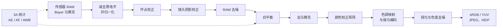

# ISP 101：经典相机成像流水线

[English](isp-101.md) · [返回中文论文目录](../README.zh-CN.md)

相机传感器记录的并不是可直接观看的照片，而是在传感器自身颜色空间中测得的、带有噪声的线性光照马赛克，每个像素只测量一种颜色。**图像信号处理器（Image Signal Processor，ISP）** 将这份 RAW 马赛克转换成可显示的 sRGB 或 YUV 图像。本指南按照经典处理流程介绍各个阶段，并指出[论文目录](../README.zh-CN.md)中哪些学习式方法能够替代或辅助它们。

[`minimal_isp.py`](minimal_isp.py) 提供了核心阶段的可运行版本，约 50 行 NumPy 代码。



实际 ISP 的顺序和细节各不相同：有的在去马赛克之后去噪，许多在去噪之前执行白平衡，手机还会在其他步骤之前加入多帧融合。但以下阶段几乎出现在所有设计中。

## 1. 传感器与 RAW 数据

- 每个感光单元在曝光期间累积光电子，模数转换器（ADC）将电荷转换为 10–14 位整数。
- **颜色滤波阵列（Color Filter Array，CFA）** 在每个感光单元上覆盖一个颜色滤光片。最常见的是 2×2 **Bayer** 排列：RGGB 及其旋转形式 GRBG、GBRG、BGGR。较新的手机传感器也使用 Quad Bayer（2×2 同色块）、Nona（3×3 同色块）或 RGBW 排列。
- 传感器饱和之前，RAW 数值与场景光照呈**线性**关系。数据存储于相机专用格式（CR2/CR3、NEF、ARW 等）或 Adobe 开放的 [DNG](https://helpx.adobe.com/camera-raw/desktop/dng-and-file-formats/digital-negative.html) 容器中。文件还保存后续处理所需的元数据，包括黑电平、白电平、CFA 排列、拍摄时白平衡和颜色矩阵。

## 2. 黑电平扣除与归一化

传感器加入一个偏置，即黑电平，以免零值附近的噪声被截断。第一步扣除偏置，再将数值缩放到 [0, 1]：

```text
x = clip((raw - black_level) / (white_level - black_level), 0, 1)
```

不同 CFA 通道的黑电平可能不同；某些传感器的黑电平还随行或列变化，可利用传感器边缘的光学黑区进行估计。

## 3. 坏点校正

热像素、死像素或固定值像素可以由出厂标定表给出，也可以在运行时通过与同色邻域像素的显著差异检测。校正通常使用这些邻域像素的中值或方向插值来替换异常值。

## 4. 镜头阴影校正

镜头使画面角落接收到的光少于中心，形成暗角；不同颜色通道的衰减不同，还会产生颜色阴影。校正方法是将逐通道增益图乘到马赛克上。增益图按镜头标定，通常还需考虑光源。

## 5. 噪声与 RAW 去噪

RAW 噪声通常可用**泊松–高斯模型**描述：散粒噪声的方差随信号强度增长，而读出噪声与信号无关。

```text
Var[x] ≈ a · E[x] + b
```

其中，`a` 取决于模拟增益 / ISO，`b` 与读出噪声有关。

传统方法可以直接处理这种异方差噪声，也可以先应用**方差稳定化变换**，例如广义 Anscombe 变换（GAT），将噪声近似变为单位方差高斯噪声，再使用 BM3D 等高斯去噪器，最后执行逆变换。去马赛克和色调映射会改变噪声的分布及通道相关性，因此在这些阶段之前直接处理 RAW，通常比对最终图像去噪更有效。

相关学习方法见：[RAW 去噪与噪声建模](../README.zh-CN.md#raw-去噪与噪声建模)、[弱光 RAW 增强](../README.zh-CN.md#弱光-raw-增强)、[连拍与 HDR](../README.zh-CN.md#连拍与-hdr)。

## 6. 白平衡与自动白平衡（AWB）

同一面白墙在钨丝灯下偏橙，在阴影中偏蓝。白平衡先估计光源在相机 RGB 空间中的颜色，再通过逐通道增益消除其影响，通常把绿色通道增益归一化为 1：

```text
R' = R · g_R,   G' = G,   B' = B · g_B
```

经典光源估计方法包括**灰度世界**（场景平均颜色为灰色）、**白点 / max-RGB**（最亮像素为白色）以及**灰度边缘**（图像导数的平均值为灰色）。相机会结合这些统计量与合理光源的先验，例如黑体轨迹。估计光源颜色就是**颜色恒常性**问题。

相关学习方法见：[白平衡、颜色与色调](../README.zh-CN.md#白平衡颜色与色调)。

## 7. 去马赛克

每个像素只有一个实测颜色，去马赛克为其插值出另外两个颜色。双线性插值会在边缘产生拉链伪影和伪色，因此实用算法会利用通道间相关性，例如 Malvar–He–Cutler 方法加入其他通道的梯度校正，或利用边缘方向，例如自适应同质性引导（AHD）方法。精细的周期性纹理仍可能产生**摩尔纹**。由于噪声会使插值更困难，而去马赛克又会传播噪声，这两个问题越来越多地被联合求解。

相关学习方法见：[去马赛克、联合复原与 RAW 超分辨率](../README.zh-CN.md#去马赛克联合复原与-raw-超分辨率)。

## 8. 颜色校正：从相机 RGB 到 sRGB

相机的光谱响应与人眼的配色函数不同，因此白平衡后的相机 RGB 仍需映射到标准颜色空间。常用模型是 3×3 **颜色校正矩阵（Color Correction Matrix，CCM）**：

```text
[R, G, B]_linear-sRGB = M_sRGB←XYZ · M_XYZ←cam · [R, G, B]_camera
```

`M_XYZ←cam` 通过在已知光源下拍摄色卡来标定。DNG 通常保存两组颜色矩阵，分别对应光源 A 和 D65，并根据估计的白平衡在二者之间插值。有些 ISP 还加入三维查找表，以实现更精细的非线性颜色控制。

## 9. 色调映射与伽马编码

线性传感器数据的动态范围通常超出显示设备的能力，直接显示会显得昏暗、平淡。**色调映射**使用全局曲线，如 S 曲线或 Reinhard 摄影算子，或使用能保留阴影与高光细节的局部算子，压缩动态范围；HDR 流水线会先合并多个曝光。最后，图像按照显示传递函数编码，例如 sRGB 曲线：

```text
当 L ≤ 0.0031308 时：V = 12.92 · L
否则：             V = 1.055 · L^(1/2.4) − 0.055
```

对比度、饱和度和整体风格等照片润饰通常发生在这一阶段附近，也是手机特有色彩风格的主要来源。

## 10. 图像增强、颜色空间转换与压缩

最后的处理包括转换到 YUV、边缘增强（反锐化掩模）、色度和亮度去噪、伪色抑制、缩放，以及编码为 JPEG 或 HEIF。

## 11. 3A 闭环

在图像处理路径之外，ISP 同时收集直方图、分区颜色均值、对焦指标等统计量，用于驱动后续帧的**自动曝光（AE）**、**自动对焦（AF）**和**自动白平衡（AWB）**。硬件 ISP 为这些控制环和上述各阶段提供数百个参数，人工调优需要大量工作，这也推动了 [ISP 参数调优](../README.zh-CN.md#isp-参数调优)研究。

## 神经 ISP 如何融入流水线

| 方式 | 学习的内容 | 对应分类 |
|:--|:--|:--|
| 替代一个阶段 | 经典 ISP 中的单个模块，如去噪、去马赛克或白平衡 | RAW 去噪、去马赛克、白平衡 |
| 替代完整 ISP | 用网络直接从 RAW 映射到 sRGB | [端到端](../README.zh-CN.md#端到端-raw-to-srgb)、[移动端](../README.zh-CN.md#移动端与轻量化-isp) |
| 提供可调渲染 | 由参数、参考风格或用户编辑控制输出，或替换模块 | [可控神经 ISP](../README.zh-CN.md#可控神经-isp) |
| 反向运行 ISP | 从 sRGB 恢复 RAW，用于数据合成或存储 | [逆向 ISP](../README.zh-CN.md#逆向-ispraw-重建与压缩) |
| 服务机器感知 | 为检测或分割优化 ISP，也可能直接省去 ISP | [面向机器视觉的 ISP](../README.zh-CN.md#面向机器视觉的-isp) |
| 调优经典 ISP | 保留硬件，学习其参数 | [ISP 参数调优](../README.zh-CN.md#isp-参数调优) |

## 延伸阅读

[学习资源](../README.zh-CN.md#学习资料)提供教程、书籍与各阶段背后的经典论文；[工具与开源 ISP](../README.zh-CN.md#工具与开源-isp)列出了 RAW 读取工具和开源 ISP 实现。